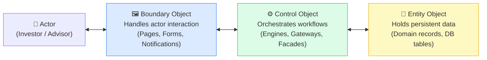
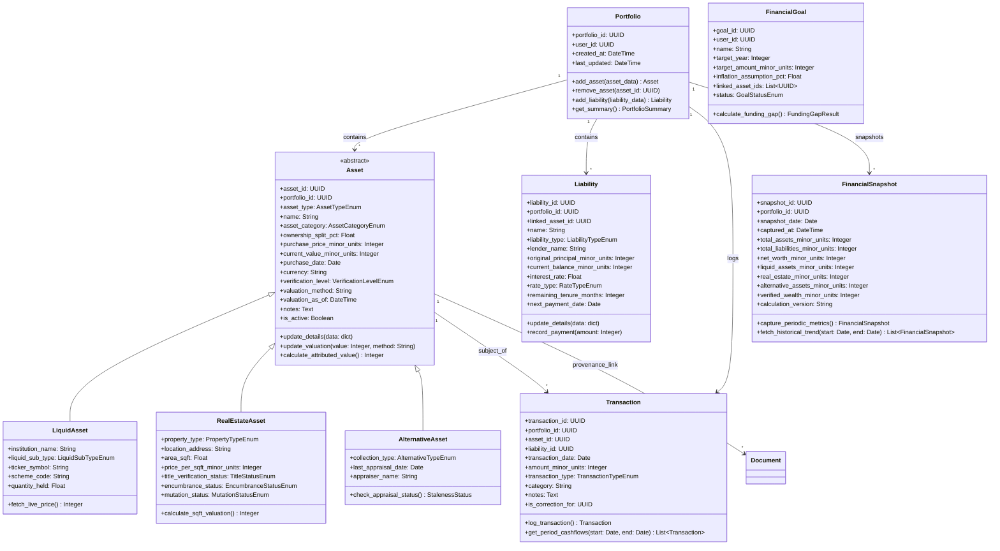
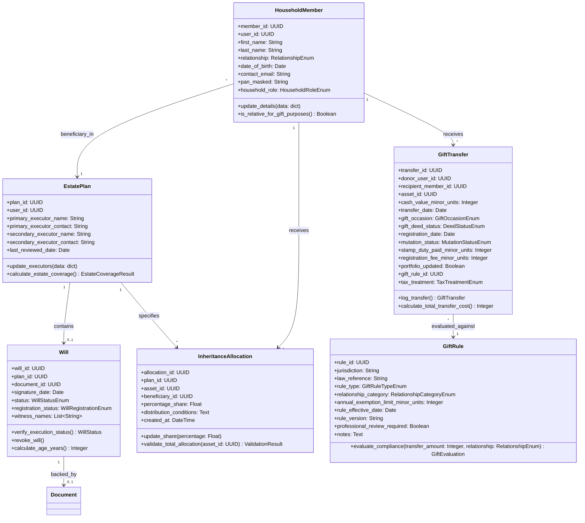
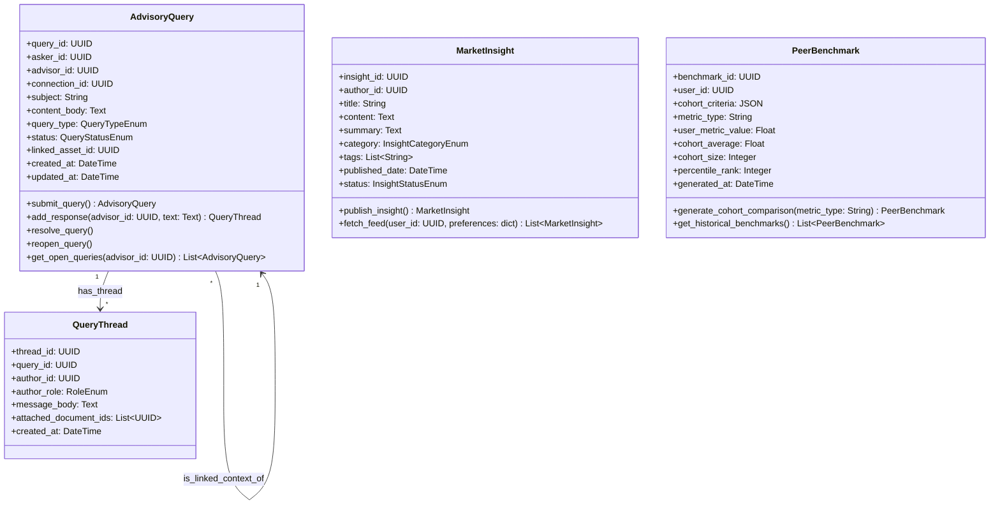
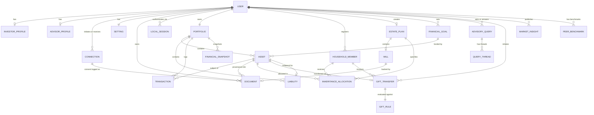

# Phase 2 — Analysis: ECB Object Model

> **OOSE Phase:** Analysis
> **Purpose:** Translates the functional requirements and use cases from Phase 1 into a formal Analysis Object Model using the Entity-Control-Boundary (ECB) pattern. Every screen, workflow, and calculation engine has a corresponding object here.
> **Status:** Draft

---

## 1. The ECB Pattern Applied to Vittavaan

The ECB (Entity-Control-Boundary) pattern organises the system into three distinct object types to enforce separation of concerns:



| Layer | Responsibility | Examples in Vittavaan |
|---|---|---|
| **Boundary** | Renders data; accepts user input; never contains business logic | `NetWorthPage`, `AddAssetForm`, `ConsentConfigurationForm` |
| **Control** | Orchestrates use cases; contains all business rules and calculations | `WealthAndOwnershipEngine`, `EstatePlanningControl`, `DashboardFacade` |
| **Entity** | Persistent domain objects; no UI or workflow logic | `Asset`, `Portfolio`, `Connection`, `GiftRule` |

**Strict rules enforced throughout implementation:**
- A Boundary object NEVER calls an Entity object directly — it always goes through a Control.
- An Entity object NEVER contains workflow logic or UI formatting.
- A Control object NEVER renders output — it returns data structures that Boundaries display.

---

## 2. Entity Objects

Entity objects represent long-lived, persistent information. They map directly to database tables.

---

### 2.1 Module 1 — Identity & Network Entities

```mermaid
classDiagram
    class User {
        +user_id: UUID
        +email: String
        +first_name: String
        +last_name: String
        +date_of_birth: Date
        +gender: GenderEnum
        +is_investor: Boolean
        +is_advisor: Boolean
        +is_admin: Boolean
        +created_at: DateTime
        +last_login: DateTime
        +get_user_details() UserPayload
        +switch_active_context(role: RoleEnum)
        +search_network(criteria: SearchCriteria) List~User~
        +send_connection_request(recipient_id: UUID) Connection
        +get_network_connections(status: StatusEnum) List~Connection~
    }

    class InvestorProfile {
        +profile_id: UUID
        +user_id: UUID
        +education_level: EducationEnum
        +city_tier: CityTierEnum
        +stated_annual_income_minor_units: Integer
        +risk_tolerance: RiskEnum
        +investment_horizon_years: Integer
        +financial_resume_summary: Text
        +profile_created_at: DateTime
        +profile_last_reviewed_at: DateTime
        +update_risk_profile(tolerance: RiskEnum)
        +get_resume_data() ResumePayload
    }

    class AdvisorProfile {
        +profile_id: UUID
        +user_id: UUID
        +firm_name: String
        +certifications: List~CertificationEnum~
        +specialty_areas: List~String~
        +professional_bio: Text
        +credential_verification_status: VerifStatusEnum
        +verified_by_admin_id: UUID
        +verified_at: DateTime
        +add_certification(cert: CertificationEnum)
        +get_public_profile() PublicAdvisorPayload
    }

    class Connection {
        +connection_id: UUID
        +requester_id: UUID
        +recipient_id: UUID
        +status: ConnectionStatusEnum
        +permissions: JSON
        +consent_scope: String
        +consent_purpose: String
        +consent_granted_at: DateTime
        +consent_expires_at: DateTime
        +created_at: DateTime
        +updated_at: DateTime
        +accept_connection()
        +reject_connection()
        +revoke_connection()
        +update_permissions(fields: List~String~, expiry: DateTime, purpose: String)
        +is_data_accessible(requesting_user_id: UUID, data_field: String) Boolean
    }

    class Setting {
        +setting_id: UUID
        +user_id: UUID
        +two_factor_enabled: Boolean
        +base_currency: String
        +email_notifications: Boolean
        +in_app_notifications: Boolean
        +display_number_format: FormatEnum
        +theme: ThemeEnum
        +get_user_settings() SettingPayload
        +toggle_2fa(status: Boolean)
        +update_base_currency(currency: String)
    }

    class Document {
        +document_id: UUID
        +owner_id: UUID
        +linked_asset_id: UUID
        +linked_estate_plan_id: UUID
        +document_type: DocumentTypeEnum
        +storage_key: String
        +document_date: Date
        +document_expiry: Date
        +file_size_bytes: Integer
        +mime_type: String
        +upload_document(file_bytes, metadata) StorageResult
        +generate_download_url(expiry_minutes: Integer) SignedURL
    }

    class LocalSession {
        +session_id: UUID
        +user_id: UUID
        +jwt_sub: String
        +active_role: RoleEnum
        +expires_at: DateTime
        +is_active: Boolean
        +device_info: String
        +ip_address: String
        +create_session(user_id, jwt_sub) LocalSession
        +validate_session() Boolean
        +terminate_session()
        +terminate_all_sessions(user_id: UUID)
    }

    User "1" --> "0..1" InvestorProfile : has
    User "1" --> "0..1" AdvisorProfile : has
    User "1" --> "1" Setting : has
    User "1" --> "*" Connection : initiates_or_receives
    User "1" --> "*" Document : owns
    User "1" --> "*" LocalSession : authenticates
```



---

### 2.2 Module 2 — Wealth & Portfolio Entities



---

### 2.3 Module 3 — Estate & Legal Entities



---

### 2.4 Module 4 — Advisory & Market Entities



---

## 3. Control Objects

Control objects implement all business logic, orchestrate workflows, and mediate between Boundaries and Entities. They are **stateless** — they receive data, compute, and return results without storing state between calls.

```mermaid
classDiagram
    class DashboardFacade {
        <<Control>>
        +get_dashboard_metrics(user_id: UUID, as_of: DateTime) DashboardPayload
        +get_asset_allocation(user_id: UUID) AllocationPayload
        +get_net_worth_trend(user_id: UUID, months: Integer) TrendPayload
        +get_alerts(user_id: UUID) List~Alert~
    }

    class AuthGatewayControl {
        <<Control>>
        +verify_handshake(jwt_token: String) ClaimsPayload
        +extract_user_identity(jwt_token: String) UserIdentity
        +initialize_local_identity(jwt_sub: String) User
        +create_session(user_id: UUID, jwt_sub: String) LocalSession
        +terminate_all_sessions(user_id: UUID)
    }

    class WealthAndOwnershipEngine {
        <<Control>>
        +calculate_total_assets(portfolio_id: UUID) MinorUnits
        +calculate_total_liabilities(portfolio_id: UUID) MinorUnits
        +calculate_net_worth(portfolio_id: UUID) NetWorthResult
        +calculate_attributed_value(asset: Asset) MinorUnits
        +calculate_household_net_worth(user_id: UUID) HouseholdResult
        +calculate_asset_class_breakdown(portfolio_id: UUID) ClassBreakdown
        +calculate_net_worth_waterfall(portfolio_id: UUID, period: Period) WaterfallResult
    }

    class ValuationAndVerificationEngine {
        <<Control>>
        +calculate_verified_wealth_pct(portfolio_id: UUID) Float
        +check_staleness(asset: Asset) StalenessResult
        +get_stale_assets(portfolio_id: UUID) List~Asset~
        +evaluate_verification_level(asset: Asset, documents: List~Document~) VerificationLevel
        +calculate_valuation_age_days(asset: Asset) Integer
    }

    class CashFlowAndDebtEngine {
        <<Control>>
        +calculate_monthly_surplus(portfolio_id: UUID, month: YearMonth) SurplusResult
        +calculate_debt_service_ratio(portfolio_id: UUID) Float
        +calculate_amortization_schedule(liability: Liability) List~AmortizationRow~
        +group_income_by_source(portfolio_id: UUID, period: Period) IncomeBreakdown
        +group_expenses_by_category(portfolio_id: UUID, period: Period) ExpenseBreakdown
        +calculate_savings_rate(portfolio_id: UUID, period: Period) Float
    }

    class PerformanceAndAttributionEngine {
        <<Control>>
        +calculate_xirr(portfolio_id: UUID, start: Date, end: Date) XirrResult
        +calculate_twrr(portfolio_id: UUID, start: Date, end: Date) TwrrResult
        +calculate_max_drawdown(portfolio_id: UUID, period: Period) DrawdownResult
        +calculate_attribution(portfolio_id: UUID, period: Period) AttributionResult
        +calculate_benchmark_return(benchmark_id: String, period: Period) Float
        +calculate_excess_return(portfolio_id: UUID, benchmark_id: String, period: Period) Float
    }

    class PlanningAndScenarioEngine {
        <<Control>>
        +calculate_goal_projected_value(goal: FinancialGoal, assumptions: PlanAssumptions) Float
        +calculate_funding_gap(goal: FinancialGoal, assumptions: PlanAssumptions) FundingGapResult
        +model_invest_vs_prepay(params: PrepayParams) ScenarioResult
        +calculate_timing_mismatch(goal: FinancialGoal) Integer
        +get_upcoming_events(user_id: UUID, days_ahead: Integer) List~FinancialEvent~
    }

    class ConsentAndMarketplaceEngine {
        <<Control>>
        +evaluate_data_access(requesting_user_id: UUID, data_owner_id: UUID, data_field: String) AccessDecision
        +filter_portfolio_payload(payload: dict, permitted_fields: List~String~) dict
        +check_consent_expiry(connection_id: UUID) ConsentStatus
        +expire_stale_consents() List~UUID~
        +evaluate_advisor_match(user_id: UUID, advisors: List~AdvisorProfile~) List~AdvisorMatch~
        +check_reidentification_risk(profile: BorrowerProfile) RiskLevel
    }

    class EstatePlanningControl {
        <<Control>>
        +allocate_inheritance(asset_id: UUID, beneficiary_id: UUID, pct: Float, conditions: Text) InheritanceAllocation
        +validate_total_allocation(asset_id: UUID) AllocationValidation
        +calculate_estate_coverage(user_id: UUID) EstateCoverageResult
        +analyse_will_coverage(user_id: UUID) WillCoverageResult
        +get_default_succession_shares(user_id: UUID) List~SuccessionShare~
        +identify_nominee_mismatches(user_id: UUID) List~NomineeMismatch~
    }

    class GiftRuleEngine {
        <<Control>>
        +evaluate_gift_eligibility(asset: Asset) GiftEligibility
        +evaluate_gift_tax_status(donor_id: UUID, recipient: HouseholdMember, asset: Asset) GiftTaxResult
        +calculate_stamp_duty(asset: RealEstateAsset, jurisdiction: String, relationship: RelationshipEnum) StampDutyResult
        +calculate_total_transfer_cost(transfer: GiftTransfer) Integer
        +evaluate_recipient_cost_basis(transfer: GiftTransfer) CostBasisResult
        +check_annual_gift_cumulative(donor_id: UUID, recipient_id: UUID, new_amount: Integer) CumulativeCheck
    }

    class PeerBenchmarkingControl {
        <<Control>>
        +generate_cohort_benchmark(user_id: UUID, metric_type: String) PeerBenchmark
        +get_anonymised_peer_data(user_id: UUID, granted_fields: List~String~) AnonymisedPayload
        +validate_minimum_cohort_size(criteria: dict) Boolean
    }

    class AdvisoryControl {
        <<Control>>
        +submit_query(asker_id: UUID, advisor_id: UUID, query_data: dict) AdvisoryQuery
        +transition_query_status(query_id: UUID, new_status: QueryStatusEnum) AdvisoryQuery
        +get_portfolio_context(user_id: UUID, query: AdvisoryQuery) PortfolioContext
        +fetch_relevant_insights(user_id: UUID) List~MarketInsight~
        +calculate_news_relevance(user_id: UUID, insight: MarketInsight) RelevancePath
    }
```



---

## 4. Boundary Objects

Boundary objects are the system's interface to actors. They correspond directly to the wireframe screens and data entry forms.

### 4.1 Page Boundaries (Full Screen Views)

| Boundary Object | Maps To Wireframe | Primary Control Used |
|---|---|---|
| `NetWorthPage` | Net Worth Dashboard | `DashboardFacade`, `WealthAndOwnershipEngine` |
| `AssetsAndLiabilitiesPage` | Assets & Liabilities (multi-tab) | `WealthAndOwnershipEngine`, `CashFlowAndDebtEngine` |
| `AnalysisPage` | Analysis | `PerformanceAndAttributionEngine` |
| `AttributionPage` | Attribution | `PerformanceAndAttributionEngine` |
| `KarjatPlotPage` | Karjat Plot (Real Estate detail) | `WealthAndOwnershipEngine`, `ValuationAndVerificationEngine` |
| `StampCollectionPage` | Stamp Collection (Alternative detail) | `WealthAndOwnershipEngine`, `ValuationAndVerificationEngine` |
| `CreditPage` | Credit | `ConsentAndMarketplaceEngine`, `CashFlowAndDebtEngine` |
| `PlanningPage` | Planning | `PlanningAndScenarioEngine` |
| `InvestorProfilePage` | Investor Profile | Direct `InvestorProfile` entity via service |
| `ProfilingPage` | Profiling (onboarding questionnaire) | Direct `InvestorProfile` entity |
| `FinancialResumePage` | Financial Resume | `WealthAndOwnershipEngine`, `CashFlowAndDebtEngine`, `ConsentAndMarketplaceEngine` |
| `HouseholdPage` | Household | `WealthAndOwnershipEngine` (household aggregation) |
| `InheritancePage` | Inheritance | `EstatePlanningControl` |
| `WillPage` | Will | `EstatePlanningControl` |
| `GiftRulesPage` | Gift Rules | `GiftRuleEngine` |
| `GiftTransferPage` | Gift Transfer | `GiftRuleEngine`, `EstatePlanningControl` |
| `ConnectionsPage` | Connections | `ConsentAndMarketplaceEngine` |
| `PeersPage` | Peers | `PeerBenchmarkingControl`, `ConsentAndMarketplaceEngine` |
| `AdvisorsPage` | Advisors (marketplace) | `ConsentAndMarketplaceEngine`, `AdvisoryControl` |
| `MarketplacePage` | Marketplace (listings) | `ConsentAndMarketplaceEngine` |
| `MarketplaceBrowsePage` | Marketplace Browse | `ConsentAndMarketplaceEngine` |
| `MarketplaceLandPage` | Marketplace Land | `ConsentAndMarketplaceEngine` |
| `AskPage` | Ask | `AdvisoryControl` |
| `TrendsAndNewsPage` | Trends & News | `AdvisoryControl` |
| `SettingsPage` | Settings | Direct entity services |

### 4.2 Form Boundaries (Input Components)

| Boundary Object | Purpose | Validation Rules |
|---|---|---|
| `AddAssetForm` | Add any asset type | ownership 0–100%; amount ≥ 0; date not future |
| `AddLiabilityForm` | Add a liability | principal > 0; interest rate 0–100%; tenure > 0 |
| `LogTransactionForm` | Record a cash flow | date not future; amount > 0; type required |
| `ConsentConfigurationForm` | Set advisor data access | expiry in future; ≥1 field selected; purpose required |
| `AllocationForm` | Assign inheritance % to beneficiary | 0 < pct ≤ remaining_unallocated |
| `GiftTransferForm` | Initiate gift tracking | asset eligibility checked; recipient required |
| `AdvisoryQueryForm` | Submit a question to advisor | subject + body required; advisor has accepted connection |
| `EstateExecutorForm` | Set will executor details | primary executor name + contact required |
| `GoalForm` | Create a financial goal | name, target year (future), amount > 0 |
| `HouseholdMemberForm` | Register family member | name, relationship, DOB required |
| `ProfileQuestionnaireForm` | Investor profiling | all sections must be completed before submission |

### 4.3 Notification Boundaries (System Messages)

| Boundary Object | Trigger | Display |
|---|---|---|
| `StaleDataWarning` | `ValuationAgeDays` > threshold | Inline on asset card + Dashboard alert |
| `ConsentExpiryWarning` | `DaysUntilConsentExpiry` < 7 | Dashboard alert + email |
| `AllocationExceededError` | Inheritance allocation > 100% | Form validation error |
| `GiftEligibilityError` | Asset is pledged/restricted | Hard block on gift form |
| `GiftTaxWarning` | Non-relative gift above ₹50,000 | Soft warning on gift form |
| `WillCoverageAlert` | Assets acquired after will date | Estate planning alert |
| `NomineeMismatchAlert` | Nominee ≠ intended beneficiary | Inheritance page alert |
| `InsufficientDataNotice` | XIRR/TWRR cannot be calculated | Empty state on Analysis page |
| `ValidationErrorNotice` | Any form validation failure | Inline on form field |
| `NotificationAlert` | New connection, answered query | In-app notification bell |
| `DataRoomOutageWarning` | Object storage unavailable | Banner on pages requiring documents |

---

## 5. Complete Entity Relationship Diagram



---

## 6. Key Design Decisions

### 6.1 Asset Polymorphism — Joined Table Inheritance

The three Asset subclasses (`LiquidAsset`, `RealEstateAsset`, `AlternativeAsset`) share many common fields but each has type-specific fields. The chosen approach is **Joined Table Inheritance**:

```
assets (base table)
  └── liquid_assets (extension table — joined on asset_id)
  └── real_estate_assets (extension table — joined on asset_id)
  └── alternative_assets (extension table — joined on asset_id)
```

**Why not Single Table Inheritance (STI)?**
STI would put all columns in one table, leaving many NULL for mismatched subtypes. For example, `price_per_sqft_minor_units` would be NULL for every Liquid Asset row — which is semantically misleading and wastes storage. Joined Table Inheritance keeps each table's columns meaningful.

**Why not Concrete Table Inheritance?**
Queries that span all asset types (e.g., "all assets in this portfolio") would require `UNION ALL` across three tables. Joined Table Inheritance allows a single `JOIN` on the base `assets` table.

### 6.2 Connection Permissions as JSONB

The `Connection.permissions` field is stored as PostgreSQL JSONB (not a separate entity table) because:
- Permission sets are fluid — the field list changes as new features are added
- JSONB is queryable (can filter connections where a specific field is permitted)
- JSON format makes serialisation/deserialisation trivial
- No need for a separate EAV (Entity-Attribute-Value) table

Format: `["total_net_worth", "real_estate_assets", "financial_goals"]`

### 6.3 Financial Snapshot — Immutable Append-Only

`FinancialSnapshot` records are **never updated or deleted**. The PostgreSQL table uses a trigger to enforce this at the database level:

```sql
CREATE RULE no_update_snapshots AS ON UPDATE TO financial_snapshots DO INSTEAD NOTHING;
CREATE RULE no_delete_snapshots AS ON DELETE TO financial_snapshots DO INSTEAD NOTHING;
```

This ensures a complete, tamper-proof historical record of net worth over time.

### 6.4 Transaction — Correcting Entry Pattern

`Transaction` records are also immutable. If a user makes an error (e.g., logs ₹50,000 instead of ₹5,000), the correction is done by logging a new transaction with `is_correction_for = original_transaction_id`. The original transaction is flagged as corrected but never deleted. Both records appear in the ledger audit trail.

---

*Next document: [02_Sequence_Diagrams.md](./02_Sequence_Diagrams.md)*
