# Phase 2 — Analysis: Sequence Diagrams

> **OOSE Phase:** Analysis
> **Purpose:** Shows how Entity, Control, and Boundary objects collaborate — in time — to fulfil the key use cases from Phase 1. Each diagram uses the Cockburn use case ID as its reference.
> **Status:** Draft

---

## How to Read These Diagrams

- **Actors** (Investor, Advisor, Admin) appear on the left.
- **Boundary** objects (`Page`, `Form`, `Warning`) are blue boxes.
- **Control** objects (`Engine`, `Control`, `Facade`, `Gateway`) are green boxes.
- **Entity** objects (`Portfolio`, `Asset`, `Connection`, etc.) are yellow boxes.
- **External systems** (Auth Provider, Object Storage) are grey boxes.

All monetary interactions enforce the integer minor-units contract. No floating-point money crosses any object boundary.

---

## UC-AUTH-001: Register and Authenticate

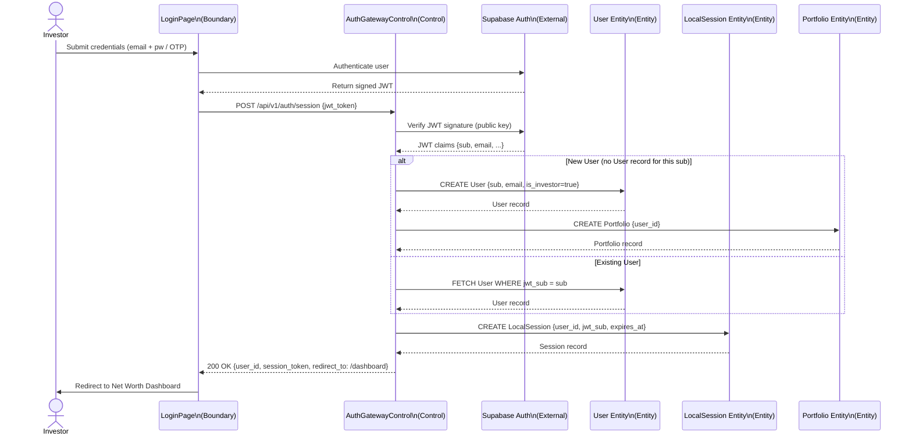

---

## UC-PORT-001: Add Liquid Asset

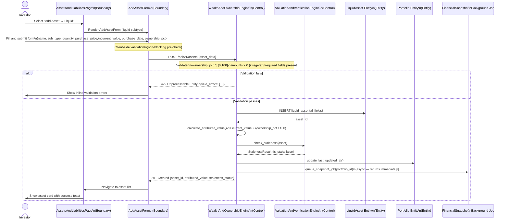

---

## UC-PORT-004: Log a Cash Flow Transaction

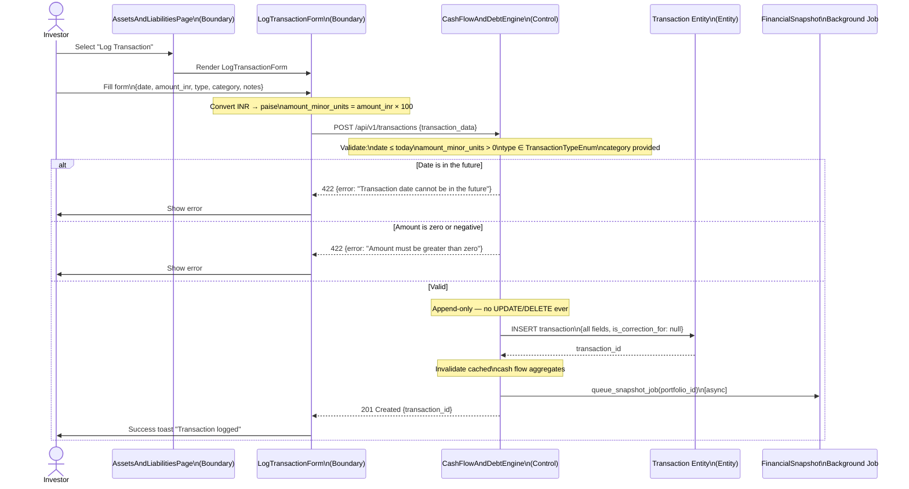

---

## UC-DASH-001: View Net Worth Dashboard

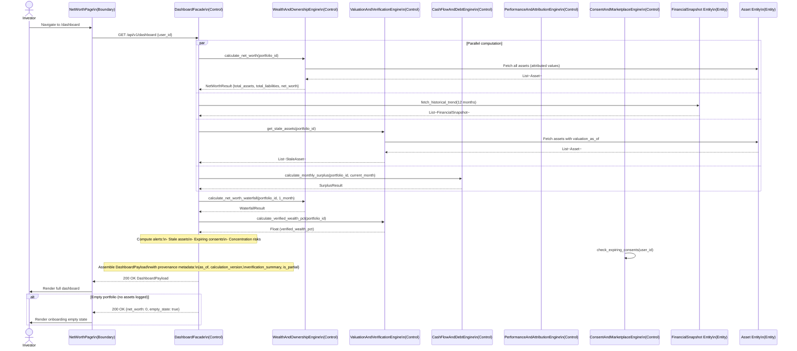

---

## UC-DASH-002: View Portfolio Performance (XIRR & TWRR)

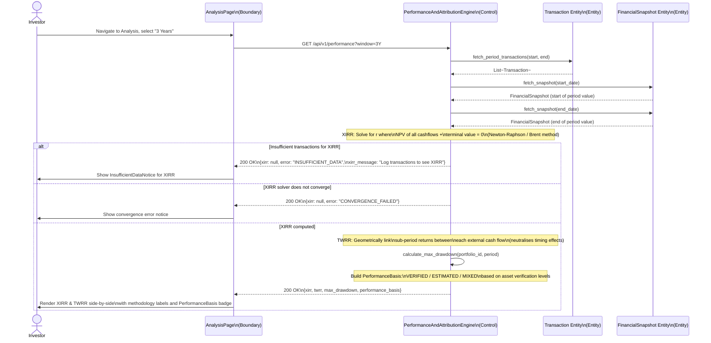

---

## UC-ESTATE-002: Allocate Inheritance

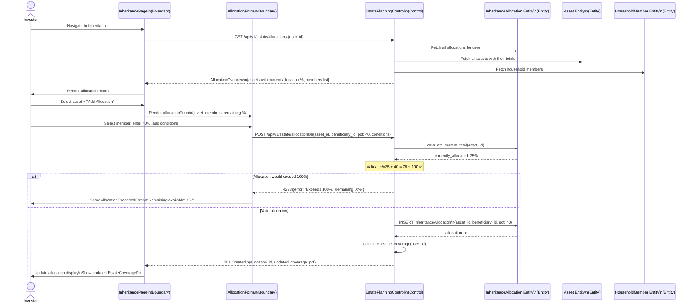

---

## UC-NET-002: Grant Data Consent to an Advisor

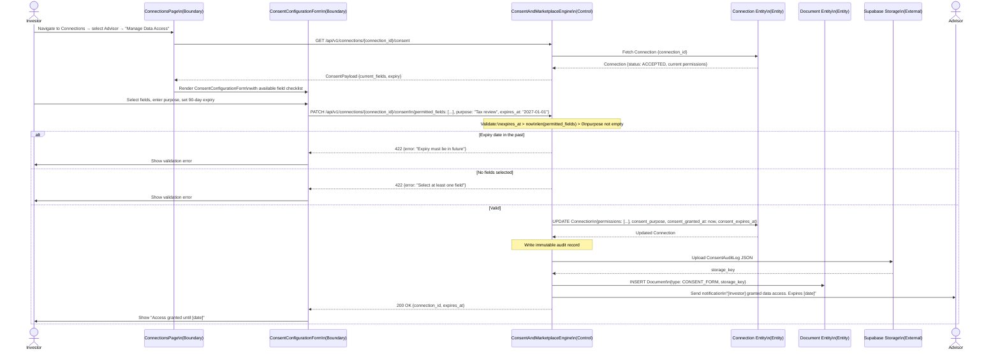

---

## UC-NET-003: Advisor Accesses Investor Data (Consent Gating)

This is the most security-critical sequence. The Protection Proxy pattern is implemented here.

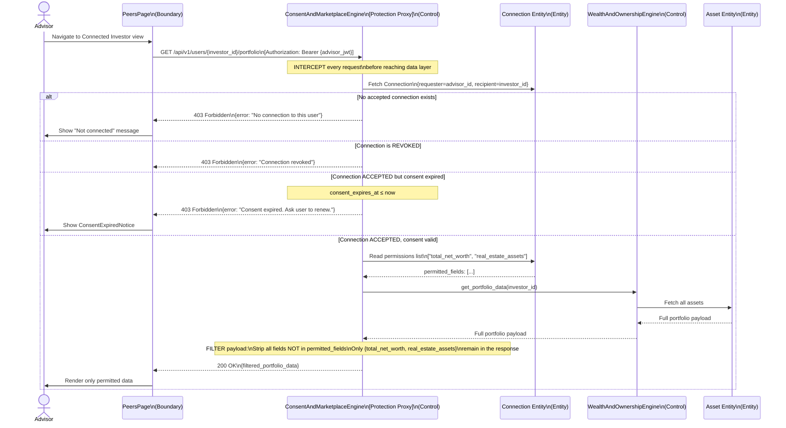

---

## UC-ESTATE-003: Log a Gift Transfer

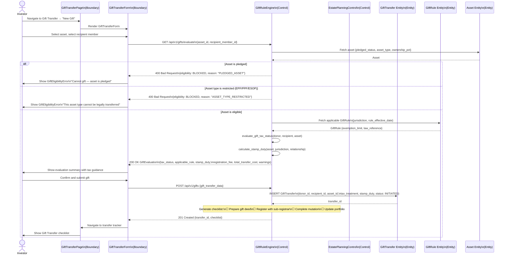

---

## UC-CREDIT-001: Submit a Credit Request (Anonymous Profile)

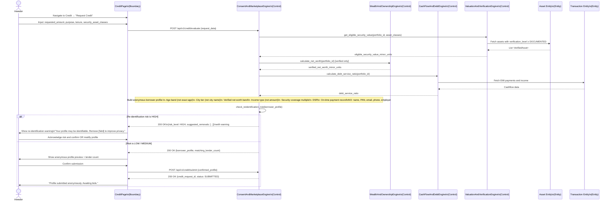

---

## UC-SETT-001: Export All User Data

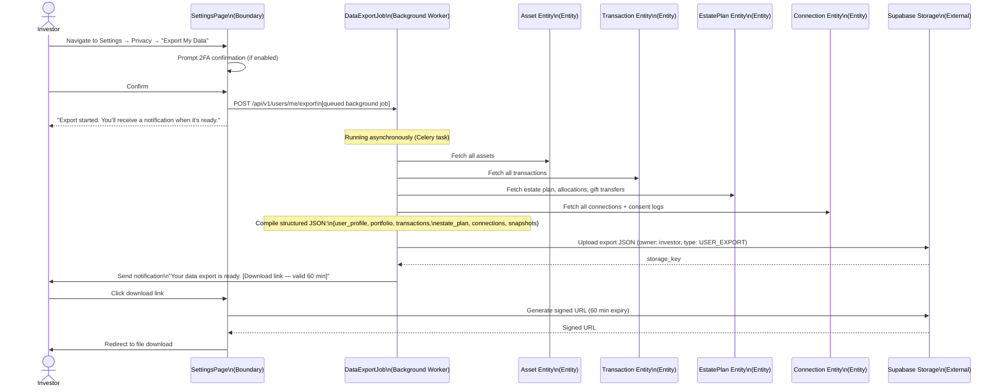

---

## Background Process: Financial Snapshot Capture

This is an internal background workflow, not a direct actor-initiated use case. It runs asynchronously after every portfolio-changing operation.

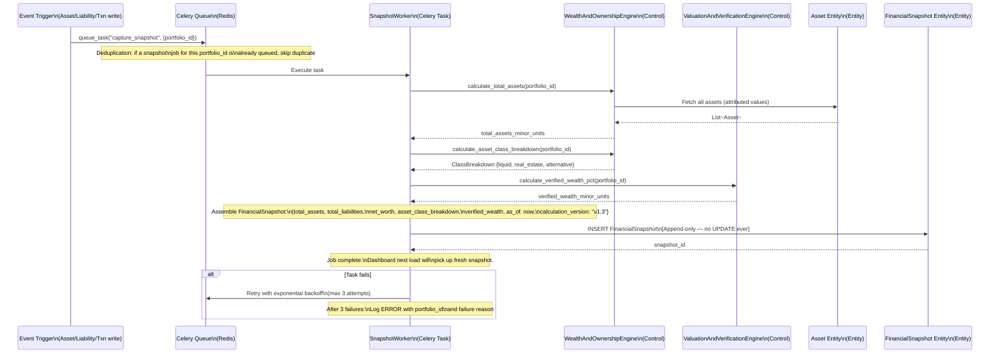

---

## Background Process: Consent Expiry Check

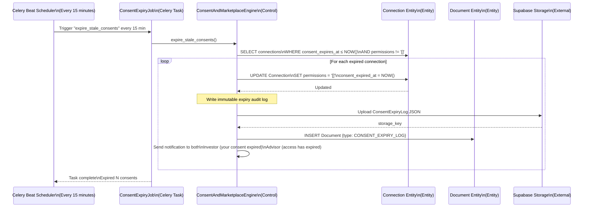

---

*Next document: [03_Domain_Glossary.md](./03_Domain_Glossary.md)*
