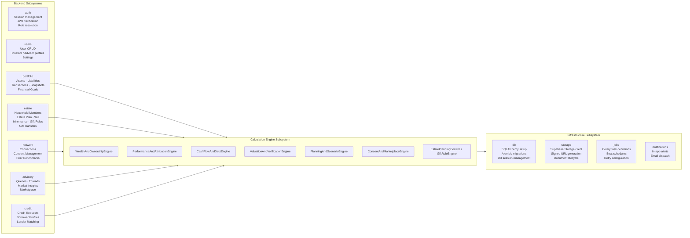
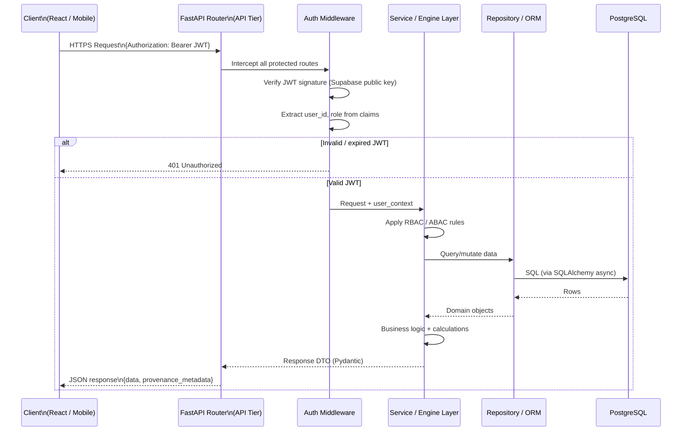
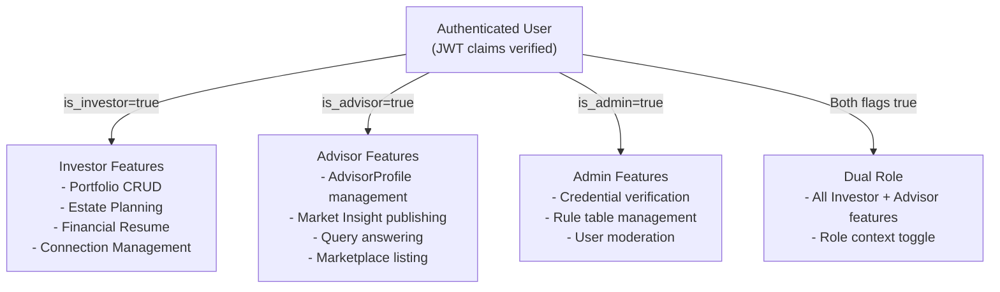
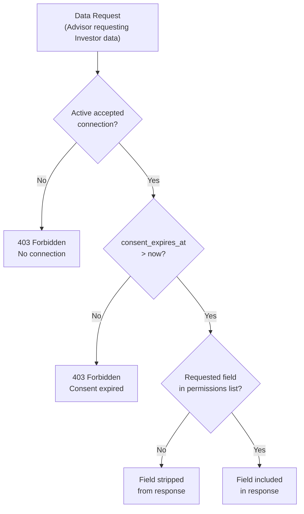

# Phase 3 — System Design: Architecture Overview

> **OOSE Phase:** System Design
> **Purpose:** Defines the system's architectural structure — how subsystems are decomposed, how they interact, and how they map to hardware/software infrastructure. This is the blueprint that Phase 4 (class-level design) and Phase 5 (implementation) will build within.
> **Status:** Draft

---

## 1. Architectural Style & Goals

Vittavaan adopts a **layered, API-first, service-oriented architecture**:

| Goal | Decision |
|---|---|
| Desktop V1 + Mobile V2 share same API | Backend is a pure JSON API; no server-side rendering |
| All calculations server-side | Frontend is a thin rendering layer; no business logic in the browser |
| Local dev ≡ Staging ≡ Production | Docker containers throughout; secrets via env vars |
| Async-safe financial writes | ACID PostgreSQL; append-only ledger tables |
| Extensible to external APIs (V2) | Adapter interfaces for market data, AA, CDSL |
| Solo developer velocity | Opinionated stack; convention over configuration |

---

## 2. System Tier Diagram

```mermaid
flowchart TB
    subgraph Client["Client Tier"]
        WEB["🖥️ Web App\nReact 19 + TypeScript\nVite · Tailwind · Recharts"]
        MOB["📱 Mobile App (V2)\nReact Native + Expo"]
    end

    subgraph API["API Tier — FastAPI"]
        ROUTER["🔀 API Router\n/api/v1/*"]
        AUTH["🔐 Auth Middleware\nJWT verification"]
        SERV["⚙️ Service Layer\nCalculation Engines\nBusiness Logic"]
    end

    subgraph ASYNC["Async Tier — Celery"]
        WORKER["👷 Celery Workers\nSnapshot · Consent · Alerts"]
        BEAT["⏰ Celery Beat\nScheduler (cron jobs)"]
    end

    subgraph DATA["Data Tier"]
        PG["🗄️ PostgreSQL 16\nPrimary database"]
        REDIS["⚡ Redis\nCelery broker · Cache"]
        STORAGE["📁 Supabase Storage\nData Room documents"]
    end

    subgraph EXTERNAL["External Services"]
        SUPABASE["🔑 Supabase Auth\nJWT issuance"]
        MARKET["📊 Market Data (V2)\nNSE · BSE · AA Framework"]
    end

    WEB -->|HTTPS · REST JSON| ROUTER
    MOB -->|HTTPS · REST JSON| ROUTER
    ROUTER --> AUTH
    AUTH --> SERV
    SERV --> PG
    SERV --> REDIS
    SERV --> STORAGE
    SERV -->|Queue tasks| WORKER
    BEAT --> WORKER
    WORKER --> PG
    WORKER --> REDIS

    ROUTER <-->|Verify JWT| SUPABASE
    SERV -.->|Adapter (V2)| MARKET

    style Client fill:#dbeafe,stroke:#3b82f6
    style API fill:#dcfce7,stroke:#22c55e
    style ASYNC fill:#fef9c3,stroke:#eab308
    style DATA fill:#fce7f3,stroke:#ec4899
    style EXTERNAL fill:#f3f4f6,stroke:#9ca3af
```

---

## 3. Subsystem Decomposition

The system is decomposed into 7 logical subsystems. Each maps to a Python package within the backend.



---

## 4. Request Lifecycle

Every API request follows this path through the system layers:



---

## 5. Hardware & Software Mapping

### 5.1 Local Development Environment

```
Developer's Mac
│
├── Docker Compose
│   ├── postgres:16-alpine          → localhost:5432
│   ├── redis:7-alpine              → localhost:6379
│   ├── backend (FastAPI, uvicorn)  → localhost:8000
│   ├── celery-worker               → reads from Redis
│   ├── celery-beat                 → reads from Redis
│   └── supabase/*                  → localhost:54321 (API)
│                                     localhost:54323 (Studio)
│
└── Vite dev server (outside Docker) → localhost:5173
    [Frontend runs outside Docker for fast HMR]
```

**Why Vite runs outside Docker:** Vite's HMR (Hot Module Replacement) requires WebSocket connections to the browser. Docker networking adds friction here; running Vite natively on the Mac gives near-instant reload on file save.

### 5.2 Staging Environment (Railway)

```
Railway Project
│
├── FastAPI service     → auto-deployed from GitHub (develop branch)
├── Celery worker       → separate Railway service, same Docker image
├── Celery beat         → separate Railway service, same Docker image
├── PostgreSQL          → Railway managed PostgreSQL
├── Redis               → Railway managed Redis
├── Supabase Auth       → Supabase cloud (staging project)
└── Supabase Storage    → Supabase cloud (staging project)

Frontend (React):
└── Vercel / Netlify    → auto-deployed from GitHub (develop branch)
                         → CDN-served, no server required
```

### 5.3 Production Environment (AWS — ap-south-1, Mumbai)

```
AWS Mumbai Region (ap-south-1)
│
├── CloudFront (CDN)    → Serves React static bundle from S3
├── S3 bucket           → Hosts React build artefacts
│
├── ECS Fargate Cluster
│   ├── FastAPI Task    → Auto-scaled based on CPU/memory
│   ├── Celery Worker   → Auto-scaled based on queue depth
│   └── Celery Beat     → Single instance (leader-elected)
│
├── Application Load Balancer → Routes to FastAPI ECS tasks
│
├── RDS PostgreSQL 16   → Multi-AZ, automated backups
├── ElastiCache Redis   → Cluster mode, 2 replicas
│
├── S3 bucket (private) → Data Room documents
│                         (migrated from Supabase Storage at launch)
│
├── Secrets Manager     → All credentials, API keys
├── Route 53            → DNS (vittavaan.in)
├── ACM                 → SSL certificate
└── CloudWatch          → Logs, metrics, alarms
```

---

## 6. Subsystem Communication Patterns

| From | To | Pattern | Protocol |
|---|---|---|---|
| React/Mobile | FastAPI | REST API call | HTTPS + JSON |
| FastAPI routes | Service layer | Direct Python call | In-process |
| Service layer | PostgreSQL | SQLAlchemy async session | asyncpg (TCP) |
| Service layer | Celery | Task dispatch | Redis queue message |
| Celery workers | PostgreSQL | SQLAlchemy session | asyncpg (TCP) |
| Celery beat | Celery workers | Schedule trigger | Redis queue message |
| FastAPI | Supabase Auth | JWT verification | HTTPS (key lookup) |
| FastAPI | Supabase Storage | Upload / signed URL | HTTPS |
| Service layer | Redis | Cache read/write | Redis protocol (TCP) |
| V2: FastAPI | AA APIs | Account Aggregator pull | HTTPS (adapter) |
| V2: FastAPI | Market data | Price feeds | HTTPS (adapter) |

---

## 7. Global Control Flow

### 7.1 Synchronous Operations (Request-Response)
Used for all user-initiated CRUD operations where the user needs immediate feedback:

- Add / update / delete an asset, liability, transaction
- Create / update a connection, consent grant
- Submit a query, log a gift transfer
- Update settings
- Authenticate (session creation)

### 7.2 Event-Driven Operations (Fire-and-Forget)
Used for operations that are consequential but not blocking:

- `FinancialSnapshot` capture (queued after every portfolio write)
- Consent expiry check (scheduled every 15 minutes)
- Stale valuation detection (scheduled daily at 2:00 AM IST)
- Data export compilation (queued on user request)
- Notification dispatch (queued after any status-changing event)
- Peer benchmark generation (scheduled weekly)

### 7.3 Read Operations with Provenance
All responses for calculated metrics include a provenance block:

```json
{
  "data": { ... },
  "provenance": {
    "as_of": "2026-09-19T10:00:00Z",
    "calculation_version": "v1.3",
    "source_ids": ["asset_uuid_1", "snapshot_uuid_2"],
    "is_partial": false,
    "performance_basis": "ESTIMATED"
  }
}
```

---

## 8. Access Control Architecture

Two complementary mechanisms enforce access control:

### 8.1 RBAC — Role-Based Access Control
Governs which **features** a user can access:



### 8.2 ABAC — Attribute-Based Access Control
Governs which **data** a user can access from another user:



---

## 9. Boundary Conditions & Failure Modes

| Failure Scenario | System Behaviour | User Experience |
|---|---|---|
| Supabase Auth unavailable | JWT verification fails; `503` returned | "Authentication temporarily unavailable. Try again." |
| PostgreSQL connection pool exhausted | `503` after 3 retry attempts | "Service temporarily busy. Try again in a moment." |
| Redis / Celery unavailable | Sync operations still work; async jobs queued in DB fallback | Snapshot capture delayed; no immediate user impact |
| Supabase Storage unavailable | Portfolio data still served; doc upload/download disabled | "Document service unavailable. Your data is safe." |
| XIRR solver non-convergence | Returns `null` with `CONVERGENCE_FAILED` code | "Return could not be calculated for this period." |
| FinancialSnapshot job fails after 3 retries | Alert logged; admin notified; portfolio data still accurate | Dashboard shows slightly stale net worth with "as of [time]" |
| Consent expiry job fails | Background retry; worst case: brief over-expiry access | Detected on next run within 15 minutes; consent revoked |
| 100% inheritance allocation breach | Hard `422` at API + DB constraint | "Remaining available: X%. Please enter a lower value." |

---

## 10. V2 Extension Points

The following interfaces are defined in V1 but implemented as no-op stubs pending V2 integrations:

```python
# v1/adapters/market_data.py
class MarketDataAdapter(Protocol):
    async def fetch_live_price(self, ticker: str) -> int: ...  # returns minor units
    async def fetch_nav(self, scheme_code: str) -> int: ...

class ManualEntryAdapter:
    """V1 implementation — returns the user's stored value unchanged."""
    async def fetch_live_price(self, ticker: str) -> int:
        return 0  # No-op; V1 uses stored current_value_minor_units directly

# v2/adapters/nse_adapter.py  (future)
class NSEMarketDataAdapter(MarketDataAdapter):
    async def fetch_live_price(self, ticker: str) -> int:
        ...  # Real NSE/BSE API call
```

This Adapter pattern ensures V2 integration is a configuration swap, not a rewrite.

---

*Next document: [02_API_Design.md](./02_API_Design.md)*
