# Phase 3 — System Design: Database Schema

> **OOSE Phase:** System Design
> **Purpose:** Defines the complete PostgreSQL 16 relational schema — tables, columns, types, constraints, indexes, and design rationale. This schema is the physical implementation of the ECB Entity Objects from Phase 2.
> **Implementation:** SQLAlchemy 2.0 ORM models + Alembic migrations. Every table change goes through a migration file; no manual schema changes.
> **Status:** Draft

---

## 1. Design Principles

1. **Integer money everywhere** — all monetary columns are `BIGINT` (paise). `FLOAT` and `NUMERIC` are prohibited for monetary columns.
2. **Joined Table Inheritance for Asset hierarchy** — base `assets` table + subtype extension tables.
3. **Append-only immutable tables** — `transactions` and `financial_snapshots` have database-level triggers blocking `UPDATE` and `DELETE`.
4. **JSONB for flexible structures** — `Connection.permissions` (consent field list), `FinancialSnapshot.waterfall_detail`.
5. **Check constraints at DB level** — `ownership_split_pct BETWEEN 0 AND 100`, `amount_minor_units >= 0`. Defense-in-depth beyond application validation.
6. **Soft deletes** — most entities use `is_active BOOLEAN DEFAULT TRUE` rather than hard `DELETE`. The exception is `users` (hard delete + anonymisation on account closure after retention period).
7. **Row-Level Security ready** — all tables have `user_id` or a chain to `user_id` for future RLS policies.
8. **UUID primary keys** — no auto-increment integers. UUIDs avoid enumeration attacks.

---

## 2. Full Entity Relationship Diagram

```mermaid
erDiagram
    users {
        UUID user_id PK
        TEXT email
        TEXT first_name
        TEXT last_name
        DATE date_of_birth
        TEXT gender
        BOOL is_investor
        BOOL is_advisor
        BOOL is_admin
        TIMESTAMPTZ created_at
        TIMESTAMPTZ last_login_at
    }

    investor_profiles {
        UUID profile_id PK
        UUID user_id FK
        TEXT education_level
        TEXT city_tier
        BIGINT stated_annual_income_minor_units
        TEXT risk_tolerance
        INT investment_horizon_years
        DATE profile_last_reviewed_at
    }

    advisor_profiles {
        UUID profile_id PK
        UUID user_id FK
        TEXT firm_name
        JSONB certifications
        JSONB specialty_areas
        TEXT professional_bio
        TEXT credential_verification_status
        UUID verified_by_admin_id
        TIMESTAMPTZ verified_at
    }

    local_sessions {
        UUID session_id PK
        UUID user_id FK
        TEXT jwt_sub
        TEXT active_role
        TIMESTAMPTZ expires_at
        BOOL is_active
    }

    settings {
        UUID setting_id PK
        UUID user_id FK
        TEXT base_currency
        BOOL two_factor_enabled
        BOOL email_notifications
        BOOL in_app_notifications
    }

    connections {
        UUID connection_id PK
        UUID requester_id FK
        UUID recipient_id FK
        TEXT status
        JSONB permissions
        TEXT consent_purpose
        TIMESTAMPTZ consent_granted_at
        TIMESTAMPTZ consent_expires_at
    }

    portfolios {
        UUID portfolio_id PK
        UUID user_id FK
        TIMESTAMPTZ created_at
        TIMESTAMPTZ last_updated_at
    }

    assets {
        UUID asset_id PK
        UUID portfolio_id FK
        TEXT asset_type
        TEXT name
        TEXT asset_category
        FLOAT ownership_split_pct
        BIGINT purchase_price_minor_units
        BIGINT current_value_minor_units
        DATE purchase_date
        TEXT currency
        TEXT verification_level
        TEXT valuation_method
        TIMESTAMPTZ valuation_as_of
        BOOL is_active
    }

    liquid_assets {
        UUID asset_id PK "FK"
        TEXT institution_name
        TEXT liquid_sub_type
        TEXT ticker_symbol
        TEXT scheme_code
        FLOAT quantity_held
    }

    real_estate_assets {
        UUID asset_id PK "FK"
        TEXT property_type
        TEXT location_address
        FLOAT area_sqft
        BIGINT price_per_sqft_minor_units
        TEXT title_verification_status
        TEXT encumbrance_status
        TEXT mutation_status
    }

    alternative_assets {
        UUID asset_id PK "FK"
        TEXT collection_type
        DATE last_appraisal_date
        TEXT appraiser_name
    }

    liabilities {
        UUID liability_id PK
        UUID portfolio_id FK
        UUID linked_asset_id FK
        TEXT name
        TEXT liability_type
        TEXT lender_name
        BIGINT original_principal_minor_units
        BIGINT current_balance_minor_units
        FLOAT interest_rate
        TEXT rate_type
        INT remaining_tenure_months
        DATE next_payment_date
        BOOL is_active
    }

    transactions {
        UUID transaction_id PK
        UUID portfolio_id FK
        UUID asset_id FK
        UUID liability_id FK
        DATE transaction_date
        BIGINT amount_minor_units
        TEXT transaction_type
        TEXT category
        TEXT notes
        UUID is_correction_for
        TIMESTAMPTZ created_at
    }

    financial_snapshots {
        UUID snapshot_id PK
        UUID portfolio_id FK
        DATE snapshot_date
        TIMESTAMPTZ captured_at
        BIGINT total_assets_minor_units
        BIGINT total_liabilities_minor_units
        BIGINT net_worth_minor_units
        BIGINT liquid_assets_minor_units
        BIGINT real_estate_minor_units
        BIGINT alternative_assets_minor_units
        BIGINT verified_wealth_minor_units
        TEXT calculation_version
    }

    financial_goals {
        UUID goal_id PK
        UUID user_id FK
        TEXT name
        INT target_year
        BIGINT target_amount_minor_units
        FLOAT inflation_assumption_pct
        TEXT status
        BOOL is_active
    }

    household_members {
        UUID member_id PK
        UUID user_id FK
        TEXT first_name
        TEXT last_name
        TEXT relationship
        DATE date_of_birth
        TEXT contact_email
        TEXT household_role
        BOOL is_active
    }

    estate_plans {
        UUID plan_id PK
        UUID user_id FK
        TEXT primary_executor_name
        TEXT primary_executor_contact
        TEXT secondary_executor_name
        TIMESTAMPTZ last_reviewed_at
    }

    wills {
        UUID will_id PK
        UUID plan_id FK
        UUID document_id FK
        DATE signature_date
        TEXT status
        TEXT registration_status
    }

    inheritance_allocations {
        UUID allocation_id PK
        UUID plan_id FK
        UUID asset_id FK
        UUID beneficiary_id FK
        FLOAT percentage_share
        TEXT distribution_conditions
        TIMESTAMPTZ created_at
    }

    gift_rules {
        UUID rule_id PK
        TEXT jurisdiction
        TEXT law_reference
        TEXT rule_type
        TEXT relationship_category
        BIGINT annual_exemption_limit_minor_units
        DATE rule_effective_date
        TEXT rule_version
        BOOL professional_review_required
        TEXT notes
    }

    gift_transfers {
        UUID transfer_id PK
        UUID donor_user_id FK
        UUID recipient_member_id FK
        UUID asset_id FK
        BIGINT cash_value_minor_units
        DATE transfer_date
        TEXT gift_occasion
        TEXT gift_deed_status
        DATE registration_date
        TEXT mutation_status
        BIGINT stamp_duty_paid_minor_units
        BIGINT registration_fee_minor_units
        BOOL portfolio_updated
        UUID gift_rule_id FK
        TEXT tax_treatment
    }

    advisory_queries {
        UUID query_id PK
        UUID asker_id FK
        UUID advisor_id FK
        UUID connection_id FK
        TEXT subject
        TEXT content_body
        TEXT query_type
        TEXT status
        UUID linked_asset_id FK
        TIMESTAMPTZ created_at
    }

    query_threads {
        UUID thread_id PK
        UUID query_id FK
        UUID author_id FK
        TEXT author_role
        TEXT message_body
        TIMESTAMPTZ created_at
    }

    market_insights {
        UUID insight_id PK
        UUID author_id FK
        TEXT title
        TEXT content
        TEXT summary
        TEXT category
        JSONB tags
        TIMESTAMPTZ published_at
        TEXT status
    }

    documents {
        UUID document_id PK
        UUID owner_id FK
        UUID linked_asset_id FK
        UUID linked_estate_plan_id FK
        TEXT document_type
        TEXT storage_key
        DATE document_date
        DATE document_expiry
        BIGINT file_size_bytes
        TEXT mime_type
        TEXT scan_status
        BOOL is_active
    }

    users ||--o| investor_profiles : "has"
    users ||--o| advisor_profiles : "has"
    users ||--o{ local_sessions : "has"
    users ||--|| settings : "has"
    users ||--o{ connections : "initiates"
    users ||--|| portfolios : "owns"
    users ||--o{ household_members : "registers"
    users ||--o| estate_plans : "creates"
    users ||--o{ financial_goals : "sets"
    users ||--o{ advisory_queries : "asks"
    users ||--o{ documents : "owns"

    portfolios ||--o{ assets : "contains"
    portfolios ||--o{ liabilities : "contains"
    portfolios ||--o{ transactions : "logs"
    portfolios ||--o{ financial_snapshots : "snapshots"

    assets ||--o| liquid_assets : "extends"
    assets ||--o| real_estate_assets : "extends"
    assets ||--o| alternative_assets : "extends"
    assets ||--o{ inheritance_allocations : "allocated_in"

    estate_plans ||--o| wills : "has"
    estate_plans ||--o{ inheritance_allocations : "specifies"

    household_members ||--o{ inheritance_allocations : "receives"
    household_members ||--o{ gift_transfers : "receives"

    advisory_queries ||--o{ query_threads : "has"

    gift_transfers }o--|| gift_rules : "evaluated_by"
```



---

## 3. Table Definitions (DDL Reference)

### 3.1 users

```sql
CREATE TABLE users (
    user_id              UUID        PRIMARY KEY DEFAULT gen_random_uuid(),
    email                TEXT        NOT NULL UNIQUE,
    first_name           TEXT        NOT NULL,
    last_name            TEXT        NOT NULL,
    date_of_birth        DATE,
    gender               TEXT        CHECK (gender IN ('MALE', 'FEMALE', 'OTHER', 'PREFER_NOT_TO_SAY')),
    is_investor          BOOLEAN     NOT NULL DEFAULT TRUE,
    is_advisor           BOOLEAN     NOT NULL DEFAULT FALSE,
    is_admin             BOOLEAN     NOT NULL DEFAULT FALSE,
    jwt_sub              TEXT        NOT NULL UNIQUE,  -- Supabase auth.users.id
    created_at           TIMESTAMPTZ NOT NULL DEFAULT now(),
    last_login_at        TIMESTAMPTZ,
    is_active            BOOLEAN     NOT NULL DEFAULT TRUE
);

CREATE INDEX idx_users_jwt_sub ON users(jwt_sub);
CREATE INDEX idx_users_email ON users(email);
```

### 3.2 portfolios

```sql
CREATE TABLE portfolios (
    portfolio_id         UUID        PRIMARY KEY DEFAULT gen_random_uuid(),
    user_id              UUID        NOT NULL REFERENCES users(user_id) ON DELETE CASCADE,
    created_at           TIMESTAMPTZ NOT NULL DEFAULT now(),
    last_updated_at      TIMESTAMPTZ NOT NULL DEFAULT now()
);

CREATE UNIQUE INDEX idx_portfolios_user ON portfolios(user_id);
```

### 3.3 assets (base table — Joined Table Inheritance)

```sql
CREATE TABLE assets (
    asset_id                     UUID        PRIMARY KEY DEFAULT gen_random_uuid(),
    portfolio_id                 UUID        NOT NULL REFERENCES portfolios(portfolio_id),
    asset_type                   TEXT        NOT NULL CHECK (asset_type IN ('LIQUID', 'REAL_ESTATE', 'ALTERNATIVE')),
    name                         TEXT        NOT NULL,
    asset_category               TEXT        NOT NULL CHECK (asset_category IN ('LIQUID', 'REAL_ESTATE', 'ALTERNATIVE')),
    ownership_split_pct          FLOAT       NOT NULL CHECK (ownership_split_pct >= 0 AND ownership_split_pct <= 100),
    purchase_price_minor_units   BIGINT      NOT NULL DEFAULT 0 CHECK (purchase_price_minor_units >= 0),
    current_value_minor_units    BIGINT      NOT NULL CHECK (current_value_minor_units >= 0),
    purchase_date                DATE        NOT NULL,
    currency                     TEXT        NOT NULL DEFAULT 'INR',
    verification_level           TEXT        NOT NULL DEFAULT 'SELF_DECLARED'
                                 CHECK (verification_level IN ('SELF_DECLARED', 'DOCUMENTED', 'VERIFIED', 'ACCEPTED')),
    valuation_method             TEXT        NOT NULL DEFAULT 'USER_ESTIMATE'
                                 CHECK (valuation_method IN ('USER_ESTIMATE', 'CIRCLE_RATE', 'COMPARABLE', 'APPRAISAL', 'MARKET_PRICE')),
    valuation_as_of              TIMESTAMPTZ,
    notes                        TEXT,
    is_active                    BOOLEAN     NOT NULL DEFAULT TRUE,
    created_at                   TIMESTAMPTZ NOT NULL DEFAULT now(),
    updated_at                   TIMESTAMPTZ NOT NULL DEFAULT now()
);

CREATE INDEX idx_assets_portfolio ON assets(portfolio_id) WHERE is_active = TRUE;
CREATE INDEX idx_assets_type ON assets(portfolio_id, asset_type);
CREATE INDEX idx_assets_verification ON assets(portfolio_id, verification_level);
```

### 3.4 liquid_assets (extension table)

```sql
CREATE TABLE liquid_assets (
    asset_id              UUID    PRIMARY KEY REFERENCES assets(asset_id) ON DELETE CASCADE,
    institution_name      TEXT,
    liquid_sub_type       TEXT    NOT NULL
                          CHECK (liquid_sub_type IN (
                            'BANK_SAVINGS', 'BANK_FD', 'EQUITY', 'MUTUAL_FUND', 'ETF',
                            'PPF', 'EPF', 'NPS', 'CRYPTO', 'BONDS', 'UNLISTED_EQUITY'
                          )),
    ticker_symbol         TEXT,
    scheme_code           TEXT,
    quantity_held         FLOAT
);
```

### 3.5 real_estate_assets (extension table)

```sql
CREATE TABLE real_estate_assets (
    asset_id                      UUID    PRIMARY KEY REFERENCES assets(asset_id) ON DELETE CASCADE,
    property_type                 TEXT    NOT NULL CHECK (property_type IN ('LAND', 'RESIDENTIAL', 'COMMERCIAL')),
    location_address              TEXT    NOT NULL,
    area_sqft                     FLOAT   CHECK (area_sqft > 0),
    price_per_sqft_minor_units    BIGINT  CHECK (price_per_sqft_minor_units >= 0),
    title_verification_status     TEXT    NOT NULL DEFAULT 'UNCHECKED'
                                  CHECK (title_verification_status IN ('UNCHECKED', 'IN_PROGRESS', 'VERIFIED', 'DISPUTED')),
    encumbrance_status            TEXT    NOT NULL DEFAULT 'CLEAR'
                                  CHECK (encumbrance_status IN ('CLEAR', 'PARTIAL', 'PLEDGED')),
    mutation_status               TEXT    NOT NULL DEFAULT 'PENDING'
                                  CHECK (mutation_status IN ('PENDING', 'IN_PROGRESS', 'COMPLETED'))
);
```

### 3.6 alternative_assets (extension table)

```sql
CREATE TABLE alternative_assets (
    asset_id              UUID    PRIMARY KEY REFERENCES assets(asset_id) ON DELETE CASCADE,
    collection_type       TEXT    NOT NULL
                          CHECK (collection_type IN (
                            'PHILATELY', 'FINE_ART', 'NUMISMATICS', 'GOLD_PHYSICAL',
                            'UNLISTED_EQUITY', 'WINE', 'WATCHES', 'OTHER'
                          )),
    last_appraisal_date   DATE,
    appraiser_name        TEXT
);
```

### 3.7 liabilities

```sql
CREATE TABLE liabilities (
    liability_id                       UUID        PRIMARY KEY DEFAULT gen_random_uuid(),
    portfolio_id                       UUID        NOT NULL REFERENCES portfolios(portfolio_id),
    linked_asset_id                    UUID        REFERENCES assets(asset_id),
    name                               TEXT        NOT NULL,
    liability_type                     TEXT        NOT NULL
                                       CHECK (liability_type IN (
                                         'HOME_LOAN', 'LAP', 'PERSONAL_LOAN', 'CAR_LOAN',
                                         'BUSINESS_LOAN', 'CREDIT_CARD', 'EDUCATION_LOAN',
                                         'GOLD_LOAN', 'MARGIN_FACILITY'
                                       )),
    lender_name                        TEXT        NOT NULL,
    original_principal_minor_units     BIGINT      NOT NULL CHECK (original_principal_minor_units > 0),
    current_balance_minor_units        BIGINT      NOT NULL CHECK (current_balance_minor_units >= 0),
    interest_rate                      FLOAT       NOT NULL CHECK (interest_rate >= 0 AND interest_rate <= 100),
    rate_type                          TEXT        NOT NULL CHECK (rate_type IN ('FIXED', 'FLOATING')),
    remaining_tenure_months            INT         CHECK (remaining_tenure_months >= 0),
    next_payment_date                  DATE,
    is_active                          BOOLEAN     NOT NULL DEFAULT TRUE,
    created_at                         TIMESTAMPTZ NOT NULL DEFAULT now()
);

CREATE INDEX idx_liabilities_portfolio ON liabilities(portfolio_id) WHERE is_active = TRUE;
```

### 3.8 transactions (APPEND-ONLY — no UPDATE/DELETE)

```sql
CREATE TABLE transactions (
    transaction_id        UUID        PRIMARY KEY DEFAULT gen_random_uuid(),
    portfolio_id          UUID        NOT NULL REFERENCES portfolios(portfolio_id),
    asset_id              UUID        REFERENCES assets(asset_id),
    liability_id          UUID        REFERENCES liabilities(liability_id),
    transaction_date      DATE        NOT NULL CHECK (transaction_date <= CURRENT_DATE),
    amount_minor_units    BIGINT      NOT NULL CHECK (amount_minor_units > 0),
    transaction_type      TEXT        NOT NULL
                          CHECK (transaction_type IN (
                            'INFLOW', 'OUTFLOW', 'BUY', 'SELL', 'RENT', 'DIVIDEND',
                            'INTEREST', 'EMI_PAYMENT', 'GIFT_OUT', 'GIFT_IN'
                          )),
    category              TEXT        NOT NULL,
    notes                 TEXT,
    is_correction_for     UUID        REFERENCES transactions(transaction_id),
    created_at            TIMESTAMPTZ NOT NULL DEFAULT now()
);

-- Enforce append-only at database level
CREATE RULE no_update_transactions AS ON UPDATE TO transactions DO INSTEAD NOTHING;
CREATE RULE no_delete_transactions AS ON DELETE TO transactions DO INSTEAD NOTHING;

CREATE INDEX idx_txn_portfolio_date ON transactions(portfolio_id, transaction_date DESC);
CREATE INDEX idx_txn_asset ON transactions(asset_id);
CREATE INDEX idx_txn_type ON transactions(portfolio_id, transaction_type);
```

### 3.9 financial_snapshots (APPEND-ONLY)

```sql
CREATE TABLE financial_snapshots (
    snapshot_id                    UUID        PRIMARY KEY DEFAULT gen_random_uuid(),
    portfolio_id                   UUID        NOT NULL REFERENCES portfolios(portfolio_id),
    snapshot_date                  DATE        NOT NULL DEFAULT CURRENT_DATE,
    captured_at                    TIMESTAMPTZ NOT NULL DEFAULT now(),
    total_assets_minor_units       BIGINT      NOT NULL CHECK (total_assets_minor_units >= 0),
    total_liabilities_minor_units  BIGINT      NOT NULL CHECK (total_liabilities_minor_units >= 0),
    net_worth_minor_units          BIGINT      NOT NULL,  -- can be negative (liabilities > assets)
    liquid_assets_minor_units      BIGINT      NOT NULL DEFAULT 0,
    real_estate_minor_units        BIGINT      NOT NULL DEFAULT 0,
    alternative_assets_minor_units BIGINT      NOT NULL DEFAULT 0,
    verified_wealth_minor_units    BIGINT      NOT NULL DEFAULT 0,
    calculation_version            TEXT        NOT NULL DEFAULT 'v1.0',
    is_partial                     BOOLEAN     NOT NULL DEFAULT FALSE
);

-- Enforce append-only
CREATE RULE no_update_snapshots AS ON UPDATE TO financial_snapshots DO INSTEAD NOTHING;
CREATE RULE no_delete_snapshots AS ON DELETE TO financial_snapshots DO INSTEAD NOTHING;

CREATE INDEX idx_snapshot_portfolio_date ON financial_snapshots(portfolio_id, snapshot_date DESC);
```

### 3.10 connections

```sql
CREATE TABLE connections (
    connection_id          UUID        PRIMARY KEY DEFAULT gen_random_uuid(),
    requester_id           UUID        NOT NULL REFERENCES users(user_id),
    recipient_id           UUID        NOT NULL REFERENCES users(user_id),
    status                 TEXT        NOT NULL DEFAULT 'PENDING'
                           CHECK (status IN ('PENDING', 'ACCEPTED', 'REJECTED', 'REVOKED')),
    permissions            JSONB       NOT NULL DEFAULT '[]',
    consent_scope          TEXT,
    consent_purpose        TEXT,
    consent_granted_at     TIMESTAMPTZ,
    consent_expires_at     TIMESTAMPTZ,
    created_at             TIMESTAMPTZ NOT NULL DEFAULT now(),
    updated_at             TIMESTAMPTZ NOT NULL DEFAULT now(),
    CONSTRAINT no_self_connection CHECK (requester_id != recipient_id),
    CONSTRAINT unique_connection UNIQUE (requester_id, recipient_id)
);

CREATE INDEX idx_conn_recipient ON connections(recipient_id, status);
CREATE INDEX idx_conn_expiry ON connections(consent_expires_at) WHERE status = 'ACCEPTED' AND permissions != '[]';
-- Index for fast consent expiry job
```

### 3.11 inheritance_allocations

```sql
CREATE TABLE inheritance_allocations (
    allocation_id              UUID        PRIMARY KEY DEFAULT gen_random_uuid(),
    plan_id                    UUID        NOT NULL REFERENCES estate_plans(plan_id),
    asset_id                   UUID        NOT NULL REFERENCES assets(asset_id),
    beneficiary_id             UUID        NOT NULL REFERENCES household_members(member_id),
    percentage_share           FLOAT       NOT NULL CHECK (percentage_share > 0 AND percentage_share <= 100),
    distribution_conditions    TEXT,
    created_at                 TIMESTAMPTZ NOT NULL DEFAULT now()
);

-- The 100% constraint is enforced at the application level (EstatePlanningControl)
-- and via a partial sum check in the API. DB-level enforcement via a trigger:
CREATE OR REPLACE FUNCTION check_allocation_total()
RETURNS TRIGGER AS $$
DECLARE
    current_total FLOAT;
BEGIN
    SELECT COALESCE(SUM(percentage_share), 0)
    INTO current_total
    FROM inheritance_allocations
    WHERE asset_id = NEW.asset_id
      AND allocation_id != COALESCE(NEW.allocation_id, '00000000-0000-0000-0000-000000000000');

    IF current_total + NEW.percentage_share > 100.0 THEN
        RAISE EXCEPTION 'Allocation would exceed 100%% for asset %. Current total: %%, adding: %%',
            NEW.asset_id, current_total, NEW.percentage_share;
    END IF;
    RETURN NEW;
END;
$$ LANGUAGE plpgsql;

CREATE TRIGGER trg_check_allocation_total
BEFORE INSERT OR UPDATE ON inheritance_allocations
FOR EACH ROW EXECUTE FUNCTION check_allocation_total();
```

### 3.12 gift_rules

```sql
CREATE TABLE gift_rules (
    rule_id                              UUID        PRIMARY KEY DEFAULT gen_random_uuid(),
    jurisdiction                         TEXT        NOT NULL,   -- 'INDIA', 'MAHARASHTRA', etc.
    law_reference                        TEXT        NOT NULL,
    rule_type                            TEXT        NOT NULL
                                         CHECK (rule_type IN ('GIFT_TAX', 'STAMP_DUTY', 'REGISTRATION_FEE', 'SUCCESSION')),
    relationship_category                TEXT
                                         CHECK (relationship_category IN ('RELATIVE', 'NON_RELATIVE', 'ANY', 'SPECIFIC_OCCASION')),
    annual_exemption_limit_minor_units   BIGINT,     -- NULL means unlimited (relative rule)
    rule_effective_date                  DATE        NOT NULL,
    rule_expiry_date                     DATE,       -- NULL means currently in force
    rule_version                         TEXT        NOT NULL,
    professional_review_required         BOOLEAN     NOT NULL DEFAULT FALSE,
    notes                                TEXT,
    created_at                           TIMESTAMPTZ NOT NULL DEFAULT now()
);

CREATE INDEX idx_gift_rules_jurisdiction ON gift_rules(jurisdiction, rule_type, rule_effective_date DESC);
```

### 3.13 documents

```sql
CREATE TABLE documents (
    document_id             UUID        PRIMARY KEY DEFAULT gen_random_uuid(),
    owner_id                UUID        NOT NULL REFERENCES users(user_id),
    linked_asset_id         UUID        REFERENCES assets(asset_id),
    linked_estate_plan_id   UUID        REFERENCES estate_plans(plan_id),
    document_type           TEXT        NOT NULL
                            CHECK (document_type IN (
                              'WILL', 'TITLE_DEED', 'VALUATION_REPORT', 'PURCHASE_AGREEMENT',
                              'CONSENT_FORM', 'CONSENT_EXPIRY_LOG', 'APPRAISAL_REPORT',
                              'LOAN_AGREEMENT', 'TAX_DOCUMENT', 'INSURANCE_POLICY',
                              'USER_EXPORT', 'OTHER'
                            )),
    storage_key             TEXT        NOT NULL UNIQUE,
    document_date           DATE,
    document_expiry         DATE,
    file_size_bytes         BIGINT,
    mime_type               TEXT,
    scan_status             TEXT        NOT NULL DEFAULT 'PENDING'
                            CHECK (scan_status IN ('PENDING', 'CLEAN', 'QUARANTINED')),
    is_active               BOOLEAN     NOT NULL DEFAULT TRUE,
    created_at              TIMESTAMPTZ NOT NULL DEFAULT now()
);

CREATE INDEX idx_docs_owner ON documents(owner_id) WHERE is_active = TRUE;
CREATE INDEX idx_docs_asset ON documents(linked_asset_id);
```

---

## 4. Enum Reference (All CHECK Constraints)

These are enforced at the database level via `CHECK` constraints (as shown above) AND at the Python/Pydantic level.

| Enum Name | Values |
|---|---|
| `AssetTypeEnum` | `LIQUID`, `REAL_ESTATE`, `ALTERNATIVE` |
| `LiquidSubTypeEnum` | `BANK_SAVINGS`, `BANK_FD`, `EQUITY`, `MUTUAL_FUND`, `ETF`, `PPF`, `EPF`, `NPS`, `CRYPTO`, `BONDS`, `UNLISTED_EQUITY` |
| `PropertyTypeEnum` | `LAND`, `RESIDENTIAL`, `COMMERCIAL` |
| `AlternativeTypeEnum` | `PHILATELY`, `FINE_ART`, `NUMISMATICS`, `GOLD_PHYSICAL`, `UNLISTED_EQUITY`, `WINE`, `WATCHES`, `OTHER` |
| `VerificationLevelEnum` | `SELF_DECLARED`, `DOCUMENTED`, `VERIFIED`, `ACCEPTED` |
| `ValuationMethodEnum` | `USER_ESTIMATE`, `CIRCLE_RATE`, `COMPARABLE`, `APPRAISAL`, `MARKET_PRICE` |
| `LiabilityTypeEnum` | `HOME_LOAN`, `LAP`, `PERSONAL_LOAN`, `CAR_LOAN`, `BUSINESS_LOAN`, `CREDIT_CARD`, `EDUCATION_LOAN`, `GOLD_LOAN`, `MARGIN_FACILITY` |
| `TransactionTypeEnum` | `INFLOW`, `OUTFLOW`, `BUY`, `SELL`, `RENT`, `DIVIDEND`, `INTEREST`, `EMI_PAYMENT`, `GIFT_OUT`, `GIFT_IN` |
| `ConnectionStatusEnum` | `PENDING`, `ACCEPTED`, `REJECTED`, `REVOKED` |
| `RelationshipEnum` | `SPOUSE`, `CHILD`, `PARENT`, `SIBLING`, `IN_LAW`, `GRANDCHILD`, `GRANDPARENT`, `OTHER` |
| `WillStatusEnum` | `DRAFT`, `EXECUTED`, `REVOKED` |
| `WillRegistrationEnum` | `UNREGISTERED`, `REGISTERED`, `NOTARISED` |
| `TitleStatusEnum` | `UNCHECKED`, `IN_PROGRESS`, `VERIFIED`, `DISPUTED` |
| `EncumbranceStatusEnum` | `CLEAR`, `PARTIAL`, `PLEDGED` |
| `MutationStatusEnum` | `PENDING`, `IN_PROGRESS`, `COMPLETED` |
| `GiftOccasionEnum` | `MARRIAGE`, `INHERITANCE`, `GENERAL`, `CONTEMPLATION_OF_DEATH` |
| `DeedStatusEnum` | `NOT_PREPARED`, `DRAFT`, `EXECUTED`, `REGISTERED` |
| `TaxTreatmentEnum` | `EXEMPT_RELATIVE`, `EXEMPT_OCCASION`, `TAXABLE_FULL`, `TAXABLE_PARTIAL` |
| `QueryTypeEnum` | `TAX`, `ESTATE`, `INVESTMENT`, `VALUATION`, `LEGAL` |
| `QueryStatusEnum` | `OPEN`, `IN_PROGRESS`, `RESOLVED`, `CLOSED` |
| `DocumentTypeEnum` | `WILL`, `TITLE_DEED`, `VALUATION_REPORT`, `PURCHASE_AGREEMENT`, `CONSENT_FORM`, `CONSENT_EXPIRY_LOG`, `APPRAISAL_REPORT`, `LOAN_AGREEMENT`, `TAX_DOCUMENT`, `INSURANCE_POLICY`, `USER_EXPORT`, `OTHER` |
| `GoalStatusEnum` | `ON_TRACK`, `SHORT`, `AT_RISK`, `FUNDED` |
| `HouseholdRoleEnum` | `OWNER`, `ADMIN`, `GUARDIAN`, `DEPENDENT` |
| `CertificationEnum` | `CA`, `SEBI_RIA`, `CFP`, `CFA`, `IBBI_VALUER`, `ADVOCATE`, `CS`, `MBA_FINANCE` |
| `CredVerifStatusEnum` | `UNVERIFIED`, `VERIFIED`, `REJECTED` |
| `GiftRuleTypeEnum` | `GIFT_TAX`, `STAMP_DUTY`, `REGISTRATION_FEE`, `SUCCESSION` |
| `RelationshipCategoryEnum` | `RELATIVE`, `NON_RELATIVE`, `ANY`, `SPECIFIC_OCCASION` |

---

## 5. Migration Strategy

### First Migration (baseline)
The first Alembic migration creates all tables in dependency order:
1. `users`
2. `portfolios`, `settings`, `investor_profiles`, `advisor_profiles`, `local_sessions`
3. `assets`, `liquid_assets`, `real_estate_assets`, `alternative_assets`
4. `liabilities`, `transactions`, `financial_snapshots`
5. `household_members`, `estate_plans`, `wills`
6. `inheritance_allocations`
7. `gift_rules`, `gift_transfers`
8. `connections`, `documents`
9. `financial_goals`, `goal_asset_links`
10. `advisory_queries`, `query_threads`, `market_insights`

### Ongoing Migration Rules
- Every schema change = a new Alembic migration file
- Migration files are committed to version control alongside code changes
- Migration is applied automatically during deployment (`alembic upgrade head`) before the app starts
- Failed migrations halt the deployment; the previous version continues serving traffic

### Seed Data (Development)
A `seed.py` script populates the development database with:
- 3 test users (1 investor-only, 1 dual-role, 1 admin)
- A realistic portfolio for each investor (mix of liquid, real estate, alternative assets)
- 12 months of sample transactions
- 2 household members, an estate plan, and gift rules for India + Maharashtra

---

## 6. Index Strategy Summary

| Table | Indexes | Purpose |
|---|---|---|
| `users` | `jwt_sub`, `email` | Auth token lookup, login |
| `assets` | `(portfolio_id, is_active)`, `(portfolio_id, asset_type)` | Dashboard aggregation |
| `transactions` | `(portfolio_id, transaction_date DESC)` | Cash flow queries, XIRR |
| `financial_snapshots` | `(portfolio_id, snapshot_date DESC)` | Trend charts |
| `connections` | `(recipient_id, status)`, `(consent_expires_at, status)` | Consent gating, expiry job |
| `documents` | `(owner_id, is_active)`, `linked_asset_id` | Data Room queries |
| `gift_rules` | `(jurisdiction, rule_type, rule_effective_date DESC)` | Rule lookup by jurisdiction |

---

## 7. Abbreviated Table Definitions

The following tables have straightforward column structures derivable directly from the ECB entity definitions in Phase 2. Full DDL is generated by Alembic from SQLAlchemy models at implementation time. Column specs are listed for completeness:

| Table | Key Columns | Notes |
|---|---|---|
| `investor_profiles` | `profile_id PK`, `user_id FK UNIQUE`, `education_level`, `city_tier`, `stated_annual_income_minor_units BIGINT`, `risk_tolerance`, `investment_horizon_years`, `profile_last_reviewed_at` | One-to-one with `users` |
| `advisor_profiles` | `profile_id PK`, `user_id FK UNIQUE`, `firm_name`, `certifications JSONB`, `specialty_areas JSONB`, `professional_bio`, `credential_verification_status`, `verified_by_admin_id FK`, `verified_at` | One-to-one with `users` |
| `local_sessions` | `session_id PK`, `user_id FK`, `jwt_sub`, `active_role`, `expires_at`, `is_active BOOL`, `device_info`, `ip_address` | Multiple per user |
| `settings` | `setting_id PK`, `user_id FK UNIQUE`, `base_currency DEFAULT 'INR'`, `two_factor_enabled BOOL`, `email_notifications BOOL`, `in_app_notifications BOOL`, `display_number_format`, `theme` | One-to-one with `users` |
| `financial_goals` | `goal_id PK`, `user_id FK`, `name`, `target_year INT`, `target_amount_minor_units BIGINT`, `inflation_assumption_pct FLOAT`, `status`, `is_active BOOL` | Many per user |
| `goal_asset_links` | `goal_id FK`, `asset_id FK`, PRIMARY KEY `(goal_id, asset_id)` | M2M join table |
| `household_members` | `member_id PK`, `user_id FK`, `first_name`, `last_name`, `relationship`, `date_of_birth`, `contact_email`, `household_role`, `is_active BOOL` | Many per user |
| `estate_plans` | `plan_id PK`, `user_id FK UNIQUE`, `primary_executor_name`, `primary_executor_contact`, `secondary_executor_name`, `last_reviewed_at` | One per user |
| `wills` | `will_id PK`, `plan_id FK UNIQUE`, `document_id FK`, `signature_date`, `status`, `registration_status` | One per estate plan |
| `gift_transfers` | `transfer_id PK`, `donor_user_id FK`, `recipient_member_id FK`, `asset_id FK`, `cash_value_minor_units BIGINT`, `transfer_date`, `gift_occasion`, `gift_deed_status`, `registration_date`, `mutation_status`, `stamp_duty_paid_minor_units BIGINT`, `registration_fee_minor_units BIGINT`, `portfolio_updated BOOL`, `gift_rule_id FK`, `tax_treatment` | All amounts BIGINT |
| `advisory_queries` | `query_id PK`, `asker_id FK`, `advisor_id FK`, `connection_id FK`, `subject`, `content_body TEXT`, `query_type`, `status`, `linked_asset_id FK`, `created_at`, `updated_at` | Status tracks lifecycle |
| `query_threads` | `thread_id PK`, `query_id FK`, `author_id FK`, `author_role`, `message_body TEXT`, `created_at` | Append-only in practice |
| `market_insights` | `insight_id PK`, `author_id FK`, `title`, `content TEXT`, `summary TEXT`, `category`, `tags JSONB`, `published_at`, `status` | Only verified advisors can create |
| `peer_benchmarks` | `benchmark_id PK`, `user_id FK`, `cohort_criteria JSONB`, `metric_type`, `user_metric_value FLOAT`, `cohort_average FLOAT`, `cohort_size INT`, `percentile_rank INT`, `generated_at` | Regenerated weekly |

---

*Next document: [04_Auth_and_Authorization.md](./04_Auth_and_Authorization.md)*
