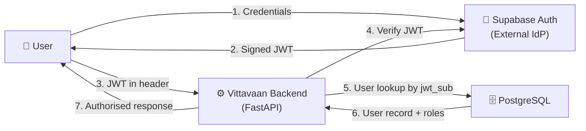
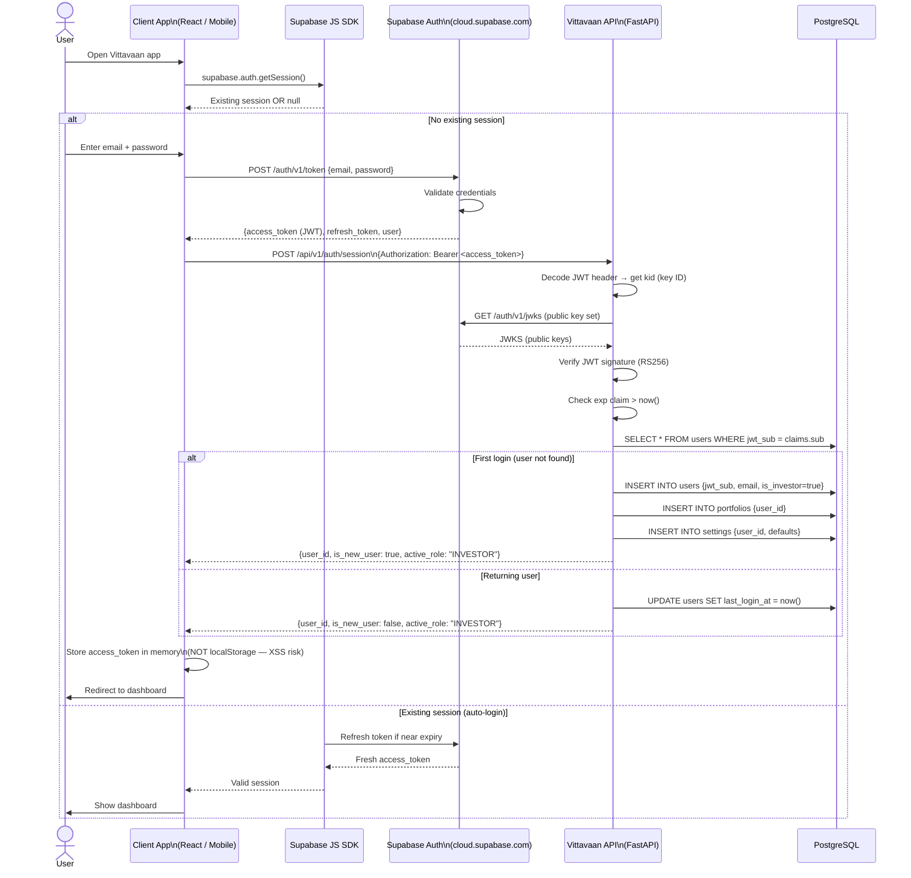
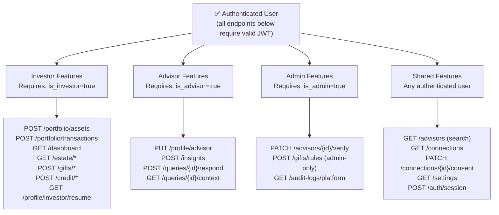
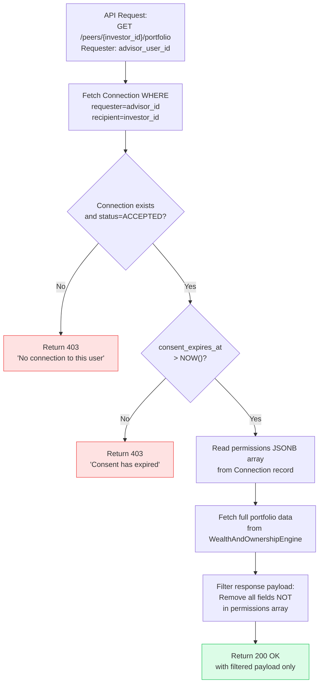
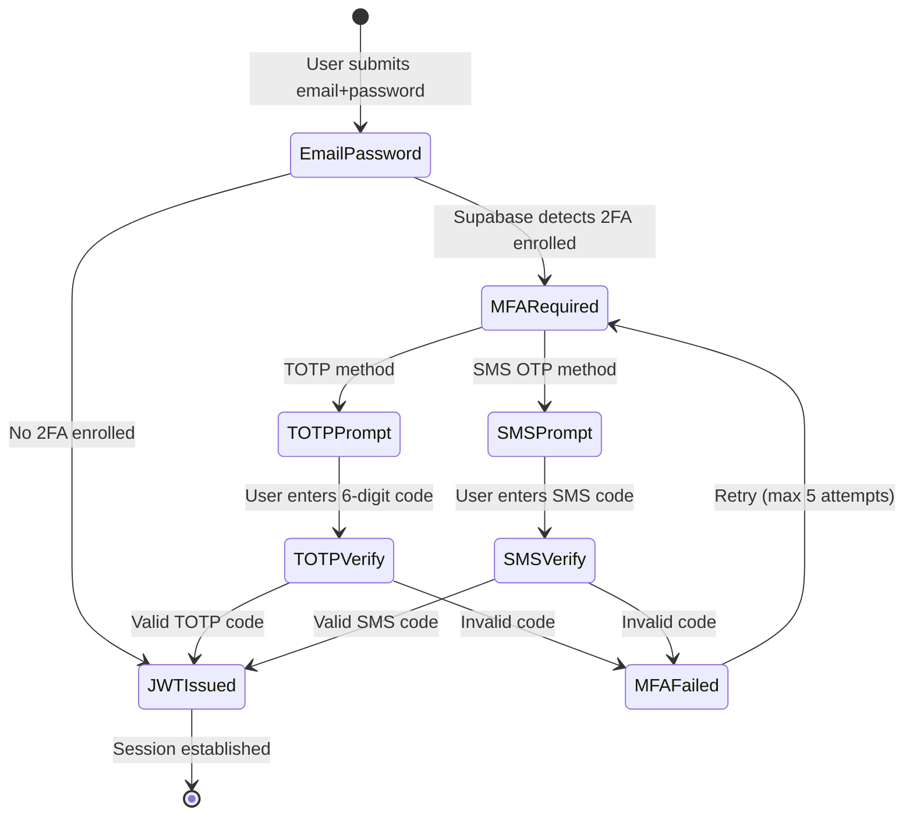
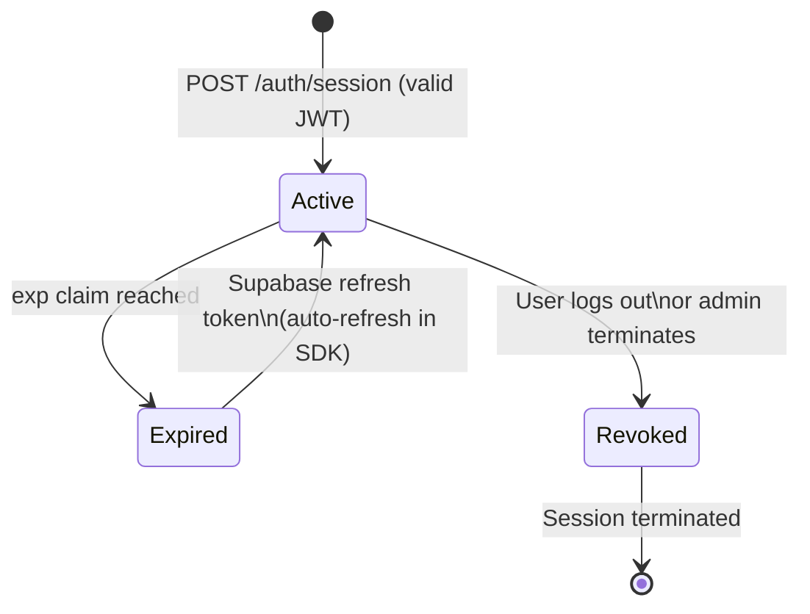

# Phase 3 — System Design: Authentication & Authorization

> **OOSE Phase:** System Design
> **Purpose:** Specifies the complete authentication flow and the two-layer authorization system (RBAC + ABAC). This is the security backbone of the platform.
> **Status:** Draft

---

## 1. Authentication Architecture Overview

Vittavaan uses a **delegated authentication model**: user identity and credential management are fully delegated to Supabase Auth. Vittavaan owns the **authorization** layer — what authenticated users are allowed to see and do.



**What Supabase Auth handles:**
- Password hashing and storage
- Email verification
- Phone OTP generation and validation
- JWT issuance (RS256 signed)
- Session revocation

**What Vittavaan handles:**
- JWT verification (signature check against Supabase public key)
- User record creation on first authentication
- Role assignment (`is_investor`, `is_advisor`, `is_admin`)
- RBAC — which features each role can access
- ABAC — which data each user can access from other users

---

## 2. Authentication Flow (Full Detail)



---

## 3. JWT Structure & Claims

Supabase Auth issues JWTs with the following structure:

```json
Header:
{
  "alg": "RS256",
  "typ": "JWT",
  "kid": "supabase-public-key-id"
}

Payload (claims):
{
  "sub": "550e8400-e29b-41d4-a716-446655440000",  // Supabase user ID (→ jwt_sub in our DB)
  "email": "yatish@example.com",
  "aud": "authenticated",
  "role": "authenticated",
  "exp": 1758345600,                               // Token expiry (Unix timestamp)
  "iat": 1758259200,                               // Issued at
  "iss": "https://yourproject.supabase.co/auth/v1"
}
```

**FastAPI extracts:**
- `sub` → maps to `users.jwt_sub` → used to fetch the `user_id` and role flags
- `exp` → verified to be in the future
- Signature → verified against Supabase's RS256 public key (fetched once at startup, cached with TTL)

**Vittavaan does NOT extend JWT claims.** Role information (`is_investor`, `is_advisor`, `is_admin`) is always read from PostgreSQL, not the JWT. This prevents stale role data from tokens issued before a role change.

---

## 4. Token Storage Security

| Client Type | Storage Method | Rationale |
|---|---|---|
| React web app | **In-memory** (React state / context) | Prevents XSS access to tokens. Token is lost on page refresh — Supabase SDK auto-refreshes silently via secure cookie or refresh token. |
| React Native mobile (V2) | **Secure enclave** via `expo-secure-store` | Hardware-backed secure storage; not accessible to other apps |
| **NEVER** | `localStorage`, `sessionStorage` | Vulnerable to XSS; a single injected script can steal the token |

---

## 5. RBAC — Role-Based Access Control

RBAC determines which **features and endpoints** a user can access.

### 5.1 Role Flags

```python
# backend/app/core/auth.py
class UserContext:
    user_id: UUID
    jwt_sub: str
    is_investor: bool
    is_advisor: bool
    is_admin: bool
    active_role: RoleEnum  # The currently selected role (can switch)
```

### 5.2 Endpoint Role Guards

FastAPI dependency injection applies role checks as decorators:

```python
# Dependency: any authenticated user
async def get_current_user(jwt: str = Depends(verify_jwt)) -> UserContext: ...

# Dependency: must be an investor
async def require_investor(user: UserContext = Depends(get_current_user)) -> UserContext:
    if not user.is_investor:
        raise HTTPException(403, "Investor role required")
    return user

# Dependency: must be an advisor
async def require_advisor(user: UserContext = Depends(get_current_user)) -> UserContext:
    if not user.is_advisor:
        raise HTTPException(403, "Advisor role required")
    return user

# Dependency: must be admin
async def require_admin(user: UserContext = Depends(get_current_user)) -> UserContext:
    if not user.is_admin:
        raise HTTPException(403, "Admin role required")
    return user
```

### 5.3 RBAC Matrix — Endpoint Access



---

## 6. ABAC — Attribute-Based Access Control (Consent Proxy)

ABAC determines which **data fields** from another user's profile a requesting user can read. This is the Protection Proxy pattern.

### 6.1 Access Decision Logic



### 6.2 Permitted Field Registry

The `permissions` JSONB field stores an array of field identifiers from this registry:

| Field Identifier | Data Disclosed | Notes |
|---|---|---|
| `total_net_worth` | Net worth in ₹ band (e.g., "₹1–5 Cr") | Never exact figure unless `exact_net_worth` is granted |
| `exact_net_worth` | Exact net worth in minor units | Requires explicit selection — not included in defaults |
| `asset_allocation` | % split across Liquid / RE / Alternative | No individual asset details |
| `liquid_assets` | Total liquid assets value + sub-type breakdown | No institution names |
| `real_estate_assets` | RE asset list with location (city only), value | No exact addresses |
| `alternative_assets` | Alternative asset list with values | |
| `liabilities` | Total liabilities, DSR | No lender names |
| `cash_flow_summary` | Monthly income, expenses, surplus | No transaction details |
| `financial_goals` | Goal names, target, status | No asset linkage details |
| `credit_profile` | Credit score band, DSR, security coverage | Anonymous |
| `verification_status` | `verified_wealth_pct` | |

**Security rule:** If `exact_net_worth` is not in the permissions list but `total_net_worth` is, the response contains `net_worth_band: "₹1–5 Cr"` instead of `net_worth_minor_units: 24500000`.

### 6.3 Implementation: FastAPI Dependency

```python
# backend/app/core/consent.py

class ConsentGate:
    """Protection Proxy — wraps all cross-user data access."""

    async def evaluate(
        self,
        requesting_user_id: UUID,
        data_owner_id: UUID,
        db: AsyncSession
    ) -> ConsentDecision:
        connection = await db.execute(
            select(Connection)
            .where(
                Connection.requester_id == requesting_user_id,
                Connection.recipient_id == data_owner_id,
                Connection.status == "ACCEPTED"
            )
        )
        conn = connection.scalar_one_or_none()

        if conn is None:
            return ConsentDecision(allowed=False, reason="NO_CONNECTION", permitted_fields=[])

        if conn.consent_expires_at and conn.consent_expires_at < datetime.now(UTC):
            return ConsentDecision(allowed=False, reason="CONSENT_EXPIRED", permitted_fields=[])

        return ConsentDecision(
            allowed=True,
            reason="CONSENT_VALID",
            permitted_fields=conn.permissions or []
        )

    def filter_payload(self, payload: dict, permitted_fields: list[str]) -> dict:
        """Strip all keys not explicitly listed in permitted_fields."""
        if not permitted_fields:
            return {}
        return {k: v for k, v in payload.items() if k in permitted_fields}
```

---

## 7. Two-Factor Authentication (2FA)

2FA is delegated to Supabase Auth and is configured by the user in Settings.

### Supported 2FA Methods
1. **TOTP (Time-based One-Time Password)** — via authenticator apps (Google Authenticator, Authy)
2. **SMS OTP** — via Indian phone number (Twilio/MSG91 integration in Supabase)

### 2FA Flow



---

## 8. Session Management

### Session Lifecycle



### Session Table
The `local_sessions` table records every session with:
- `session_id` — UUID
- `user_id` — who is authenticated
- `jwt_sub` — the Supabase user ID (for cross-reference)
- `active_role` — current role context (INVESTOR or ADVISOR)
- `expires_at` — matches the JWT `exp` claim
- `is_active` — set to `false` on explicit logout
- `device_info` — user-agent string (for "view active sessions" feature)
- `ip_address` — for audit purposes (not displayed to user by default)

### Logout Everywhere
`DELETE /auth/sessions` sets `is_active = FALSE` for all sessions for the current `user_id`. The user must re-authenticate on all devices.

---

## 9. Admin Access Control

Admin-only endpoints are guarded by the `require_admin` dependency. Admins have:
- Read access to all advisor profiles for credential verification
- Write access to `advisor_profiles.credential_verification_status`
- Write access to `gift_rules` table (adding new rules on Finance Act updates)
- Read access to platform-level audit logs

**Admins do NOT have:** Access to any individual Investor's financial data (portfolio, transactions, estate plan). This is enforced at the service layer — admin role does not bypass the ABAC consent gate.

---

## 10. Security Headers

All API responses include:

```
Strict-Transport-Security: max-age=31536000; includeSubDomains
X-Content-Type-Options: nosniff
X-Frame-Options: DENY
Content-Security-Policy: default-src 'none'
Cache-Control: no-store  (for all authenticated endpoints)
```

CORS is configured to allow only known origins:
```python
# backend/app/core/config.py
ALLOWED_ORIGINS = [
    "http://localhost:5173",               # local Vite dev server
    "https://staging.vittavaan.in",        # staging frontend
    "https://vittavaan.in",                # production frontend
    "https://www.vittavaan.in",
]
```

---

*Next document: [05_Event_and_Background_Jobs.md](./05_Event_and_Background_Jobs.md)*
