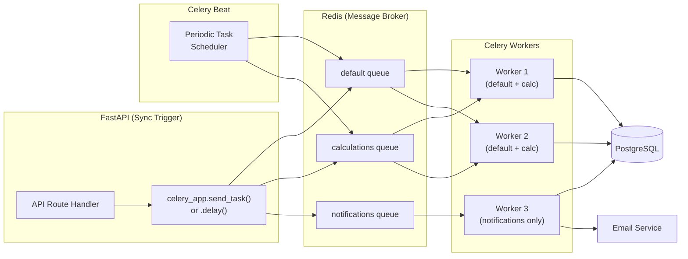
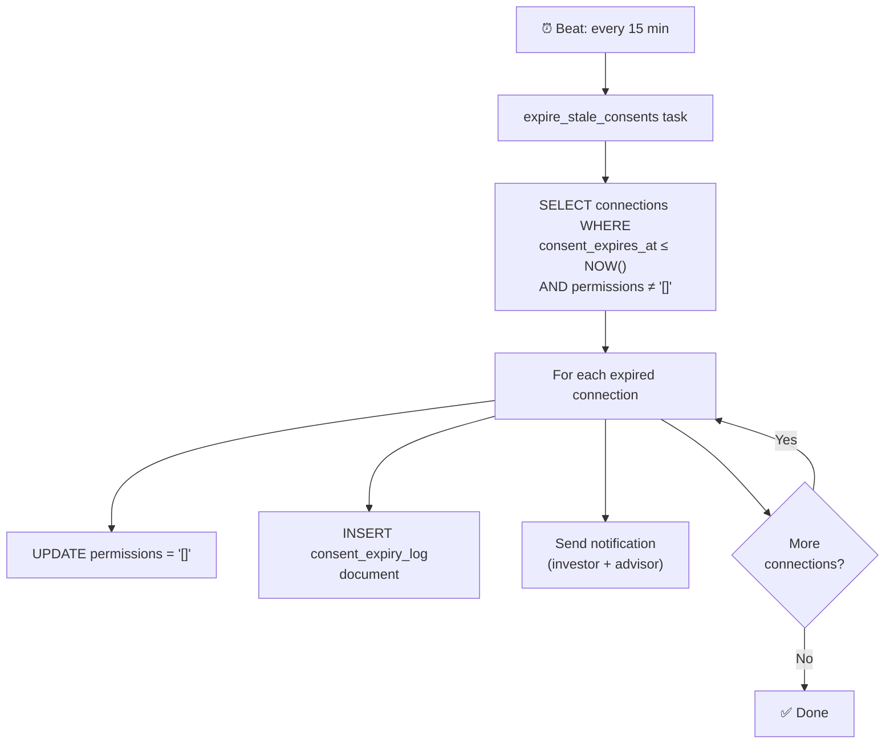

# Phase 3 — System Design: Events & Background Jobs

> **OOSE Phase:** System Design
> **Purpose:** Specifies all asynchronous event-driven and scheduled background operations — what triggers them, what they do, how they fail, and how they are monitored.
> **Technology:** Celery 5.x + Redis (broker + result backend)
> **Status:** Draft

---

## 1. Why Background Jobs?

Certain operations must not block the user's HTTP request:
1. **Computationally intensive**: Generating a `FinancialSnapshot` requires querying all assets, liabilities, and transactions — too slow for a synchronous response.
2. **Eventually consistent by nature**: Consent expiry checks run periodically — there is no user action that triggers them.
3. **Fault-tolerant**: If a notification email fails, the user should not see an error on their portfolio save — retry in the background.
4. **Decoupled**: The snapshot job does not need to know about the UI — it reads from and writes to the database independently.

---

## 2. Architecture



### Queue Strategy

| Queue | Assigned To | Purpose |
|---|---|---|
| `default` | All workers | General-purpose jobs |
| `calculations` | Calculation workers only | `FinancialSnapshot`, XIRR cache warm-up |
| `notifications` | Notification worker | Emails, in-app alerts (isolated so a notification failure never delays calculations) |

---

## 3. Event Catalog

### 3.1 Portfolio Write Events (Triggered Immediately After Write)

These jobs are dispatched by the API after any successful write that changes portfolio data.

---

**`capture_financial_snapshot`**
- **Trigger:** After any successful `POST`/`PATCH`/`DELETE` to `/portfolio/assets`, `/portfolio/liabilities`, `/portfolio/transactions`
- **Queue:** `calculations`
- **Deduplication:** If a job for the same `portfolio_id` is already in the queue, skip the duplicate. (Prevents snapshot storm when a user adds 10 assets in rapid succession.)
- **What it does:**
  1. Fetches all active assets (with attributed values)
  2. Fetches all liabilities
  3. Computes: `total_assets`, `total_liabilities`, `net_worth`, breakdown by class, `verified_wealth`
  4. Inserts a new `FinancialSnapshot` record (append-only)
- **Timeout:** 30 seconds (per NFR-PERF-004)
- **Retry policy:** 3 attempts with exponential backoff (5s, 30s, 120s)
- **Failure handling:** After 3 failures, log `ERROR` with `portfolio_id` and send an admin alert. The dashboard shows the previous snapshot with a staleness warning.

```python
# backend/app/jobs/snapshot.py
@celery_app.task(
    name="jobs.capture_financial_snapshot",
    queue="calculations",
    max_retries=3,
    default_retry_delay=5,
    autoretry_for=(Exception,),
    retry_backoff=True,
)
async def capture_financial_snapshot(portfolio_id: str) -> dict:
    ...
```

---

**`invalidate_performance_cache`**
- **Trigger:** After any portfolio write (debounced — fires once even if 5 writes happen in 10 seconds)
- **Queue:** `calculations`
- **What it does:** Deletes cached XIRR and TWRR values for the portfolio from Redis. Next performance API call will recompute.
- **Timeout:** 5 seconds
- **Retry policy:** 2 attempts, 2s backoff

---

### 3.2 Consent Events

**`expire_stale_consents`**
- **Trigger:** Celery Beat — every 15 minutes
- **Queue:** `default`
- **What it does:**
  1. Queries all `Connection` records where `consent_expires_at <= NOW()` and `permissions != '[]'`
  2. For each expired connection: sets `permissions = '[]'`, writes an immutable `CONSENT_EXPIRY_LOG` document
  3. Sends notification to both Investor and Advisor
- **Expected volume:** Typically 0–10 connections per run in V1 scale
- **Timeout:** 5 minutes
- **Retry policy:** 3 attempts, 30s backoff
- **Idempotency:** Safe to run multiple times — a connection with `permissions = '[]'` is skipped



---

**`send_consent_expiry_warning`**
- **Trigger:** Celery Beat — daily at 9:00 AM IST (03:30 UTC)
- **Queue:** `notifications`
- **What it does:** Queries connections where `consent_expires_at` is within 7 days. Sends a warning notification to the Investor: "Your data access grant for [Advisor] expires in [N] days."
- **Timeout:** 5 minutes
- **Retry policy:** 2 attempts, 60s backoff

---

### 3.3 Valuation Staleness Events

**`check_stale_valuations`**
- **Trigger:** Celery Beat — daily at 2:00 AM IST (20:30 UTC previous day)
- **Queue:** `calculations`
- **What it does:**
  1. Queries all active assets across all portfolios
  2. Computes `ValuationAgeDays = NOW() - valuation_as_of` for each
  3. Compares against asset-class staleness thresholds (from config table)
  4. Marks assets as `STALE` in a staleness cache (Redis)
  5. For any asset newly turned stale, enqueues a notification to the asset owner
- **Staleness thresholds (configurable, not hardcoded):**

| Asset Sub-type | Warning Threshold | Stale Threshold |
|---|---|---|
| Bank Account | 180 days | 365 days |
| Equity / MF | 30 days | 60 days |
| FD | 30 days | 90 days |
| Real Estate | 180 days | 365 days |
| Alternative | 180 days | 365 days |
| Crypto | 7 days | 30 days |

- **Timeout:** 15 minutes
- **Retry policy:** 3 attempts, 60s backoff

---

### 3.4 Notification Events

All notification jobs are dispatched to the `notifications` queue, isolated from computation queues.

**`send_in_app_notification`**
- **Trigger:** Dispatched by any job or service that needs to notify a user
- **What it does:** Creates a notification record in the `notifications` table (not yet implemented in schema — added in sprint 3). Sets `is_read = FALSE`.
- **Input:** `{user_id, notification_type, title, message, action_url}`

**`send_email_notification`**
- **Trigger:** Same as above, for notifications with email delivery configured
- **What it does:** Calls the email service (SendGrid/AWS SES) with a templated email
- **Rate limit:** Max 20 emails/user/day (prevent notification spam)
- **Timeout:** 30 seconds
- **Retry policy:** 3 attempts, 30s backoff

**Notification Types:**

| `notification_type` | When Sent | Recipient |
|---|---|---|
| `CONSENT_GRANTED` | Investor grants data access | Advisor |
| `CONSENT_EXPIRY_WARNING` | 7 days before consent expiry | Investor |
| `CONSENT_EXPIRED` | Consent expires | Investor + Advisor |
| `CONNECTION_REQUEST` | New connection request sent | Recipient |
| `CONNECTION_ACCEPTED` | Connection request accepted | Requester |
| `QUERY_SUBMITTED` | New advisory query | Advisor |
| `QUERY_ANSWERED` | Advisor responded to query | Investor |
| `STALE_VALUATION_ALERT` | Asset turns stale | Portfolio owner |
| `EXPORT_READY` | Data export compiled | Investor |
| `CREDIT_BID_RECEIVED` | Lender submits a bid | Investor |
| `SNAPSHOT_FAILURE` | FinancialSnapshot job fails after all retries | Admin |

---

### 3.5 Data Export Events

**`compile_user_data_export`**
- **Trigger:** `POST /users/me/export` — queued immediately, user is told "export started"
- **Queue:** `default`
- **What it does:**
  1. Fetches all user data across all tables
  2. Compiles into structured JSON
  3. Uploads to Supabase Storage (`users/{user_id}/exports/{timestamp}.json`)
  4. Inserts a `Document` record (`type: USER_EXPORT`)
  5. Dispatches `send_in_app_notification` + `send_email_notification` with download link
- **SLA:** Must complete within 72 hours (NFR-PRIV-002)
- **Timeout:** 30 minutes (for large accounts)
- **Retry policy:** 2 attempts, 5m backoff
- **Rate limit:** 1 export per user per 24 hours (enforced in the API, not the job)

---

### 3.6 Peer Benchmark Events

**`generate_peer_benchmarks`**
- **Trigger:** Celery Beat — weekly on Sunday at 3:00 AM IST (21:30 UTC Saturday)
- **Queue:** `calculations`
- **What it does:**
  1. Queries all active investor profiles
  2. Groups users into cohorts by: `city_tier`, `age_band`, `risk_tolerance`
  3. For each cohort with ≥ 10 members (minimum cohort size for anonymity), computes:
     - Average net worth
     - Average liquid / RE / alternative split
     - Average DSR
  4. Stores results in `peer_benchmarks` table (not yet in schema — added in sprint 4)
- **Privacy guarantee:** Cohorts with < 10 members are not computed — no benchmark is surfaced.
- **Timeout:** 30 minutes
- **Retry policy:** 3 attempts, 5m backoff

---

### 3.7 Account Closure & Data Retention Events

**`anonymise_closed_account`**
- **Trigger:** After `RetentionExpiryDate` is reached (calculated at account closure)
- **Queue:** `default`
- **What it does:**
  1. Deletes personal identifiers: `first_name`, `last_name`, `email`, `date_of_birth`, `pan_masked`
  2. Replaces with anonymised placeholders: `first_name = "DELETED"`, `email = "deleted_{uuid}@vittavaan.invalid"`
  3. Deletes all uploaded documents from Supabase Storage
  4. Marks user record as `is_active = FALSE`
  5. Retains: all financial transaction records (for 7 years from creation per Income Tax Act)
- **This job fires once, 7 years after account closure. Scheduled via a DB-persisted task, not just Celery Beat.**
- **Timeout:** 15 minutes
- **Retry policy:** 5 attempts, 1h backoff (critical operation)

---

## 4. Beat Schedule Configuration

```python
# backend/app/jobs/schedule.py
from celery.schedules import crontab

CELERYBEAT_SCHEDULE = {
    # Every 15 minutes
    "expire-stale-consents": {
        "task": "jobs.expire_stale_consents",
        "schedule": crontab(minute="*/15"),
        "options": {"queue": "default"},
    },
    # Daily at 2:00 AM IST (20:30 UTC)
    "check-stale-valuations": {
        "task": "jobs.check_stale_valuations",
        "schedule": crontab(hour=20, minute=30),
        "options": {"queue": "calculations"},
    },
    # Daily at 9:00 AM IST (03:30 UTC)
    "consent-expiry-warnings": {
        "task": "jobs.send_consent_expiry_warnings",
        "schedule": crontab(hour=3, minute=30),
        "options": {"queue": "notifications"},
    },
    # Weekly, Sunday 3:00 AM IST (21:30 UTC Saturday)
    "generate-peer-benchmarks": {
        "task": "jobs.generate_peer_benchmarks",
        "schedule": crontab(hour=21, minute=30, day_of_week=6),
        "options": {"queue": "calculations"},
    },
}
```

---

## 5. Job Monitoring & Observability

### 5.1 Flower (Local Development)
Celery Flower runs locally for task monitoring:
```
http://localhost:5555  → Flower dashboard (all queues, worker status, task history)
```

### 5.2 Failure Alerting
When a job exceeds its retry limit:

```python
@celery_app.task(bind=True, max_retries=3)
def capture_financial_snapshot(self, portfolio_id: str):
    try:
        ...
    except Exception as exc:
        if self.request.retries >= self.max_retries:
            # Last retry failed — alert admin
            send_admin_alert(
                "SNAPSHOT_JOB_FAILED",
                f"Financial snapshot job failed for portfolio {portfolio_id} after 3 retries."
            )
            logger.error(
                "SNAPSHOT_JOB_FINAL_FAILURE",
                extra={"portfolio_id": portfolio_id, "error": str(exc)}
            )
        raise self.retry(exc=exc, countdown=5 * (2 ** self.request.retries))
```

### 5.3 Key Metrics to Monitor

| Metric | Alert Threshold | Indicates |
|---|---|---|
| `celery.queue.default.length` | > 100 tasks | Queue backlog — workers may be stuck |
| `celery.queue.calculations.length` | > 50 tasks | Snapshot delays |
| `jobs.capture_financial_snapshot.failure_rate` | > 5% in 1h | Infrastructure problem |
| `jobs.expire_stale_consents.last_success_age` | > 20 minutes | Beat scheduler down |
| `jobs.check_stale_valuations.duration_ms` | > 600,000 ms | Performance degradation |

These metrics are emitted to CloudWatch (production) or logged to stdout (local/staging).

---

## 6. Idempotency Design

Every job is designed to be **idempotent** — running it twice produces the same end state as running it once.

| Job | Idempotency Mechanism |
|---|---|
| `capture_financial_snapshot` | `FinancialSnapshot` is append-only; duplicate runs create a second snapshot (acceptable — trend charts take the latest) |
| `expire_stale_consents` | `WHERE permissions != '[]'` — already-expired connections are skipped |
| `check_stale_valuations` | Updates staleness cache in Redis (overwrite is safe) |
| `send_consent_expiry_warning` | Checks notification `sent_at` — does not re-send if already sent today |
| `compile_user_data_export` | Overwrites the export file in storage (latest run wins) |

---

*Next document: [06_Data_Room_Architecture.md](./06_Data_Room_Architecture.md)*
