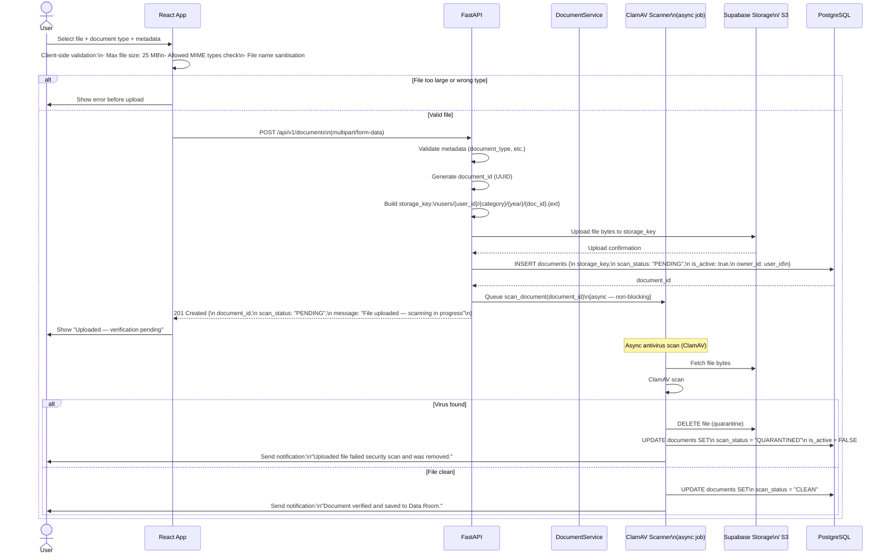
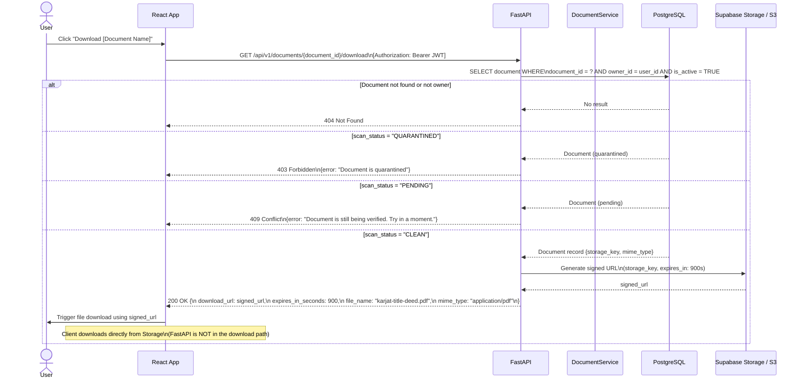
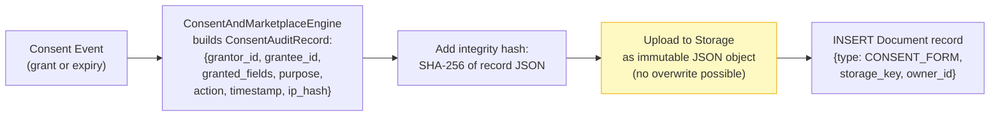
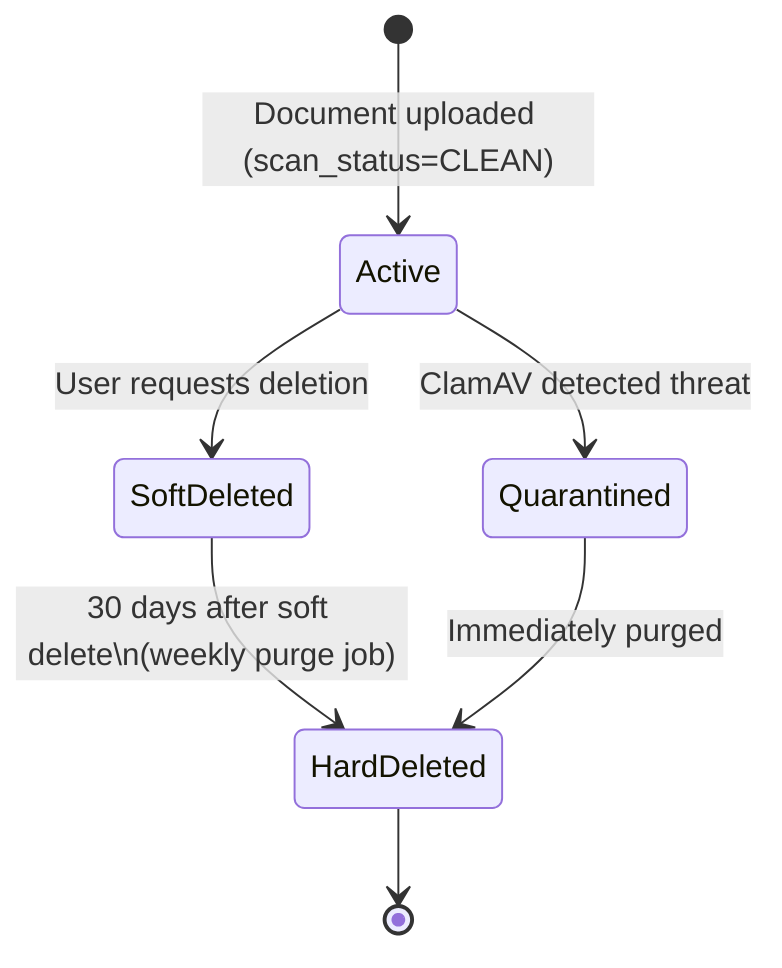
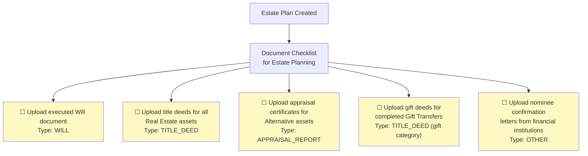

# Phase 3 — System Design: Data Room Architecture

> **OOSE Phase:** System Design
> **Purpose:** Specifies how documents are stored, accessed, secured, and managed throughout their lifecycle. The Data Room is critical for legal provenance — title deeds, appraisal reports, consent audit logs, will documents, and data exports.
> **Status:** Draft

---

## 1. What is the Data Room?

The Data Room is the secure document storage subsystem of Vittavaan. It stores:

| Category | Examples | Sensitivity |
|---|---|---|
| **Asset provenance** | Title deeds, purchase agreements, FD receipts, valuation reports, appraisal certificates | HIGH |
| **Estate documents** | Wills, gift deeds, succession certificates | VERY HIGH |
| **Consent audit** | Consent grant records, consent expiry logs | HIGH |
| **Legal compliance** | Gift rule versions, stamp duty receipts, registration records | HIGH |
| **User export** | Complete data export ZIP | HIGH |
| **Platform** | Advisory query attachments | MEDIUM |

All documents are:
- **Encrypted at rest** (AES-256) — provided by Supabase Storage / S3
- **Encrypted in transit** — TLS 1.3 only
- **Access-controlled** — every download requires a fresh time-limited signed URL
- **Never publicly accessible** — no public bucket permissions; no CDN caching of documents
- **Soft-deletable** — deleted documents are marked `is_active = FALSE`; physically removed after 30 days

---

## 2. Storage Architecture

### Local / Staging: Supabase Storage
- S3-compatible object store managed by Supabase
- Integrated with Supabase Auth — storage RLS policies possible
- 1 GB free tier; adequate for local dev and staging
- Storage bucket: `vittavaan-data-room` (private, no public access)

### Production: AWS S3 (`ap-south-1`, Mumbai)
- S3 bucket: `vittavaan-data-room-prod`
- Bucket policy: all public access blocked
- Encryption: SSE-S3 (AES-256) by default; upgrade to SSE-KMS (AWS KMS managed key) for VERY HIGH sensitivity documents
- Access logging: S3 server access logs → CloudWatch Logs
- Lifecycle rule: Objects in `exports/` prefix → delete after 72 hours (user export files)
- Versioning: **Disabled** (we use soft-delete + append-only at application layer; S3 versioning creates legal complexity)

---

## 3. Storage Key Conventions

All objects are stored with a structured key (path) that encodes ownership and type:

```
Pattern:
  users/{user_id}/{category}/{year}/{document_id}.{ext}

Examples:
  users/550e8400-e29b-41d4-a716-446655440000/deeds/2026/abc12345-deed.pdf
  users/550e8400-e29b-41d4-a716-446655440000/wills/2026/def67890-will.pdf
  users/550e8400-e29b-41d4-a716-446655440000/consent-logs/2026/ghi11111-consent.json
  users/550e8400-e29b-41d4-a716-446655440000/exports/2026/jkl22222-export.json
  users/550e8400-e29b-41d4-a716-446655440000/appraisals/2026/mno33333-appraisal.pdf
```

**Category slug → `document_type` mapping:**

| Category Slug | Document Types |
|---|---|
| `deeds` | `TITLE_DEED`, `GIFT_DEED` |
| `valuations` | `VALUATION_REPORT`, `APPRAISAL_REPORT` |
| `agreements` | `PURCHASE_AGREEMENT`, `LOAN_AGREEMENT` |
| `wills` | `WILL` |
| `consent-logs` | `CONSENT_FORM`, `CONSENT_EXPIRY_LOG` |
| `tax` | `TAX_DOCUMENT` |
| `insurance` | `INSURANCE_POLICY` |
| `exports` | `USER_EXPORT` |
| `other` | `OTHER` |

---

## 4. Document Upload Flow



---

## 5. Document Download Flow (Signed URL)

Documents are **never served directly** from storage. Every download requires:
1. An authenticated API call
2. Ownership verification (the requestor must be the document owner)
3. A freshly generated, time-limited signed URL



**Why the client downloads directly from storage (not via API)?**
- Avoids streaming large files through FastAPI → lower server memory, better performance
- Signed URL has 15-minute TTL — adequate time to download
- If URL expires, user clicks download again (no cost beyond a new URL generation)

---

## 6. Allowed MIME Types

The API rejects uploads with any MIME type not in this allowlist:

| MIME Type | File Extension | Documents Allowed |
|---|---|---|
| `application/pdf` | `.pdf` | All |
| `image/jpeg` | `.jpg`, `.jpeg` | Appraisals, valuations, deeds |
| `image/png` | `.png` | Appraisals, valuations |
| `image/webp` | `.webp` | Appraisals |
| `application/json` | `.json` | Consent logs, exports (system-generated only) |
| `application/zip` | `.zip` | User export only (system-generated) |

Rejected MIME types (any other type including `.exe`, `.docx`, `.xlsx`, `.ppt`) return `400 Bad Request`.

---

## 7. Consent Audit Log — Immutable Design

Consent audit logs deserve special treatment — they are legal records under DPDP Act and must be immutable.



**Immutability enforcement:**
- The S3 bucket has **Object Lock** enabled for the `consent-logs/` prefix in production
- Logs are written with a `COMPLIANCE` mode retention of 7 years (matching data retention rules)
- The application never issues a `DELETE` for consent log objects — any such call would be rejected by S3

---

## 8. Document Soft Delete

When a user requests deletion of a document:
1. The `Document.is_active` flag is set to `FALSE`
2. The object in storage is **not immediately deleted**
3. A scheduled job (`purge_deleted_documents`) runs weekly and hard-deletes storage objects for documents where `is_active = FALSE AND (NOW() - created_at) > 30 days`

**Exception:** Consent audit logs and `USER_EXPORT` documents are **never hard-deleted before their retention expiry** (7 years and 72 hours respectively).



---

## 9. File Size Limits

| Limit | Value | Applies To |
|---|---|---|
| Maximum file size per upload | 25 MB | All user uploads |
| Maximum total Data Room storage per user | 2 GB | Soft limit (configurable) |
| Maximum user export file size | 200 MB | System-generated export |
| Maximum consent log size | 50 KB | System-generated JSON |

Users approaching 80% of their storage quota receive an email notification.

---

## 10. Data Room + Estate Plan Integration

When an `EstatePlan` or `Will` is created, the Data Room provides a structured document checklist:



The `EstateCoveragePct` metric includes a **document completeness component**: an estate plan with all documents uploaded scores higher than one with missing provenance.

---

## 11. Local Development Setup

In local development, Supabase Storage runs inside Docker (part of the `supabase/*` docker-compose services):

```yaml
# docker-compose.yml (relevant excerpt)
services:
  supabase-storage:
    image: supabase/storage-api:v0.43.11
    environment:
      ANON_KEY: ${SUPABASE_ANON_KEY}
      SERVICE_KEY: ${SUPABASE_SERVICE_KEY}
      STORAGE_BACKEND: file     # local filesystem in dev (not S3)
      FILE_STORAGE_BACKEND_PATH: /var/lib/storage
    volumes:
      - supabase_storage_data:/var/lib/storage
    ports:
      - "5000:5000"
```

In production, the `STORAGE_BACKEND=s3` environment variable switches Supabase Storage to use the real S3 bucket — no code changes needed.

---

*← Previous: [05_Event_and_Background_Jobs.md](./05_Event_and_Background_Jobs.md)*

*Phase 3 complete. Next: Phase 4 — Object Design (class-level interfaces, design patterns, final API contracts)*
