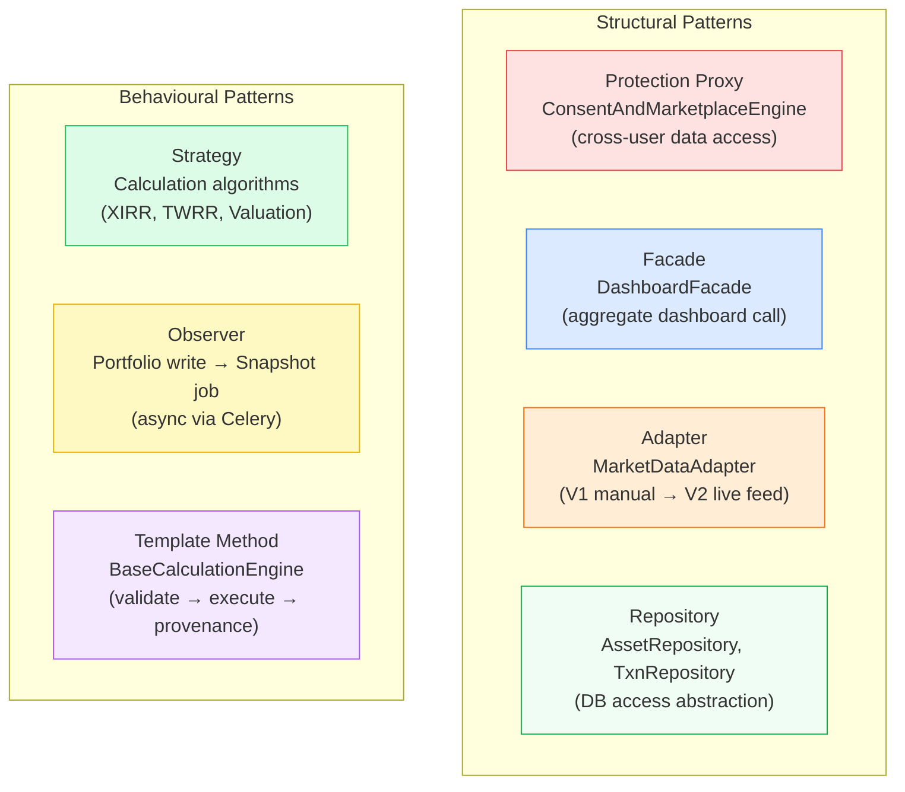
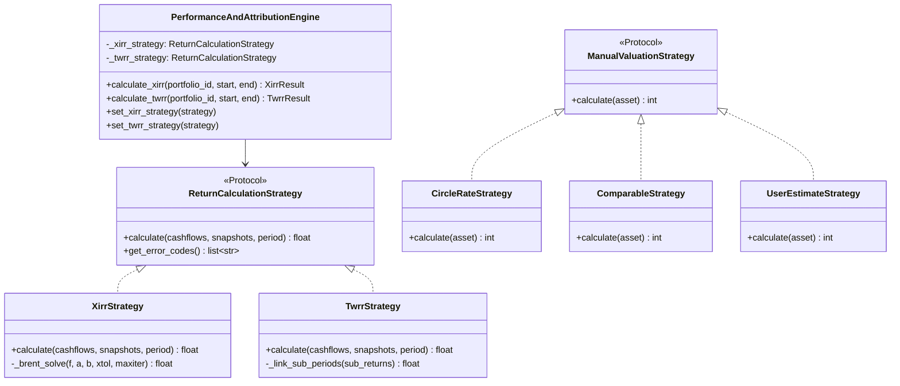
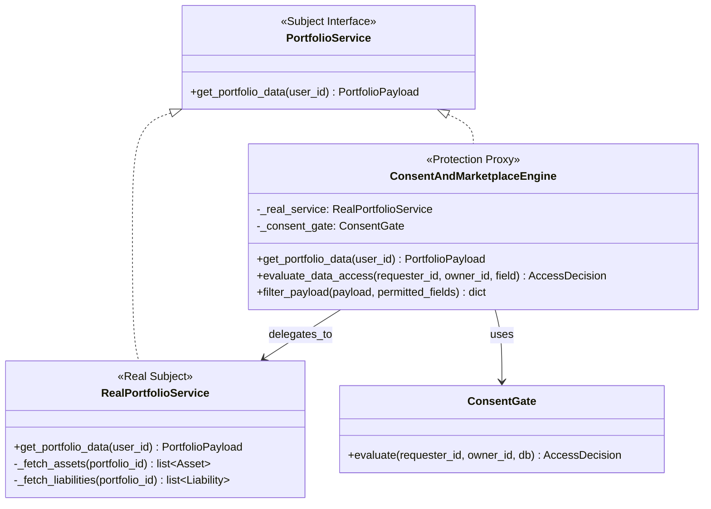
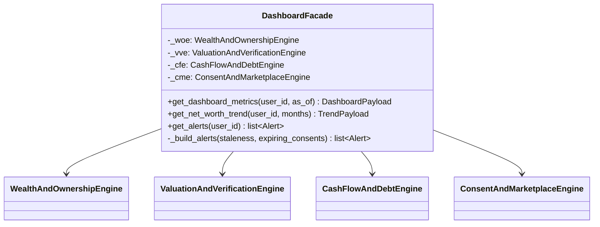
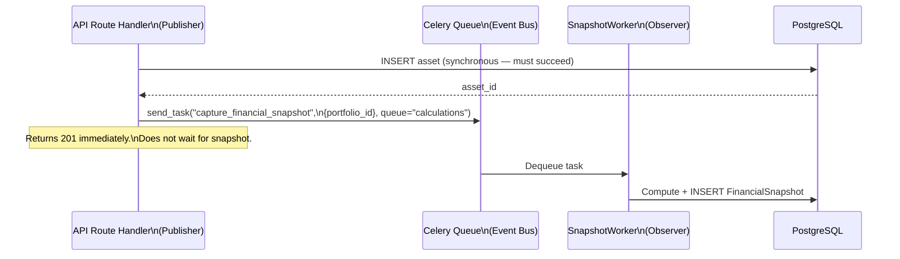
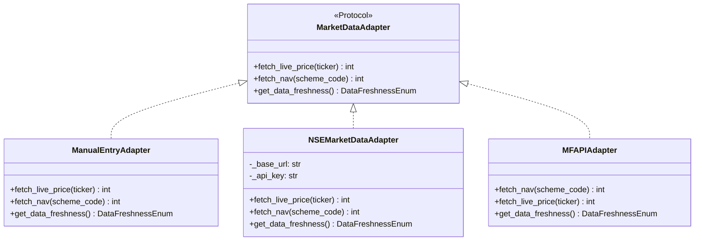
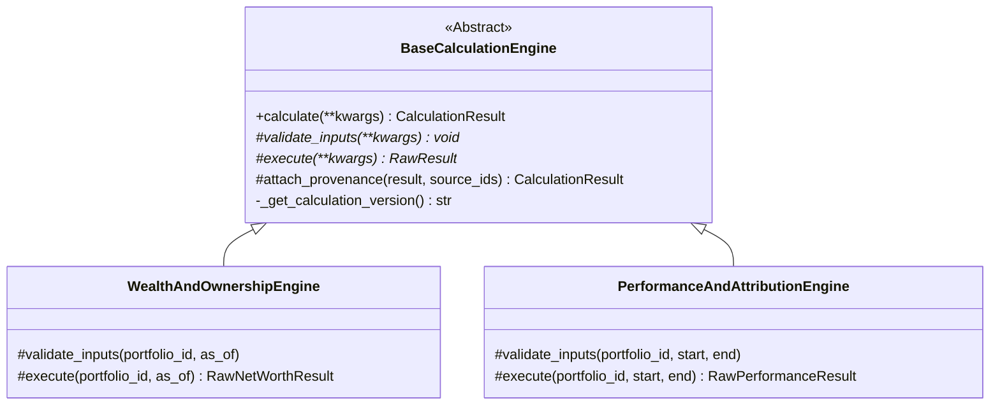
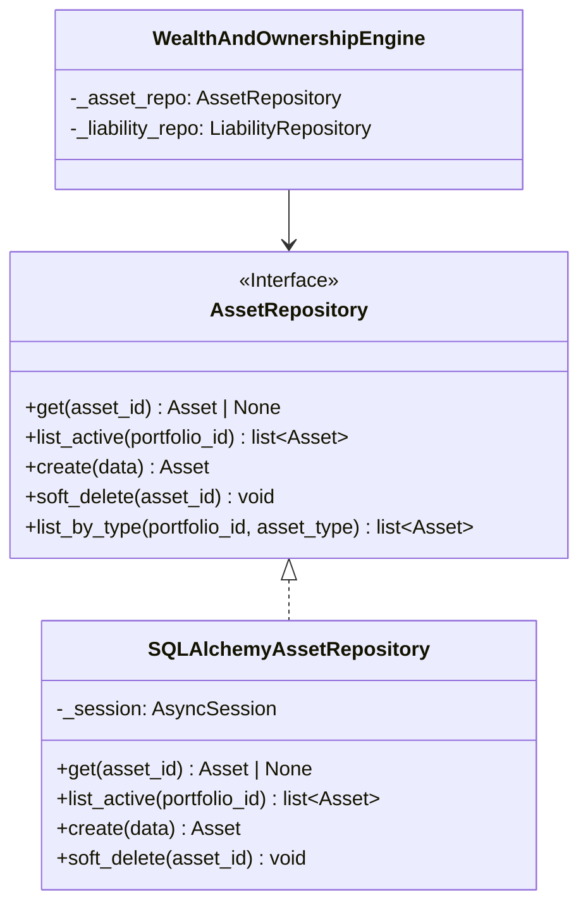

# Phase 4 — Object Design: Design Patterns

> **OOSE Phase:** Object Design
> **Purpose:** Documents every design pattern applied in Vittavaan — which pattern, exactly where it is applied, why it was chosen, the Python interface skeleton, and a Mermaid diagram showing the structure in context.
> **Rule:** Every pattern used in implementation must trace back to an entry in this document. New patterns not listed here require this document to be updated first.
> **Status:** Draft

---

## Pattern Overview



---

## Pattern 1 — Strategy

### Where Applied
- `PerformanceAndAttributionEngine` — swappable return calculation strategies (`XirrStrategy`, `TwrrStrategy`)
- `ValuationAndVerificationEngine` — swappable valuation strategies (`CircleRateStrategy`, `ComparableStrategy`, `AppraisalStrategy`, `UserEstimateStrategy`)

### Problem Solved
Both engines have multiple algorithms that vary independently (XIRR vs TWRR are different algorithms solving different questions; circle rate vs comparable sales are different valuation methods). Strategy pattern lets the engine select the right algorithm at runtime without conditional branching, and allows new algorithms to be added without modifying existing ones.

### Structure



### Python Skeleton

```python
# backend/app/services/strategies/return_strategies.py
from typing import Protocol
from dataclasses import dataclass

class ReturnCalculationStrategy(Protocol):
    """
    Strategy interface for portfolio return calculation.
    Implementors must be stateless — all context passed via arguments.
    """
    def calculate(
        self,
        cashflows: list[tuple[date, int]],  # (date, paise amount)
        snapshots: list[FinancialSnapshot],
        period: DateRange,
    ) -> float | None:
        """Return annualised rate as percentage (e.g., 14.2), or None on failure."""
        ...

    def get_applicable_error_codes(self) -> list[str]:
        """Names of error codes this strategy can produce."""
        ...


class XirrStrategy:
    def calculate(self, cashflows, snapshots, period) -> float | None:
        if len(cashflows) < 2:
            raise CalculationError("INSUFFICIENT_DATA")
        return self._brent_solve(cashflows) * 100  # convert to pct

    def _brent_solve(self, cashflows) -> float:
        from scipy.optimize import brentq
        t0 = cashflows[0][0]
        def npv(r):
            return sum(c / (1 + r) ** ((t - t0).days / 365) for t, c in cashflows)
        return brentq(npv, a=-0.9999, b=100.0, xtol=1e-6, maxiter=1000)


# backend/app/services/strategies/valuation_strategies.py
class ValuationStrategy(Protocol):
    def calculate(self, asset: Asset) -> int:
        """Return attributed value in minor units (paise)."""
        ...

class UserEstimateStrategy:
    def calculate(self, asset: Asset) -> int:
        return int(asset.current_value_minor_units * asset.ownership_split_pct / 100)

class CircleRateStrategy:
    def calculate(self, asset: RealEstateAsset) -> int:
        # price_per_sqft × area_sqft × ownership_pct / 100
        gross = int(asset.price_per_sqft_minor_units * asset.area_sqft)
        return int(gross * asset.ownership_split_pct / 100)
```

---

## Pattern 2 — Protection Proxy

### Where Applied
`ConsentAndMarketplaceEngine` — acts as a proxy for ALL cross-user portfolio data access.

### Problem Solved
Every request from User A to access User B's data must be intercepted and evaluated against the consent configuration. Embedding this check in each endpoint or service is error-prone (easy to forget). The Proxy pattern makes it impossible to bypass: the data cannot be fetched without going through the proxy, which applies the consent gate.

### Structure



### Python Skeleton

```python
# backend/app/services/consent_engine.py
class ConsentAndMarketplaceEngine:
    """
    Protection Proxy — intercepts ALL cross-user data requests.

    The caller (API route) NEVER calls RealPortfolioService directly
    when fetching another user's data. This class is the only path.
    """

    def __init__(
        self,
        real_service: RealPortfolioService,
        consent_gate: ConsentGate,
    ) -> None:
        self._real = real_service
        self._gate = consent_gate

    async def get_peer_portfolio(
        self,
        requesting_user_id: UUID,
        data_owner_id: UUID,
        db: AsyncSession,
    ) -> dict:
        # Gate evaluation — never skip this
        decision = await self._gate.evaluate(requesting_user_id, data_owner_id, db)

        if not decision.allowed:
            raise PermissionDenied(reason=decision.reason)

        # Fetch full data from real service
        full_payload = await self._real.get_portfolio_data(data_owner_id, db)

        # Strip all non-permitted fields — protection proxy's core job
        return self.filter_payload(
            payload=full_payload,
            permitted_fields=decision.permitted_fields,
        )

    def filter_payload(self, payload: dict, permitted_fields: list[str]) -> dict:
        """
        Remove every key NOT in permitted_fields.
        Fields are absent from output — not null, not redacted — absent.
        """
        if not permitted_fields:
            return {}
        return {k: v for k, v in payload.items() if k in permitted_fields}
```

### Critical Implementation Rules
1. The route handler `GET /peers/{user_id}/portfolio` MUST call `consent_engine.get_peer_portfolio()` — never `real_portfolio_service.get_portfolio_data()` directly.
2. The `filter_payload` method strips keys entirely — it does NOT return `{"total_net_worth": null}` for non-permitted fields.
3. Every call to this proxy is logged at INFO level with `requesting_user_id`, `data_owner_id`, `decision.reason`, and `permitted_fields` count.

---

## Pattern 3 — Facade

### Where Applied
`DashboardFacade` — combines calls to 5+ engines and returns a single consolidated `DashboardPayload`.

### Problem Solved
The dashboard requires data from `WealthAndOwnershipEngine`, `ValuationAndVerificationEngine`, `CashFlowAndDebtEngine`, `ConsentAndMarketplaceEngine`, and `FinancialSnapshot` — all in one page load. Without a Facade, the frontend would need to make 5+ separate API calls, creating waterfall latency. The Facade runs these in parallel (via `asyncio.gather`) and returns one structured payload.

### Structure



### Python Skeleton

```python
# backend/app/services/dashboard_facade.py
class DashboardFacade:
    """
    Facade — single entry point for the dashboard page.
    Orchestrates 5 engine calls in parallel. No business logic here —
    it composes, not computes.
    """

    async def get_dashboard_metrics(
        self,
        user_id: UUID,
        db: AsyncSession,
        as_of: datetime | None = None,
    ) -> DashboardPayload:
        # Run independent computations in parallel
        (
            net_worth,
            snapshot_trend,
            stale_assets,
            monthly_cashflow,
            expiring_consents,
        ) = await asyncio.gather(
            self._woe.calculate_net_worth(portfolio_id, as_of=as_of),
            self._snapshots.fetch_historical_trend(portfolio_id, months=13),
            self._vve.get_stale_assets(portfolio_id),
            self._cfe.calculate_monthly_surplus(portfolio_id, current_month()),
            self._cme.check_expiring_consents(user_id, days_ahead=7),
        )

        waterfall = await self._woe.calculate_net_worth_waterfall(portfolio_id, period="1M")
        verified_pct = await self._vve.calculate_verified_wealth_pct(portfolio_id)

        return DashboardPayload(
            net_worth=net_worth,
            snapshot_trend=snapshot_trend,
            monthly_cashflow=monthly_cashflow,
            verified_wealth_pct=verified_pct,
            waterfall=waterfall,
            alerts=self._build_alerts(stale_assets, expiring_consents),
            provenance=_merge_provenance([net_worth.provenance, monthly_cashflow.provenance]),
        )
```

---

## Pattern 4 — Observer (via Celery)

### Where Applied
Portfolio write operations (asset create/update, liability create/update, transaction log) → automatically trigger `FinancialSnapshot` capture.

### Problem Solved
The net worth dashboard must always reflect the latest portfolio state. After every write, a snapshot must be taken. Embedding this call synchronously in every write handler is brittle and slows the response. The Observer pattern (implemented via Celery task dispatch) decouples the write from its consequence.

### Structure



### Python Skeleton

```python
# backend/app/api/assets.py (route handler — Publisher)
@router.post("/portfolio/assets", status_code=201)
async def create_asset(
    data: AssetCreateRequest,
    user: UserContext = Depends(require_investor),
    db: AsyncSession = Depends(get_db),
) -> AssetResponse:
    asset = await asset_service.create(data, user.user_id, db)
    await db.commit()

    # Notify observer — fire-and-forget
    capture_financial_snapshot.delay(str(asset.portfolio_id))

    return AssetResponse.from_orm(asset)


# backend/app/jobs/snapshot.py (Observer)
@celery_app.task(
    name="jobs.capture_financial_snapshot",
    queue="calculations",
    max_retries=3,
    autoretry_for=(Exception,),
    retry_backoff=True,
)
async def capture_financial_snapshot(portfolio_id: str) -> None:
    async with get_async_session() as db:
        result = await wealth_engine.calculate_net_worth(UUID(portfolio_id))
        snapshot = FinancialSnapshot(
            portfolio_id=UUID(portfolio_id),
            **result.to_snapshot_fields(),
            calculation_version=CALCULATION_VERSION,
        )
        db.add(snapshot)
        await db.commit()
```

### Implementation Rules
1. `capture_financial_snapshot.delay()` is called AFTER `db.commit()` — never before (task must not run against uncommitted data).
2. Task is idempotent: if two tasks fire for the same portfolio within a short window, running both is acceptable (two snapshots in rapid succession is harmless).
3. Deduplication (nice-to-have): use Celery's `task_acks_late=True` + a Redis lock with a 5-second TTL to skip duplicate tasks.

---

## Pattern 5 — Adapter

### Where Applied
`MarketDataAdapter` — abstracts the source of asset prices/NAVs. V1 uses `ManualEntryAdapter` (returns the stored value). V2 replaces it with `NSEMarketDataAdapter`, `BSEAdapter`, `MFAPIAdapter` without changing any caller.

### Problem Solved
In V1, there is no live market data feed — users enter values manually. In V2, we want to fetch live prices. If all engines call the adapter interface (not the concrete implementation), the V2 upgrade is a configuration change, not a rewrite.

### Structure



### Python Skeleton

```python
# backend/app/adapters/market_data.py
from typing import Protocol

class MarketDataAdapter(Protocol):
    """
    Adapter interface for asset price/NAV data.
    V1: ManualEntryAdapter (returns stored value — no external call).
    V2: NSEMarketDataAdapter, MFAPIAdapter (real-time prices).
    """
    async def fetch_live_price(self, ticker: str) -> int:
        """Return current market price in minor units (paise per unit)."""
        ...

    async def fetch_nav(self, scheme_code: str) -> int:
        """Return current NAV in minor units (paise per unit)."""
        ...


class ManualEntryAdapter:
    """
    V1 implementation.
    Returns the user's stored current_value_minor_units unchanged.
    fetch_live_price() and fetch_nav() are no-ops — the caller's stored
    value is treated as truth.
    """
    async def fetch_live_price(self, ticker: str) -> int:
        return 0  # Signal: caller should use stored value

    async def fetch_nav(self, scheme_code: str) -> int:
        return 0  # Signal: caller should use stored value

    def get_data_freshness(self) -> DataFreshnessEnum:
        return DataFreshnessEnum.MANUAL


# backend/app/core/config.py
# DI binding — swap this to change the adapter:
def get_market_data_adapter() -> MarketDataAdapter:
    if settings.MARKET_DATA_PROVIDER == "MANUAL":
        return ManualEntryAdapter()
    elif settings.MARKET_DATA_PROVIDER == "NSE":
        return NSEMarketDataAdapter(api_key=settings.NSE_API_KEY)
    raise ValueError(f"Unknown provider: {settings.MARKET_DATA_PROVIDER}")
```

---

## Pattern 6 — Template Method

### Where Applied
`BaseCalculationEngine` — defines the invariant skeleton of every calculation: validate inputs → execute core algorithm → attach provenance metadata.

### Problem Solved
Every engine must validate its inputs, run the calculation, and wrap the output with provenance metadata. Without a shared template, each engine re-implements this lifecycle differently, creating inconsistency. The Template Method pattern fixes the lifecycle in the base class and lets subclasses override only the core algorithm step.

### Structure



### Python Skeleton

```python
# backend/app/services/base_engine.py
from abc import ABC, abstractmethod

class BaseCalculationEngine(ABC):
    """
    Template Method base class for all calculation engines.

    Subclasses MUST implement validate_inputs() and execute().
    Subclasses MUST NOT override calculate() — the lifecycle is fixed here.
    """
    CALCULATION_VERSION: str = "v1.0"  # Override in each subclass

    async def calculate(self, **kwargs) -> CalculationResult:
        """
        Fixed template — do not override.
        1. Validate inputs (raises CalculationError on failure)
        2. Execute core algorithm
        3. Attach provenance metadata
        """
        await self.validate_inputs(**kwargs)        # Hook 1 — subclass implements
        raw_result = await self.execute(**kwargs)   # Hook 2 — subclass implements
        return self._attach_provenance(            # Fixed — base class handles
            raw_result,
            source_ids=raw_result.source_ids,
        )

    @abstractmethod
    async def validate_inputs(self, **kwargs) -> None:
        """Raise CalculationError with specific error_code if preconditions fail."""
        ...

    @abstractmethod
    async def execute(self, **kwargs) -> RawResult:
        """Core calculation. Return raw result without provenance."""
        ...

    def _attach_provenance(self, raw: RawResult, source_ids: list[UUID]) -> CalculationResult:
        return CalculationResult(
            data=raw.data,
            provenance=ProvenanceMetadata(
                as_of=datetime.now(UTC),
                calculation_version=self.CALCULATION_VERSION,
                source_ids=source_ids,
                is_partial=raw.is_partial,
                performance_basis=raw.performance_basis,
            ),
        )


# backend/app/services/wealth_engine.py
class WealthAndOwnershipEngine(BaseCalculationEngine):
    CALCULATION_VERSION = "v1.0"

    async def validate_inputs(self, portfolio_id: UUID, **_) -> None:
        portfolio = await self._portfolio_repo.get(portfolio_id)
        if portfolio is None:
            raise CalculationError("PORTFOLIO_NOT_FOUND", portfolio_id=portfolio_id)

    async def execute(self, portfolio_id: UUID, as_of: datetime | None = None) -> RawResult:
        assets = await self._asset_repo.list_active(portfolio_id)
        liabilities = await self._liability_repo.list_active(portfolio_id)
        # ... computation ...
```

---

## Pattern 7 — Repository

### Where Applied
All database access is mediated through Repository objects. Services and engines never import SQLAlchemy models or write SQL directly.

### Problem Solved
If services query the database directly, it becomes impossible to:
- Test services without a real database
- Change the database (e.g., add caching) without modifying business logic
- Enforce query consistency (e.g., always filtering `is_active = True`)

The Repository pattern is the single point of truth for data access.

### Structure



### Python Skeleton

```python
# backend/app/repositories/asset_repository.py
from typing import Protocol

class AssetRepository(Protocol):
    async def get(self, asset_id: UUID) -> Asset | None: ...
    async def list_active(self, portfolio_id: UUID) -> list[Asset]: ...
    async def create(self, data: AssetCreateData) -> Asset: ...
    async def soft_delete(self, asset_id: UUID) -> None: ...
    async def list_by_type(
        self, portfolio_id: UUID, asset_type: AssetTypeEnum
    ) -> list[Asset]: ...


class SQLAlchemyAssetRepository:
    def __init__(self, session: AsyncSession) -> None:
        self._session = session

    async def list_active(self, portfolio_id: UUID) -> list[Asset]:
        result = await self._session.execute(
            select(AssetModel)
            .where(AssetModel.portfolio_id == portfolio_id)
            .where(AssetModel.is_active == True)  # noqa: E712 — SQLAlchemy bool
            .order_by(AssetModel.created_at.desc())
        )
        return [Asset.from_orm(row) for row in result.scalars()]

    async def soft_delete(self, asset_id: UUID) -> None:
        await self._session.execute(
            update(AssetModel)
            .where(AssetModel.asset_id == asset_id)
            .values(is_active=False, updated_at=datetime.now(UTC))
        )


# Repositories for all aggregate roots:
# AssetRepository, LiabilityRepository, TransactionRepository (read-only)
# FinancialSnapshotRepository (insert-only)
# ConnectionRepository, DocumentRepository
# EstatePlanRepository, HouseholdMemberRepository
# GiftRuleRepository, GiftTransferRepository
```

### Repository Rules
1. Repositories NEVER contain business logic — only data access
2. All `SELECT` queries on user-owned data include `WHERE user_id = ?` or trace back to `user_id` via join — no cross-user data leakage at the DB layer
3. `TransactionRepository` and `FinancialSnapshotRepository` expose only `insert()` and `query()` — no `update()` or `delete()`
4. Repositories always filter `is_active = True` in `list_*` methods unless explicitly requesting archived records (via a `include_inactive=True` parameter)

---

## Dependency Injection Map

All engines and repositories are wired via FastAPI's dependency injection system:

```python
# backend/app/core/dependencies.py

# Repositories
async def get_asset_repo(db: AsyncSession = Depends(get_db)) -> AssetRepository:
    return SQLAlchemyAssetRepository(db)

async def get_transaction_repo(db: AsyncSession = Depends(get_db)) -> TransactionRepository:
    return SQLAlchemyTransactionRepository(db)

# Engines (receive repos via DI)
async def get_wealth_engine(
    asset_repo: AssetRepository = Depends(get_asset_repo),
    liability_repo: LiabilityRepository = Depends(get_liability_repo),
) -> WealthAndOwnershipEngine:
    return WealthAndOwnershipEngine(asset_repo=asset_repo, liability_repo=liability_repo)

# Facade (receives engines via DI)
async def get_dashboard_facade(
    woe: WealthAndOwnershipEngine = Depends(get_wealth_engine),
    vve: ValuationAndVerificationEngine = Depends(get_valuation_engine),
    cfe: CashFlowAndDebtEngine = Depends(get_cashflow_engine),
    cme: ConsentAndMarketplaceEngine = Depends(get_consent_engine),
) -> DashboardFacade:
    return DashboardFacade(woe=woe, vve=vve, cfe=cfe, cme=cme)
```

This structure makes every engine and repository independently testable — swap `SQLAlchemyAssetRepository` with an `InMemoryAssetRepository` in tests and the engine is fully tested without a database.

---

*Next: [03_Class_Interfaces.md](./03_Class_Interfaces.md)*
