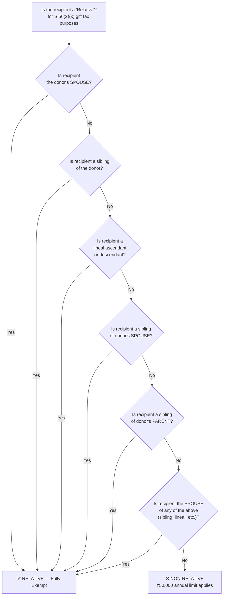
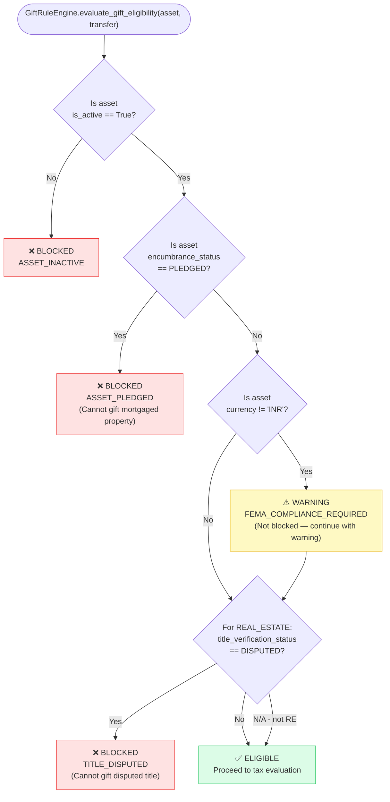
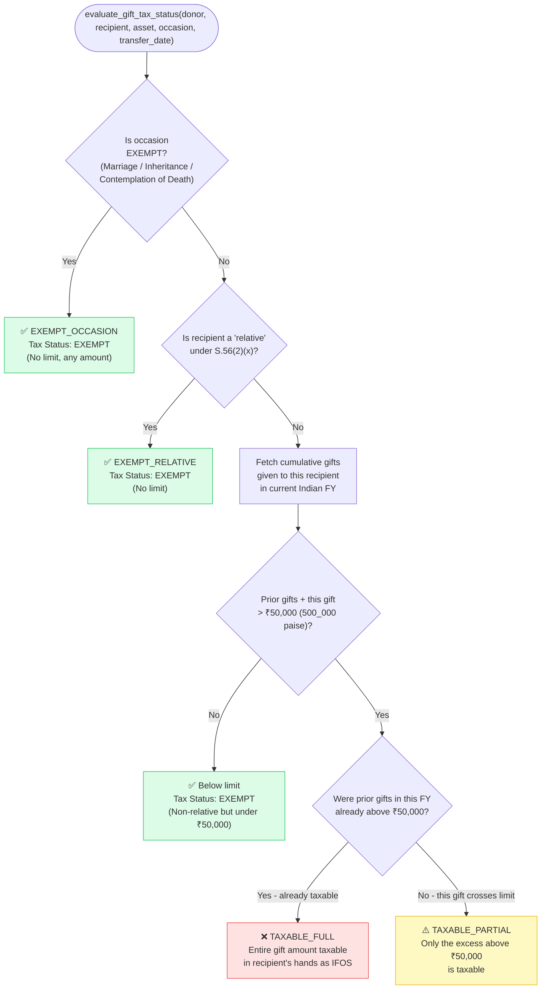
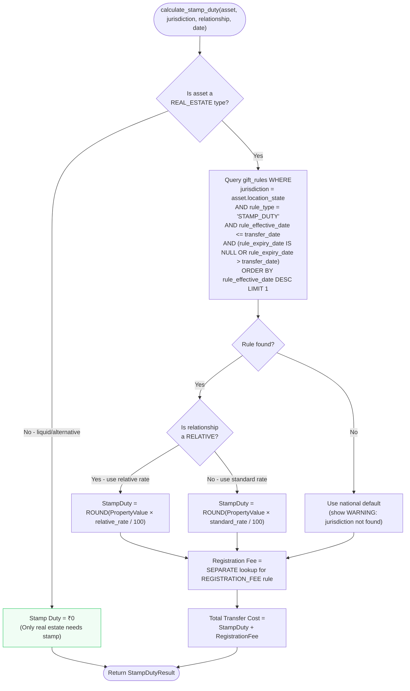

# Phase 4 — Object Design: Legal Rules Engine Design

> **OOSE Phase:** Object Design
> **Purpose:** Specifies the complete design of the `GiftRuleEngine` — the rule store, lookup algorithm, evaluation logic, version management, and the full gift eligibility decision tree. This is a critical legal compliance component; any changes require professional review.
> **Important:** This document is engineering documentation, not legal advice. Rules encoded here must be reviewed by a qualified CA or tax advocate before going live.
> **Status:** Draft — Professional legal review required before implementation

---

## 1. Why a Rules Engine?

Indian gift and succession tax law changes every Finance Act (annual Union Budget). The worst possible design is:

```python
# ❌ BAD — hardcoded, requires code deployment for every Finance Act
GIFT_EXEMPTION_LIMIT = 50_000_00  # paise — what if it changes?
def is_taxable_gift(amount_paise: int) -> bool:
    return amount_paise > GIFT_EXEMPTION_LIMIT
```

The right design:
- Rules live in the `gift_rules` database table
- A Finance Act change = a new database record with `rule_effective_date` and `rule_version`
- The engine queries the DB for the applicable rule on any given `transfer_date`
- No code deployment required for routine law changes
- Historical transfers are evaluated against the rules that were in force on their date

---

## 2. Gift Rule Table — Data Model

This table is referenced in Phase 3 (Database Schema). Reproduced here with full column semantics:

```sql
gift_rules table:
  rule_id                             UUID PRIMARY KEY
  jurisdiction                        TEXT NOT NULL
    -- 'INDIA' (central laws: Income Tax Act)
    -- 'MAHARASHTRA', 'KARNATAKA', 'DELHI', etc. (state laws: stamp duty)
  law_reference                       TEXT NOT NULL
    -- e.g., 'Section 56(2)(x) Income Tax Act 1961'
    -- e.g., 'Maharashtra Stamp Act Schedule I Article 25'
  rule_type                           TEXT NOT NULL
    -- 'GIFT_TAX'         -- determines taxability of the gift in recipient's hands
    -- 'STAMP_DUTY'       -- state-specific stamp duty on gift deed
    -- 'REGISTRATION_FEE' -- sub-registrar registration fee
    -- 'SUCCESSION'       -- default intestacy shares (HSA)
  relationship_category               TEXT
    -- 'RELATIVE'         -- rule applies to defined relatives
    -- 'NON_RELATIVE'     -- rule applies to non-relatives
    -- 'ANY'              -- rule applies regardless of relationship
    -- 'SPECIFIC_OCCASION'-- rule applies on specific occasions (e.g. marriage)
    -- NULL               -- not applicable for this rule_type
  annual_exemption_limit_minor_units  BIGINT
    -- For GIFT_TAX + NON_RELATIVE: ₹50,000 = 5_000_000 paise
    -- For GIFT_TAX + RELATIVE: NULL (fully exempt, no limit)
    -- For STAMP_DUTY: NULL (rate-based, not limit-based)
  stamp_duty_rate_pct                 FLOAT
    -- e.g., 2.0 for Maharashtra 2% stamp duty
    -- NULL for non-STAMP_DUTY rules
  registration_fee_rate_pct           FLOAT
    -- e.g., 1.0 for registration fee
    -- NULL for non-REGISTRATION_FEE rules
  rule_effective_date                 DATE NOT NULL
    -- Date from which this rule applies
  rule_expiry_date                    DATE
    -- NULL = currently in force. Set when rule is superseded.
  rule_version                        TEXT NOT NULL
    -- e.g., 'FA2023', 'FA2024', 'MAHARASHTRA-2022'
  professional_review_required        BOOLEAN NOT NULL DEFAULT FALSE
  notes                               TEXT
```

### Seed Data (Development) — Initial Rule Set

```sql
-- RULE 1: Central Gift Tax — Relative (no limit)
INSERT INTO gift_rules VALUES (
  gen_random_uuid(),
  'INDIA', 'Section 56(2)(x) Income Tax Act 1961 as amended by FA2023',
  'GIFT_TAX', 'RELATIVE', NULL, NULL, NULL,
  '2023-04-01', NULL, 'FA2023', FALSE,
  'Gifts from relatives are fully exempt from taxation in recipient hands regardless of amount.'
);

-- RULE 2: Central Gift Tax — Non-relative (₹50,000 annual limit)
INSERT INTO gift_rules VALUES (
  gen_random_uuid(),
  'INDIA', 'Section 56(2)(x) Income Tax Act 1961 as amended by FA2023',
  'GIFT_TAX', 'NON_RELATIVE', 5000000, NULL, NULL,
  '2023-04-01', NULL, 'FA2023', FALSE,
  'Gifts from non-relatives taxable if aggregate exceeds ₹50,000 in a financial year.'
);

-- RULE 3: Central Gift Tax — Specific Occasions (marriage, inheritance, etc.)
INSERT INTO gift_rules VALUES (
  gen_random_uuid(),
  'INDIA', 'Section 56(2)(x)(a)-(c) Income Tax Act 1961',
  'GIFT_TAX', 'SPECIFIC_OCCASION', NULL, NULL, NULL,
  '2023-04-01', NULL, 'FA2023', FALSE,
  'Gifts received on marriage, inheritance, or under contemplation of death are fully exempt regardless of amount or relationship.'
);

-- RULE 4: Maharashtra Stamp Duty — Blood Relative (discounted rate 2%)
INSERT INTO gift_rules VALUES (
  gen_random_uuid(),
  'MAHARASHTRA', 'Maharashtra Stamp Act Schedule I Article 25 (amended 2022)',
  'STAMP_DUTY', 'RELATIVE', NULL, 2.0, NULL,
  '2022-01-01', NULL, 'MAHARASHTRA-2022', TRUE,
  'Stamp duty at 2% for gift deed between family members (blood relatives + spouse). Circle rate or agreement value, whichever is higher.'
);

-- RULE 5: Maharashtra Stamp Duty — Non-relative (market rate 5%)
INSERT INTO gift_rules VALUES (
  gen_random_uuid(),
  'MAHARASHTRA', 'Maharashtra Stamp Act Schedule I Article 25',
  'STAMP_DUTY', 'NON_RELATIVE', NULL, 5.0, NULL,
  '2022-01-01', NULL, 'MAHARASHTRA-2022', TRUE,
  'Stamp duty at 5% for gift deed to non-relatives.'
);
```

---

## 3. "Relative" Definition Under Section 56(2)(x)

This is the legal definition that determines whether a gift is exempt from Income Tax. Engineering must encode this precisely.



**Encoding in `HouseholdMember.is_relative_for_gift_tax`:**

```python
# Complete relative set per S.56(2)(x):
SECTION_56_RELATIVES = {
    # Direct blood
    RelationshipEnum.SPOUSE,
    RelationshipEnum.CHILD,          # son or daughter
    RelationshipEnum.PARENT,         # father or mother
    RelationshipEnum.SIBLING,        # brother or sister
    RelationshipEnum.GRANDCHILD,     # lineal descendant
    RelationshipEnum.GRANDPARENT,    # lineal ascendant
    # Spousal relatives (included in "lineal ascendants/descendants of spouse")
    RelationshipEnum.IN_LAW,         # spouse's parents, spouse's siblings
}

# NOT in S.56(2)(x) relative definition:
# - Cousins
# - Aunts/Uncles (parent's siblings ARE in the list — see PARENT_SIBLING branch)
# - Nieces/Nephews
# - Friends

# Note: IN_LAW is a simplified catch-all in V1. The actual law is more granular
# (spouse's sibling, lineal ascendant/descendant of spouse and their spouses).
# professional_review_required = TRUE for IN_LAW cases.
```

---

## 4. Gift Eligibility Decision Tree



---

## 5. Gift Tax Evaluation Decision Tree

Once an asset is confirmed ELIGIBLE, the engine evaluates the tax consequence in the recipient's hands:



---

## 6. Stamp Duty Calculation

Stamp duty is a state subject — rates vary by state and property type. The engine looks up the rate from the `gift_rules` table for the relevant jurisdiction.



**PropertyValue for stamp duty** = `max(market_value, circle_rate_value)`. In V1, since we don't have circle rate data, we use `current_value_minor_units` as the base value. A WARNING is attached: "Stamp duty computed on declared value; consult a stamp duty expert for circle rate computation."

---

## 7. Rule Lookup Algorithm

```python
# backend/app/services/gift_rule_engine.py

class GiftRuleEngine(BaseCalculationEngine):
    """
    Evaluates Indian gift tax and stamp duty rules.
    All rule data fetched from DB — no hardcoded rates.
    """

    async def _get_applicable_rule(
        self,
        jurisdiction: str,
        rule_type: str,
        relationship_category: str,
        as_of_date: date,
        db: AsyncSession,
    ) -> GiftRule | None:
        """
        Rule lookup with fallback hierarchy:
        1. Exact jurisdiction + relationship match
        2. Jurisdiction + 'ANY' relationship match
        3. 'INDIA' (central law) + relationship match
        4. Return None (caller handles missing rule)
        """
        result = await db.execute(
            select(GiftRuleModel)
            .where(GiftRuleModel.jurisdiction == jurisdiction)
            .where(GiftRuleModel.rule_type == rule_type)
            .where(
                or_(
                    GiftRuleModel.relationship_category == relationship_category,
                    GiftRuleModel.relationship_category == "ANY",
                )
            )
            .where(GiftRuleModel.rule_effective_date <= as_of_date)
            .where(
                or_(
                    GiftRuleModel.rule_expiry_date.is_(None),
                    GiftRuleModel.rule_expiry_date > as_of_date,
                )
            )
            .order_by(
                GiftRuleModel.rule_effective_date.desc(),
                # Prefer exact relationship match over 'ANY'
                case(
                    (GiftRuleModel.relationship_category == relationship_category, 0),
                    else_=1,
                )
            )
            .limit(1)
        )
        row = result.scalar_one_or_none()
        return GiftRule.from_orm(row) if row else None
```

---

## 8. Annual Cumulative Gift Check

The ₹50,000 limit applies to the **aggregate** of all non-relative gifts received from the **same donor** in a single financial year.

```python
async def check_annual_gift_cumulative(
    self,
    donor_id: UUID,
    recipient_member_id: UUID,
    new_amount_minor_units: int,
    financial_year: IndianFinancialYear,
    db: AsyncSession,
) -> CumulativeGiftCheck:
    """
    Returns the running total and whether this new gift will cross the
    ₹50,000 non-relative exemption limit.
    """
    # Sum all prior gifts from this donor to this recipient in this FY
    existing_total = await db.execute(
        select(func.coalesce(func.sum(GiftTransferModel.cash_value_minor_units), 0))
        .where(GiftTransferModel.donor_user_id == donor_id)
        .where(GiftTransferModel.recipient_member_id == recipient_member_id)
        .where(GiftTransferModel.transfer_date >= financial_year.start)
        .where(GiftTransferModel.transfer_date <= financial_year.end)
        # Only count non-relative gifts (relative gifts don't have a limit)
        .where(GiftTransferModel.tax_treatment.notin_(
            ["EXEMPT_RELATIVE", "EXEMPT_OCCASION"]
        ))
    )
    prior_total = existing_total.scalar_one()

    LIMIT_PAISE = 5_000_000  # ₹50,000 in paise

    combined_total = prior_total + new_amount_minor_units
    crosses_limit = combined_total > LIMIT_PAISE

    return CumulativeGiftCheck(
        prior_gifts_this_fy_minor_units=prior_total,
        new_gift_minor_units=new_amount_minor_units,
        combined_total_minor_units=combined_total,
        annual_limit_minor_units=LIMIT_PAISE,
        crosses_limit=crosses_limit,
        excess_minor_units=max(0, combined_total - LIMIT_PAISE),
        already_above_limit=prior_total > LIMIT_PAISE,
    )
```

---

## 9. Cost Basis Carryover

When an asset is gifted, the recipient's **cost basis** for future capital gains purposes is NOT the fair market value at the time of gift — it is the **original acquisition cost** of the donor (carried over):

```python
async def evaluate_recipient_cost_basis(
    self,
    transfer: GiftTransfer,
) -> CostBasisResult:
    """
    For capital gains computation by the recipient on future sale:
    - Cost = donor's original purchase price (carryover)
    - Holding period = starts from donor's original purchase date
    - Exception: gifts on marriage / inheritance use market value at time of gift
      (professional review required for exact treatment)
    """
    asset = await self._asset_repo.get(transfer.asset_id)

    if transfer.gift_occasion in {
        GiftOccasionEnum.MARRIAGE,
        GiftOccasionEnum.INHERITANCE,
        GiftOccasionEnum.CONTEMPLATION_OF_DEATH,
    }:
        return CostBasisResult(
            cost_basis_minor_units=transfer.cash_value_minor_units,  # FMV at date of gift
            holding_period_start=transfer.transfer_date,             # Starts at gift date
            carryover_applied=False,
            professional_review_recommended=True,
            note="Exempt-occasion gifts: cost basis treatment requires professional review.",
        )

    # Standard non-occasion gift: carryover basis
    return CostBasisResult(
        cost_basis_minor_units=asset.purchase_price_minor_units,
        holding_period_start=asset.purchase_date,
        carryover_applied=True,
        professional_review_recommended=False,
        note=f"Original purchase price carried over. Holding period: {asset.purchase_date}.",
    )
```

---

## 10. Version Management and Finance Act Amendments

### How to add a new rule when the Finance Act changes

1. **Do NOT edit or delete existing rules** — they represent historical law
2. Set `rule_expiry_date` on the superseded rule to the day before the new rule takes effect
3. Insert a new `gift_rules` record with the new `rule_effective_date` and new `rule_version`
4. Historical gift transfers are automatically evaluated against the old rule (they used `transfer_date <= rule_expiry_date`)

```sql
-- Example: Finance Act 2025 raises non-relative limit to ₹1,00,000

-- Step 1: Expire the old rule
UPDATE gift_rules
SET rule_expiry_date = '2025-03-31'
WHERE rule_type = 'GIFT_TAX'
  AND jurisdiction = 'INDIA'
  AND relationship_category = 'NON_RELATIVE'
  AND rule_version = 'FA2023';

-- Step 2: Insert the new rule
INSERT INTO gift_rules VALUES (
  gen_random_uuid(),
  'INDIA', 'Section 56(2)(x) Income Tax Act 1961 as amended by FA2025',
  'GIFT_TAX', 'NON_RELATIVE', 10_000_000, NULL, NULL,
  '2025-04-01', NULL, 'FA2025', FALSE,
  'Limit raised to ₹1,00,000 from FY2025-26.'
);
```

No code is redeployed. Transfers on or after 2025-04-01 automatically pick up the new rule.

### Who can add rules?
Only Admin users (`is_admin = True`) via the admin panel. The `POST /admin/gift-rules` endpoint is guarded by `require_admin`. All rule insertions are audit-logged.

---

## 11. Legal Disclaimers in UI

Wherever gift tax results are displayed, the frontend MUST display the following disclaimer text (not configurable — always shown):

```
⚠️ This analysis is based on general provisions of the Income Tax Act, 1961 
and state-specific stamp duty regulations. It is indicative only and does not 
constitute legal or tax advice. Gift tax treatment may vary based on individual 
circumstances, the exact nature of the asset, and amendments to applicable law. 
Please consult a qualified Chartered Accountant or tax advocate before 
executing any gift transfer.
```

This text is rendered from a configuration constant — it is never hardcoded in the UI component itself so it can be updated without a deployment.

---

## 12. Open Questions (Require Professional Review)

These items are flagged with `professional_review_required = TRUE` in the rules table:

| # | Issue | Reason | Priority |
|---|---|---|---|
| 1 | Stamp duty for immovable property gifted in other states | We've only seeded Maharashtra rates | Medium |
| 2 | Joint ownership gift: if two co-owners gift 50% each to same person | Is it one transaction or two? Does the ₹50k limit apply per donor? | Low |
| 3 | Gift of unlisted equity | Fair market value determination for unlisted shares (Rule 11UA) is complex | High |
| 4 | Gift of crypto assets | Taxability under VDA rules (Section 115BBH) — different treatment | High |
| 5 | HUF gifts to member | Karta's authority to gift HUF property is restricted | Low |
| 6 | Cost basis for inherited assets | Section 49(1) cost in inheritor's hands — needs careful encoding | Medium |
| 7 | Stamp duty on gift of movable property | Most states: no stamp duty on gifting movable property (jewellery, shares, cash) | Low |

---

*← Previous: [03_Class_Interfaces.md](./03_Class_Interfaces.md)*

*Phase 4 complete. Next: Phase 5 — Implementation (Sprint Roadmap, Project Structure, Code Standards)*
