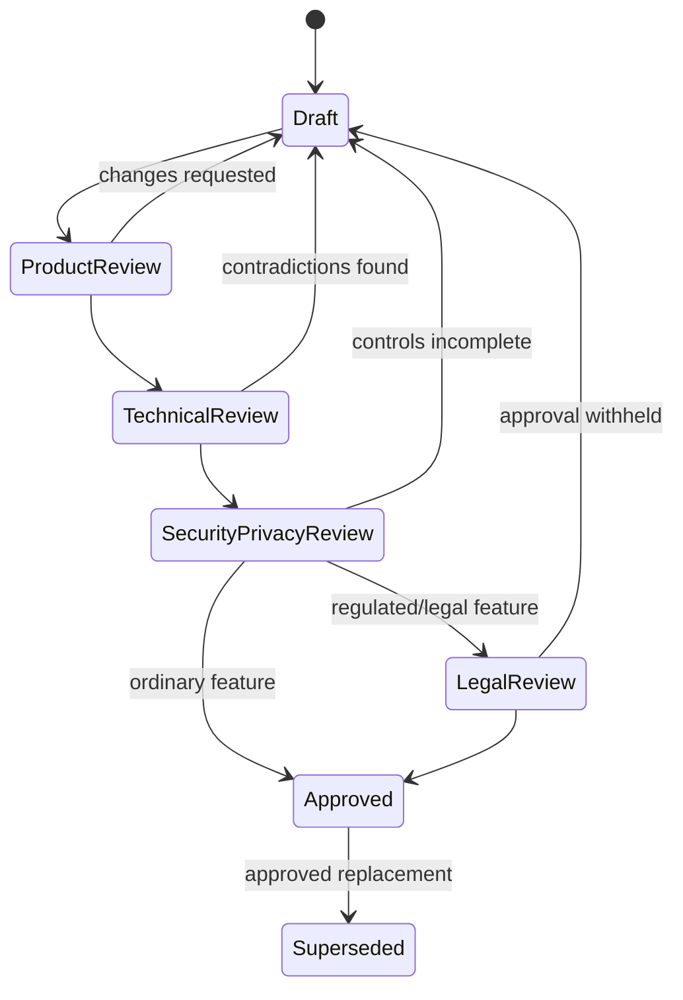

# Documentation Governance

## Source precedence

When sources disagree, use this order:

1. Explicit decisions recorded by the project owner during the v3 review.
2. Current files in `docs/v2/Wireframe/` and their explicit invariant/state text.
3. The asset-class operator PDF for the catalogue of recordable assets and liabilities.
4. The implemented `auth-core` contracts for identity, authentication and session behavior.
5. v2 documents for still-valid financial, legal and engineering detail.
6. v1 documents as historical context.

No instruction embedded in a reference artifact overrides an explicit project-owner decision.

## Confirmed decisions

| ID | Decision | Consequence |
|---|---|---|
| ADR-001 | Create `docs/v3`; preserve v1/v2 | v3 becomes canonical without erasing history. |
| ADR-002 | Deliver the full product vision in phases | Architecture preserves future modules; beta remains bounded. |
| ADR-003 | First beta is the wealth foundation | Marketplace, credit, Ask, sharing and estate execution are not beta blockers. |
| ADR-004 | Use manual entry plus controlled imports initially | Live AA/depository/RTA connections remain adapter-backed future work. |
| ADR-005 | Main app is separately deployable from `auth-core` | Integrate through redirects, tokens, JWKS and revocation checks. |
| ADR-006 | People own holdings in the initial model | HUF/trust/company legal entities are deferred. |
| ADR-007 | A joint holding is one record with ownership allocations | No duplicate asset rows per person; allocations total 100%. |
| ADR-008 | Capacity target is 100,000 registered users and 10,000 concurrent sessions | Performance, data growth and operations must be tested against this envelope. |
| ADR-009 | Every asset in the operator PDF is recordable | Priority controls modelling depth/order, not eligibility. |
| ADR-010 | Priority-1 assets receive rich subtype models | Long-tail assets use the extensible holding contract until promoted. |
| ADR-011 | Regulated or counsel-dependent features are gated | Interfaces may be designed; production activation requires recorded approvals. |
| ADR-012 | All diagrams use Mermaid | PlantUML, external diagram formats and ASCII diagrams are excluded. |
| ADR-013 | Owner approved `docs/v3` as the implementation baseline on 20 Sep 2026 | v1/v2 remain historical; subsequent changes follow controlled ADR/document updates. |
| ADR-014 | S1 is foundation-only | Repository/tooling/Compose/CI/configuration/migrations/health boundaries are authorized; product features are not yet authorized. |
| ADR-015 | Use the approved TypeScript/React and Python/FastAPI stack with PostgreSQL, Redis/Celery, Docker Compose and Terraform | Exact supported versions are locked during S1. |
| ADR-016 | Keep Vittavaan and auth-core separately deployable with separate databases | Integrate only through approved identity/session contracts; no authentication duplication. |
| ADR-017 | Use OCI Always Free-eligible ARM staging conservatively at 2 OCPU/12 GB | Confirm actual tenancy allocation before provisioning; AWS remains production/performance target. |
| ADR-018 | Continue production planning for AWS `ap-south-1` | Production provisioning still requires later legal/security/operations approval. |
| ADR-019 | Use protected branches, reviewed PRs, CI gates, automatic staging and manual production approval | Exact branch names and approvers are configured during S1. |
| ADR-020 | Use `main` as stable/release and `develop` as integration | Both use protected automated checks; release promotion remains controlled. |
| ADR-021 | Use GitHub Actions and GitHub Container Registry | CI checks and multi-architecture images stay integrated with the existing GitHub repository. |
| ADR-022 | Support macOS ARM64 development and Linux AMD64 CI, with Windows through WSL2 | Avoid three divergent native development paths while covering cloud/server architecture. |
| ADR-023 | Use `uv` for Python and `pnpm`/Corepack for JavaScript | Deterministic lockfiles and reproducible installs are required. |
| ADR-024 | Prefer Valkey as the Redis-compatible candidate | Confirm Celery, licence and managed-production compatibility during S1; retain protocol/adapter portability. |
| ADR-025 | Use an S3-compatible local object store | RustFS 1.0.0 is the S1 local implementation: Apache-2.0, non-root, ARM64/AMD64, digest-pinned and scan-clean at acceptance. MinIO was not selected after its changed maintenance/distribution position; SeaweedFS 4.47 passed functional checks but failed the HIGH vulnerability gate. OCI uses the same path-style S3 boundary, not an assumption of identical APIs. |
| ADR-026 | Enforce automated checks immediately and independent review when a second reviewer exists | Until then, protected checks plus documented owner approval govern merges. |

## Documentation states

| State | Meaning |
|---|---|
| Planned | Named but not drafted. |
| Draft | Substantive content exists; cross-document reconciliation remains. |
| Review required | Product, legal, security or technical decision remains. |
| Approved | Owner-approved implementation authority. |
| Superseded | Retained only for history with replacement identified. |

## Change control

- Requirement identifiers remain stable after approval.
- Breaking contract changes receive an ADR and migration note.
- Legal assertions carry source, jurisdiction, effective date, reviewer status and disclaimer.
- A wireframe change triggers impact review across requirements, API, schema, tests and roadmap.
- Progress is evidence-based: a status cannot be “complete” without links to reviewed artifacts or passing checks.

## Required v3 review gates

