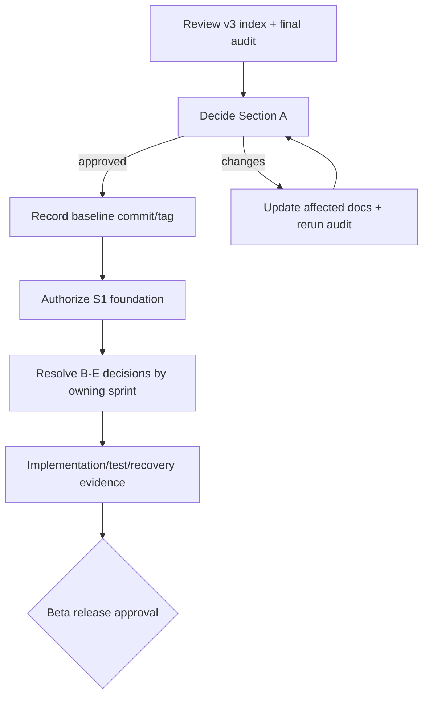

# Owner Review and Decision Checklist

## How to use this checklist

This is the decision gate between the documentation rebuild and implementation. A decision is complete only when the owner records the selected option, date, rationale and any conditions. `BLOCKS S1` means repository/platform scaffolding should not begin without it. Later-gate items do not block S1 but must be resolved before the named sprint/release gate.

Statuses: `OPEN`, `CONFIRMED`, `DEFERRED`, `EXTERNAL REVIEW`, `NOT APPLICABLE`.

## A. Baseline and S1 blockers

| ID | Decision | Recommended position | Status | Required record |
|---|---|---|---|---|
| DEC3-001 | Approve `docs/v3` as the implementation baseline; v1/v2 remain historical. | Approved; changes continue through versioned ADR/document updates. | CONFIRMED — 20 Sep 2026 | Owner approval in project conversation; commit/tag recorded when documentation is committed. |
| DEC3-002 | Confirm no application feature code starts before the S1 platform foundation. | S1 may create repository structure, tooling, Compose, CI and empty service boundaries only. | CONFIRMED — 20 Sep 2026 | Owner approved all seven Section A recommendations. |
| DEC3-003 | Confirm technology baseline. | React/TypeScript/Vite; Python 3.12/FastAPI/Pydantic/SQLAlchemy; PostgreSQL; Redis/Celery; Terraform; Docker Compose. Pin exact supported versions during S1. | CONFIRMED — 20 Sep 2026 | Stack approved; version locks remain an S1 implementation task. |
| DEC3-004 | Confirm repository strategy relative to `auth-core`. | Separate deployable repositories and databases; contract integration through issuer/JWKS/handoff; no shared database or copied auth code. | CONFIRMED — 20 Sep 2026 | Boundary approved; exact URLs/owners recorded during S1/S2 setup. |
| DEC3-005 | Confirm initial shared staging. | OCI Ampere A1 Always Free-eligible single VM, designed for 2 OCPU/12 GB; AWS remains production/performance target. | CONFIRMED — 20 Sep 2026 | Direction approved; tenancy/home-region console evidence still required before provisioning. |
| DEC3-006 | Confirm production region/provider direction. | AWS `ap-south-1` for production data/services, subject to legal/security review. | CONFIRMED — 20 Sep 2026 | Direction approved; no production spend/provisioning authorized yet. |
| DEC3-007 | Confirm branch/release governance. | Protected default/integration branches, reviewed PRs, CI gates, staging auto-deploy and protected production approval. | CONFIRMED — 20 Sep 2026 | Governance approved; exact branch names/approvers set in S1. |

## B. Decisions due before identity/household work (S2-S3)

| ID | Decision | Recommended position | Status | Due |
|---|---|---|---|---|
| DEC3-010 | Auth-core issuer, audience, JWKS and web/handoff URLs per environment. | Exact allow-listed values; no token in URL/local storage. | OPEN | Before S2 integration. |
| DEC3-011 | Auth verifier topology and revocation behavior. | Reuse auth-core-supported verifier contract; fail closed for protected financial operations. | OPEN | Before S2 design sign-off. |
| DEC3-012 | Workspace-to-household relationship. | No implicit mapping; auth workspace role never grants household financial access. | OPEN | Before S3. |
| DEC3-013 | Minor/guardian beta handling. | Record guardian relationship and dated review; no automatic majority authority transfer. | EXTERNAL REVIEW | Before S3 beta acceptance. |
| DEC3-014 | Database tenant isolation. | Shared PostgreSQL schema with mandatory scoped repositories plus RLS defense in depth initially; reassess higher isolation by risk/scale. | OPEN | Before first financial migrations. |
| DEC3-015 | Encryption/key provider and searchable-field threat model. | Managed KMS/Vault envelope encryption; exact-match blind indexes only after explicit necessity/security review. | OPEN | Before sensitive identity/financial fields. |

## C. Decisions due before catalogue, imports and ledger work (S4-S6)

| ID | Decision | Recommended position | Status | Due |
|---|---|---|---|---|
| DEC3-020 | Approve 93 asset and 13 liability seed codes and display groupings. | Approve stable machine codes; labels may be localized without code changes. | OPEN | Before S4 seed migration. |
| DEC3-021 | Approve P1/P2 form treatment. | P1 guided forms; P2 schema-driven forms; every subtype remains recordable. | OPEN | Before S4 UI contracts. |
| DEC3-022 | Subtype JSON maximum and promotion rule. | Start with a conservative bounded payload; promote authorization/money/query/reporting fields to typed columns. | OPEN | Before S4 physical DDL. |
| DEC3-023 | Valuation methods and staleness by subtype. | Approve a versioned policy catalogue; estimates remain clearly labelled and excluded from verified-only totals. | OPEN | Before S6 projections. |
| DEC3-024 | Controlled import formats for beta. | Begin with versioned Vittavaan CSV templates and one documented generic mapping flow; no live connectors. | OPEN | Before S5. |
| DEC3-025 | Connector consent basis and provider ceremony. | Implement generic consent lifecycle now; activate provider-specific collection only behind GATE-LEGAL-011. | EXTERNAL REVIEW | Before any live connector activation. |
| DEC3-026 | Liability contingent treatment. | Disclose separately and exclude from direct net debt until crystallized; preserve prior contingent history. | OPEN | Before S6. |

## D. Decisions due before documents, wealth, analysis and planning (S7-S10)

| ID | Decision | Recommended position | Status | Due |
|---|---|---|---|---|
| DEC3-030 | Document retention classes and legal holds. | Obtain record-class schedule; do not assume universal seven-year retention. | EXTERNAL REVIEW | Before S7 customer data. |
| DEC3-031 | Malware scanner/object adapter for staging and production. | Contract-based adapters; scanner failure keeps objects quarantined. | OPEN | Before S7. |
| DEC3-032 | Net-worth valuation-selection policy. | Latest policy-eligible non-superseded event at/before as-of, with method precedence, freshness and explicit gaps. | OPEN | Before S8 golden fixtures. |
| DEC3-033 | Benchmark provider/licence. | Leave benchmark unavailable unless GATE-LEGAL-012 is approved; do not use an unlicensed default. | EXTERNAL REVIEW | Before enabling benchmark display. |
| DEC3-034 | Golden calculation vectors and tolerances. | Owner/finance reviewer approves exact XIRR/TWRR/FX/rounding/debt examples. | OPEN | Before S8-S9 completion. |
| DEC3-035 | Initial calculator inventory. | Goal funding plus invest-versus-prepay only; additional legal/tax/suitability calculators remain gated. | OPEN | Before S10. |

## E. Privacy, reliability and release approvals

| ID | Decision | Recommended position | Status | Due |
|---|---|---|---|---|
| DEC3-040 | Production retention/privacy schedule. | Specialist-approved by record class, purpose, jurisdiction, legal hold and anonymization outcome. | EXTERNAL REVIEW | Before storing beta user data. |
| DEC3-041 | India residency and subprocessors. | Production financial data/objects/backups in India unless a documented legal/security exception is approved. | EXTERNAL REVIEW | Before production procurement. |
| DEC3-042 | Production RPO/RTO. | Approve RPO <=5 minutes and RTO <=60 minutes subject to restore/failover evidence. | OPEN | Before production architecture lock. |
| DEC3-043 | OCI staging recovery objectives. | RPO 24 hours outside deploys; RTO 4 staffed hours; monthly restore drill. | OPEN | Before staging acceptance. |
| DEC3-044 | Security/privacy assessment. | Threat-model review, SAST/SCA/container/IaC scans, IDOR tests and independent penetration test before beta. | OPEN | Before beta release. |
| DEC3-045 | Accessibility acceptance. | WCAG 2.2 AA automated/manual/assistive-technology evidence and accessible support path. | OPEN | Before beta release. |
| DEC3-046 | 100k/10k scale envelope acceptance. | Production-shaped load/soak/failure tests; OCI staging results are not accepted as proof. | OPEN | Before production launch. |

## F. Feature-gated legal/commercial decisions

The twelve entries in the Legal and Approval Register remain `EXTERNAL REVIEW` and disabled by default: advisers, Ask, credit, marketplace, escrow, gifts, succession/estate, tax packs, financial resume, live connectors, and benchmark/news/look-through data. Documentation or wireframe presence does not authorize implementation or activation.

## Owner review sequence

## Approval record

Section A was approved by the project owner on **20 Sep 2026** with the statement: **“I approve all seven recommendations.”**

Approval disposition:

- approved decisions: `DEC3-001` through `DEC3-007`, without exceptions;
- permitted next milestone: S1 Repository Foundation;
- permitted S1 work: repository structure, version/toolchain locks, Docker/local services, CI, configuration, health/telemetry foundations, migration framework and empty module boundaries;
- prohibited at this gate: product-feature implementation outside S1, production provisioning/spend, real-user data ingestion and activation of any gated capability;
- baseline commit/tag: to be recorded when the currently approved documentation changes are committed to the repository;
- next decision gate: Section B items before S2/S3, with database isolation/encryption resolved before sensitive financial migrations.

Future approval records must include:

- baseline commit/tag and repository;
- approved/deferred decision IDs with conditions;
- owner and date;
- permitted next milestone;
- explicitly prohibited work;
- next review date;
- links to any replacement decision/ADR.

The v3 baseline is owner-approved. Application implementation remains not started; S1 foundation is now authorized.

## G. S1 operational setup approval

The owner approved the recommended S1 setup on **20 Sep 2026**. Confirmed defaults are `main`/`develop`, GitHub Actions, GitHub Container Registry, macOS ARM64 plus Linux AMD64 CI and WSL2, `uv`, `pnpm`/Corepack, Valkey as the compatibility-review candidate, an S3-compatible local object store with MinIO subject to maintenance/licence review, and protected automated checks with independent human review when another reviewer becomes available.

This approval permits the foundation scaffold described in the S1 backlog. It does not permit production provisioning, real-user data or product features outside S1.
