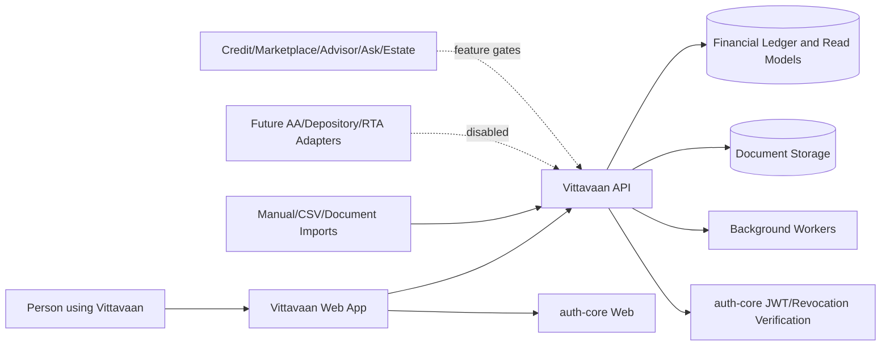
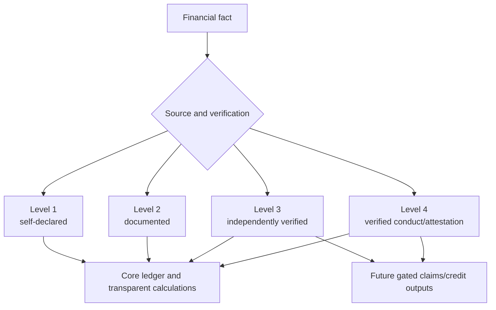

# Product Scope and Release Boundaries

## Goal

Give an Indian household an honest, attributable and explainable record of its wealth without pretending uncertain values are verified or crossing into execution/advice without approval.

## First customer beta

The beta includes:

- Redirect-based authentication through `auth-core` and local application-principal bootstrap.
- People, households, roles, explicit access and shared holding ownership allocations.
- Manual asset/liability entry and controlled CSV/document-assisted imports.
- Every operator-PDF asset and liability type as a selectable, recordable classification.
- Rich class-specific capture for priority-1 asset types.
- Holdings, valuations, transactions, income streams, liabilities and contingent obligations.
- Data room, document provenance, malware quarantine and access history.
- Net worth, verified share, trends, movement explanation, cash flow and liquidity.
- Performance, attribution, benchmarks where licensed, concentration and cost analysis.
- Goals, holding links, liquidity mismatches and transparent calculators.
- Settings, preferences, notification policy, export/closure coordination and auditability.

The beta does not include live trading, money movement, custody, automated recommendations, production financial connectors, lender submissions, marketplace transactions, advisor payments, AI Ask, gift execution or estate administration.

## System boundary

## Core actors

| Actor | Responsibility and authority |
|---|---|
| Authenticated principal | Identity proven by auth-core; may represent only themselves unless an application grant says otherwise. |
| Holding owner | Person with an economic ownership allocation; alone can commit or dispose of their share. |
| Household administrator | Maintains permitted records and imports but cannot commit another owner’s money. |
| Viewer | Reads only the scopes explicitly granted. |
| Dependant/minor | Person represented in the ledger; may have no login and may require a guardian. |
| Professional | Future advisor/CA/advocate/valuer operating within a specific verified engagement and grant. |
| System operator | Operates service health and approved workflows; has no routine right to view financial content. |
| Auth-core | External identity/session authority and issuer of revocable access tokens. |
| Import source | Manual file/document now; approved read-only connector later. |

## Capability separation

Documents may support Level 2, but uploading a document never automatically proves Level 3. Capability policies are enforced server-side.

## Scale and service objectives

- 100,000 registered users without schema redesign.
- 10,000 concurrent authenticated sessions at the agreed load-test mix.
- Up to 10,000 ledger events in a substantial portfolio before archival optimizations are required.
- Dashboard read-model API p95 under 500 ms when projections are current.
- Standard read API p95 under 300 ms and ordinary financial write p95 under 750 ms, excluding asynchronous projections/uploads.
- Material projections updated within 30 seconds under normal conditions.
- Production availability objective: 99.9% monthly, subject to an approved error budget.
- Production financial data and backups reside in India unless a documented legal/security decision permits otherwise.

## Feature-gate contract

A gated capability defaults off and requires all of the following before real-user activation:

1. Named product owner approval.
2. Required legal/regulatory opinion recorded.
3. Security and privacy threat-model approval.
4. Contracted and tested external provider where applicable.
5. Operational runbook, monitoring and support ownership.
6. Passing functional, security, accessibility and performance acceptance evidence.
7. Environment-specific activation recorded in the audit log.

