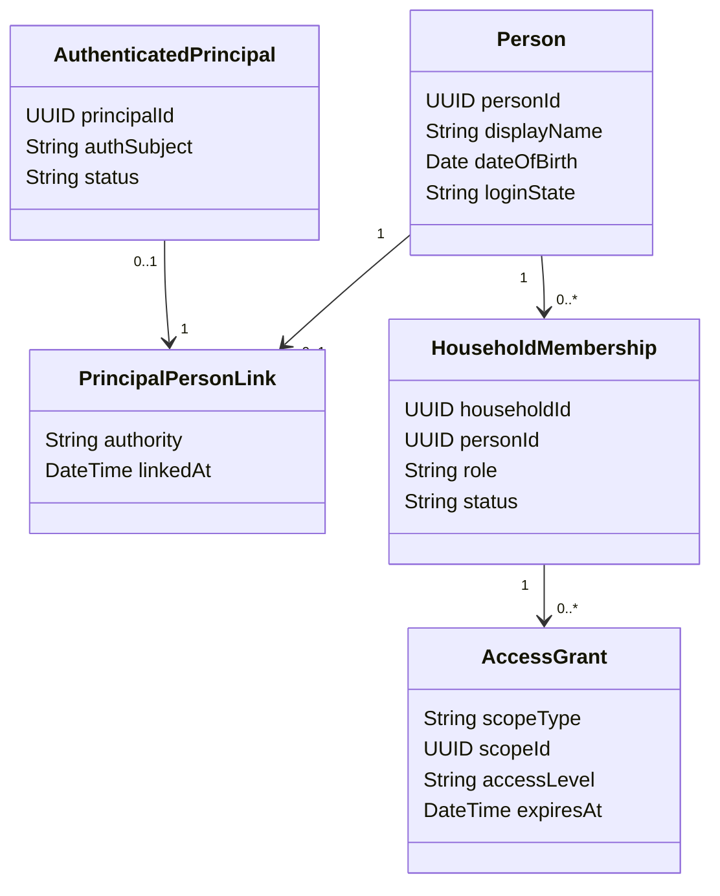
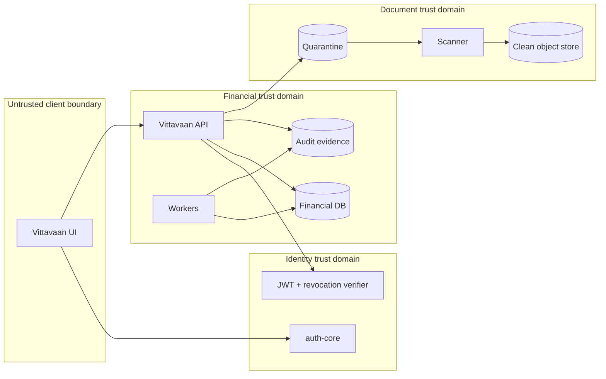

# Actors and System Boundary

## Actor model

Authentication, personhood, ownership and authority are separate concepts:

- An **authenticated principal** is an identity proven by auth-core.
- A **person** is someone represented in the wealth ledger and may have no login.
- An **owner** has an economic allocation in a holding.
- A **household role** controls permitted administration or viewing within an explicitly granted scope.
- A **professional role** is valid only within a verified, purpose-bound engagement.

## Human actors

### Self-service owner

Maintains their own records, imports data, uploads documents, grants access and authorizes actions affecting their ownership. Authentication never substitutes for ownership verification.

### Household administrator

Maintains facts within granted scopes, resolves imports and manages household organization. Cannot sell, gift, pledge, list or otherwise commit another owner’s holding; cannot access a private will or similarly restricted record solely because they are an administrator.

### Viewer

Reads only explicitly granted totals, holdings, documents or other fields until expiry/revocation. The API filters the response; the client never receives prohibited fields.

### Dependant or minor

May exist without a login. A guardian can administer permitted records, but turning 18 creates a review workflow rather than automatically transferring access or legal control.

### Professional

Future CA, advocate, valuer or registered advisor. Credentials, purpose, engagement, scope and expiry are independently verified. Professional status does not grant portfolio access.

### Platform operator

Operates infrastructure and bounded support workflows. Routine financial-content access is prohibited. Exceptional access requires a documented, time-limited, audited mechanism and approved role.

## System actors

| Actor | In-scope interaction | Trust rule |
|---|---|---|
| auth-core | Authentication, MFA, sessions, JWT/JWKS, revocation and identity lifecycle | Vittavaan verifies every request and does not share databases. |
| Object storage | Encrypted document bytes and time-limited access | Object key alone never authorizes download. |
| Malware scanner | Asynchronous inspection of quarantined uploads | Scanner result is untrusted input until authenticated and correlated. |
| Notification provider | Delivery of approved, minimal-content messages | Financial amounts/documents are excluded from provider payloads by default. |
| Import file | User-provided CSV/document data | Parsed into staging; never writes directly to the ledger. |
| Future connector | Read-only balances/positions/transactions/documents | Disabled until vendor, consent, reconciliation and operations gates pass. |
| Benchmark/news source | Licensed external reference data | Source and licence determine permitted display and retention. |

## Trust boundaries

## Actor-to-beta-use-case matrix

| Use case family | Owner | Administrator | Viewer | Dependant/minor | Operator | auth-core |
|---|---:|---:|---:|---:|---:|---:|
| Authenticate/bootstrap | ✓ | ✓ | ✓ | if login | bounded support | authority |
| Create household/person | ✓ | granted | — | — | — | — |
| Configure ownership | ✓ | draft/maintain | — | represented | — | — |
| Add/import financial facts | ✓ | granted | — | represented | — | — |
| Resolve reconciliation | ✓ | granted | — | — | — | — |
| View wealth/analysis/planning | ✓ | granted | granted subset | granted subset | — | identity only |
| Upload/read documents | ✓ | granted | granted subset | granted subset | malware ops only | identity only |
| Grant/revoke access | ✓ | only if delegated | — | guardian rules | — | identity only |
| Export/close account | self | self only | self only | guardian/legal workflow | governed support | coordinates identity |

## Out-of-boundary actions

The beta does not accept trade orders, move money, operate escrow, file tax returns, value unpriced assets, execute legal documents, submit credit applications or generate investment recommendations.

