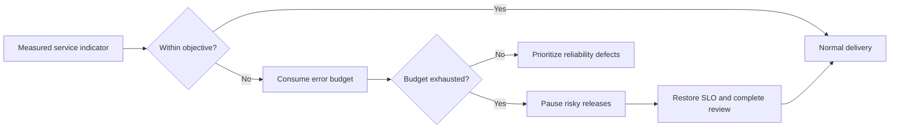

# Non-Functional Requirements and Service-Level Objectives

## Measurement conventions

- **p95/p99:** 95th/99th percentile measured over rolling five-minute windows and reported over 30 days.
- **Normal load:** the approved production workload model, including realistic payload sizes and background activity.
- **Availability:** successful eligible requests divided by eligible requests; client validation errors and approved maintenance are excluded.
- Each production SLO must have an owner, dashboard, alert, runbook and error budget.

## Performance and freshness

| ID | Requirement / SLO |
|---|---|
| NFR3-PERF-001 | Dashboard read-model API latency shall be p95 ≤500 ms and p99 ≤1,200 ms when projections are current. |
| NFR3-PERF-002 | Ordinary detail/list reads shall be p95 ≤300 ms and p99 ≤800 ms for bounded pages. |
| NFR3-PERF-003 | Ordinary financial writes shall acknowledge success/failure at p95 ≤750 ms, excluding uploads and asynchronous projection work. |
| NFR3-PERF-004 | Paginated endpoints shall use opaque cursors, default ≤50 and maximum ≤200 records; unbounded collections are prohibited. |
| NFR3-PERF-005 | Material wealth projections shall become current within 30 seconds for 99% of accepted events under normal load. |
| NFR3-PERF-006 | Interactive web routes shall target Largest Contentful Paint ≤2.5 s and Interaction to Next Paint ≤200 ms at p75 on the supported desktop profile. |
| NFR3-PERF-007 | Import progress shall update at least every 10 seconds while work is active; large jobs must be resumable or safely restartable. |

## Capacity and scalability

| ID | Requirement |
|---|---|
| NFR3-SCALE-001 | The architecture shall support 100,000 registered users and 10,000 concurrent authenticated sessions without schema redesign. |
| NFR3-SCALE-002 | A substantial portfolio with 10,000 ledger events and 1,000 active holdings shall meet read SLOs through projections/caching. |
| NFR3-SCALE-003 | API and worker processes shall be horizontally scalable and hold no correctness-critical local state. |
| NFR3-SCALE-004 | Job queues shall provide bounded concurrency, backpressure, retry budgets and dead-letter handling. |
| NFR3-SCALE-005 | High-growth append-only tables shall have documented index, retention/archive and partition thresholds based on measured size/query cost. |
| NFR3-SCALE-006 | A load model shall cover dashboard reads, holding lists, writes, imports, projections, document access and auth verification—not only synthetic health traffic. |

## Availability, resilience and recovery

| ID | Requirement / SLO |
|---|---|
| NFR3-REL-001 | Production availability objective shall be 99.9% monthly for eligible application API requests. |
| NFR3-REL-002 | No single application instance failure shall lose an accepted financial write. |
| NFR3-REL-003 | Cross-service and background operations shall be idempotent and safe under at-least-once delivery. |
| NFR3-REL-004 | External dependencies shall use bounded timeouts, circuit breakers and explicit degraded behavior. |
| NFR3-REL-005 | Revocation verification failure shall fail closed for protected operations. Document storage failure shall not prevent ledger reads. |
| NFR3-REL-006 | Initial production targets are RPO ≤5 minutes and RTO ≤60 minutes; both require restore-drill evidence before launch. |
| NFR3-REL-007 | Point-in-time database recovery and versioned object recovery shall be enabled; restoration shall be exercised at least quarterly. |
| NFR3-REL-008 | Releases shall support automated health validation and rollback/forward recovery without destructive database reversal. |

## Security

| ID | Requirement |
|---|---|
| NFR3-SEC-001 | All external traffic shall use TLS 1.2+; production services shall prefer TLS 1.3 where supported. |
| NFR3-SEC-002 | Data at rest, backups and object storage shall use approved encryption and managed key rotation. |
| NFR3-SEC-003 | Authorization shall be server-side, deny-by-default and tested for cross-person, cross-household and cross-document IDOR. |
| NFR3-SEC-004 | Auth-core tokens shall be validated for algorithm, key, issuer, audience, subject, token ID, time and revocation. |
| NFR3-SEC-005 | Browser refresh credentials shall remain HttpOnly; access tokens shall never be stored in local storage or placed in URLs. |
| NFR3-SEC-006 | State-changing cookie-authenticated operations shall enforce CSRF protection; all input shall receive server-side schema and business validation. |
| NFR3-SEC-007 | Secrets shall come from environment-specific secret management and never appear in source, images, logs or client bundles. |
| NFR3-SEC-008 | Uploads shall be size/type bounded, checksummed, quarantined and malware-scanned before download availability. |
| NFR3-SEC-009 | Sensitive operations shall be rate-limited by safe combinations of principal, route and network signal without creating account-enumeration leaks. |
| NFR3-SEC-010 | CI shall run secret scanning, SAST and dependency/container vulnerability checks; unresolved critical production findings block release. |
| NFR3-SEC-011 | Production launch requires independent penetration testing and closure or accepted risk for high/critical findings. |

## Privacy, data governance and residency

| ID | Requirement |
|---|---|
| NFR3-PRIV-001 | Production financial data, primary databases, objects and backups shall reside in India unless an approved legal/security decision states otherwise. |
| NFR3-PRIV-002 | Collection and processing shall be purpose-bound and data-minimized; optional analytics/commercial consent shall be separate and revocable. |
| NFR3-PRIV-003 | Access grants and consents shall be explicit, scoped, expiring, revocable and immutably evidenced. |
| NFR3-PRIV-004 | Exports shall be machine-readable, complete for Vittavaan-owned data and delivered through authenticated expiring access. |
| NFR3-PRIV-005 | Closure shall revoke access promptly and apply approved retention, legal hold and irreversible anonymization rules. |
| NFR3-PRIV-006 | Non-production environments shall use synthetic or approved masked data; production copies are prohibited by default. |
| NFR3-PRIV-007 | Logs, analytics, traces and notification payloads shall exclude tokens, document content, full identifiers and unnecessary financial values. |
| NFR3-PRIV-008 | Retention shall be configurable by data class and legal basis rather than one blanket period. |

## Financial correctness and explainability

| ID | Requirement |
|---|---|
| NFR3-FIN-001 | Money shall use integer minor units with ISO currency; binary floating point is prohibited for money, rates and ownership calculations. |
| NFR3-FIN-002 | Every displayed financial result shall carry scope, as-of, calculation version, completeness and source/verification provenance. |
| NFR3-FIN-003 | Calculation engines shall be deterministic for identical versioned inputs and expose named failure reasons rather than fabricated results. |
| NFR3-FIN-004 | Aggregates shall reconcile to source components within explicitly documented rounding rules. |
| NFR3-FIN-005 | Historical calculations shall remain reproducible using versioned facts, policies, FX/benchmark inputs and engine version. |
| NFR3-FIN-006 | Corrections shall preserve the original fact and a traceable supersession/reversal chain. |

## Accessibility and user experience

| ID | Requirement |
|---|---|
| NFR3-UX-001 | Beta shall conform to WCAG 2.2 AA for supported web routes. |
| NFR3-UX-002 | All interactive elements shall be keyboard operable with visible focus and logical order. |
| NFR3-UX-003 | Colour shall never be the only carrier of financial status; charts require accessible summaries/tables. |
| NFR3-UX-004 | Supported desktop browsers are the latest two major versions of Chrome, Edge, Firefox and Safari. |
| NFR3-UX-005 | The desktop-first interface shall remain usable without horizontal page scrolling at 1024 CSS pixels; data grids may use documented contained scrolling. |
| NFR3-UX-006 | Indian currency formatting and unambiguous `DD MMM YYYY` dates shall be consistent; underlying APIs remain locale-neutral. |
| NFR3-UX-007 | Empty, partial, stale, failed, unauthorized and insufficient-data states shall explain impact and the next safe action. |
| NFR3-UX-008 | Reduced motion and user-selected text scaling shall not remove information or prevent task completion. |

## Maintainability and contract quality

| ID | Requirement |
|---|---|
| NFR3-MAINT-001 | Domain, application, infrastructure and interface concerns shall have enforced dependency boundaries. |
| NFR3-MAINT-002 | OpenAPI shall be the HTTP contract source; generated clients and contract tests shall detect drift. |
| NFR3-MAINT-003 | Database changes shall use reviewed migrations; production manual schema edits are prohibited. |
| NFR3-MAINT-004 | Python and TypeScript shall use strict static checks with documented, narrow suppressions. |
| NFR3-MAINT-005 | Calculation/domain unit coverage shall be ≥90%; overall backend ≥80%; frontend critical-flow coverage is supplemented by E2E rather than a misleading line-only target. |
| NFR3-MAINT-006 | Architecture decisions, requirements, use cases and tests shall retain stable traceability IDs. |
| NFR3-MAINT-007 | Feature flags shall have owner, purpose, default, environment state and removal/review date. |

## Observability and operations

| ID | Requirement |
|---|---|
| NFR3-OPS-001 | Requests/jobs shall propagate correlation and causation IDs across API, outbox, workers and audit evidence. |
| NFR3-OPS-002 | Metrics shall cover latency, errors, saturation, queue age, projection lag, auth-verification failures, imports and document scanning. |
| NFR3-OPS-003 | Alerts shall be actionable, severity-classified, routed to an owner and linked to a tested runbook. |
| NFR3-OPS-004 | Deployments shall be automated through CI/CD; production requires protected-environment approval. |
| NFR3-OPS-005 | Infrastructure and environment configuration shall be reproducible and reviewed; configuration drift shall be detected. |
| NFR3-OPS-006 | Audit and application logs shall use synchronized UTC timestamps while user-facing views render the selected locale/time zone. |

## SLO acceptance and error budget

