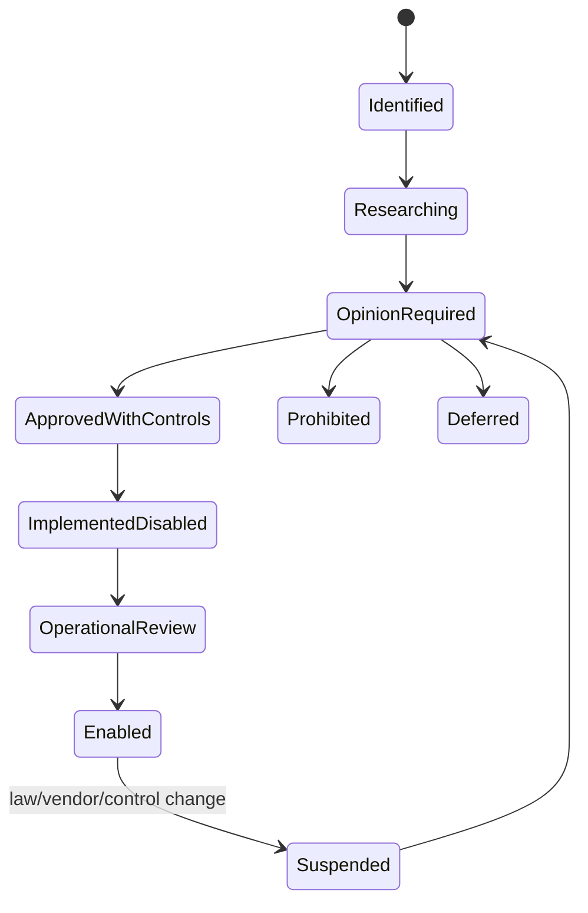

# Legal, Regulatory and External Approval Register

## Purpose

This register prevents an attractive wireframe or draft legal rule from being mistaken for approval to operate. It is a delivery control, not legal advice. Every item requires a named owner, evidence link, decision date, jurisdiction/scope and review date before activation.

## Gate states

## Product gates

| Gate ID | Capability | Required evidence before enablement | Default |
|---|---|---|---|
| GATE-LEGAL-001 | Advisor discovery, matching, engagement, payment and ratings | SEBI counsel opinion; credential-verification process; conflicts/commercial-disclosure policy; engagement and rating eligibility rules. | Disabled |
| GATE-LEGAL-002 | Ledger-grounded Ask | Advice-boundary opinion; allowed/refused question taxonomy; source licence; model-risk evaluation; professional escalation language. | Disabled |
| GATE-LEGAL-003 | Blind credit auction/lender bids | RBI/lending-intermediation opinion; regulated-lender diligence; consent/PII release; bureau/data contracts; complaints and deletion duties. | Disabled |
| GATE-LEGAL-004 | Marketplace listings and completion fee | Marketplace/intermediary classification; seller/buyer terms; diligence representations; tax/invoicing; complaints and dispute policy. | Disabled |
| GATE-LEGAL-005 | Escrow/payment integration | RBI/payment-aggregator and escrow structure opinion; licensed provider contract; no-custody controls; reconciliation, refund and dispute runbooks. | Disabled |
| GATE-LEGAL-006 | Gift tax/stamp-duty calculations | CA/advocate-reviewed jurisdictional rules, sources, effective dates, versioning, disclaimers and exception workflow. | Disabled |
| GATE-LEGAL-007 | Will coverage/succession defaults | Personal-law and jurisdiction counsel; confidentiality/authority model; no-document-generation boundary; professional referral process. | Disabled |
| GATE-LEGAL-008 | Death and estate administration | Death verification, executor authority, freeze/notification rules, tax apportionment, claims and retention reviewed by counsel. | Disabled |
| GATE-LEGAL-009 | Tax/FY packs | CA review of content, classification, disclaimers, source evidence and information-vs-filing boundary. | Disabled |
| GATE-LEGAL-010 | Financial resume/external claims | Privacy review; claim-band and anti-reidentification policy; recipient binding; expiry/revocation; attestation liability. | Disabled |
| GATE-LEGAL-011 | Live financial connectors | Provider contracts, AA/DP/RTA terms, consent artefacts, permitted storage/use, reconciliation, outage and deletion controls. | Disabled |
| GATE-LEGAL-012 | Benchmark/news/look-through data | Licence permits intended display, caching, transformation, retention and derived calculations. | Disabled unless approved source configured |

## Cross-cutting legal/privacy reviews

| Topic | Decision required |
|---|---|
| DPDP applicability and roles | Confirm data fiduciary/processor relationships, notice/consent, rights, grievance and breach duties. |
| Retention | Approve a record-class schedule; do not assume all financial data requires seven years. |
| Data residency/transfers | Confirm India-region production policy and controls for any foreign subprocessors. |
| Minors | Approve guardian authority, consent, majority transition and restricted processing. |
| Joint ownership | Approve authority language and dispute treatment; economic allocation is not proof of legal title. |
| Verification labels | Review wording so “verified” does not imply guarantee, valuation or authenticity beyond performed checks. |
| Accessibility evidence | Confirm support process for users who cannot complete standard digital flows. |
| Incident/breach response | Define reporting thresholds, timelines, roles, evidence preservation and communications. |

## Operator PDF interpretation

The regulator, licence, time, cost and existing-platform columns are research notes. Recording a user’s asset ordinarily differs from distributing, advising, arranging, trading, lending, valuing or holding that asset. Each future business activity must be analysed by actual conduct and commercial model; the PDF does not settle the answer.

## Approval record template

Each completed gate must record:

- Gate ID and precise feature/flow/environment.
- Reviewer name, qualification and organization.
- Written opinion/contract/control evidence location.
- Jurisdictions and user segments covered.
- Assumptions, prohibited behavior and required disclosures.
- Product, security, privacy and operations control owners.
- Approval/effective/review-expiry dates.
- Feature-flag key and activation audit reference.
- Suspension trigger and rollback/disable procedure.

