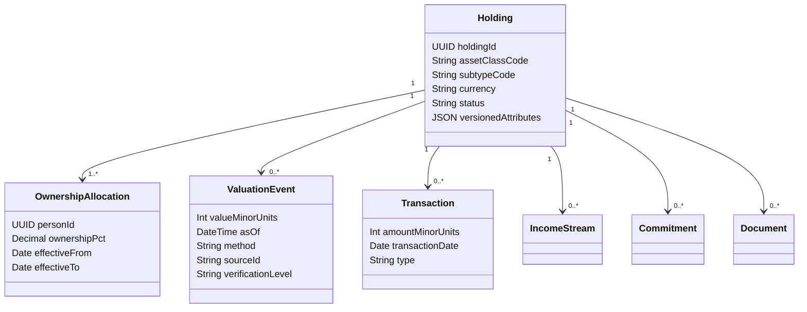

# Asset and Liability Coverage Catalogue

## Interpretation of the operator PDF

The PDF is a catalogue of assets and liabilities a user may own or owe. It is not a commitment that Vittavaan sells, brokers, recommends, values, executes or custodies them. Every listed type must be recordable. Priority controls implementation order and richness, not eligibility.

## Universal holding contract

Every holding supports:

- Stable holding ID and classification code.
- One or more person ownership allocations totaling exactly 100%.
- Name/description, currency, quantity/unit where meaningful and acquisition facts.
- Append-only valuation events with method, amount, as-of time, source, confidence and verification.
- Cost-basis lots where applicable; never substitute current value for tax cost.
- Liquidity class, exit window, restrictions, pledge/collateral and exit-cost note.
- Linked transactions, income streams, commitments, goals, liabilities and documents.
- Import/source identity, reconciliation status and complete audit provenance.
- Extensible versioned attributes validated by asset-subtype schema.

## Priority-1 rich models

| Class | Included subtypes | Required class-specific capability |
|---|---|---|
| Equities | Publicly traded companies, government/municipal exposure where represented as securities | ISIN/symbol/exchange, units/lots, corporate actions, dividends, pledge, price source, market/sector/issuer exposure and performance facts. |
| Cash and equivalents | Savings, FD, RD, loan/OD-linked accounts, credit-card positive balances, lockers, T-bills, CDs, money-market funds | Institution/account mask, balance, rate, maturity, break penalty, lien/sweep, accessibility and interest stream. Lockers are containers/documents, not automatically valued assets. |
| Mutual funds | Direct/regular schemes and money-market schemes | Scheme/folio, ISIN/code, units, NAV source/date, expense ratio, exit load, lock-in, category, fund manager/AUM where sourced and look-through snapshot. |
| P2P lending | Platform loans/notes | Borrower/platform pseudonymous reference, principal outstanding, rate, schedule, delinquency/NPA state, recoveries, default status and IRR cash flows. |
| Small savings and pensions | EPF, PPF, NPS, SSY, SCSS, post-office products, APY, gratuity, annuities | Scheme rules/version, employer/employee components, maturity/lock-in, withdrawal eligibility, nominee, pension/annuity stream and guardian transition. |
| Private investments | VC, growth/buyout, distressed debt, PMS, AIF, syndicates, convertible notes, ESOPs/vested options | Commitment/drawdown, distributions, units, strike/vest/cliff/exercise cost, last funding/NAV event, dilution, MOIC/TVPI/DPI, liquidity window and rights documents. |
| Real estate | Direct property, land/agriculture where represented here, REIT/fractional, parking/storage | Address/geography, title/registration, area/unit, ownership, use/occupancy, lease/income, circle rate/appraisal/comparable events, encumbrance, linked debt/LTV, RERA where relevant and mutation. |
| Collectibles and luxury | Art, vehicles where collectible, wine, coins, jewellery and other collections | Provenance, item/collection inventory, appraisal/appraiser, authenticity checks, insurance, storage, holding cost, sealed/not-inspected items and resale evidence. |
| Crypto and digital assets | Bitcoin, Ethereum, NFTs, tokenized assets | Asset/network, wallet/exchange reference, quantity, cost lots, price source, custody type, FIU venue flag where known and on-chain transaction references without exposing secrets. |
| Trust holdings | Trustee-managed interests | Trust/reference, jurisdiction, trustee, beneficial-interest description, statement value, restrictions and documents; legal-entity ownership itself is deferred. |
| Receivables/contracts | Earnouts and profit shares | Counterparty, contract, face/expected amount, due/contingent dates, status, received cash flows, assignability and impairment note. |
| Insurance-linked securities | CAT/reinsurance securities | Issuer/vehicle, peril/event, principal at risk, coupon, maturity, trigger and valuation statement. |
| Royalties and rights | Music, patents, trademarks and similar contractual rights | Right type, payer/licensee, territory, term, assignability, receipt history, royalty basis and supporting contract. |
| Agriculture and farmland | Timberland, agribusiness, livestock, farm land | Survey/parcel, acreage, usable/waste area, crop/livestock inventory, tenancy, yield/lease income, water/access/title and seasonal facts. |
| Franchises | Owned/licensed business franchise | Agreement term, territory, transfer rights, fees/royalty payable, unit economics, renewal and operator. |
| GST input credit | Eligible/claimed/disputed credit | GSTIN reference, tax period, source filing, eligible/claimed/utilized/disputed amounts and status; never counted as liquid cash without policy. |
| Vehicles | Bikes, cars, aircraft, yachts/private jets and fractional interests | Registration/identifier, make/model/year, ownership share, financing, insured/appraised value, operating/storage cost and usage restrictions. |

## Extensible long-tail models

The following are recordable from beta through the universal holding contract and versioned subtype attributes. They graduate to rich models when real-user requirements and validation rules are approved:

- Fixed income beyond simple bonds/deposits: government, municipal and corporate bonds; debentures; commercial paper; mortgage/working-capital/trade-finance credit; direct and mezzanine lending; microfinance.
- Hedge funds and long-short, macro, arbitrage or distressed strategies.
- Commodities, futures and physical precious metals not modelled as collectibles.
- Infrastructure projects including toll roads, airports, pipelines, PPPs and energy.
- Derivatives: equity/index, commodity, currency, spot/forward/swap and convertible instruments. Notional exposure never enters net worth as market value.
- Litigation finance and SPAC interests.
- Carbon credits and emissions instruments.
- Shipping containers, vessels and cargo interests.
- Sports teams and athlete contracts.
- Film, television, concert and entertainment rights.
- Domain names and digital real estate.
- Space investments.
- Data, AI-model, data-centre, AI-compute and quantum-compute interests.
- Biotech royalties, drug-development and genetic-data interests.
- Offshore holdings, with mandatory currency, FX as-of, jurisdiction and reporting-obligation flags.

## Liability catalogue

| Class | Required subtype facts |
|---|---|
| Home loan/mortgage | Property link, principal/outstanding, EMI, rate/benchmark/reset, tenure, lender, schedule, start/end and security. |
| Personal loan | Secured/unsecured, disbursal, lender, outstanding, rate, EMI, tenure and payment history. |
| Vehicle loan | Vehicle link, registration, outstanding, rate, EMI, lender and security. |
| Education loan | Student, institution/course, co-borrower, moratorium, rate, total interest and schedule. |
| Credit-card debt | Issuer/account mask, statement due, billing/due dates, limit, utilization, rate/fees and payment status. |
| OD/CC limit | Sanctioned limit, utilized balance, availability, rate, lender, renewal/end date and end use. |
| BNPL | Provider, purchase/plan, outstanding amount, instalment cycle, fees/rate and default state. |
| Business/MSME loan | Business reference, secured/unsecured, turnover/GST reference where consented, outstanding and schedule. |
| Gold loan | Gold/collateral reference, weight, assessed value, LTV, amount, rate, lender and tenure. |
| Loan against securities | Pledged holding links, margin/LTV, drawing, rate, lender, margin-call policy and outstanding. |
| GST/tax dues | Authority, tax type/period, PAN/GSTIN token reference, due amount/date, interest/penalty and dispute status. |
| Co-signed/guaranteed obligation | Primary borrower, role, contingent exposure, trigger, outstanding and repayment status. Shown separately unless crystallized. |
| Legal/court-linked debt | Court/authority, case reference, payee, ordered amount, due dates and compliance/dispute state. |

## Land-development worksheet

Page 2 is treated as an illustrative scenario, not a universal valuation formula. The real-estate model must be able to represent total area, developed/waste/usable/saleable area, unit conversions, cost, expected price per unit, attributable share and dated scenario assumptions. Projected sale values never replace an independently supported current valuation.

## Explicit exclusions

- Regulator/licence, time-frame, cost and competitor columns are research context, not confirmed legal conclusions.
- Vittavaan does not infer a market price for an illiquid asset merely because the user chose a subtype.
- A user-entered estimate is displayed as an estimate and excluded from verified-only totals.
- Generic custom attributes cannot bypass server-side money, ownership, access, provenance or audit invariants.

