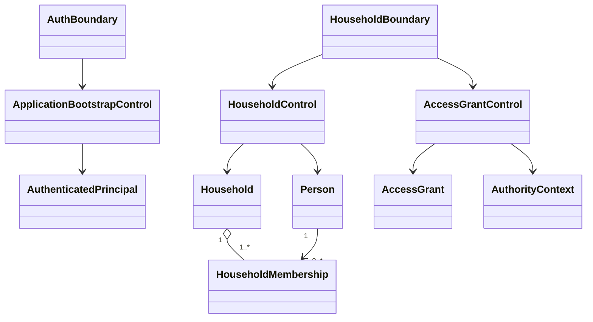
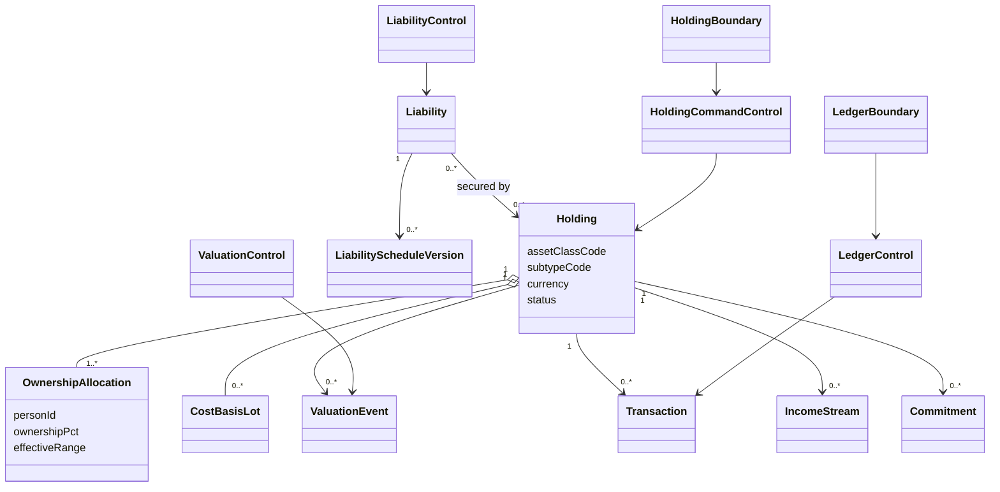
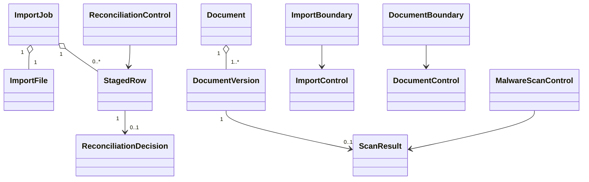
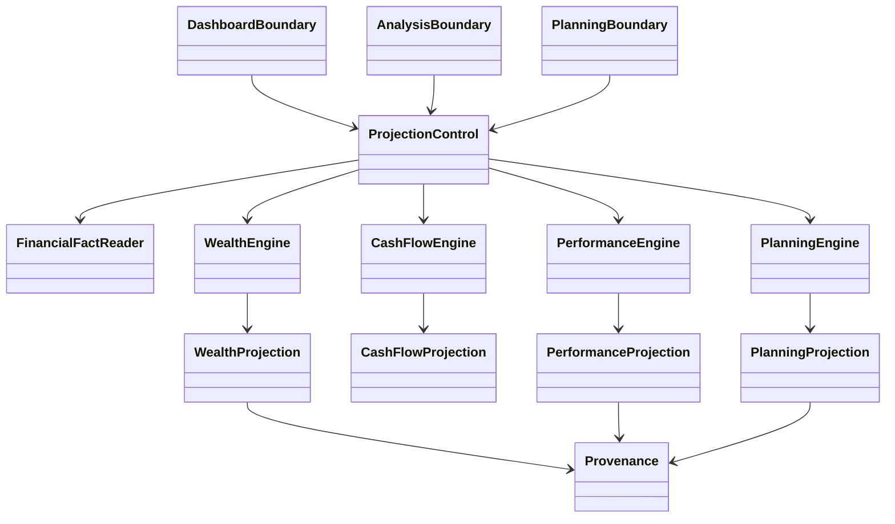
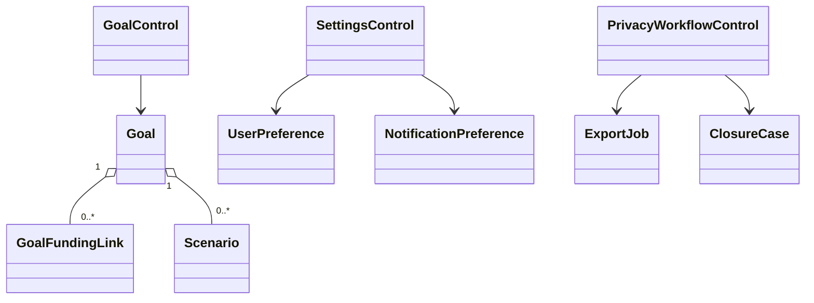

# Entity–Boundary–Control Object Model

## Design principles

- Entities contain durable business identity and invariants, not HTTP/UI concerns.
- Controls coordinate use cases and policies; they do not bypass repositories or authorization.
- Boundaries translate external representations and remain thin.
- Append-only facts and rebuildable projections are separated.
- Aggregate boundaries minimize contention while protecting invariants.

## Identity and household module

**Aggregate roots:** `Household`, `AccessGrant`. `Person` has independent identity; membership changes are guarded through `Household`.

**Controls:**

- `ApplicationBootstrapControl`: verifies identity context, provisions local principal, resolves allowed entry scopes.
- `HouseholdControl`: creates people/memberships, applies role/guardian rules, calculates permitted household composition.
- `AccessGrantControl`: grants, filters, expires and revokes access; creates authorization audit evidence.
- `AuthorityPolicy`: evaluates ownership, role, grant, purpose and feature state for one action.

## Holding and ledger module

**Aggregate roots:** `Holding`, `Liability`, and append-only `Transaction` stream. Ownership allocations change atomically within `Holding` and total 100% for active periods.

**Controls:**

- `HoldingCommandControl`: validates catalogue/subtype, authority, ownership and lifecycle changes.
- `ValuationControl`: appends/supersedes valuation assertions and selects applicable current valuation via policy.
- `LedgerControl`: records immutable transactions, corrections and transfer reconciliation.
- `LiabilityControl`: maintains obligation terms and versioned schedules; distinguishes direct/contingent amounts.
- `CataloguePolicy`: resolves subtype schema, allowed units, valuation methods and required attributes.

## Import and document module

**Aggregate roots:** `ImportJob`, `Document`. Staged rows are never ledger facts. Document version availability depends on authenticated scan results.

**Controls:**

- `ImportControl`: idempotency, file lifecycle, parsing, mapping, row validation and confirmed commits.
- `ReconciliationControl`: duplicate/match proposals and explicit decisions.
- `DocumentControl`: metadata, links, versions, signed access and retention.
- `MalwareScanControl`: correlates scan request/result and transitions quarantine safely.

## Calculation and projection module

Projections are not aggregate roots or sources of truth. Engines consume authorized versioned facts and return results plus provenance/failure reasons. `ProjectionControl` persists optimized read models and handles version invalidation.

## Goal and settings module

## Cross-cutting services

| Control/policy | Responsibility |
|---|---|
| `AuthorizationControl` | Builds authority context and enforces deny-by-default object/field/action access. |
| `AuditEvidenceControl` | Records append-only safe evidence transactionally or via outbox. |
| `ProvenanceBuilder` | Produces consistent lineage/completeness/calculation metadata. |
| `FeatureGateControl` | Evaluates environment gate state and approval record. |
| `OutboxControl` | Writes/publishes idempotent domain events with causation/correlation. |
| `MoneyPolicy` | Minor-unit, currency, FX and rounding invariants. |
| `TimePolicy` | UTC storage, as-of rules, financial year and locale rendering boundaries. |

## Boundary inventory

| Boundary | Inputs/outputs; no business ownership |
|---|---|
| Web page/routes | Screen composition and accessible interaction states. |
| FastAPI HTTP boundaries | OpenAPI validation, principal context, control invocation and response translation. |
| Worker/event boundaries | Authenticated event decoding, idempotency and control invocation. |
| Auth-core verification adapter | Verified identity context; no household authorization decision. |
| CSV/document parsers | Untrusted input to staged proposals. |
| Object-storage/scanner adapters | Bytes and scan result transport. |
| Future connector adapters | Normalized source facts under consent and reconciliation policy. |

## Prohibited dependencies

- Entities do not import FastAPI, SQLAlchemy, Celery, React or provider SDKs.
- Boundaries do not calculate net worth, ownership, permissions or financial returns.
- Calculation engines do not query unrestricted repositories or authorize callers.
- Repositories do not call controls.
- Read projections do not become authoritative facts.

