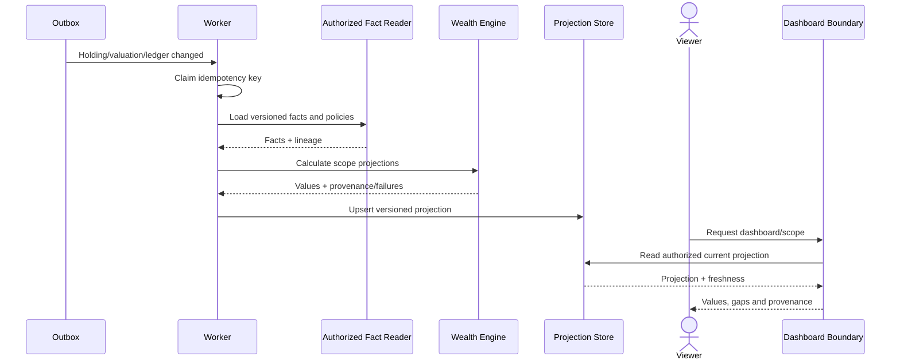
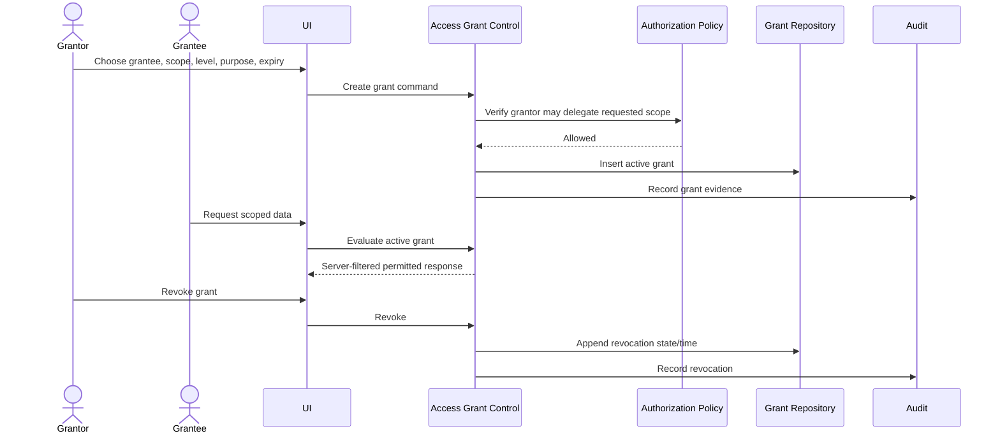
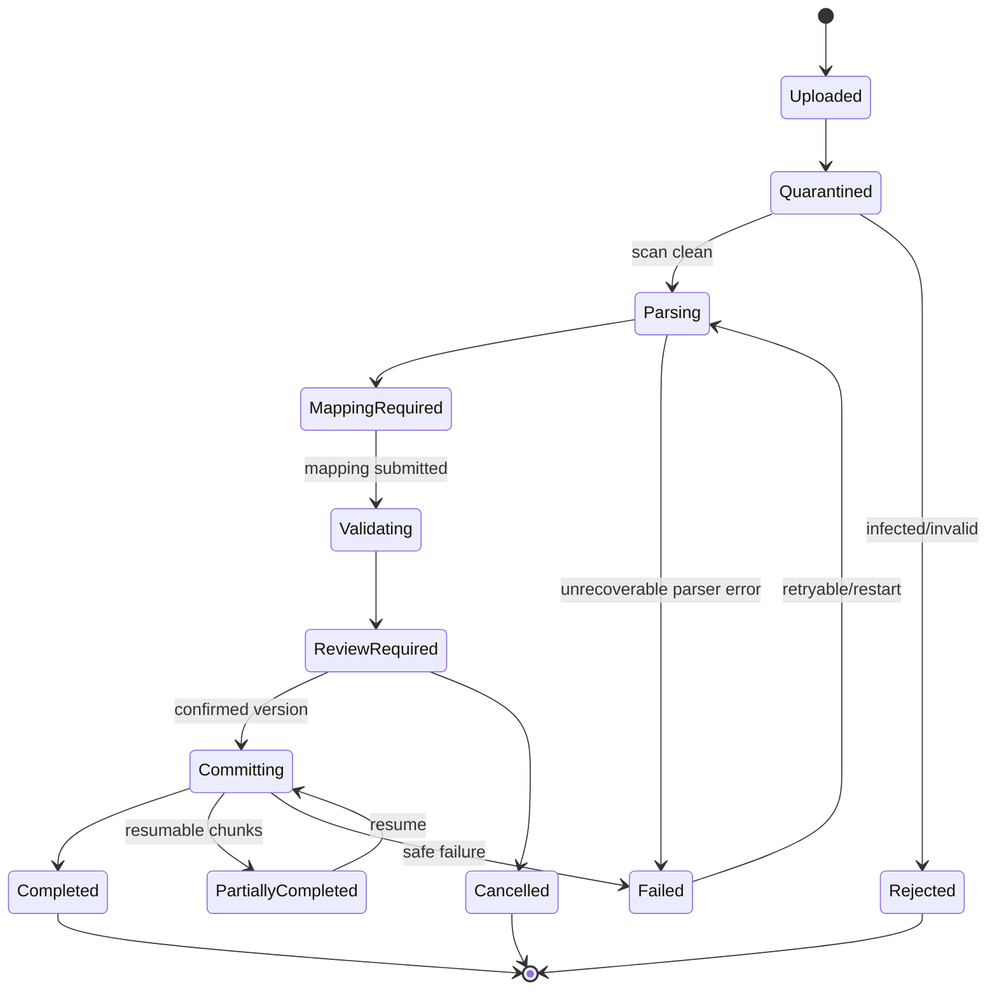
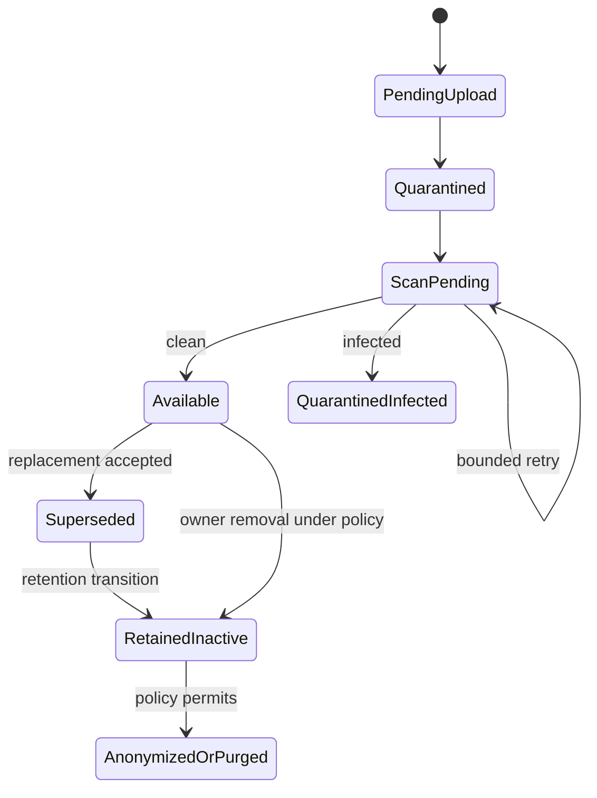
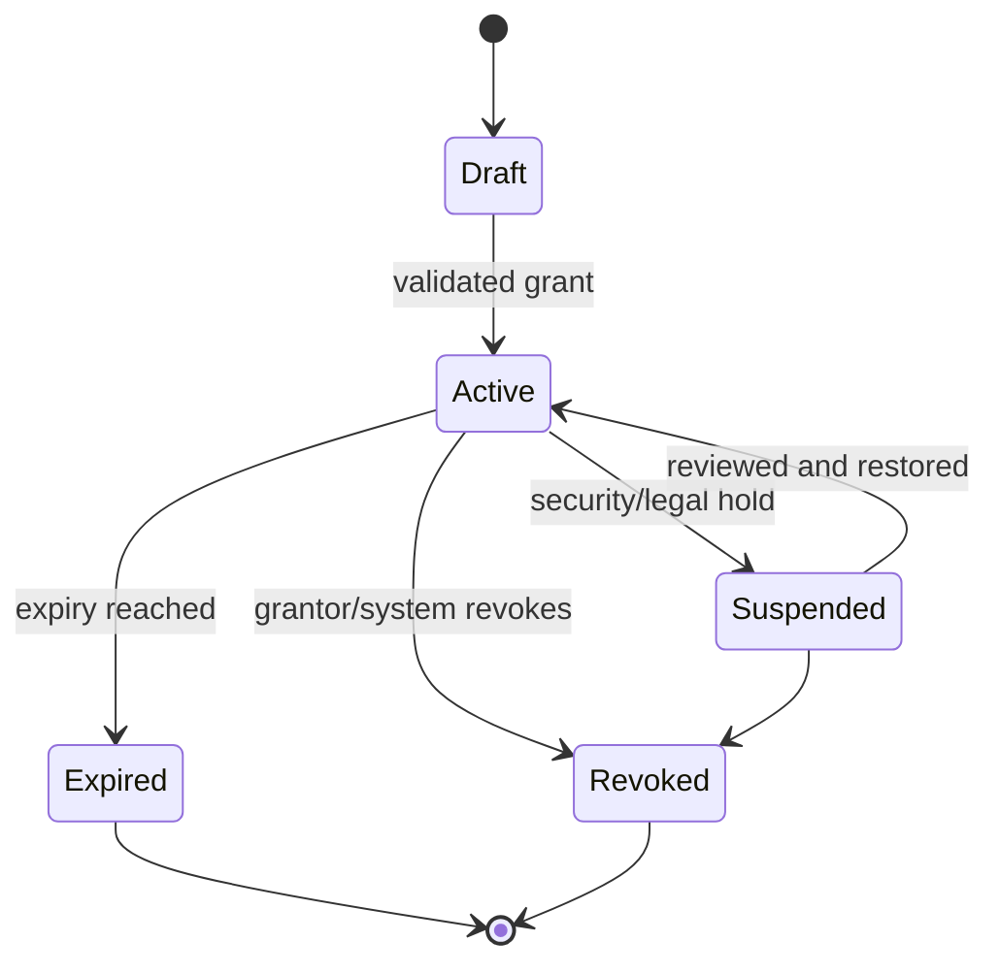
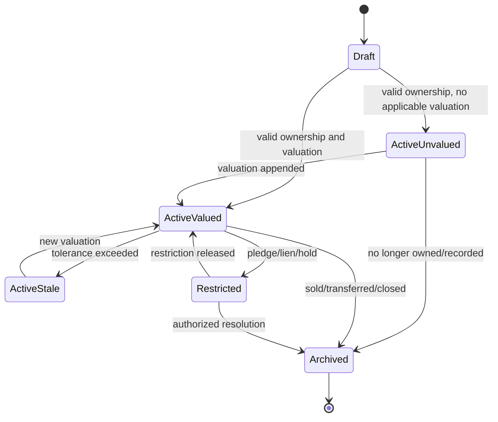
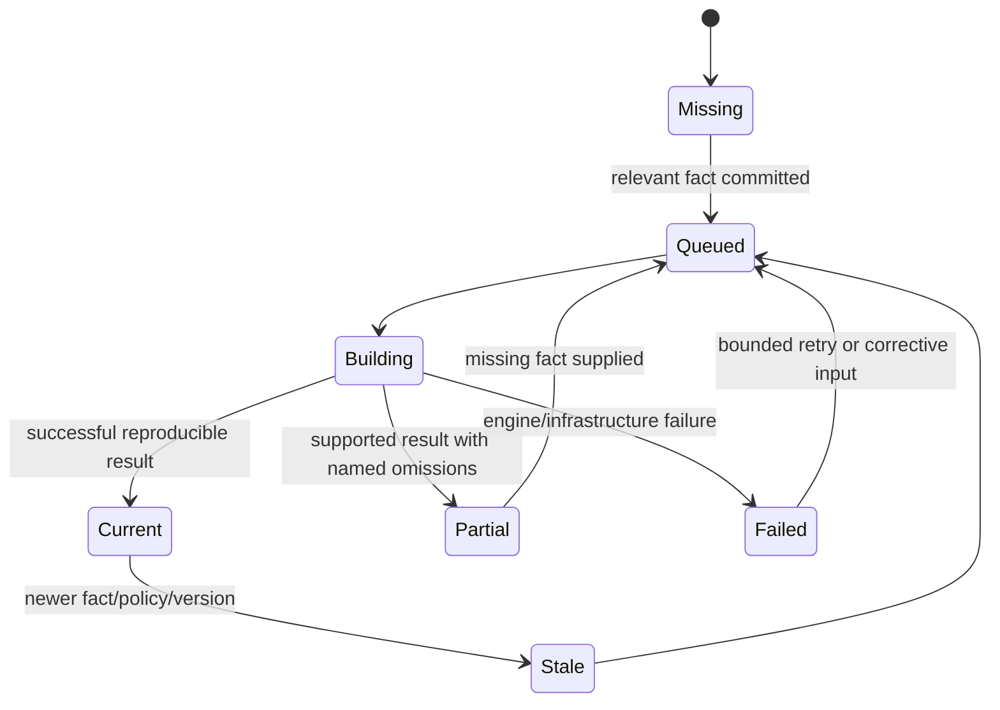

# Sequence and State Diagrams

## Create a jointly owned holding

```mermaid
sequenceDiagram
    actor Actor
    participant UI as Holding Boundary
    participant Authz as Authorization Control
    participant HC as Holding Command Control
    participant Cat as Catalogue Policy
    participant Repo as Holding Repository
    participant Outbox as Outbox/Audit

    Actor->>UI: Submit holding, allocations, valuation
    UI->>Authz: Resolve authority for affected people
    Authz-->>UI: Allowed authority context
    UI->>HC: Create command + context
    HC->>Cat: Validate subtype/attributes/method
    Cat-->>HC: Validated normalized facts
    HC->>HC: Validate active allocations total 100%
    HC->>Repo: Atomic insert holding + allocations + valuation
    Repo->>Outbox: Record projection and audit events
    Repo-->>HC: Canonical IDs/version
    HC-->>UI: Created; projections pending
    UI-->>Actor: Holding with provenance/status
```

## Import and reconcile a CSV

```mermaid
sequenceDiagram
    actor Actor
    participant UI as Import Boundary
    participant IC as Import Control
    participant Store as Quarantine Storage
    participant Parser
    participant RC as Reconciliation Control
    participant Ledger as Ledger Controls
    participant Outbox

    Actor->>UI: Upload file + idempotency key
    UI->>IC: Create/reuse import job
    IC->>Store: Store and checksum
    IC->>Parser: Parse into staged rows
    Parser-->>IC: Rows + structural errors
    IC-->>UI: Mapping/validation view
    Actor->>UI: Map columns and owners
    UI->>RC: Validate and find duplicates
    RC-->>UI: Errors, warnings, candidates
    Actor->>UI: Confirm selected rows/decisions
    UI->>IC: Commit confirmed job version
    IC->>Ledger: Atomic/resumable canonical commands
    Ledger->>Outbox: Projection and audit events
    IC-->>UI: Committed/rejected row report
```

## Append and correct a valuation

```mermaid
sequenceDiagram
    actor Actor
    participant UI as Holding Boundary
    participant VC as Valuation Control
    participant Policy as Valuation Policy
    participant Repo as Valuation Repository
    participant Proj as Projection Control

    Actor->>UI: Add valuation assertion
    UI->>VC: Append with authority/provenance
    VC->>Policy: Validate method, date, subtype
    VC->>Repo: Insert immutable event
    VC->>Policy: Select applicable current event
    VC->>Proj: Emit invalidation event
    VC-->>UI: New event and current/stale state
    alt correction required
      Actor->>UI: Correct prior valuation
      UI->>VC: Append superseding event
      VC->>Repo: Insert link to prior event
      VC->>Proj: Emit new invalidation event
    end
```

## Build and serve a wealth projection



## Upload and scan a document

```mermaid
sequenceDiagram
    actor Actor
    participant API as Document Boundary
    participant DC as Document Control
    participant Q as Quarantine Store
    participant Scan as Malware Scanner
    participant Clean as Clean Store
    participant Audit

    Actor->>API: Create metadata/link and upload
    API->>DC: Authorize target and initialize version
    DC->>Q: Store bytes/checksum
    DC-->>Actor: Pending scan
    Q->>Scan: Authenticated scan request
    Scan-->>DC: Correlated clean/infected/error result
    alt clean
      DC->>Clean: Promote/copy approved object
      DC->>Audit: Record availability
    else infected
      DC->>Audit: Record quarantine outcome
    else scanner error
      DC->>DC: Keep pending; bounded retry
    end
```

## Grant and revoke access



## Import job state



## Document version state



## Access grant state



## Holding lifecycle



## Projection state



