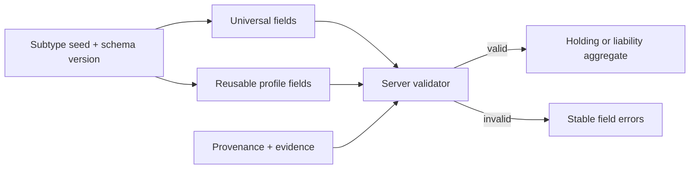

# Asset and Liability Subtype Field Dictionary

## Purpose

This document turns the operator PDF catalogue into implementable data-entry contracts. Every listed asset or liability is selectable even when a user does not own it. A selected subtype determines the form schema, validation rules, supported valuation methods, import mapping and presentation labels.

The PDF's regulator, licence, implementation-cost, timeframe, fees and competitor columns remain research context. They do not become user fields or assertions that Vittavaan provides, intermediates or values a product.

## Field notation

| Marker | Meaning |
|---|---|
| R | Required before the record can become `ACTIVE`. |
| C | Conditionally required when the stated condition applies. |
| O | Optional and may be unknown. |
| D | Derived; never accepted as an authoritative client value. |

Draft records may be incomplete. Activation validates universal fields, subtype fields, ownership and provenance atomically. Unknown is represented by absence plus completeness metadata, never by zero, an empty string or a fabricated date.

## Universal asset fields

These map to typed tables in the database design rather than subtype JSON.

| Field | Requirement | Type | Validation and meaning |
|---|---|---|---|
| `asset_class_code` | R | catalogue code | Active class and valid parent of subtype. |
| `asset_subtype_code` | R | catalogue code | Active subtype/schema version. |
| `name` | R | string 1-160 | User-recognizable label; no secrets. |
| `owner_allocations` | R | array | At least one effective person allocation; active total exactly `100.0000`. |
| `household_id` | O | UUID | Must be authorized and compatible with every visible owner. |
| `currency` | R | ISO 4217 | Native accounting/valuation currency. |
| `quantity` | C | decimal(30,12) | Required for unitized assets; positive unless the subtype explicitly supports short positions. |
| `identifier_type` / `identifier` | C | enum / encrypted string | Required when the selected subtype has a canonical identifier; only masked form is returned. |
| `acquired_on` | O | date | Actual or documented acquisition date, not import date. |
| `status` | R | enum | `DRAFT`, `ACTIVE`, `DISPOSED`, `CLOSED`, `ARCHIVED`. |
| `subtype_schema_version` | R | semantic version | Schema used to validate subtype attributes. |
| `source` | R | source reference | Manual, import, connector, operator or calculated provenance. |
| `initial_valuation` | C | money assertion | Required for net-worth inclusion; amount, currency, method, as-of, source and verification level. |
| `liquidity_class` | R | enum | `IMMEDIATE`, `DAYS`, `MONTHS`, `YEARS`, `RESTRICTED`, `UNKNOWN`. |
| `expected_exit_days` | C | integer 0-36500 | Required for `DAYS`, `MONTHS` or `YEARS`. |
| `restrictions` | O | effective records | Pledge, lien, lock-in, freeze, legal or contractual restriction. |
| `cost_basis_lots` | C | lot records | Required when performance/tax basis is claimed. |
| `documents` | O | links | Statements, contracts, title, appraisal and evidence remain separate documents. |

## Reusable asset field profiles

### SEC - Marketable security

| Field | Req. | Type | Validation |
|---|---|---|---|
| `security_name` | R | string | Legal/instrument name. |
| `isin` | C | string | 12-character ISO 6166 where issued; checksum validation. |
| `symbol` / `exchange_code` | C | string | Pair required for exchange-listed instruments. |
| `issuer_name` | R | string | Issuer or sovereign. |
| `instrument_currency` | R | ISO 4217 | Must match denomination, not display currency. |
| `units` | R | decimal(30,12) | Positive for beta; short positions are a later explicit capability. |
| `sector_code` / `country_code` | O | catalogue / ISO code | Exposure metadata with source. |
| `maturity_date` | C | date | Required for term instruments. |
| `coupon_rate_pct` | C | decimal(9,6) | 0-100; required for coupon-bearing debt. |
| `coupon_frequency` | C | enum | Required when coupon rate exists. |
| `credit_rating` / `rating_agency` / `rating_as_of` | O | structured | All-or-none agency/date when rating supplied. |

### CASH - Cash, deposit and savings account

| Field | Req. | Type | Validation |
|---|---|---|---|
| `institution_name` | R | string | Bank/post office/provider. |
| `account_mask` | C | encrypted string | Last four/display mask only in API responses. |
| `account_kind` | R | enum | Savings, current, FD, RD, sweep, locker, etc. |
| `interest_rate_pct` | O | decimal(9,6) | 0-100. |
| `opened_on` / `matures_on` | O/C | date | Maturity required for term deposit. |
| `break_penalty` | O | structured money/rate/text | Explicit type and basis. |
| `deposit_insurance_eligible` | O | boolean | User-declared/source-qualified; no automatic guarantee claim. |
| `sweep_or_lien_state` | O | enum | None, sweep, lien, frozen or unknown. |
| `accessible_amount` | O | money | Dated assertion; cannot exceed balance without explanation. |
| `locker_contents_valued` | C | boolean | Locker itself has no asset value; contents require separate holdings. |

### FUND - Pooled investment

| Field | Req. | Type | Validation |
|---|---|---|---|
| `scheme_name` | R | string | Scheme/fund/legal vehicle name. |
| `scheme_code` / `isin` | C | string | At least one required for a publicly identified scheme. |
| `folio_mask` | O | encrypted string | Masked on read. |
| `plan_type` | O | enum | Direct, regular, institutional or unknown. |
| `option_type` | O | enum | Growth, IDCW/distribution or other approved value. |
| `units` | R | decimal(30,12) | Positive. |
| `nav` / `nav_date` | C | decimal/date | Pair required when unit-price valuation used. |
| `expense_ratio_pct` / `expense_as_of` | O | decimal/date | Pair; 0-100. |
| `exit_load_rule` | O | structured | Versioned rule, not free-form calculation. |
| `lock_in_until` | O | date | Drives restriction/liquidity state. |
| `fund_category` | O | catalogue | Category with source and as-of date. |

### CREDIT - Lending, receivable and fixed contractual cash flow

| Field | Req. | Type | Validation |
|---|---|---|---|
| `counterparty_reference` | R | encrypted/masked string | No unnecessary identity data. |
| `platform_or_contract_name` | O | string | Platform, agreement or facility. |
| `original_principal` | C | money | Required for loan instruments. |
| `principal_outstanding` | R | money | Non-negative, dated fact. |
| `interest_rate_pct` / `rate_type` | O | decimal/enum | Fixed, floating, mixed or none. |
| `started_on` / `due_on` | O/C | date | Due date required for fixed-term claims. |
| `payment_frequency` | O | enum | Approved cadence. |
| `credit_state` | R | enum | Current, late, delinquent, defaulted, restructured, recovered or disputed. |
| `days_past_due` | C | integer | Required for delinquent/defaulted state. |
| `expected_recovery` | O | money | Must be labelled estimate with as-of/source. |
| `assignable` | O | boolean | Contractual transferability. |

### PENSION - Small savings, retirement and annuity

| Field | Req. | Type | Validation |
|---|---|---|---|
| `scheme_code` | R | catalogue | EPF, PPF, NPS, SSY, SCSS, post-office, APY, gratuity or annuity. |
| `provider_or_employer` | C | string | Required when administered by an institution/employer. |
| `member_account_mask` | O | encrypted string | Masked response only. |
| `employee_component` / `employer_component` | O | money | Same currency/as-of. |
| `vested_amount` | O | money | Must identify vesting basis/date. |
| `maturity_or_retirement_date` | O | date | Drives liquidity. |
| `withdrawal_eligibility` | O | structured | Rule version and next eligible date. |
| `annuity_amount` / `annuity_frequency` | C | money/enum | Pair required for annuity streams. |
| `nominee_recorded` | O | boolean | Status only; nominee details remain protected records/documents. |
| `guardian_transition_date` | C | date | Required where a minor/guardian arrangement has a known transition. |

### PRIVATE - Private capital, employee equity and alternative fund

| Field | Req. | Type | Validation |
|---|---|---|---|
| `vehicle_or_company_name` | R | string | Investee, partnership or managed vehicle. |
| `instrument_type` | R | enum | Equity, partnership interest, note, option, carried interest, etc. |
| `committed_capital` / `drawn_capital` | C | money | Commitment-based vehicles; drawn cannot exceed committed without explanation. |
| `ownership_or_units` | O | decimal | Explicit unit/percentage basis. |
| `last_funding_round` / `round_date` | O | string/date | Pair when supplied. |
| `distribution_total` | O | money | Observed distributions only. |
| `strike_price` / `vested_units` / `expiry_date` | C | structured | Required for options/ESOPs as applicable. |
| `valuation_basis` | R | enum | Statement, funding round, appraisal, model or declared estimate. |
| `liquidity_window` | O | date range | Contractual/expected, labelled accordingly. |
| `moic` / `tvpi` / `dpi` | D | decimal | Calculated only with complete required cash flows. |

### PROPERTY - Real property, land and infrastructure interest

| Field | Req. | Type | Validation |
|---|---|---|---|
| `property_or_project_type` | R | enum | Residential, commercial, land, agriculture, REIT/fractional, infrastructure, etc. |
| `country_code` / `administrative_area` | R | ISO/string | Geography without exposing a full address in lists. |
| `address_ciphertext` | C | encrypted object | Required for direct property; access-controlled. |
| `title_or_registration_mask` | C | encrypted string | Required where legally registered. |
| `area_value` / `area_unit` | C | decimal/enum | Pair; positive. |
| `usable_area` / `saleable_area` / `waste_area` | O | decimal + unit | Cannot be negative; assumptions dated. |
| `ownership_use` | O | enum | Self-use, leased, vacant, development, agricultural, etc. |
| `occupancy_or_tenancy` | O | structured | Effective dates and source. |
| `rera_or_project_reference` | O | string | Relevant Indian project reference. |
| `appraisal_method` / `appraiser` / `appraisal_date` | C | structured | Required for appraisal valuation. |
| `rental_income` | O | income-stream link | Do not duplicate income values in attributes. |
| `linked_debt` / `ltv_pct` | O/D | relationship/decimal | LTV derived from selected value and linked liability. |

### TANGIBLE - Commodity, collectible and vehicle

| Field | Req. | Type | Validation |
|---|---|---|---|
| `item_type` | R | catalogue | Metal, art, wine, coin, jewellery, vehicle, vessel, aircraft, livestock, etc. |
| `description` | R | string | Distinguishing description. |
| `maker_make_model` | O | string | Maker/brand/model where relevant. |
| `serial_or_registration_mask` | C | encrypted string | Required for registered vehicles/high-value serialized items. |
| `manufacture_or_vintage_year` | O | smallint | Plausible year range. |
| `weight_or_quantity` / `unit` | C | decimal/enum | Required for fungible commodities/inventory. |
| `provenance_summary` | O | string | Documents hold detailed evidence. |
| `authenticity_state` | O | enum | Unchecked, documented, verified or disputed. |
| `appraiser` / `appraisal_date` | C | string/date | Pair for appraisal-based valuation. |
| `insured_value` / `insurance_expiry` | O | money/date | Insurance is not current market value. |
| `storage_location_class` | O | enum | Home, vault, warehouse, custodian or other; no public exact location. |
| `annual_holding_cost` | O | money | Dated estimate or observed total. |

### DIGITAL - Crypto, token and digital property

| Field | Req. | Type | Validation |
|---|---|---|---|
| `asset_symbol_or_token_id` | R | string | Network-qualified identifier. |
| `network` | C | catalogue | Required for on-chain assets. |
| `quantity` | R | decimal(38,18) | Non-negative. |
| `custody_type` | R | enum | Self-custody, exchange, institutional, smart contract or unknown. |
| `wallet_or_account_hash` | O | keyed hash | Never store private keys or seed phrases. |
| `venue_name` / `fiu_status_known` | O | string/tri-state | Factual metadata only. |
| `token_standard` | O | string | NFT/token standard. |
| `contract_address` | O | string | Validated per supported network. |
| `price_source` / `price_as_of` | C | source/date-time | Required for market-price valuation. |

### RIGHT - Royalty, licence, franchise and entertainment/contract right

| Field | Req. | Type | Validation |
|---|---|---|---|
| `right_type` | R | catalogue | Patent, music, film, franchise, sports, domain, royalty, earnout, etc. |
| `contract_reference` | R | encrypted/masked string | Supporting document strongly recommended. |
| `counterparty_name` | O | string | Payer, licensee, franchisor or obligor. |
| `territory` | O | string/country list | Bounded values. |
| `effective_from` / `expires_on` | C | date | Expiry required for finite rights. |
| `payment_basis` | O | structured | Fixed, percentage, milestone or usage-based. |
| `assignability` | O | enum | Transferable, restricted, prohibited or unknown. |
| `contingency_or_trigger` | O | string | Required for earnout/litigation/event-dependent rights. |
| `receipt_history_complete` | O | boolean | Controls return/income calculations. |

### DERIVATIVE - Derivative and contingent exposure

| Field | Req. | Type | Validation |
|---|---|---|---|
| `derivative_kind` | R | enum | Option, future, forward, swap, convertible or other approved kind. |
| `underlying_reference` | R | string | Security, commodity, currency, rate or index. |
| `position_side` | R | enum | Long or short. |
| `contract_quantity` / `contract_multiplier` | R | decimal | Positive. |
| `strike_price` | C | money | Required for options/convertibles when applicable. |
| `expiry_or_settlement_date` | R | date | Future at activation unless recording history. |
| `notional_amount` | C | money | Exposure only; explicitly excluded from net worth. |
| `premium_or_cost` | O | money | Observed transaction fact. |
| `current_market_value` | C | valuation event | Only this, not notional, contributes to net worth. |
| `margin_or_collateral` | O | relationship/money | Link holding where possible. |

### SPECIAL - Specialized scientific, environmental or unusual interest

| Field | Req. | Type | Validation |
|---|---|---|---|
| `specialized_kind` | R | catalogue | Carbon, data, compute, space, biotech, genetic data, etc. |
| `project_or_issuer` | R | string | Project/company/vehicle. |
| `jurisdiction` | R | country code | Legal/economic jurisdiction. |
| `units_or_interest` | O | decimal + unit | Unit must be catalogue-controlled. |
| `registry_or_contract_reference` | C | encrypted/masked string | Required where a registry/contract establishes the interest. |
| `commercialization_stage` | O | enum | Research, development, operational, revenue, exited, unknown. |
| `valuation_basis` | R | enum | Statement, transaction, appraisal, model or declared estimate. |
| `material_risk_note` | R | string | Concise illiquidity/uncertainty disclosure. |

## Asset subtype seed catalogue

Each seed points to one primary profile. Secondary profile behavior may be composed where shown. `P1` receives a dedicated guided form in beta; `P2` is recordable through the schema-driven form.

| Class code | Subtype code | Display name | Priority | Profile | Default valuation methods |
|---|---|---|---|---|---|
| `TRAD_SECURITY` | `PUBLIC_EQUITY` | Publicly traded company | P1 | SEC | Market price, statement |
| `TRAD_SECURITY` | `GOVERNMENT_BOND` | Government bond/security | P2 | SEC | Market price, statement, amortized cost |
| `TRAD_SECURITY` | `MUNICIPAL_BOND` | Municipal bond | P2 | SEC | Market price, statement, model |
| `TRAD_SECURITY` | `CORPORATE_BOND` | Corporate bond | P2 | SEC | Market price, statement, model |
| `TRAD_SECURITY` | `DEBENTURE` | Debenture/NCD | P2 | SEC | Market price, statement, model |
| `TRAD_SECURITY` | `COMMERCIAL_PAPER` | Commercial paper | P2 | SEC | Statement, amortized cost |
| `TRAD_SECURITY` | `CERTIFICATE_OF_DEPOSIT` | Certificate of deposit | P2 | SEC | Statement, amortized cost |
| `CASH` | `SAVINGS_ACCOUNT` | Savings account | P1 | CASH | Statement, declared balance |
| `CASH` | `CURRENT_ACCOUNT` | Current account | P1 | CASH | Statement, declared balance |
| `CASH` | `FIXED_DEPOSIT` | Fixed deposit | P1 | CASH | Statement, accrued value |
| `CASH` | `RECURRING_DEPOSIT` | Recurring deposit | P1 | CASH | Statement, accrued value |
| `CASH` | `SWEEP_ACCOUNT` | Sweep/linked deposit | P1 | CASH | Statement |
| `CASH` | `POSITIVE_CARD_BALANCE` | Credit-card positive balance | P1 | CASH | Statement |
| `CASH` | `SAFE_DEPOSIT_LOCKER` | Safe-deposit locker | P1 | CASH | No value unless separate contents exist |
| `FUND` | `MUTUAL_FUND` | Mutual fund | P1 | FUND | NAV, statement |
| `FUND` | `MONEY_MARKET_FUND` | Money-market fund | P1 | FUND | NAV, statement |
| `FUND` | `PMS` | Portfolio management service | P1 | PRIVATE + FUND | Statement, NAV |
| `FUND` | `AIF` | Alternative investment fund | P1 | PRIVATE + FUND | Statement, NAV, appraisal |
| `CREDIT_ASSET` | `P2P_LOAN` | Peer-to-peer loan/note | P1 | CREDIT | Statement, discounted cash flow, recovery estimate |
| `CREDIT_ASSET` | `DIRECT_LENDING` | Direct/private lending | P2 | CREDIT | Statement, model |
| `CREDIT_ASSET` | `MEZZANINE_DEBT` | Mezzanine debt | P2 | CREDIT | Statement, model |
| `CREDIT_ASSET` | `MICROFINANCE_INTEREST` | Microfinance interest | P2 | CREDIT | Statement, model |
| `CREDIT_ASSET` | `MORTGAGE_CREDIT` | Mortgage credit interest | P2 | CREDIT | Statement, model |
| `CREDIT_ASSET` | `WORKING_CAPITAL_CREDIT` | Working-capital/trade-finance credit | P2 | CREDIT | Statement, model |
| `PENSION_SAVINGS` | `EPF` | Employees' Provident Fund | P1 | PENSION | Statement |
| `PENSION_SAVINGS` | `PPF` | Public Provident Fund | P1 | PENSION | Statement |
| `PENSION_SAVINGS` | `NPS` | National Pension System | P1 | PENSION + FUND | NAV, statement |
| `PENSION_SAVINGS` | `SSY` | Sukanya Samriddhi Yojana | P1 | PENSION | Statement, accrued value |
| `PENSION_SAVINGS` | `SCSS` | Senior Citizens' Savings Scheme | P1 | PENSION | Statement, accrued value |
| `PENSION_SAVINGS` | `POST_OFFICE_SAVINGS` | Post-office savings product | P1 | PENSION | Statement, accrued value |
| `PENSION_SAVINGS` | `APY` | Atal Pension Yojana | P1 | PENSION | Statement |
| `PENSION_SAVINGS` | `GRATUITY` | Gratuity entitlement | P1 | PENSION | Employer statement, modelled estimate |
| `PENSION_SAVINGS` | `ANNUITY` | Annuity/pension contract | P1 | PENSION | Provider statement, model |
| `PRIVATE_CAPITAL` | `VENTURE_CAPITAL` | Venture-capital interest | P1 | PRIVATE | Statement, funding round, appraisal |
| `PRIVATE_CAPITAL` | `GROWTH_BUYOUT` | Growth/buyout interest | P1 | PRIVATE | Statement, appraisal |
| `PRIVATE_CAPITAL` | `DISTRESSED_INVESTMENT` | Distressed investment | P1 | PRIVATE | Statement, recovery model |
| `PRIVATE_CAPITAL` | `SYNDICATE_INTEREST` | Investment syndicate interest | P1 | PRIVATE | Statement, funding round |
| `PRIVATE_CAPITAL` | `CONVERTIBLE_NOTE` | Convertible note | P1 | PRIVATE + SEC | Statement, model |
| `PRIVATE_CAPITAL` | `ESOP_OPTION` | ESOP/employee option | P1 | PRIVATE | Employer statement, model |
| `HEDGE_STRATEGY` | `HEDGE_FUND` | Hedge fund | P2 | FUND + PRIVATE | Statement, NAV |
| `HEDGE_STRATEGY` | `LONG_SHORT` | Long-short strategy | P2 | FUND + PRIVATE | Statement, NAV |
| `HEDGE_STRATEGY` | `GLOBAL_MACRO` | Global macro strategy | P2 | FUND + PRIVATE | Statement, NAV |
| `HEDGE_STRATEGY` | `ARBITRAGE_STRATEGY` | Arbitrage strategy | P2 | FUND + PRIVATE | Statement, NAV |
| `REAL_ASSET` | `RESIDENTIAL_PROPERTY` | Residential property | P1 | PROPERTY | Appraisal, comparable, declared estimate |
| `REAL_ASSET` | `COMMERCIAL_PROPERTY` | Commercial property | P1 | PROPERTY | Appraisal, comparable, income capitalization |
| `REAL_ASSET` | `LAND` | Land/development land | P1 | PROPERTY | Appraisal, circle rate, scenario estimate |
| `REAL_ASSET` | `AGRICULTURAL_LAND` | Agricultural land/farmland | P1 | PROPERTY | Appraisal, comparable, declared estimate |
| `REAL_ASSET` | `REIT` | REIT | P1 | SEC | Market price, NAV |
| `REAL_ASSET` | `FRACTIONAL_PROPERTY` | Fractional property interest | P1 | PROPERTY + SEC | Statement, appraisal |
| `REAL_ASSET` | `PARKING_STORAGE_UNIT` | Parking/storage unit | P1 | PROPERTY | Appraisal, comparable |
| `INFRASTRUCTURE` | `TOLL_ROAD` | Toll-road interest | P2 | PROPERTY + SPECIAL | Statement, model |
| `INFRASTRUCTURE` | `AIRPORT` | Airport interest | P2 | PROPERTY + SPECIAL | Statement, model |
| `INFRASTRUCTURE` | `PIPELINE` | Pipeline interest | P2 | PROPERTY + SPECIAL | Statement, model |
| `INFRASTRUCTURE` | `PPP_PROJECT` | Public-private partnership interest | P2 | PROPERTY + SPECIAL | Statement, model |
| `INFRASTRUCTURE` | `ENERGY_PROJECT` | Energy-project interest | P2 | PROPERTY + SPECIAL | Statement, model |
| `TANGIBLE` | `PRECIOUS_METAL` | Gold/silver/precious metal | P2 | TANGIBLE | Market reference, appraisal |
| `TANGIBLE` | `COMMODITY_INTEREST` | Physical commodity interest | P2 | TANGIBLE | Market reference, statement |
| `TANGIBLE` | `ART` | Art | P1 | TANGIBLE | Appraisal, transaction, declared estimate |
| `TANGIBLE` | `WINE` | Wine collection | P1 | TANGIBLE | Appraisal, transaction |
| `TANGIBLE` | `COINS_STAMPS` | Coins/stamps | P1 | TANGIBLE | Appraisal, transaction |
| `TANGIBLE` | `JEWELLERY` | Jewellery | P1 | TANGIBLE | Appraisal, metal reference |
| `TANGIBLE` | `OTHER_COLLECTIBLE` | Other collectible/luxury asset | P1 | TANGIBLE | Appraisal, transaction, declared estimate |
| `DIGITAL_ASSET` | `CRYPTO_TOKEN` | Cryptocurrency/token | P1 | DIGITAL | Market price, statement |
| `DIGITAL_ASSET` | `NFT` | Non-fungible token | P1 | DIGITAL | Market transaction, appraisal, declared estimate |
| `DIGITAL_ASSET` | `TOKENIZED_ASSET` | Tokenized real-world asset | P1 | DIGITAL + SEC | Market price, statement |
| `DIGITAL_ASSET` | `DOMAIN_NAME` | Domain name/digital real estate | P2 | RIGHT | Appraisal, transaction, declared estimate |
| `TRUST_INTEREST` | `TRUST_BENEFICIAL_INTEREST` | Trust-held beneficial interest | P1 | PRIVATE | Trustee statement, appraisal |
| `CONTRACT_RIGHT` | `RECEIVABLE` | Contractual receivable | P1 | CREDIT + RIGHT | Statement, expected recovery |
| `CONTRACT_RIGHT` | `EARNOUT` | Earnout | P1 | RIGHT | Expected value, received cash flows |
| `CONTRACT_RIGHT` | `PROFIT_SHARE` | Profit-share contract | P1 | RIGHT | Statement, expected value |
| `CONTRACT_RIGHT` | `ROYALTY` | Royalty/right | P1 | RIGHT | Income capitalization, transaction |
| `CONTRACT_RIGHT` | `FRANCHISE` | Franchise interest | P1 | RIGHT | Appraisal, income capitalization |
| `CONTRACT_RIGHT` | `LITIGATION_FINANCE` | Litigation-finance interest | P2 | RIGHT | Expected recovery, statement |
| `CONTRACT_RIGHT` | `SPORTS_INTEREST` | Sports-team/athlete contract interest | P2 | RIGHT | Appraisal, transaction |
| `CONTRACT_RIGHT` | `ENTERTAINMENT_RIGHT` | Film/television/concert right | P2 | RIGHT | Income capitalization, transaction |
| `INSURANCE_SECURITY` | `CAT_BOND` | Catastrophe/insurance-linked security | P1 | SEC + RIGHT | Market price, statement, model |
| `DERIVATIVE` | `EQUITY_OPTION` | Equity/index option | P2 | DERIVATIVE | Market value, model |
| `DERIVATIVE` | `FUTURE` | Futures contract | P2 | DERIVATIVE | Market value, statement |
| `DERIVATIVE` | `FX_FORWARD_SWAP` | Currency forward/swap | P2 | DERIVATIVE | Market value, model |
| `DERIVATIVE` | `COMMODITY_DERIVATIVE` | Commodity derivative | P2 | DERIVATIVE | Market value, model |
| `DERIVATIVE` | `CONVERTIBLE_SECURITY` | Convertible security | P2 | DERIVATIVE + SEC | Market value, model |
| `SPECIALIZED` | `AGRI_BUSINESS` | Agribusiness/livestock/timber interest | P1 | PROPERTY + TANGIBLE | Appraisal, statement, model |
| `SPECIALIZED` | `CARBON_CREDIT` | Carbon/emissions credit | P2 | SPECIAL | Registry/market price, statement |
| `SPECIALIZED` | `SHIPPING_INTEREST` | Container/vessel/cargo interest | P2 | TANGIBLE + RIGHT | Appraisal, statement |
| `SPECIALIZED` | `SPACE_INVESTMENT` | Space-economy investment | P2 | SPECIAL | Statement, funding round, model |
| `SPECIALIZED` | `DATA_AI_INTEREST` | Data/AI-model/data-centre/compute interest | P2 | SPECIAL | Statement, transaction, model |
| `SPECIALIZED` | `BIOTECH_RIGHT` | Biotech/drug/genetic-data interest | P2 | SPECIAL + RIGHT | Statement, milestone model |
| `VEHICLE` | `ROAD_VEHICLE` | Car/bike/road vehicle | P1 | TANGIBLE | Appraisal, comparable |
| `VEHICLE` | `AIRCRAFT` | Aircraft/private jet interest | P1 | TANGIBLE | Appraisal, statement |
| `VEHICLE` | `VESSEL` | Yacht/vessel interest | P1 | TANGIBLE | Appraisal, statement |
| `VEHICLE` | `FRACTIONAL_VEHICLE` | Fractional vehicle/aircraft/vessel interest | P1 | TANGIBLE + RIGHT | Statement, appraisal |
| `TAX_ASSET` | `GST_INPUT_CREDIT` | GST input-tax credit | P1 | CREDIT | Filing statement; policy-limited inclusion |
| `OTHER` | `CUSTOM_ASSET` | Other disclosed asset | P2 | SPECIAL | Declared estimate, appraisal |

Any asset can additionally be marked `offshore=true`; this requires jurisdiction, native currency, FX source/as-of and reporting-obligation status. Offshore is a cross-cutting attribute, not a duplicate subtype.

## Universal liability fields

| Field | Requirement | Type | Validation and meaning |
|---|---|---|---|
| `liability_class_code` / `liability_subtype_code` | R | catalogue codes | Active and parent-consistent. |
| `name` | R | string 1-160 | User-recognizable label. |
| `borrower_person_id` | R | UUID | Authorized person; co-borrowers use effective allocations/roles. |
| `household_id` | O | UUID | Reporting context only. |
| `lender_name` | C | string | Required for direct lender obligations. |
| `account_reference` | O | encrypted string | Masked in responses. |
| `currency` | R | ISO 4217 | Contract currency. |
| `original_principal` | C | money | Required for funded loans. |
| `outstanding_balance` | R | dated valuation/balance event | Non-negative for direct debt; contingent amount stored separately. |
| `interest_rate_pct` / `rate_type` | C | decimal/enum | Required for interest-bearing obligations. |
| `benchmark_code` / `spread_pct` / `next_reset_on` | C | structured | Required for floating rates. |
| `started_on` / `matures_on` | O/C | date | Maturity required for term facilities where known. |
| `repayment_frequency` / `next_payment` | C | enum/money/date | Required when scheduled repayment exists. |
| `obligation_nature` | R | enum | `DIRECT`, `CONTINGENT`, `TAX`, or `COURT_ORDERED`. |
| `security_links` | C | relationships | Required for secured obligations when collateral is recorded. |
| `source` | R | source reference | Provenance and as-of time. |
| `status` | R | enum | `DRAFT`, `ACTIVE`, `PAID_OFF`, `DEFAULTED`, `DISPUTED`, `CLOSED`, `ARCHIVED`. |

## Liability subtype dictionary

| Code | Display name | Additional fields and conditional rules |
|---|---|---|
| `HOME_MORTGAGE` | Home loan/mortgage | `property_holding_id` R; sanctioned amount O; EMI/schedule C; benchmark/reset C for floating; security rank O. |
| `PERSONAL_LOAN` | Personal loan | secured flag R; purpose O; disbursed amount/date C; EMI/schedule C. |
| `VEHICLE_LOAN` | Vehicle loan | `vehicle_holding_id` R when recorded; registration mask O; EMI/schedule C; hypothecation state O. |
| `EDUCATION_LOAN` | Education loan | student person R; institution/course O; co-borrower roles O; moratorium end C; schedule C after moratorium. |
| `CREDIT_CARD_DEBT` | Credit-card debt | issuer/account mask R; statement date/due date R; statement due R; credit limit O; utilized amount D; minimum due O; annualized rate/fees O. |
| `OD_CC_FACILITY` | Overdraft/cash-credit limit | sanctioned limit R; utilized balance R; available amount D; renewal/end date O; end-use O. |
| `BNPL` | Buy-now-pay-later | provider and purchase/plan reference R; instalment count/frequency R; next due C; fees/rate O. |
| `BUSINESS_MSME_LOAN` | Business/MSME loan | business reference R; secured flag R; purpose/end-use O; consented GST/turnover reference O; schedule C. |
| `GOLD_LOAN` | Gold loan | collateral holding/link R; pledged weight and purity O; assessed value/as-of C; LTV D; tenure R. |
| `LOAN_AGAINST_SECURITIES` | Loan against securities | one or more pledged holding links R; sanctioned/drawing limit R; margin/LTV policy R; margin-call threshold O. |
| `GST_TAX_DUE` | GST or other tax due | authority, tax type and period R; PAN/GSTIN token O; base tax, interest and penalty components R; due date R; dispute state R. |
| `GUARANTEE_COSIGNED` | Guaranteed/co-signed obligation | primary borrower reference R; guarantor role R; maximum contingent exposure R; crystallization trigger R; crystallized state/date C. Excluded from direct debt until crystallized. |
| `LEGAL_COURT_DEBT` | Legal/court-linked debt | authority/court and case reference R; payee O; ordered amount/date R; compliance dates C; appeal/dispute state R. |

## Cross-field validation rules

1. Active subtype code must resolve to the schema version recorded on the aggregate; schema upgrades never reinterpret old JSON silently.
2. Every money object has integer minor units and ISO currency. Cross-currency totals require a persisted FX event and as-of time.
3. Percentage fields use decimal strings and database ranges; no binary floats cross an API boundary.
4. A valuation method must be allowed by the subtype seed. `DECLARED_ESTIMATE` always receives the lowest verification capability until supported.
5. Notional, insured value, credit limit, commitment and appraisal are not automatically current value.
6. A locker, expired option, fully utilized tax credit or closed right can remain documented with zero included value; zero must be an asserted fact, not a missing-value substitute.
7. Dates follow domain order: acquisition/start cannot follow disposal/maturity; statement/as-of cannot be in the future beyond permitted clock skew.
8. Sensitive identifiers, addresses and counterparties use encrypted columns or protected documents, never unrestricted JSON/logs.
9. Any derived metric records calculation version, inputs, exclusions and as-of; clients cannot write derived values as facts.
10. Conditional errors return stable field paths and codes suitable for generated forms and import reports.

## Form composition

The server-published schema is authoritative. The web form may render it dynamically, but server validation, authorization and invariant enforcement remain mandatory.
