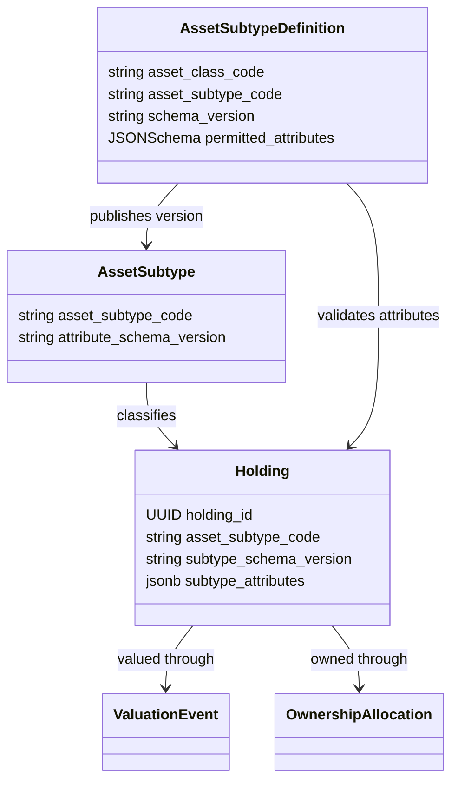
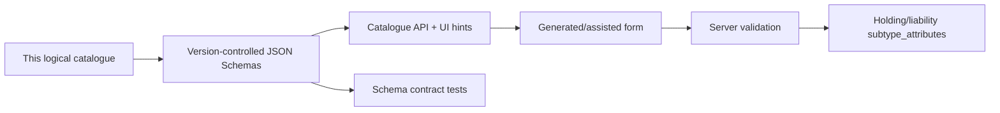

# India Asset and Liability Subtype Attribute Schemas

> **Status:** Implementation-ready logical schema baseline; machine-readable JSON Schema generation remains an implementation task.
>
> **Version:** `1.0.0-draft`
>
> **Market:** India-first. Foreign/offshore holdings use the same subtype plus the cross-cutting offshore fields below.

## Purpose

This document defines the exact subtype-specific information that Vittavaan may capture for every currently planned asset and liability subtype. It answers two questions for each field:

1. Is this information stored in `subtype_attributes`, or somewhere else in the normalized model?
2. Is it entered by a user, supplied by a source, or calculated by Vittavaan?

The colleague JSON was used only as a field-template reference. Its example values and records are not requirements. The operator PDF remains the coverage source; current Indian official sources informed identifiers and product-specific fields.

## How to read the schemas

Each compact field declaration uses:

| Marker | Meaning |
|---|---|
| `R` | Required before the holding/liability becomes active. |
| `C` | Conditionally required when the stated product feature applies. |
| `O` | Optional; absence means unknown or not applicable. |
| `D` | Derived by Vittavaan; never accepted as an authoritative manual value. |
| `S` | Sensitive; encrypt or store as a protected reference and mask in normal responses. |

Types are `str`, `enum`, `bool`, `date`, `datetime`, `int`, `dec`, `pct`, `money`, `country`, `ref`, `list<T>` and `object`. Money is `{minor_units:int64,currency:ISO4217}`. Percentages are fixed-precision decimals from 0 to 100 unless the field explicitly permits negative values. Account, policy, registration and contract numbers use protected references, not plain JSON strings.

All schemas use `additionalProperties: false`, reject empty strings, have bounded lengths and are versioned. A subtype attribute never replaces authorization, ownership, provenance, current value, balance history, transactions, documents or a dedicated relationship.

## Information stored outside `subtype_attributes`

| Information | Authoritative destination |
|---|---|
| Type, name, currency, quantity, acquisition date, lifecycle status | Typed `holdings` columns |
| Owner and ownership percentage | `ownership_allocations` |
| Current/historic value or appraisal | `valuation_events` |
| Purchase cost and contributions | `cost_basis_lots` and `transactions` |
| Income, rent, dividends, interest receipts | `income_streams` and `transactions` |
| Restrictions, pledge, lien, lock-in or freeze | `holding_restrictions` |
| Documents and evidence | `documents`, `document_versions`, `document_links`, `verification_evidence` |
| Returns, portfolio weights, yield, LTV, utilization, holding period | Versioned projections/calculations |
| Liability lender, principal, currency, rate, dates and status | Typed `liabilities` columns |
| Current/historic outstanding amount | `liability_balance_events` |
| EMI and repayment schedule | `liability_schedule_versions/items` |
| Collateral/financed asset | `liability_holding_links` |

`holdings.quantity` is required for an active, explicitly unit-based position such as a listed security, mutual fund, REIT, token, catastrophe bond, equity option or convertible security. For other subtypes it is used only when the position is actually measured in units. The asset field requirement matrix lists the exact mandatory-quantity subtypes; the shared database column stays nullable for non-unitized assets.

## Cross-cutting optional asset attributes

These may be composed into any asset subtype when applicable:

- `offshore`: O bool; when true requires `jurisdiction` R country, `tax_residency_relevance` R enum(`NONE`,`REPORTABLE`,`UNKNOWN`), `reporting_status` R enum(`NOT_REQUIRED`,`PENDING`,`FILED`,`UNKNOWN`) and optional `foreign_account_ref` S ref.
- `custodian_name`: O str; `custody_account_ref`: O/S ref.
- `beneficial_owner_declaration`: O bool; supporting proof remains a document.
- `notes`: O str(1..1000); never contains secrets or unrestricted personal data.

## Relationship to the database



For example, a `PENSION_SAVINGS / PPF` holding may have this validated subtype object:

```json
{
  "institution_name": "Example institution",
  "account_ref": "protected-reference-id",
  "opened_on": "2012-09-09",
  "maturity_date": "2027-09-09",
  "interest_rate_pct": "7.100000",
  "nomination_status": "RECORDED"
}
```

Its owner, current balance, invested contributions, statement document and calculated return are intentionally absent from this object because they belong to their normalized tables.

## Asset schemas

Only the fields listed for a subtype, plus the cross-cutting fields above, are permitted in its `subtype_attributes` object.

### Traditional securities

| Class / subtype | Exact permitted subtype attributes |
|---|---|
| `TRAD_SECURITY / PUBLIC_EQUITY` | `issuer_name` R str; `security_name` R str; `isin` C str(12); `symbol` C str; `exchange_code` C enum(`NSE`,`BSE`,`OTHER`); `listing_status` R enum(`LISTED`,`SUSPENDED`,`DELISTED`,`UNLISTED`); `sector_code` O str; `demat_account_ref` O/S ref. ISIN is required when issued; symbol and exchange are paired. An active holding requires a positive `holdings.quantity` share count. |
| `TRAD_SECURITY / GOVERNMENT_BOND` | `issuer_level` R enum(`CENTRAL`,`STATE`,`SOVEREIGN_OTHER`); `issuer_name` R str; `security_name` R str; `isin` C str(12); `face_value` R money; `coupon_rate_pct` O pct; `coupon_frequency` C enum; `issue_date` O date; `maturity_date` R date; `redemption_terms` O str; `demat_account_ref` O/S ref. |
| `TRAD_SECURITY / MUNICIPAL_BOND` | `issuer_name` R str; `security_name` R str; `isin` C str(12); `face_value` R money; `coupon_rate_pct` O pct; `coupon_frequency` C enum; `issue_date` O date; `maturity_date` R date; `credit_rating` O str; `rating_agency` C str; `rating_as_of` C date; `security_or_escrow_summary` O str. |
| `TRAD_SECURITY / CORPORATE_BOND` | `issuer_name` R str; `security_name` R str; `isin` C str(12); `face_value` R money; `coupon_rate_pct` O pct; `coupon_frequency` C enum; `issue_date` O date; `maturity_date` R date; `secured_status` R enum(`SECURED`,`UNSECURED`,`UNKNOWN`); `seniority` O enum; `credit_rating` O str; `rating_agency` C str; `rating_as_of` C date. |
| `TRAD_SECURITY / DEBENTURE` | Corporate-bond fields plus `convertibility` R enum(`NCD`,`FULLY_CONVERTIBLE`,`PARTLY_CONVERTIBLE`,`OPTIONALLY_CONVERTIBLE`); `conversion_terms` C object; `debenture_trustee` O str. |
| `TRAD_SECURITY / COMMERCIAL_PAPER` | `issuer_name` R str; `isin` C str(12); `face_value` R money; `issue_date` R date; `maturity_date` R date; `discount_or_yield_pct` O pct; `credit_rating` O str; `rating_agency` C str; `rating_as_of` C date. |
| `TRAD_SECURITY / CERTIFICATE_OF_DEPOSIT` | `issuing_bank_or_fi` R str; `isin` C str(12); `face_value` R money; `issue_date` R date; `maturity_date` R date; `discount_or_interest_rate_pct` O pct; `demat_account_ref` O/S ref. |

### Cash, deposits and accounts

| Class / subtype | Exact permitted subtype attributes |
|---|---|
| `CASH / SAVINGS_ACCOUNT` | `institution_name` R str; `account_ref` R/S ref; `branch_ifsc` O str(11); `interest_rate_pct` O pct; `deposit_insurance_status` O enum(`ELIGIBLE`,`NOT_ELIGIBLE`,`UNKNOWN`); `lien_state` O enum(`NONE`,`LIEN`,`FROZEN`,`UNKNOWN`). |
| `CASH / CURRENT_ACCOUNT` | `institution_name` R str; `account_ref` R/S ref; `branch_ifsc` O str(11); `overdraft_enabled` O bool; `lien_state` O enum. A negative/overdrawn balance is a linked liability, not a negative asset. |
| `CASH / FIXED_DEPOSIT` | `institution_name` R str; `deposit_ref` R/S ref; `principal_amount` R money; `interest_rate_pct` R pct; `interest_payout_frequency` R enum; `opened_on` R date; `maturity_date` R date; `maturity_amount` O money; `auto_renewal` O bool; `premature_break_rule` O object; `deposit_insurance_status` O enum. |
| `CASH / RECURRING_DEPOSIT` | `institution_name` R str; `deposit_ref` R/S ref; `instalment_amount` R money; `instalment_frequency` R enum; `interest_rate_pct` R pct; `opened_on` R date; `maturity_date` R date; `maturity_amount` O money; `missed_instalments` O int>=0. |
| `CASH / SWEEP_ACCOUNT` | `institution_name` R str; `account_ref` R/S ref; `linked_account_ref` O/S ref; `sweep_threshold` O money; `interest_rate_pct` O pct; `sweep_direction` R enum(`AUTO_CREATE_DEPOSIT`,`AUTO_BREAK_DEPOSIT`,`BOTH`). |
| `CASH / POSITIVE_CARD_BALANCE` | `issuer_name` R str; `card_ref` R/S ref; `statement_date` R date; `reason` O enum(`REFUND`,`OVERPAYMENT`,`CASHBACK`,`OTHER`). Only a verified positive balance is an asset; ordinary card debt uses `CREDIT_CARD_DEBT`. |
| `CASH / SAFE_DEPOSIT_LOCKER` | `institution_name` R str; `locker_ref` R/S ref; `branch_ifsc` O str(11); `annual_fee` O money; `contents_recorded_separately` R bool. The locker itself has zero portfolio value; valuable contents are separate holdings. |

### Funds and managed portfolios

| Class / subtype | Exact permitted subtype attributes |
|---|---|
| `FUND / MUTUAL_FUND` | `scheme_name` R str; `amc_name` R str; `scheme_code` C str; `isin` C str(12); `folio_ref` O/S ref; `plan_type` R enum(`DIRECT`,`REGULAR`,`INSTITUTIONAL`,`UNKNOWN`); `option_type` R enum(`GROWTH`,`IDCW_PAYOUT`,`IDCW_REINVESTMENT`,`OTHER`); `fund_category` O str; `expense_ratio_pct` O pct; `expense_as_of` C date; `lock_in_until` O date. Units/NAV/value remain typed quantity and valuation facts. |
| `FUND / MONEY_MARKET_FUND` | Mutual-fund fields plus `money_market_category` O enum(`LIQUID`,`OVERNIGHT`,`MONEY_MARKET`,`ULTRA_SHORT`,`OTHER`); `weighted_average_maturity_days` O int>=0. |
| `FUND / PMS` | `portfolio_manager_name` R str; `sebi_registration_ref` O/S ref; `client_account_ref` R/S ref; `strategy_name` R str; `mandate_type` R enum(`DISCRETIONARY`,`NON_DISCRETIONARY`,`ADVISORY`); `benchmark_name` O str; `fee_terms` O object; `reporting_date` R date. Underlying positions may be separate holdings when available. |
| `FUND / AIF` | `fund_name` R str; `scheme_name` R str; `sebi_registration_ref` O/S ref; `category` R enum(`CATEGORY_I`,`CATEGORY_II`,`CATEGORY_III`); `class_or_series` O str; `commitment_amount` O money; `drawn_amount` O money; `unfunded_commitment` D money; `vintage_year` O int; `tenure_end_date` O date; `manager_name` R str; `statement_date` R date. |

### Credit and lending assets

| Class / subtype | Exact permitted subtype attributes |
|---|---|
| `CREDIT_ASSET / P2P_LOAN` | `platform_name` R str; `loan_ref` R/S ref; `borrower_ref` O/S ref; `original_principal` R money; `principal_outstanding` R money; `interest_rate_pct` R pct; `started_on` R date; `due_on` R date; `payment_frequency` R enum; `credit_state` R enum(`CURRENT`,`LATE`,`DELINQUENT`,`DEFAULTED`,`RESTRUCTURED`,`RECOVERED`,`DISPUTED`); `days_past_due` C int>=0; `risk_grade` O str; `escrow_or_trustee_known` O bool. |
| `CREDIT_ASSET / DIRECT_LENDING` | `counterparty_ref` R/S ref; `agreement_ref` R/S ref; `original_principal` R money; `principal_outstanding` R money; `interest_rate_pct` O pct; `rate_type` R enum; `started_on` R date; `due_on` C date; `payment_frequency` O enum; `security_summary` O str; `credit_state` R enum; `days_past_due` C int>=0. |
| `CREDIT_ASSET / MEZZANINE_DEBT` | Direct-lending fields plus `seniority` R enum(`SUBORDINATED`,`JUNIOR`,`OTHER`); `equity_kicker` O object; `conversion_or_warrant_terms` O object; `cash_pay_rate_pct` O pct; `pik_rate_pct` O pct. |
| `CREDIT_ASSET / MICROFINANCE_INTEREST` | `institution_or_platform` R str; `facility_ref` R/S ref; `portfolio_or_borrower_group` O str; `principal_outstanding` R money; `interest_rate_pct` O pct; `maturity_date` O date; `repayment_frequency` O enum; `delinquency_or_npa_state` R enum; `social_or_program_tag` O str. |
| `CREDIT_ASSET / MORTGAGE_CREDIT` | `borrower_ref` R/S ref; `agreement_ref` R/S ref; `principal_outstanding` R money; `interest_rate_pct` O pct; `maturity_date` R date; `property_security_summary` R str; `security_rank` O enum; `credit_state` R enum; `days_past_due` C int>=0. |
| `CREDIT_ASSET / WORKING_CAPITAL_CREDIT` | `counterparty_ref` R/S ref; `facility_or_invoice_ref` R/S ref; `credit_kind` R enum(`WORKING_CAPITAL`,`TRADE_FINANCE`,`INVOICE`,`SUPPLY_CHAIN`,`OTHER`); `principal_outstanding` R money; `due_on` C date; `interest_or_discount_rate_pct` O pct; `recourse_type` O enum; `credit_state` R enum. |

### Indian pensions and small-savings schemes

| Class / subtype | Exact permitted subtype attributes |
|---|---|
| `PENSION_SAVINGS / EPF` | `uan_ref` R/S ref; `employer_name` O str; `establishment_ref` O/S ref; `member_id_ref` O/S ref; `employee_component` O money; `employer_epf_component` O money; `eps_component` O money; `passbook_as_of` R date; `nomination_status` O enum(`RECORDED`,`NOT_RECORDED`,`UNKNOWN`). Components must reconcile to a sourced balance or carry an exception. |
| `PENSION_SAVINGS / PPF` | `institution_name` R str; `account_ref` R/S ref; `opened_on` R date; `maturity_date` R date; `interest_rate_pct` O pct; `extension_block_end_date` O date; `loan_or_lien_state` O enum(`NONE`,`LOAN`,`LIEN`,`UNKNOWN`); `nomination_status` O enum. |
| `PENSION_SAVINGS / NPS` | `pran_ref` R/S ref; `tier` R enum(`TIER_I`,`TIER_II`); `cra_name` O str; `pop_name` O str; `pension_fund_manager` O str; `investment_choice` O enum(`ACTIVE`,`AUTO`,`UNKNOWN`); `scheme_allocation` O object; `statement_as_of` R date; `nomination_status` O enum. Units/NAV/value use valuation facts. |
| `PENSION_SAVINGS / SSY` | `institution_name` R str; `account_ref` R/S ref; `beneficiary_person_id` R ref; `guardian_person_id` C ref; `opened_on` R date; `maturity_date` R date; `interest_rate_pct` O pct; `annual_deposit_amount` O money. Beneficiary/guardian must be authorized household persons. |
| `PENSION_SAVINGS / SCSS` | `institution_name` R str; `account_ref` R/S ref; `opened_on` R date; `maturity_date` R date; `deposit_amount` R money; `interest_rate_pct` O pct; `interest_payout_frequency` R enum; `extension_end_date` O date; `nomination_status` O enum. |
| `PENSION_SAVINGS / POST_OFFICE_SAVINGS` | `institution_name` R str; `account_ref` R/S ref; `scheme_kind` R enum(`SAVINGS`,`RD`,`TD`,`MIS`,`NSC`,`KVP`,`OTHER`); `certificate_ref` C/S ref; `opened_or_issue_date` R date; `maturity_date` C date; `principal_amount` O money; `interest_rate_pct` O pct; `payout_frequency` O enum; `nomination_status` O enum. |
| `PENSION_SAVINGS / APY` | `pran_ref` R/S ref; `bank_or_pop_name` O str; `contribution_frequency` R enum; `contribution_amount` R money; `guaranteed_pension_band` O money; `pension_start_date` O date; `spouse_person_id` O ref; `nomination_status` O enum; `statement_as_of` R date. |
| `PENSION_SAVINGS / GRATUITY` | `employer_name` R str; `employment_start_date` R date; `employment_end_date` O date; `covered_under_act` O bool; `last_drawn_eligible_salary` O money; `completed_service_years` D dec; `employer_statement_amount` O money; `statement_as_of` C date; `nomination_status` O enum. Estimated entitlement is a modelled valuation, not an attribute. |
| `PENSION_SAVINGS / ANNUITY` | `insurer_name` R str; `policy_ref` R/S ref; `annuity_type` R enum(`IMMEDIATE`,`DEFERRED`); `life_basis` R enum(`SINGLE`,`JOINT`,`OTHER`); `purchase_price` O money; `annuity_amount` R money; `payment_frequency` R enum; `commencement_date` R date; `return_of_purchase_price` O bool; `secondary_annuitant_person_id` C ref; `guarantee_period_end` O date; `surrender_terms` O object; `nomination_status` O enum. |

### Private capital and hedge strategies

| Class / subtype | Exact permitted subtype attributes |
|---|---|
| `PRIVATE_CAPITAL / VENTURE_CAPITAL` | `company_or_fund_name` R str; `instrument_kind` R enum; `share_class` O str; `ownership_pct` O pct; `committed_capital` O money; `drawn_capital` O money; `last_round_name` O str; `last_round_date` C date; `last_round_price` O money; `dilution_terms` O str; `exit_rights` O str. |
| `PRIVATE_CAPITAL / GROWTH_BUYOUT` | `company_or_fund_name` R str; `instrument_kind` R enum; `ownership_pct` O pct; `committed_capital` O money; `drawn_capital` O money; `distribution_total` O money; `vintage_year` O int; `manager_name` O str; `liquidity_window` O object. |
| `PRIVATE_CAPITAL / DISTRESSED_INVESTMENT` | `issuer_or_asset_name` R str; `instrument_kind` R enum; `claim_or_security_ref` O/S ref; `seniority` O enum; `restructuring_state` R enum; `expected_recovery` O money; `expected_recovery_date` O date; `legal_or_insolvency_reference` O/S ref. |
| `PRIVATE_CAPITAL / SYNDICATE_INTEREST` | `syndicate_or_lead_name` R str; `investee_name` R str; `instrument_kind` R enum; `spv_name` O str; `commitment_amount` O money; `drawn_amount` O money; `ownership_or_units` O dec; `carry_or_fee_terms` O object; `exit_rights` O str. |
| `PRIVATE_CAPITAL / CONVERTIBLE_NOTE` | `issuer_name` R str; `agreement_ref` R/S ref; `principal_amount` R money; `issue_date` R date; `maturity_date` O date; `interest_rate_pct` O pct; `valuation_cap` O money; `discount_pct` O pct; `conversion_trigger` R str; `conversion_status` R enum. |
| `PRIVATE_CAPITAL / ESOP_OPTION` | `employer_or_issuer` R str; `grant_ref` R/S ref; `grant_date` R date; `granted_units` R dec; `vested_units` R dec; `exercised_units` O dec; `strike_price` R money; `vesting_schedule_summary` R str; `next_vesting_date` O date; `expiry_date` R date; `exercise_status` R enum. |
| `HEDGE_STRATEGY / HEDGE_FUND` | `fund_name` R str; `manager_name` R str; `domicile_country` R country; `fund_or_account_ref` R/S ref; `strategy_name` O str; `share_class` O str; `redemption_terms` O object; `lock_up_until` O date; `statement_date` R date; `leverage_disclosed` O dec. |
| `HEDGE_STRATEGY / LONG_SHORT` | Hedge-fund fields plus `gross_exposure_pct` O pct; `net_exposure_pct` O dec(-100..100); `shorting_permitted` R bool. |
| `HEDGE_STRATEGY / GLOBAL_MACRO` | Hedge-fund fields plus `primary_markets` O list<str>; `base_currency` R ISO4217; `derivative_usage` O bool. |
| `HEDGE_STRATEGY / ARBITRAGE_STRATEGY` | Hedge-fund fields plus `arbitrage_kind` O enum(`CASH_FUTURES`,`MERGER`,`CONVERTIBLE`,`STATISTICAL`,`OTHER`); `leverage_disclosed` O dec. |

### Property and infrastructure

| Class / subtype | Exact permitted subtype attributes |
|---|---|
| `REAL_ASSET / RESIDENTIAL_PROPERTY` | `property_kind` R enum; `address_ref` R/S ref; `state_code` R str; `district` R str; `pin_code` O str(6); `title_or_registration_ref` R/S ref; `rera_project_ref` O/S ref; `carpet_area` O object; `built_up_area` O object; `land_share` O object; `possession_status` R enum; `occupancy_status` R enum; `completion_or_possession_date` O date; `property_tax_ref` O/S ref. |
| `REAL_ASSET / COMMERCIAL_PROPERTY` | Residential-property identity/area fields plus `commercial_kind` R enum(`OFFICE`,`RETAIL`,`WAREHOUSE`,`INDUSTRIAL`,`HOSPITALITY`,`OTHER`); `lease_status` R enum; `tenant_count` O int; `lease_expiry_date` O date; `occupancy_area_pct` O pct; `noi_basis_available` O bool. Rent itself is an income stream. |
| `REAL_ASSET / LAND` | `land_kind` R enum(`RESIDENTIAL`,`COMMERCIAL`,`INDUSTRIAL`,`DEVELOPMENT`,`OTHER`); `address_ref` R/S ref; `state_code` R str; `district` R str; `survey_or_khasra_ref` R/S ref; `title_or_registration_ref` R/S ref; `area` R object; `usable_area` O object; `saleable_area` O object; `waste_area` O object; `land_use_or_zoning` O str; `conversion_status` O enum; `development_status` O enum. |
| `REAL_ASSET / AGRICULTURAL_LAND` | Land fields plus `agricultural_land_class` O str; `crop_or_use` O str; `irrigation_status` O enum; `tenancy_or_cultivation_status` O enum; `state_eligibility_confirmed` O bool. State-specific ownership restrictions require legal review. |
| `REAL_ASSET / REIT` | `trust_name` R str; `isin` C str(12); `symbol` C str; `exchange_code` C enum; `manager_name` O str; `reit_kind` O enum(`REIT`,`SM_REIT`); `distribution_frequency` O enum; `demat_account_ref` O/S ref. Quantity and market/NAV values remain typed facts. |
| `REAL_ASSET / FRACTIONAL_PROPERTY` | `platform_or_manager_name` R str; `spv_or_scheme_name` R str; `interest_ref` R/S ref; `underlying_property_summary` R str; `interest_kind` R enum(`SPV_SECURITY`,`SM_REIT_UNIT`,`CO_OWNERSHIP`,`CONTRACTUAL`,`OTHER`); `ownership_or_units` O dec; `rera_project_ref` O/S ref; `lock_in_until` O date; `exit_terms` O object. Regulatory classification must be sourced, not inferred. |
| `REAL_ASSET / PARKING_STORAGE_UNIT` | `unit_kind` R enum(`PARKING`,`SELF_STORAGE`,`WAREHOUSE_UNIT`); `address_ref` R/S ref; `unit_or_registration_ref` R/S ref; `area` O object; `title_kind` R enum(`SEPARATE_TITLE`,`APPURTENANT`,`LEASE`,`CONTRACTUAL`,`UNKNOWN`); `occupancy_status` O enum; `lease_expiry_date` O date. |
| `INFRASTRUCTURE / TOLL_ROAD` | `project_or_spv_name` R str; `interest_kind` R enum; `concession_authority` O str; `concession_ref` O/S ref; `concession_end_date` O date; `operational_status` R enum; `route_or_location` O str; `traffic_or_revenue_source_date` O date. |
| `INFRASTRUCTURE / AIRPORT` | `project_or_spv_name` R str; `interest_kind` R enum; `airport_name_or_code` R str; `concession_authority` O str; `concession_end_date` O date; `operational_status` R enum. |
| `INFRASTRUCTURE / PIPELINE` | `project_or_spv_name` R str; `interest_kind` R enum; `commodity_or_service` R str; `route_or_region` O str; `capacity` O object; `concession_or_contract_end` O date; `operational_status` R enum. |
| `INFRASTRUCTURE / PPP_PROJECT` | `project_or_spv_name` R str; `sector` R str; `government_counterparty` R str; `concession_or_agreement_ref` R/S ref; `concession_end_date` O date; `project_stage` R enum; `revenue_model` O enum. |
| `INFRASTRUCTURE / ENERGY_PROJECT` | `project_or_spv_name` R str; `energy_kind` R enum; `installed_capacity` O object; `location` O str; `offtake_counterparty` O str; `ppa_end_date` O date; `project_stage` R enum; `operational_since` O date. |

### Tangible, digital and contractual assets

| Class / subtype | Exact permitted subtype attributes |
|---|---|
| `TANGIBLE / PRECIOUS_METAL` | `metal_type` R enum; `form` R enum; `weight` R object; `purity` O dec; `hallmark_or_serial_ref` O/S ref; `custody_location_class` R enum; `appraiser_name` O str; `appraisal_date` C date. |
| `TANGIBLE / COMMODITY_INTEREST` | `commodity_type` R str; `form_or_grade` R str; `quantity_and_unit` R object; `warehouse_or_custodian` O str; `warehouse_receipt_ref` O/S ref; `delivery_location` O str; `expiry_or_storage_end` O date. |
| `TANGIBLE / ART` | `artist_or_maker` O str; `work_title` R str; `medium` O str; `creation_year` O int; `dimensions` O object; `provenance_summary` O str; `authenticity_state` R enum; `catalogue_or_serial_ref` O/S ref; `storage_location_class` O enum; `insured_value` O money. |
| `TANGIBLE / WINE` | `producer` R str; `label_or_cuvee` R str; `vintage_year` O int; `region_country` O str; `bottle_count` R int>0; `bottle_size_ml` O int; `storage_location_class` R enum; `provenance_summary` O str; `condition_grade` O str. |
| `TANGIBLE / COINS_STAMPS` | `collection_kind` R enum(`COIN`,`STAMP`,`MIXED`); `description` R str; `item_count` O int; `country_or_issue` O str; `year_or_period` O str; `grade_or_condition` O str; `certification_ref` O/S ref; `provenance_summary` O str. |
| `TANGIBLE / JEWELLERY` | `item_type` R str; `metal_type` O str; `gross_weight` O object; `net_metal_weight` O object; `purity` O dec; `gemstone_summary` O str; `hallmark_or_certificate_ref` O/S ref; `appraiser_name` O str; `appraisal_date` C date; `insured_value` O money. |
| `TANGIBLE / OTHER_COLLECTIBLE` | `item_type` R str; `description` R str; `maker_or_brand` O str; `serial_ref` O/S ref; `year_or_period` O str; `provenance_summary` O str; `authenticity_state` O enum; `condition_grade` O str; `appraiser_name` O str; `appraisal_date` C date. |
| `DIGITAL_ASSET / CRYPTO_TOKEN` | `asset_symbol` R str; `asset_name` R str; `network` R str; `contract_address` C str; `custody_type` R enum(`SELF_CUSTODY`,`EXCHANGE`,`INSTITUTIONAL`,`SMART_CONTRACT`,`UNKNOWN`); `wallet_or_account_hash` O str; `venue_name` O str; `fiu_registration_status` O enum(`REGISTERED`,`NOT_REGISTERED`,`UNKNOWN`,`NOT_APPLICABLE`); `tax_lot_method` O enum. Never store private keys or seed phrases. |
| `DIGITAL_ASSET / NFT` | `collection_name` O str; `token_id` R str; `network` R str; `contract_address` R str; `token_standard` O str; `custody_type` R enum; `wallet_or_account_hash` O str; `creator_or_issuer` O str; `rights_summary` O str; `metadata_uri_hash` O str. |
| `DIGITAL_ASSET / TOKENIZED_ASSET` | `token_name` R str; `token_id_or_symbol` R str; `network_or_registry` R str; `contract_address` C str; `underlying_asset_type` R str; `issuer_or_spv` R str; `legal_claim_type` R enum; `custodian_or_trustee` O str; `redemption_terms` O object; `regulatory_classification` O str. |
| `DIGITAL_ASSET / DOMAIN_NAME` | `domain_name` R str; `registrar_name` R str; `registrar_account_ref` O/S ref; `registration_date` O date; `expiry_date` R date; `auto_renewal` O bool; `registry_lock` O bool; `monetization_status` O enum. |
| `TRUST_INTEREST / TRUST_BENEFICIAL_INTEREST` | `trust_name` R str; `trust_jurisdiction` R country; `trust_deed_ref` R/S ref; `trustee_name` R str; `interest_type` R enum(`FIXED`,`DISCRETIONARY`,`CONTINGENT`,`LIFE_INTEREST`,`REMAINDER`,`OTHER`); `beneficial_share_pct` C pct; `distribution_terms` O str; `vesting_or_end_date` O date; `revocability` O enum; `statement_date` R date. |
| `CONTRACT_RIGHT / RECEIVABLE` | `counterparty_ref` R/S ref; `contract_or_invoice_ref` R/S ref; `original_amount` R money; `amount_outstanding` R money; `due_date` R date; `interest_or_penalty_terms` O object; `credit_state` R enum; `assignability` O enum. |
| `CONTRACT_RIGHT / EARNOUT` | `counterparty_ref` R/S ref; `agreement_ref` R/S ref; `measurement_period` R object; `trigger_or_formula` R str; `maximum_entitlement` O money; `amount_received` O money; `next_assessment_date` O date; `contingency_state` R enum. |
| `CONTRACT_RIGHT / PROFIT_SHARE` | `counterparty_ref` R/S ref; `agreement_ref` R/S ref; `profit_base` R str; `share_pct` R pct; `effective_from` R date; `expires_on` O date; `payment_frequency` O enum; `audit_rights` O bool. |
| `CONTRACT_RIGHT / ROYALTY` | `right_type` R enum(`MUSIC`,`PATENT`,`TRADEMARK`,`BOOK`,`SOFTWARE`,`OTHER`); `work_or_ip_name` R str; `registration_or_contract_ref` O/S ref; `payer_or_licensee` O str; `territory` O list<country>; `payment_basis` R object; `effective_from` R date; `expires_on` O date; `assignability` O enum. |
| `CONTRACT_RIGHT / FRANCHISE` | `franchisor_name` R str; `brand_name` R str; `agreement_ref` R/S ref; `territory` O str; `effective_from` R date; `expires_on` R date; `initial_fee` O money; `ongoing_fee_basis` O object; `renewal_terms` O str; `transferability` O enum. |
| `CONTRACT_RIGHT / LITIGATION_FINANCE` | `case_ref` R/S ref; `court_or_forum` R str; `funded_party_ref` R/S ref; `agreement_ref` R/S ref; `funded_amount` R money; `return_waterfall` R object; `case_stage` R enum; `expected_resolution_date` O date; `adverse_cost_exposure` O money. Feature remains legally gated. |
| `CONTRACT_RIGHT / SPORTS_INTEREST` | `team_or_athlete_ref` R/S ref; `contract_ref` R/S ref; `interest_kind` R enum; `effective_from` R date; `expires_on` O date; `payment_or_revenue_basis` O object; `territory_or_league` O str; `assignability` O enum. |
| `CONTRACT_RIGHT / ENTERTAINMENT_RIGHT` | `project_or_work_name` R str; `media_kind` R enum; `contract_ref` R/S ref; `right_kind` R enum; `territory` O list<country>; `effective_from` R date; `expires_on` O date; `revenue_share_basis` O object; `recoupment_waterfall` O object. |
| `INSURANCE_SECURITY / CAT_BOND` | `issuer_or_spv` R str; `security_name` R str; `isin` C str(12); `peril_or_trigger` R str; `trigger_type` R enum; `face_value` R money; `coupon_rate_pct` O pct; `issue_date` O date; `maturity_date` R date; `loss_attachment_terms` O str. |

### Derivatives, specialized assets and vehicles

| Class / subtype | Exact permitted subtype attributes |
|---|---|
| `DERIVATIVE / EQUITY_OPTION` | `underlying_ref` R str; `option_type` R enum(`CALL`,`PUT`); `position_side` R enum(`LONG`,`SHORT`); `exercise_style` O enum; `strike_price` R money; `expiry_date` R date; `contract_multiplier` R dec>0; `settlement_type` R enum; `exchange_code` O str. Notional is derived and excluded from net worth. |
| `DERIVATIVE / FUTURE` | `underlying_ref` R str; `position_side` R enum; `expiry_date` R date; `contract_quantity` R dec>0; `contract_multiplier` R dec>0; `settlement_type` R enum; `exchange_code` O str. |
| `DERIVATIVE / FX_FORWARD_SWAP` | `instrument_kind` R enum(`FORWARD`,`SWAP`); `buy_currency` R ISO4217; `sell_currency` R ISO4217; `buy_amount` R money; `sell_amount` R money; `contract_rate` R dec; `settlement_date` R date; `counterparty_ref` O/S ref; `deliverability` O enum. |
| `DERIVATIVE / COMMODITY_DERIVATIVE` | `underlying_commodity` R str; `instrument_kind` R enum; `position_side` R enum; `quantity_and_unit` R object; `strike_price` C money; `expiry_date` R date; `settlement_type` R enum; `exchange_code` O str; `delivery_location` O str. |
| `DERIVATIVE / CONVERTIBLE_SECURITY` | `issuer_name` R str; `security_name` R str; `isin` O str(12); `principal_or_face_value` R money; `coupon_rate_pct` O pct; `maturity_date` O date; `conversion_ratio_or_formula` R object; `conversion_start_date` O date; `conversion_end_date` O date; `conversion_status` R enum. |
| `SPECIALIZED / AGRI_BUSINESS` | `interest_kind` R enum(`FARMLAND`,`TIMBER`,`LIVESTOCK`,`AGRIBUSINESS_EQUITY`,`REVENUE_SHARE`,`OTHER`); `project_or_business_name` R str; `location` O str; `units_or_area` O object; `crop_species_or_activity` O str; `harvest_or_cycle_date` O date; `operator_name` O str; `biological_asset_count` O int. |
| `SPECIALIZED / CARBON_CREDIT` | `project_name` R str; `credit_standard` R str; `registry_name` R str; `registry_ref` R/S ref; `project_country` R country; `vintage_year` R int; `credit_type` R str; `units_tco2e` R dec>=0; `retirement_status` R enum(`ACTIVE`,`RETIRED`,`CANCELLED`,`UNKNOWN`); `retirement_date` C date; `verification_body` O str. |
| `SPECIALIZED / SHIPPING_INTEREST` | `interest_kind` R enum(`CONTAINER`,`VESSEL`,`CARGO`,`LEASE`,`EQUITY`,`OTHER`); `asset_or_project_name` R str; `imo_or_container_ref` O/S ref; `operator_name` O str; `flag_country` O country; `capacity_or_units` O object; `lease_or_charter_end` O date; `operational_status` R enum. |
| `SPECIALIZED / SPACE_INVESTMENT` | `company_or_project_name` R str; `interest_kind` R enum; `jurisdiction` R country; `development_stage` R enum; `mission_or_asset_summary` O str; `launch_or_milestone_date` O date; `commercialization_stage` O enum; `material_risk_note` R str. |
| `SPECIALIZED / DATA_AI_INTEREST` | `company_or_asset_name` R str; `interest_kind` R enum(`EQUITY`,`DATA_RIGHT`,`MODEL_RIGHT`,`COMPUTE_CAPACITY`,`DATA_CENTRE`,`OTHER`); `jurisdiction` R country; `rights_or_capacity_summary` R str; `contract_ref` O/S ref; `term_end_date` O date; `commercialization_stage` O enum; `data_rights_basis` O str; `material_risk_note` R str. Never store the underlying personal dataset in this object. |
| `SPECIALIZED / BIOTECH_RIGHT` | `company_or_program_name` R str; `interest_kind` R enum; `jurisdiction` R country; `therapy_or_program` O str; `development_phase` R enum; `milestone_terms` O object; `royalty_terms` O object; `patent_or_contract_ref` O/S ref; `exclusivity_end_date` O date; `material_risk_note` R str. |
| `VEHICLE / ROAD_VEHICLE` | `vehicle_kind` R enum; `make` R str; `model` R str; `variant` O str; `manufacture_year` R int; `registration_ref` R/S ref; `registration_state` R str; `vin_or_chassis_ref` O/S ref; `engine_or_motor_ref` O/S ref; `fuel_type` O enum; `odometer_km` O int>=0; `insurance_expiry` O date. |
| `VEHICLE / AIRCRAFT` | `make` R str; `model` R str; `manufacture_year` O int; `registration_ref` R/S ref; `serial_ref` O/S ref; `jurisdiction` R country; `ownership_interest_pct` O pct; `operator_name` O str; `airworthiness_expiry` O date; `hours_or_cycles` O object. |
| `VEHICLE / VESSEL` | `vessel_kind` R enum; `make_or_builder` O str; `model_or_name` R str; `manufacture_year` O int; `registration_or_imo_ref` R/S ref; `flag_country` O country; `length_or_tonnage` O object; `berth_or_location_class` O str; `insurance_expiry` O date. |
| `VEHICLE / FRACTIONAL_VEHICLE` | `underlying_vehicle_kind` R enum; `platform_or_spv_name` R str; `interest_ref` R/S ref; `ownership_pct_or_units` R dec; `usage_rights` O object; `operator_name` O str; `term_end_date` O date; `exit_terms` O object. |
| `TAX_ASSET / GST_INPUT_CREDIT` | `gstin_ref` R/S ref; `tax_period` R str; `credit_component` R enum(`IGST`,`CGST`,`SGST`,`UTGST`,`CESS`,`MIXED`); `ledger_balance` R money; `ledger_as_of` R date; `eligibility_state` R enum(`ELIGIBLE`,`BLOCKED`,`DISPUTED`,`REVERSAL_PENDING`,`UNKNOWN`); `return_or_ledger_ref` O/S ref. Inclusion in net worth is policy-gated. |
| `OTHER / CUSTOM_ASSET` | `custom_type_name` R str; `description` R str; `legal_or_contract_basis` O str; `identifier_ref` O/S ref; `jurisdiction` O country; `units_or_interest` O object; `valuation_basis_note` R str; `material_risk_note` R str. Requires manual review before activation. |

## Liability schemas

Only the listed subtype-specific attributes are stored in `liabilities.subtype_attributes`. Lender, account reference, principal, currency, rate, start/maturity dates, balance history, schedules and collateral links remain in typed columns or related tables.

The proposed stable liability class/subtype pairs are:

| Liability class | Subtypes |
|---|---|
| `SECURED_LOAN` | `HOME_MORTGAGE`, `VEHICLE_LOAN`, `GOLD_LOAN`, `LOAN_AGAINST_SECURITIES` |
| `UNSECURED_LOAN` | `PERSONAL_LOAN` |
| `EDUCATION_LOAN` | `EDUCATION_LOAN` |
| `REVOLVING_CREDIT` | `CREDIT_CARD_DEBT`, `OD_CC_FACILITY` |
| `CONSUMER_CREDIT` | `BNPL` |
| `BUSINESS_LOAN` | `BUSINESS_MSME_LOAN` |
| `STATUTORY_DUE` | `GST_TAX_DUE` |
| `CONTINGENT` | `GUARANTEE_COSIGNED` |
| `LEGAL_OBLIGATION` | `LEGAL_COURT_DEBT` |

| Liability class / subtype | Exact permitted subtype attributes |
|---|---|
| `SECURED_LOAN / HOME_MORTGAGE` | `sanctioned_amount` O money; `loan_purpose` R enum(`PURCHASE`,`CONSTRUCTION`,`RENOVATION`,`TOP_UP`,`BALANCE_TRANSFER`,`OTHER`); `property_holding_id` R ref; `security_rank` O enum; `benchmark_code` C str; `spread_pct` C dec; `next_reset_on` C date; `emi_amount` O money. |
| `UNSECURED_LOAN / PERSONAL_LOAN` | `sanctioned_amount` O money; `disbursed_amount` O money; `disbursed_on` O date; `purpose` O str; `secured_flag` R bool(false); `emi_amount` O money. |
| `SECURED_LOAN / VEHICLE_LOAN` | `sanctioned_amount` O money; `vehicle_holding_id` C ref; `registration_ref` O/S ref; `hypothecation_state` O enum; `emi_amount` O money. |
| `EDUCATION_LOAN / EDUCATION_LOAN` | `sanctioned_amount` O money; `student_person_id` R ref; `institution_name` O str; `course_name` O str; `study_country` O country; `co_borrower_person_ids` O list<ref>; `moratorium_end_date` O date; `emi_amount` O money. |
| `REVOLVING_CREDIT / CREDIT_CARD_DEBT` | `issuer_name` R str; `card_ref` R/S ref; `statement_date` R date; `payment_due_date` R date; `credit_limit` O money; `minimum_due` O money; `annualized_rate_pct` O pct; `fees_and_interest` O money. Utilized percentage is derived. |
| `REVOLVING_CREDIT / OD_CC_FACILITY` | `facility_kind` R enum(`OVERDRAFT`,`CASH_CREDIT`); `sanctioned_limit` R money; `drawing_power` O money; `renewal_or_end_date` O date; `end_use` O str; `benchmark_code` C str; `spread_pct` C dec; `next_reset_on` C date. Available amount and utilization are derived. |
| `CONSUMER_CREDIT / BNPL` | `provider_name` R str; `plan_or_purchase_ref` R/S ref; `purchase_date` O date; `original_purchase_amount` O money; `instalment_count` R int>0; `instalment_frequency` R enum; `next_due_date` O date; `fees_or_rate` O object. |
| `BUSINESS_LOAN / BUSINESS_MSME_LOAN` | `business_ref` R/S ref; `facility_kind` R enum(`TERM_LOAN`,`WORKING_CAPITAL`,`EQUIPMENT`,`INVOICE`,`OTHER`); `sanctioned_amount` O money; `secured_flag` R bool; `purpose_or_end_use` O str; `gstin_ref` O/S ref; `udyam_ref` O/S ref; `turnover_source_ref` O/S ref; `emi_amount` O money. |
| `SECURED_LOAN / GOLD_LOAN` | `sanctioned_amount` O money; `collateral_holding_id` R ref; `pledged_weight` O object; `purity` O dec; `assessed_value` C money; `assessment_date` C date; `security_packet_ref` O/S ref. LTV is derived. |
| `SECURED_LOAN / LOAN_AGAINST_SECURITIES` | `sanctioned_limit` R money; `pledged_holding_ids` R list<ref>; `drawing_power` O money; `margin_requirement_pct` R pct; `margin_call_threshold_pct` O pct; `benchmark_code` C str; `spread_pct` C dec; `next_reset_on` C date. LTV/utilization are derived. |
| `STATUTORY_DUE / GST_TAX_DUE` | `authority_name` R str; `tax_kind` R enum(`GST`,`INCOME_TAX`,`TDS`,`PROPERTY_TAX`,`OTHER`); `tax_period` R str; `pan_or_gstin_ref` O/S ref; `notice_or_demand_ref` O/S ref; `base_tax_amount` R money; `interest_amount` R money; `penalty_amount` R money; `due_date` R date; `dispute_state` R enum; `appeal_ref` O/S ref. |
| `CONTINGENT / GUARANTEE_COSIGNED` | `primary_borrower_ref` R/S ref; `creditor_name` R str; `underlying_facility_ref` R/S ref; `guarantor_role` R enum(`GUARANTOR`,`CO_BORROWER`,`CO_SIGNER`); `maximum_exposure` R money; `crystallization_trigger` R str; `crystallized` R bool; `crystallized_on` C date; `repayment_state` O enum. Non-crystallized exposure is excluded from direct debt. |
| `LEGAL_OBLIGATION / LEGAL_COURT_DEBT` | `authority_or_court` R str; `case_or_order_ref` R/S ref; `payee_ref` O/S ref; `ordered_amount` R money; `order_date` R date; `payment_due_date` O date; `interest_amount` O money; `penalty_amount` O money; `compliance_state` R enum; `appeal_or_dispute_state` R enum; `appeal_ref` O/S ref. |

## Cross-field rules

1. Reference fields ending in `_person_id` or `_holding_id` must resolve within the caller's authorized scope; the client cannot invent an owner or collateral ID.
2. A field marked `S` is encrypted or converted to a protected reference before persistence and is masked in APIs, logs and analytics.
3. Current values, outstanding balances, appraisals, NAVs and statement balances are dated events, never duplicated into subtype JSON.
4. Calculated values—including return, IRR, yield, portfolio weight, LTV, utilization, tenure and holding period—are projection outputs with versioned inputs.
5. Subtype money must match the aggregate currency unless explicitly defined as multi-currency.
6. Paired fields such as rating/agency/date, appraisal/appraiser/date, benchmark/spread/reset date and annuity amount/frequency are validated together.
7. Schema upgrades never reinterpret stored JSON silently. Breaking changes create a new semantic version and an audited migration or retain the old version.
8. Long-form legal terms, statements, deeds, contracts and certificates are documents; subtype JSON stores only bounded summaries and references.
9. Regulatory classification and eligibility fields are sourced assertions, not legal advice generated by Vittavaan.
10. Features requiring legal, regulatory or vendor approval remain disabled even though their record-keeping schemas are documented.

## Schema ownership and runtime implementation



The actual JSON Schema documents belong in a version-controlled catalogue package. `asset_subtypes.attribute_schema_version`, `liability_subtypes.attribute_schema_version`, and the aggregate's `subtype_schema_version` identify the immutable schema version used. Database administrators cannot edit field rules ad hoc.

## India-specific reference baseline

The following official sources informed the first schema baseline. They must be rechecked at implementation and periodically thereafter because product and regulatory rules change:

- SEBI master circulars and regulations for listed securities, mutual funds, PMS, AIF, REIT/SM REIT, InvIT and derivatives: <https://www.sebi.gov.in/sebiweb/home/HomeAction.do?doListing=yes&sid=1&ssid=6>
- RBI master directions, including NBFC-P2P and Account Aggregator frameworks: <https://www.rbi.org.in/Scripts/BS_ViewMasterDirections.aspx>
- NSDL/SEBI depository FAQ for beneficial ownership, demat and ISIN: <https://nsdl.co.in/downloadables/pdf/SEBI_FAQ_on_Depository_System.pdf>
- India Post small-savings product information: <https://www.indiapost.gov.in/>
- PFRDA for NPS and APY: <https://www.pfrda.org.in/>
- EPFO member/passbook services: <https://www.epfindia.gov.in/>
- Ministry of Labour and Employment, Payment of Gratuity Act: <https://labour.gov.in/actsbottomtable/payment-gratuity-act-1972-download-15809-kb21st-august-1972>
- Ministry of Housing and Urban Affairs RERA FAQ: <https://rera.mohua.gov.in/new-img-rera/FAQs-on-RERA.pdf>
- IRDAI policyholder and annuity materials: <https://irdai.gov.in/>
- FIU-IND VDA service-provider registration/AML guidance: <https://fiuindia.gov.in/files/Downloads/Downloads.html>
- Income Tax e-filing guidance for VDA transaction reporting: <https://www.incometax.gov.in/iec/foportal/help/FileITR-2Online-FAQ>
- GST portal guidance for input-tax-credit ledgers and reversals: <https://tutorial.gst.gov.in/>

These references support field selection and provenance; they do not represent a legal conclusion that Vittavaan may distribute, intermediate, value or advise on a product.
