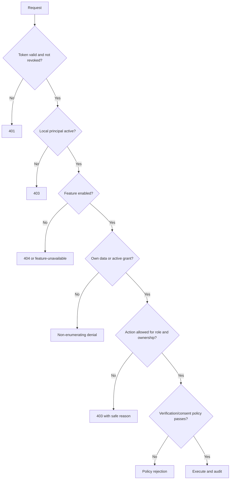

# Auth-Core Integration

## Boundary decision

`auth-core` is Vittavaan's sole authentication and session authority. The main application does not implement registration, passwords, OTPs, MFA, passkeys, recovery, refresh rotation, session lists, global logout or identity erasure.

Vittavaan owns application authorization: person/household roles, ownership authority, grants, consent, document access and feature gates.

## Browser flow

```mermaid
sequenceDiagram
    actor User
    participant App as Vittavaan Web
    participant AuthWeb as auth-core Web
    participant AuthAPI as auth-core API
    participant WealthAPI as Vittavaan API
    participant Verify as JWT/Revocation Verifier
    participant WealthDB as Vittavaan DB

    User->>App: Open protected route
    App->>AuthWeb: Redirect with allow-listed return target and state
    AuthWeb->>AuthAPI: Complete login/MFA/session workflow
    AuthAPI-->>AuthWeb: Short-lived access token; refresh in HttpOnly cookie
    AuthWeb->>AuthAPI: Request one-time code for exact return URL
    AuthAPI-->>AuthWeb: 60-second single-use code
    AuthWeb-->>App: Redirect with code and matching state only
    App->>WealthAPI: Exchange code and state
    WealthAPI->>AuthAPI: Private server-to-server exchange
    AuthAPI-->>WealthAPI: Access token after consuming code
    WealthAPI-->>App: Access token held in memory only
    App->>WealthAPI: Bootstrap request with bearer access token
    WealthAPI->>Verify: Validate signature, claims and revocation
    Verify-->>WealthAPI: Verified identity context
    WealthAPI->>WealthDB: Upsert local principal by auth subject
    WealthDB-->>WealthAPI: Principal, memberships, grants, feature flags
    WealthAPI-->>App: Application bootstrap payload
    App-->>User: Render authorized default scope
```

The browser handoff is now implemented locally as a state-bound, single-use code exchange. Auth-core permits only exact configured return URLs, consumes each code atomically, and revalidates the underlying session before returning a token to Vittavaan's server. Vittavaan uses an `HttpOnly`, `SameSite=Lax` state cookie, performs the private exchange, removes the code and state from the browser URL, and keeps the returned access token only in memory. Tokens must not be placed in URLs, persistent browser storage, logs or analytics.

## Required token checks

Vittavaan accepts only tokens that pass:

- Approved RS256 algorithm and known `kid` from auth-core JWKS.
- Exact issuer and Vittavaan API audience.
- Valid `sub`, `jti`, `iat`, `nbf` and `exp` with bounded clock skew.
- Supported client type and authentication context.
- Active workspace context where required.
- Revocation checks for token, refresh family/session and user-wide revocation.
- Required role/permission version compatibility when such claims are used.

Identity claims establish who called. They do not establish ownership of a holding or permission to view another person’s data.

## Local principal

The application stores a minimal reference:

| Field | Purpose |
|---|---|
| `principal_id` | Vittavaan-local stable ID. |
| `auth_subject` | Unique auth-core `sub`; no provider-specific identity IDs. |
| `status` | Application access state, distinct from authentication state. |
| `default_person_id` | Person represented by the principal in ordinary self-scope. |
| `created_at`, `last_seen_at` | Operational lifecycle. |

Email, phone, password hashes, factors, recovery state, refresh tokens and auth sessions are not copied into Vittavaan.

## Authorization order



## Failure behavior

- Expired access token: return `401` with a stable reauthentication/refresh error code.
- Unknown signing key: refresh JWKS once under a bounded circuit breaker, then fail closed.
- Revocation store unavailable: fail closed for protected financial operations.
- Auth-core web unavailable before login: show a clear unavailable state; never offer a bypass.
- Valid identity but no local person: create an idempotent bootstrap record and route to first-run setup.
- Suspended/closed local access: reject even when the auth-core session remains valid.

## Privacy and account lifecycle

- `auth-core` coordinates identity export/erasure; Vittavaan exports financial-domain data it owns.
- Closure revokes access immediately, freezes destructive changes and starts the approved retention/anonymization workflow.
- Legally retained financial/audit facts use pseudonymous references after identity erasure.
- Cross-service workflows use idempotent requests, correlation IDs and signed service authentication; no shared database writes.

## Deployment questions still to resolve

- Final Vittavaan audience value and issuer URLs per environment.
- Whether the Go verifier is a sidecar, shared gateway or internal service in each environment.
- Exact shared-staging domains, internal service addresses and independently provisioned handoff secret.
- Workspace-to-household mapping policy; auth-core workspace membership must not silently grant household financial access.
- Cross-service export/closure orchestration contract.
