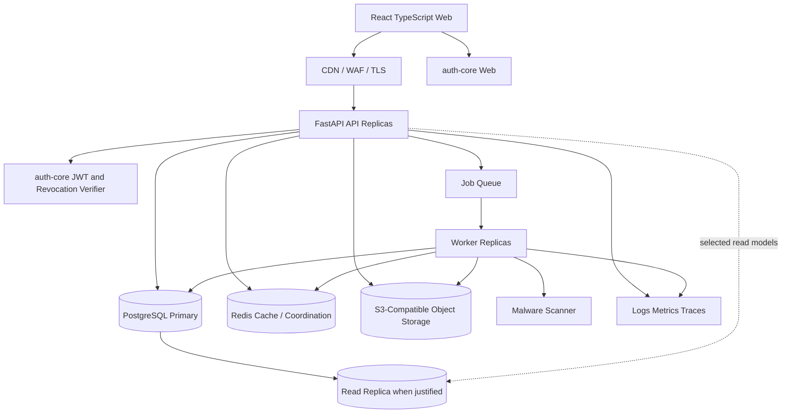
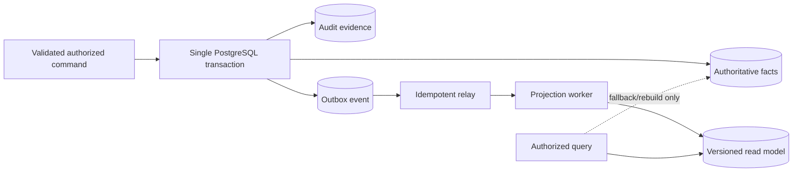

# Architecture Overview

## Architectural style

Vittavaan begins as a modular monolith with independently scalable web, API and worker processes. Modules share one PostgreSQL cluster but own their tables and expose behavior through application controls, not cross-module SQL. The design preserves extraction seams without paying distributed-transaction complexity before measured need.

## Logical modules

| Module | Owns |
|---|---|
| Identity bridge | Local principal and auth-core subject mapping; no credentials/sessions. |
| Household/access | People, households, memberships, grants and authority policies. |
| Holdings/catalogue | Holdings, ownership allocations, subtype schemas, restrictions and cost lots. |
| Ledger/liabilities | Transactions, income streams, liabilities, schedules and commitments. |
| Valuation | Append-only valuations, source facts, selection and staleness policies. |
| Imports/reconciliation | Import jobs/files/staged rows/mappings/decisions and commit orchestration. |
| Documents | Metadata, versions, links, quarantine/scanning, signed access and retention. |
| Projection/calculation | Wealth, cash-flow, analysis and planning engines plus rebuildable read models. |
| Goals/settings/privacy | Goals/scenarios, preferences, notifications, exports and closure cases. |
| Governance | Feature gates, approvals, audit evidence, outbox and policy versions. |

## Write and read paths

Financial writes become authoritative only after the database transaction commits. Projection failure never rolls back committed facts; the UI exposes projection freshness and workers retry idempotently.

## Environment topology

| Environment | Data | Purpose |
|---|---|---|
| Local | Synthetic developer fixtures | Docker-based full workflow and focused tests. |
| CI | Ephemeral synthetic data | Migrations, contract, integration, security and build gates. |
| Staging | Synthetic or explicitly approved masked data | OCI single-VM integration/UAT, owner acceptance and deployment validation; not authoritative capacity evidence. |
| Production | Real user data in approved India region | Controlled customer service with protected deployment approval. |

Staging initially targets an OCI Ampere A1 Always Free-eligible VM running the same OCI-compatible container images and base Compose service definitions used locally. Environment overlays change configuration, secrets, storage and edge routing—not application behavior. Because Always Free is capacity-constrained, reclaimable and single-host, performance and resilience qualification must also run in ephemeral production-shaped infrastructure before launch. Production remains AWS Mumbai using ECS/Fargate, RDS PostgreSQL Multi-AZ, ElastiCache, S3, CloudFront/WAF, KMS, Secrets Manager and CloudWatch-compatible telemetry. Provider-specific services remain behind adapters.

## Availability and scaling

- API and workers are stateless and independently autoscaled.
- PostgreSQL is the consistency boundary; PgBouncer/RDS Proxy prevents connection exhaustion.
- Redis is never the sole source of durable financial truth.
- Read replicas are introduced only for projection/reporting queries tolerant of replica lag.
- Queue partitions/priorities prevent bulk imports from starving interactive projection work.
- Per-principal and per-household concurrency keys serialize only invariant-sensitive commands.
- Projection rebuilds use version checkpoints and bounded batches.

## Failure boundaries

| Failure | Required behavior |
|---|---|
| auth-core/verifier unavailable | Protected operations fail closed; no bypass. |
| PostgreSQL unavailable | Reject writes; show clear temporary failure; never buffer financial writes in browser. |
| Redis unavailable | Bypass non-security cache; security/revocation-dependent operations fail closed; durable jobs remain recoverable. |
| Queue/worker unavailable | Facts may commit with pending projections; surface last-calculated time and alert on lag. |
| Object storage unavailable | Ledger remains readable; uploads/downloads disabled without discarding bytes. |
| Scanner unavailable | Documents remain quarantined and inaccessible. |
| External reference source unavailable | Use last approved value only when policy permits; disclose source age; never fabricate. |

## Data flow constraints

- All APIs authorize before loading sensitive content where practical and always before response serialization.
- Financial facts are never placed in event/log payloads unless the consumer requires them and the contract explicitly permits them; prefer IDs/version references.
- Cross-service calls use workload identity, bounded timeouts, retries only for idempotent operations and correlation IDs.
- All timestamps are stored in UTC; financial date semantics remain explicit where time zone matters.
