# Database Design

## Purpose and scope

This is the implementation-level relational model for the wealth-management application. PostgreSQL is the authoritative store for application-owned financial facts. Authentication credentials, passwords, MFA secrets, recovery factors, and sessions remain exclusively in **auth-core**. This database stores only the immutable auth-core subject reference required for local authorization.

The design favors append-only financial facts, explicit provenance, effective dating, optimistic concurrency, encrypted sensitive values, reproducible calculations, and rebuildable read projections. All money columns use integer minor units; quantities and rates use fixed-precision decimals; timestamps use UTC-aware `TIMESTAMPTZ`.

## Key notation

| Marker | Meaning |
|---|---|
| `PK` | Primary key |
| `FK` | Foreign key |
| `UQ` | Unique constraint or unique index; “scope” means uniqueness is composite with the owning ID |
| `CHK` | Database check constraint |
| `-` | Ordinary column, although application validation may still apply |

Nullability/default describes the DDL contract. A nullable field is optional only when the domain meaning permits it; it is not a substitute for incomplete validation.

## System boundary and principal model

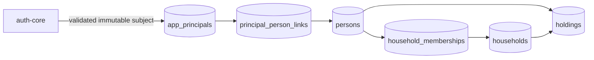

There is deliberately no `users` table containing login data. `app_principals` is the application-side security identity, while `persons` is the wealth-domain individual. This separation supports delegates, advisers, service principals, household membership, and future identity merges without copying authentication data.

## Table inventory

| Domain | Tables |
|---|---|
| Identity and access | `app_principals`, `persons`, `principal_person_links`, `households`, `household_memberships`, `access_grants` |
| Assets and holdings | `asset_classes`, `asset_subtypes`, `holdings`, `ownership_allocations`, `holding_restrictions`, `cost_basis_lots`, `commitments` |
| Sources and valuation | `sources`, `valuation_events`, `verification_evidence`, `staleness_policies`, `fx_rate_events` |
| Ledger and liabilities | `transactions`, `income_streams`, `liability_classes`, `liability_subtypes`, `liabilities`, `liability_holding_links`, `liability_schedule_versions`, `liability_schedule_items` |
| Imports and documents | `import_jobs`, `import_staged_rows`, `reconciliation_decisions`, `documents`, `document_versions`, `document_links`, `document_access_events` |
| Planning and preferences | `goals`, `goal_funding_links`, `saved_scenarios`, `user_preferences`, `notification_preferences` |
| Governance and asynchronous processing | `feature_gates`, `approval_records`, `audit_evidence`, `outbox_events`, `idempotency_records`, `projection_checkpoints`, `wealth_projections`, `performance_projections`, `export_jobs`, `closure_cases` |

Total planned tables: **48**.

## Complete table-by-table data dictionary

## Identity and access

### `app_principals`

Local authorization projection of an authenticated auth-core subject; it does not store credentials.

| Column | Key / constraint | PostgreSQL type | Nullability / default | Meaning |
|---|---|---|---|---|
| `principal_id` | PK | `UUID` | NOT NULL, generated | Stable application principal |
| `auth_subject_id` | UQ, external reference | `TEXT` | NOT NULL | Immutable auth-core subject identifier |
| `principal_type` | CHK | `TEXT` | NOT NULL | PERSON, SERVICE, or SUPPORT |
| `status` | CHK | `TEXT` | NOT NULL, ACTIVE | ACTIVE, SUSPENDED, or CLOSED |
| `first_seen_at` | - | `TIMESTAMPTZ` | NOT NULL, now() | First accepted sign-in |
| `last_seen_at` | - | `TIMESTAMPTZ` | NOT NULL, now() | Most recent accepted sign-in |
| `created_at` | - | `TIMESTAMPTZ` | NOT NULL, now() | Creation time |
| `updated_at` | - | `TIMESTAMPTZ` | NOT NULL, now() | Last update |
| `version` | CHK | `BIGINT` | NOT NULL, 1 | Optimistic-lock version |

Direct relationships:

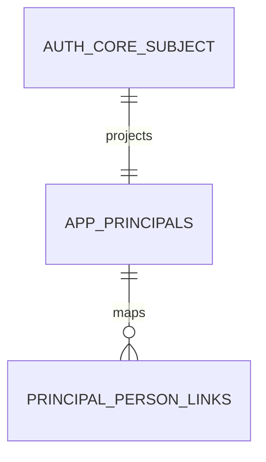

### `persons`

Domain identity for the individual whose wealth, access, or household membership is represented.

| Column | Key / constraint | PostgreSQL type | Nullability / default | Meaning |
|---|---|---|---|---|
| `person_id` | PK | `UUID` | NOT NULL, generated | Person identifier |
| `display_name` | - | `TEXT` | NOT NULL | Display-safe name |
| `legal_name_ciphertext` | - | `BYTEA` | NULL | Encrypted legal name when required |
| `date_of_birth_ciphertext` | - | `BYTEA` | NULL | Encrypted date of birth |
| `tax_residency_codes` | CHK | `TEXT[]` | NOT NULL, {} | Validated country codes |
| `residency_country_code` | CHK | `CHAR(2)` | NULL | ISO 3166-1 alpha-2 country |
| `status` | CHK | `TEXT` | NOT NULL, ACTIVE | ACTIVE, INACTIVE, DECEASED, or CLOSED |
| `created_at` | - | `TIMESTAMPTZ` | NOT NULL, now() | Creation time |
| `updated_at` | - | `TIMESTAMPTZ` | NOT NULL, now() | Last update |
| `version` | CHK | `BIGINT` | NOT NULL, 1 | Optimistic-lock version |

Direct relationships:

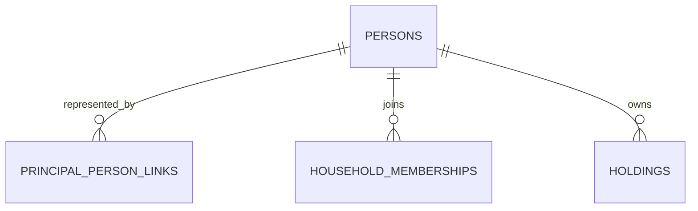

### `principal_person_links`

Effective-dated mapping between an authenticated principal and a domain person.

| Column | Key / constraint | PostgreSQL type | Nullability / default | Meaning |
|---|---|---|---|---|
| `principal_person_link_id` | PK | `UUID` | NOT NULL, generated | Link identifier |
| `principal_id` | FK app_principals.principal_id | `UUID` | NOT NULL | Authenticated principal |
| `person_id` | FK persons.person_id | `UUID` | NOT NULL | Represented person |
| `relationship_type` | CHK | `TEXT` | NOT NULL | SELF, DELEGATE, ADVISER, or SUPPORT |
| `effective_from` | - | `TIMESTAMPTZ` | NOT NULL, now() | Authority start |
| `effective_to` | CHK | `TIMESTAMPTZ` | NULL | Authority end; must follow start |
| `created_at` | - | `TIMESTAMPTZ` | NOT NULL, now() | Creation time |

Direct relationships:

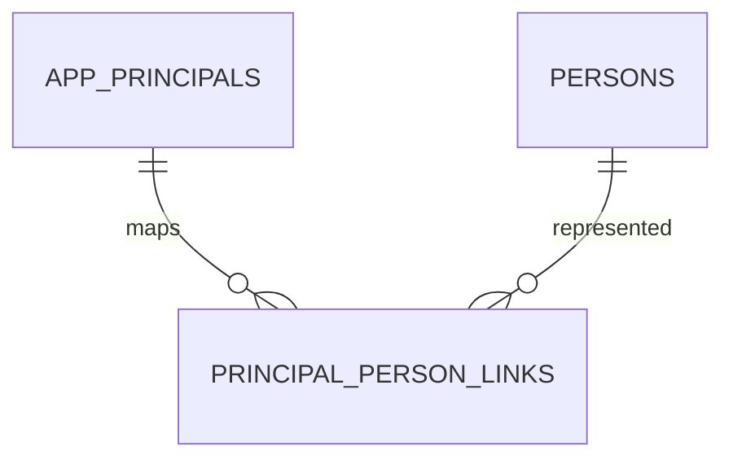

### `households`

A portfolio grouping and collaboration boundary; it is not an authentication boundary.

| Column | Key / constraint | PostgreSQL type | Nullability / default | Meaning |
|---|---|---|---|---|
| `household_id` | PK | `UUID` | NOT NULL, generated | Household identifier |
| `name` | - | `TEXT` | NOT NULL | Display name |
| `base_currency` | CHK | `CHAR(3)` | NOT NULL, INR | ISO 4217 reporting currency |
| `status` | CHK | `TEXT` | NOT NULL, ACTIVE | ACTIVE, INACTIVE, or CLOSED |
| `created_by_principal_id` | FK app_principals.principal_id | `UUID` | NOT NULL | Creator |
| `created_at` | - | `TIMESTAMPTZ` | NOT NULL, now() | Creation time |
| `updated_at` | - | `TIMESTAMPTZ` | NOT NULL, now() | Last update |
| `version` | CHK | `BIGINT` | NOT NULL, 1 | Optimistic-lock version |

Direct relationships:

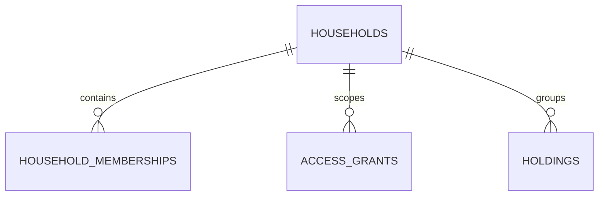

### `household_memberships`

Effective-dated membership and role assignment for a person in a household.

| Column | Key / constraint | PostgreSQL type | Nullability / default | Meaning |
|---|---|---|---|---|
| `household_membership_id` | PK | `UUID` | NOT NULL, generated | Membership identifier |
| `household_id` | FK households.household_id | `UUID` | NOT NULL | Household |
| `person_id` | FK persons.person_id | `UUID` | NOT NULL | Member |
| `role` | CHK | `TEXT` | NOT NULL | OWNER, MEMBER, ADVISER, or VIEWER |
| `effective_from` | - | `TIMESTAMPTZ` | NOT NULL, now() | Membership start |
| `effective_to` | CHK | `TIMESTAMPTZ` | NULL | Membership end |
| `created_by_principal_id` | FK app_principals.principal_id | `UUID` | NOT NULL | Granting actor |
| `created_at` | - | `TIMESTAMPTZ` | NOT NULL, now() | Creation time |

Direct relationships:

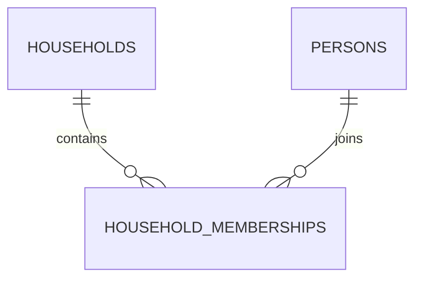

### `access_grants`

Explicit, revocable, least-privilege authorization over a household or domain object.

| Column | Key / constraint | PostgreSQL type | Nullability / default | Meaning |
|---|---|---|---|---|
| `access_grant_id` | PK | `UUID` | NOT NULL, generated | Grant identifier |
| `grantee_principal_id` | FK app_principals.principal_id | `UUID` | NOT NULL | Recipient |
| `granted_by_principal_id` | FK app_principals.principal_id | `UUID` | NOT NULL | Grantor |
| `household_id` | FK households.household_id | `UUID` | NULL | Optional household scope |
| `resource_type` | CHK | `TEXT` | NOT NULL | Approved resource type |
| `resource_id` | - | `UUID` | NULL | Optional object scope |
| `permissions` | CHK | `TEXT[]` | NOT NULL | Non-empty permission codes |
| `effective_from` | - | `TIMESTAMPTZ` | NOT NULL, now() | Grant start |
| `effective_to` | CHK | `TIMESTAMPTZ` | NULL | Grant end |
| `revoked_at` | - | `TIMESTAMPTZ` | NULL | Revocation time |
| `reason` | - | `TEXT` | NULL | Auditable reason |
| `created_at` | - | `TIMESTAMPTZ` | NOT NULL, now() | Creation time |

Direct relationships:

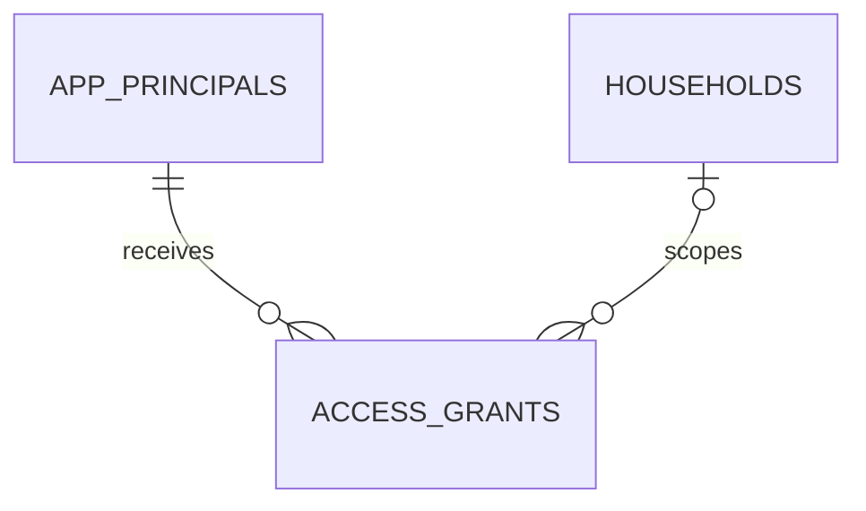

## Assets and holdings

### `asset_classes`

Stable top-level asset taxonomy used for aggregation and product rules.

| Column | Key / constraint | PostgreSQL type | Nullability / default | Meaning |
|---|---|---|---|---|
| `asset_class_code` | PK | `TEXT` | NOT NULL | Stable machine code |
| `display_name` | UQ | `TEXT` | NOT NULL | User-facing name |
| `description` | - | `TEXT` | NOT NULL | Scope and classification guidance |
| `sort_order` | UQ | `SMALLINT` | NOT NULL | Display order |
| `active` | - | `BOOLEAN` | NOT NULL, true | Selectable flag |
| `effective_from` | - | `DATE` | NOT NULL | Catalogue start |
| `effective_to` | CHK | `DATE` | NULL | Catalogue end |

Direct relationships:

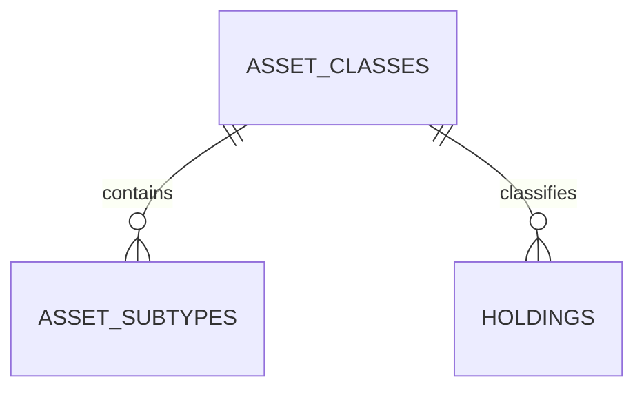

### `asset_subtypes`

Asset-class-specific subtype catalogue and schema discriminator.

| Column | Key / constraint | PostgreSQL type | Nullability / default | Meaning |
|---|---|---|---|---|
| `asset_subtype_code` | PK | `TEXT` | NOT NULL | Stable subtype code |
| `asset_class_code` | FK asset_classes.asset_class_code | `TEXT` | NOT NULL | Parent class |
| `display_name` | - | `TEXT` | NOT NULL | User-facing name |
| `attribute_schema_version` | - | `TEXT` | NOT NULL | Validated extension schema version |
| `valuation_method_codes` | CHK | `TEXT[]` | NOT NULL | Allowed valuation methods |
| `sort_order` | - | `SMALLINT` | NOT NULL | Order within class |
| `active` | - | `BOOLEAN` | NOT NULL, true | Selectable flag |
| `effective_from` | - | `DATE` | NOT NULL | Catalogue start |
| `effective_to` | CHK | `DATE` | NULL | Catalogue end |

Direct relationships:

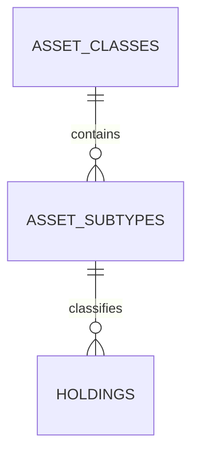

### `holdings`

Canonical asset position. Shared columns support all classes; bounded JSONB holds subtype-specific attributes.

| Column | Key / constraint | PostgreSQL type | Nullability / default | Meaning |
|---|---|---|---|---|
| `holding_id` | PK | `UUID` | NOT NULL, generated | Holding identifier |
| `owner_person_id` | FK persons.person_id | `UUID` | NOT NULL | Primary accountable owner |
| `household_id` | FK households.household_id | `UUID` | NULL | Optional household context |
| `asset_class_code` | FK asset_classes.asset_class_code | `TEXT` | NOT NULL | Top-level class |
| `asset_subtype_code` | FK asset_subtypes.asset_subtype_code | `TEXT` | NOT NULL | Subtype |
| `name` | - | `TEXT` | NOT NULL | Display name |
| `currency` | CHK | `CHAR(3)` | NOT NULL | Native ISO 4217 currency |
| `quantity` | CHK | `NUMERIC(30,12)` | NULL | Units when applicable |
| `identifier_type` | CHK | `TEXT` | NULL | ISIN, ticker, folio, property reference, etc. |
| `identifier_ciphertext` | - | `BYTEA` | NULL | Encrypted sensitive identifier |
| `subtype_attributes` | - | `JSONB` | NOT NULL, {} | Schema-validated subtype fields |
| `status` | CHK | `TEXT` | NOT NULL, ACTIVE | ACTIVE, CLOSED, DISPOSED, or ARCHIVED |
| `acquired_on` | - | `DATE` | NULL | Known acquisition date |
| `created_by_principal_id` | FK app_principals.principal_id | `UUID` | NOT NULL | Creator |
| `created_at` | - | `TIMESTAMPTZ` | NOT NULL, now() | Creation time |
| `updated_at` | - | `TIMESTAMPTZ` | NOT NULL, now() | Last update |
| `version` | CHK | `BIGINT` | NOT NULL, 1 | Optimistic-lock version |

Direct relationships:

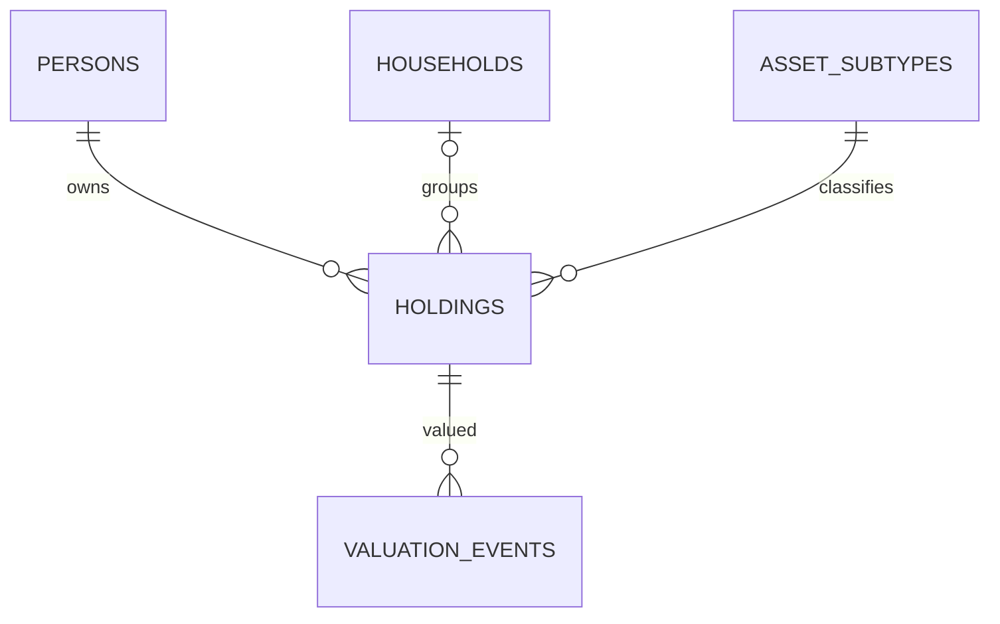

### `ownership_allocations`

Effective-dated beneficial ownership split for a holding.

| Column | Key / constraint | PostgreSQL type | Nullability / default | Meaning |
|---|---|---|---|---|
| `ownership_allocation_id` | PK | `UUID` | NOT NULL, generated | Allocation identifier |
| `holding_id` | FK holdings.holding_id | `UUID` | NOT NULL | Holding |
| `person_id` | FK persons.person_id | `UUID` | NOT NULL | Beneficial owner |
| `ownership_pct` | CHK | `NUMERIC(7,4)` | NOT NULL | Percentage; active rows total 100 |
| `effective_from` | - | `DATE` | NOT NULL | Ownership start |
| `effective_to` | CHK | `DATE` | NULL | Ownership end |
| `source_id` | FK sources.source_id | `UUID` | NULL | Evidence source |
| `created_at` | - | `TIMESTAMPTZ` | NOT NULL, now() | Creation time |

Direct relationships:

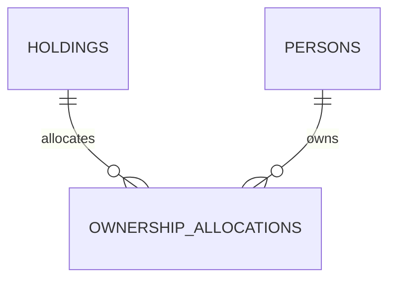

### `holding_restrictions`

Effective-dated lien, pledge, lock-in, freeze, or legal restriction.

| Column | Key / constraint | PostgreSQL type | Nullability / default | Meaning |
|---|---|---|---|---|
| `restriction_id` | PK | `UUID` | NOT NULL, generated | Restriction identifier |
| `holding_id` | FK holdings.holding_id | `UUID` | NOT NULL | Restricted holding |
| `liability_id` | FK liabilities.liability_id | `UUID` | NULL | Related liability |
| `restriction_type` | CHK | `TEXT` | NOT NULL | Approved restriction code |
| `counterparty_reference` | - | `TEXT` | NULL | Bounded counterparty reference |
| `effective_from` | - | `DATE` | NOT NULL | Start |
| `effective_to` | CHK | `DATE` | NULL | End |
| `status` | CHK | `TEXT` | NOT NULL | ACTIVE, RELEASED, or DISPUTED |
| `source_id` | FK sources.source_id | `UUID` | NULL | Evidence source |
| `created_at` | - | `TIMESTAMPTZ` | NOT NULL, now() | Creation time |

Direct relationships:

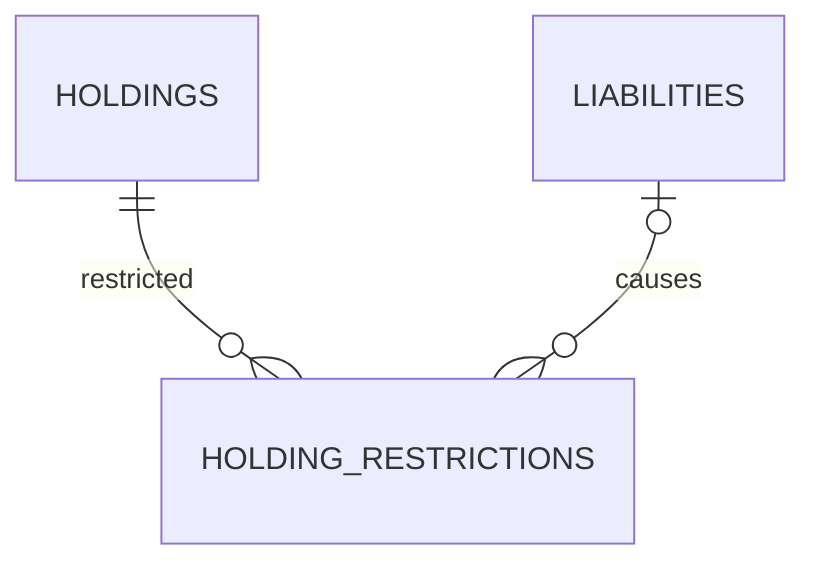

### `cost_basis_lots`

Append-only acquisition lots, kept separate from current valuation.

| Column | Key / constraint | PostgreSQL type | Nullability / default | Meaning |
|---|---|---|---|---|
| `cost_basis_lot_id` | PK | `UUID` | NOT NULL, generated | Lot identifier |
| `holding_id` | FK holdings.holding_id | `UUID` | NOT NULL | Holding |
| `quantity` | CHK | `NUMERIC(30,12)` | NULL | Units acquired |
| `cost_amount_minor_units` | CHK | `BIGINT` | NOT NULL | Acquisition cost |
| `currency` | CHK | `CHAR(3)` | NOT NULL | ISO currency |
| `acquired_on` | - | `DATE` | NOT NULL | Acquisition date |
| `source_id` | FK sources.source_id | `UUID` | NULL | Source |
| `supersedes_lot_id` | FK cost_basis_lots.cost_basis_lot_id | `UUID` | NULL | Corrected prior lot |
| `recorded_by_principal_id` | FK app_principals.principal_id | `UUID` | NOT NULL | Actor |
| `recorded_at` | - | `TIMESTAMPTZ` | NOT NULL, now() | Append time |

Direct relationships:

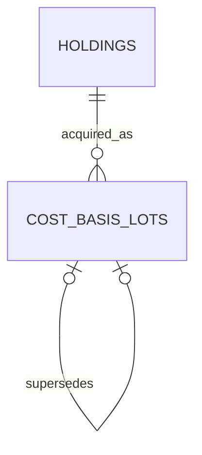

### `commitments`

Undrawn or contingent funding obligations disclosed separately from liabilities.

| Column | Key / constraint | PostgreSQL type | Nullability / default | Meaning |
|---|---|---|---|---|
| `commitment_id` | PK | `UUID` | NOT NULL, generated | Commitment identifier |
| `holding_id` | FK holdings.holding_id | `UUID` | NOT NULL | Associated holding |
| `person_id` | FK persons.person_id | `UUID` | NOT NULL | Responsible person |
| `committed_minor_units` | CHK | `BIGINT` | NOT NULL | Total committed |
| `drawn_minor_units` | CHK | `BIGINT` | NOT NULL, 0 | Amount drawn |
| `currency` | CHK | `CHAR(3)` | NOT NULL | ISO currency |
| `due_on` | - | `DATE` | NULL | Known due date |
| `window_start` | - | `DATE` | NULL | Draw window start |
| `window_end` | CHK | `DATE` | NULL | Draw window end |
| `status` | CHK | `TEXT` | NOT NULL | OPEN, PARTIALLY_DRAWN, FULFILLED, or CANCELLED |
| `source_id` | FK sources.source_id | `UUID` | NULL | Source |
| `version` | CHK | `BIGINT` | NOT NULL, 1 | Optimistic-lock version |

Direct relationships:

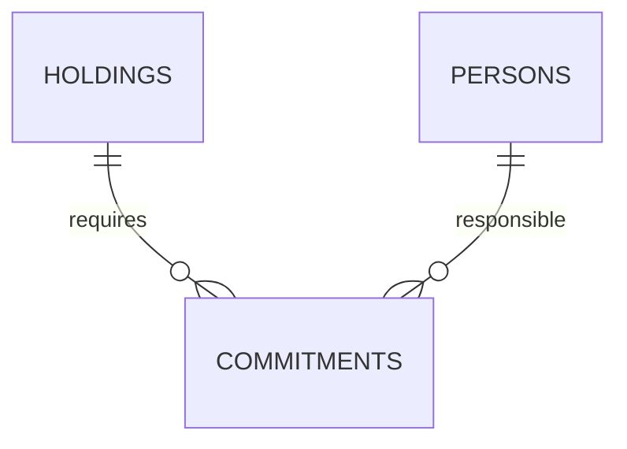

## Sources and valuation

### `sources`

Provenance record for manual, imported, connected, calculated, or operator-entered data.

| Column | Key / constraint | PostgreSQL type | Nullability / default | Meaning |
|---|---|---|---|---|
| `source_id` | PK | `UUID` | NOT NULL, generated | Source identifier |
| `source_type` | CHK | `TEXT` | NOT NULL | MANUAL, IMPORT, CONNECTOR, CALCULATED, or OPERATOR |
| `provider_code` | - | `TEXT` | NULL | Provider or institution code |
| `external_reference_hash` | - | `TEXT` | NULL | Non-reversible external reference |
| `trust_tier` | CHK | `TEXT` | NOT NULL | VERIFIED, DECLARED, ESTIMATED, or UNKNOWN |
| `captured_by_principal_id` | FK app_principals.principal_id | `UUID` | NULL | Capturing actor |
| `captured_at` | - | `TIMESTAMPTZ` | NOT NULL | Capture time |
| `metadata` | - | `JSONB` | NOT NULL, {} | Allow-listed provenance metadata |
| `created_at` | - | `TIMESTAMPTZ` | NOT NULL, now() | Creation time |

Direct relationships:

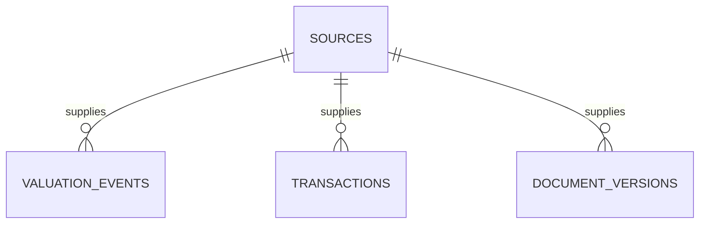

### `valuation_events`

Immutable point-in-time asset valuation event; corrections supersede instead of overwriting.

| Column | Key / constraint | PostgreSQL type | Nullability / default | Meaning |
|---|---|---|---|---|
| `valuation_event_id` | PK | `UUID` | NOT NULL, generated | Valuation identifier |
| `holding_id` | FK holdings.holding_id | `UUID` | NOT NULL | Valued holding |
| `source_id` | FK sources.source_id | `UUID` | NOT NULL | Provenance |
| `as_of_at` | - | `TIMESTAMPTZ` | NOT NULL | Valuation effective time |
| `value_minor_units` | - | `BIGINT` | NOT NULL | Signed value in minor units |
| `currency` | CHK | `CHAR(3)` | NOT NULL | Native ISO currency |
| `valuation_method` | CHK | `TEXT` | NOT NULL | MARKET, APPRAISAL, DECLARED, MODELLED, or COST |
| `confidence` | CHK | `NUMERIC(5,4)` | NULL | Optional 0-to-1 confidence |
| `supersedes_event_id` | FK valuation_events.valuation_event_id | `UUID` | NULL | Corrected event |
| `recorded_by_principal_id` | FK app_principals.principal_id | `UUID` | NOT NULL | Actor |
| `recorded_at` | - | `TIMESTAMPTZ` | NOT NULL, now() | Append time |
| `metadata` | - | `JSONB` | NOT NULL, {} | Bounded method details |

Direct relationships:

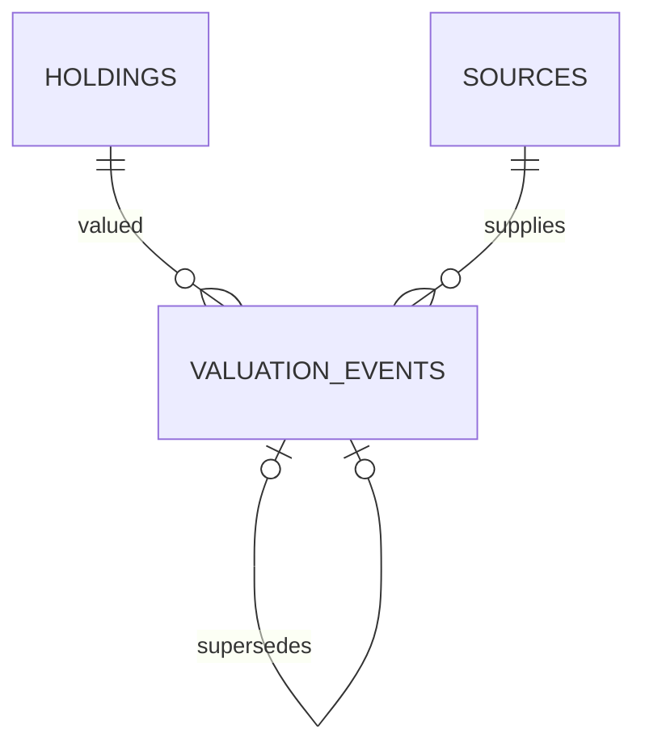

### `verification_evidence`

Evidence that verifies a valuation or other supported fact.

| Column | Key / constraint | PostgreSQL type | Nullability / default | Meaning |
|---|---|---|---|---|
| `verification_evidence_id` | PK | `UUID` | NOT NULL, generated | Evidence identifier |
| `valuation_event_id` | FK valuation_events.valuation_event_id | `UUID` | NULL | Supported valuation |
| `document_id` | FK documents.document_id | `UUID` | NULL | Supporting document |
| `evidence_type` | CHK | `TEXT` | NOT NULL | Approved evidence type |
| `verification_state` | CHK | `TEXT` | NOT NULL | PENDING, VERIFIED, REJECTED, or EXPIRED |
| `verified_by_principal_id` | FK app_principals.principal_id | `UUID` | NULL | Verifier |
| `verified_at` | - | `TIMESTAMPTZ` | NULL | Verification time |
| `expires_at` | - | `TIMESTAMPTZ` | NULL | Evidence expiry |
| `notes` | - | `TEXT` | NULL | Bounded notes |
| `created_at` | - | `TIMESTAMPTZ` | NOT NULL, now() | Creation time |

Direct relationships:

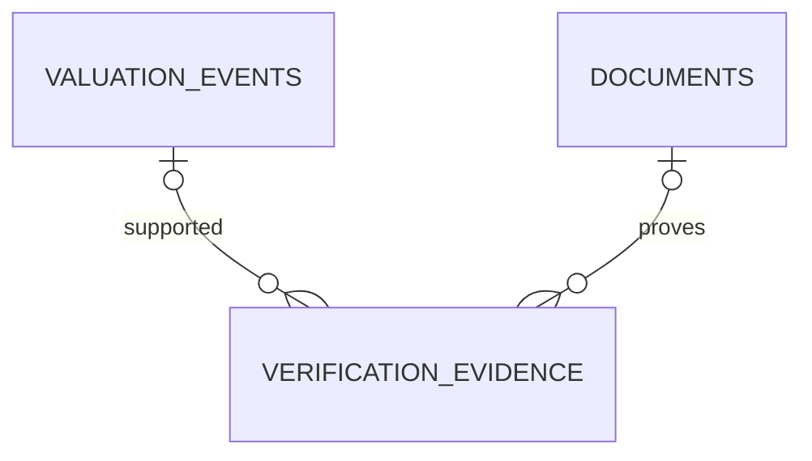

### `staleness_policies`

Versioned rules determining when data is fresh, stale, or expired.

| Column | Key / constraint | PostgreSQL type | Nullability / default | Meaning |
|---|---|---|---|---|
| `staleness_policy_id` | PK | `UUID` | NOT NULL, generated | Policy identifier |
| `asset_subtype_code` | FK asset_subtypes.asset_subtype_code | `TEXT` | NULL | Optional subtype scope |
| `source_type` | CHK | `TEXT` | NULL | Optional source scope |
| `fresh_for_seconds` | CHK | `INTEGER` | NOT NULL | Fresh interval |
| `stale_for_seconds` | CHK | `INTEGER` | NOT NULL | Additional stale interval |
| `policy_version` | - | `TEXT` | NOT NULL | Published version |
| `effective_from` | - | `TIMESTAMPTZ` | NOT NULL | Start |
| `effective_to` | CHK | `TIMESTAMPTZ` | NULL | End |
| `created_at` | - | `TIMESTAMPTZ` | NOT NULL, now() | Creation time |

Direct relationships:

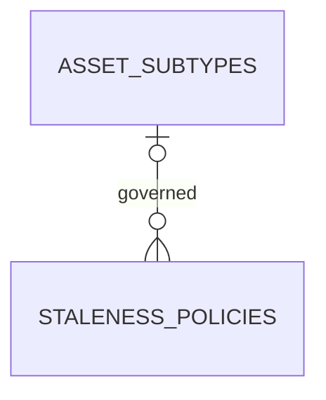

### `fx_rate_events`

Immutable foreign-exchange observations used for reproducible reporting conversions.

| Column | Key / constraint | PostgreSQL type | Nullability / default | Meaning |
|---|---|---|---|---|
| `fx_rate_event_id` | PK | `UUID` | NOT NULL, generated | Rate identifier |
| `base_currency` | CHK | `CHAR(3)` | NOT NULL | Base ISO currency |
| `quote_currency` | CHK | `CHAR(3)` | NOT NULL | Quote ISO currency |
| `rate` | CHK | `NUMERIC(30,12)` | NOT NULL | Positive conversion rate |
| `as_of_at` | - | `TIMESTAMPTZ` | NOT NULL | Effective time |
| `source_id` | FK sources.source_id | `UUID` | NOT NULL | Rate source |
| `recorded_at` | - | `TIMESTAMPTZ` | NOT NULL, now() | Append time |

Direct relationships:

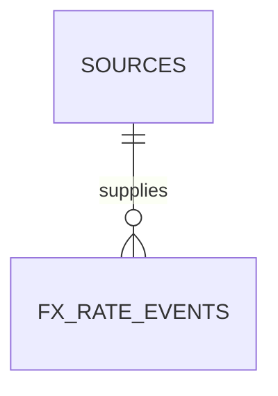

## Ledger and liabilities

### `transactions`

Normalized append-only cash or position ledger event.

| Column | Key / constraint | PostgreSQL type | Nullability / default | Meaning |
|---|---|---|---|---|
| `transaction_id` | PK | `UUID` | NOT NULL, generated | Transaction identifier |
| `holding_id` | FK holdings.holding_id | `UUID` | NULL | Related holding |
| `person_id` | FK persons.person_id | `UUID` | NOT NULL | Owner |
| `source_id` | FK sources.source_id | `UUID` | NOT NULL | Provenance |
| `external_transaction_hash` | UQ scope | `TEXT` | NULL | Deduplication key |
| `transaction_type` | CHK | `TEXT` | NOT NULL | BUY, SELL, INCOME, FEE, TAX, TRANSFER, etc. |
| `trade_date` | - | `DATE` | NULL | Trade date |
| `settled_at` | - | `TIMESTAMPTZ` | NULL | Settlement time |
| `quantity` | CHK | `NUMERIC(30,12)` | NULL | Signed units |
| `amount_minor_units` | - | `BIGINT` | NOT NULL | Signed amount |
| `currency` | CHK | `CHAR(3)` | NOT NULL | ISO currency |
| `description` | - | `TEXT` | NULL | Sanitized description |
| `supersedes_transaction_id` | FK transactions.transaction_id | `UUID` | NULL | Corrected event |
| `recorded_at` | - | `TIMESTAMPTZ` | NOT NULL, now() | Append time |

Direct relationships:

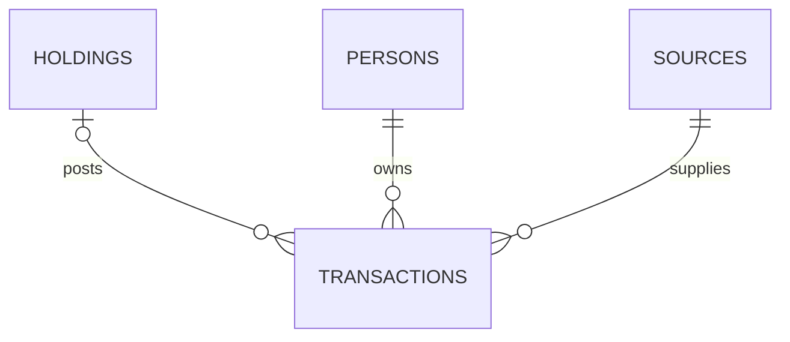

### `income_streams`

Recurring or expected income used in cash-flow analysis.

| Column | Key / constraint | PostgreSQL type | Nullability / default | Meaning |
|---|---|---|---|---|
| `income_stream_id` | PK | `UUID` | NOT NULL, generated | Income stream identifier |
| `person_id` | FK persons.person_id | `UUID` | NOT NULL | Recipient |
| `holding_id` | FK holdings.holding_id | `UUID` | NULL | Producing asset |
| `name` | - | `TEXT` | NOT NULL | Display name |
| `income_type` | CHK | `TEXT` | NOT NULL | SALARY, RENT, DIVIDEND, INTEREST, PENSION, etc. |
| `amount_minor_units` | CHK | `BIGINT` | NOT NULL | Expected amount |
| `currency` | CHK | `CHAR(3)` | NOT NULL | ISO currency |
| `frequency` | CHK | `TEXT` | NOT NULL | MONTHLY, QUARTERLY, ANNUAL, or IRREGULAR |
| `starts_on` | - | `DATE` | NOT NULL | Start date |
| `ends_on` | CHK | `DATE` | NULL | End date |
| `growth_rate_pct` | CHK | `NUMERIC(7,4)` | NULL | Optional annual growth |
| `source_id` | FK sources.source_id | `UUID` | NULL | Source |
| `status` | CHK | `TEXT` | NOT NULL, ACTIVE | ACTIVE, PAUSED, or ENDED |
| `version` | CHK | `BIGINT` | NOT NULL, 1 | Optimistic-lock version |

Direct relationships:

```mermaid
erDiagram
    PERSONS ||--o{ INCOME_STREAMS : receives
    HOLDINGS o|--o{ INCOME_STREAMS : produces
```

### `liability_classes`

Stable top-level liability taxonomy.

| Column | Key / constraint | PostgreSQL type | Nullability / default | Meaning |
|---|---|---|---|---|
| `liability_class_code` | PK | `TEXT` | NOT NULL | Stable class code |
| `display_name` | UQ | `TEXT` | NOT NULL | User-facing name |
| `description` | - | `TEXT` | NOT NULL | Classification guidance |
| `sort_order` | UQ | `SMALLINT` | NOT NULL | Display order |
| `active` | - | `BOOLEAN` | NOT NULL, true | Selectable flag |
| `effective_from` | - | `DATE` | NOT NULL | Catalogue start |
| `effective_to` | CHK | `DATE` | NULL | Catalogue end |

Direct relationships:

```mermaid
erDiagram
    LIABILITY_CLASSES ||--o{ LIABILITY_SUBTYPES : contains
    LIABILITY_CLASSES ||--o{ LIABILITIES : classifies
```

### `liability_subtypes`

Liability subtype catalogue and extension-schema discriminator.

| Column | Key / constraint | PostgreSQL type | Nullability / default | Meaning |
|---|---|---|---|---|
| `liability_subtype_code` | PK | `TEXT` | NOT NULL | Stable subtype code |
| `liability_class_code` | FK liability_classes.liability_class_code | `TEXT` | NOT NULL | Parent class |
| `display_name` | - | `TEXT` | NOT NULL | User-facing name |
| `attribute_schema_version` | - | `TEXT` | NOT NULL | Validated extension schema |
| `sort_order` | - | `SMALLINT` | NOT NULL | Order within class |
| `active` | - | `BOOLEAN` | NOT NULL, true | Selectable flag |
| `effective_from` | - | `DATE` | NOT NULL | Catalogue start |
| `effective_to` | CHK | `DATE` | NULL | Catalogue end |

Direct relationships:

```mermaid
erDiagram
    LIABILITY_CLASSES ||--o{ LIABILITY_SUBTYPES : contains
    LIABILITY_SUBTYPES ||--o{ LIABILITIES : classifies
```

### `liabilities`

Canonical debt or obligation record; balances are derived from dated schedule/valuation facts.

| Column | Key / constraint | PostgreSQL type | Nullability / default | Meaning |
|---|---|---|---|---|
| `liability_id` | PK | `UUID` | NOT NULL, generated | Liability identifier |
| `borrower_person_id` | FK persons.person_id | `UUID` | NOT NULL | Primary borrower |
| `household_id` | FK households.household_id | `UUID` | NULL | Household context |
| `liability_class_code` | FK liability_classes.liability_class_code | `TEXT` | NOT NULL | Top-level class |
| `liability_subtype_code` | FK liability_subtypes.liability_subtype_code | `TEXT` | NOT NULL | Subtype |
| `lender_name` | - | `TEXT` | NULL | Lender display name |
| `account_reference_ciphertext` | - | `BYTEA` | NULL | Encrypted account reference |
| `original_principal_minor_units` | CHK | `BIGINT` | NULL | Original borrowed amount |
| `currency` | CHK | `CHAR(3)` | NOT NULL | ISO currency |
| `interest_rate_pct` | CHK | `NUMERIC(9,6)` | NULL | Nominal annual rate |
| `rate_type` | CHK | `TEXT` | NULL | FIXED, FLOATING, or MIXED |
| `started_on` | - | `DATE` | NULL | Origination date |
| `matures_on` | CHK | `DATE` | NULL | Maturity date |
| `subtype_attributes` | - | `JSONB` | NOT NULL, {} | Schema-validated subtype details |
| `status` | CHK | `TEXT` | NOT NULL, ACTIVE | ACTIVE, PAID_OFF, CLOSED, or DEFAULTED |
| `source_id` | FK sources.source_id | `UUID` | NULL | Source |
| `created_at` | - | `TIMESTAMPTZ` | NOT NULL, now() | Creation time |
| `updated_at` | - | `TIMESTAMPTZ` | NOT NULL, now() | Last update |
| `version` | CHK | `BIGINT` | NOT NULL, 1 | Optimistic-lock version |

Direct relationships:

```mermaid
erDiagram
    PERSONS ||--o{ LIABILITIES : borrows
    LIABILITY_SUBTYPES ||--o{ LIABILITIES : classifies
    LIABILITIES ||--o{ LIABILITY_SCHEDULE_VERSIONS : scheduled
```

### `liability_holding_links`

Effective link between a liability and collateral or financed asset.

| Column | Key / constraint | PostgreSQL type | Nullability / default | Meaning |
|---|---|---|---|---|
| `liability_holding_link_id` | PK | `UUID` | NOT NULL, generated | Link identifier |
| `liability_id` | FK liabilities.liability_id | `UUID` | NOT NULL | Liability |
| `holding_id` | FK holdings.holding_id | `UUID` | NOT NULL | Holding |
| `link_type` | CHK | `TEXT` | NOT NULL | SECURED_BY, FINANCES, or ASSOCIATED_WITH |
| `allocation_pct` | CHK | `NUMERIC(7,4)` | NULL | Optional attributed percentage |
| `effective_from` | - | `DATE` | NOT NULL | Start |
| `effective_to` | CHK | `DATE` | NULL | End |
| `created_at` | - | `TIMESTAMPTZ` | NOT NULL, now() | Creation time |

Direct relationships:

```mermaid
erDiagram
    LIABILITIES ||--o{ LIABILITY_HOLDING_LINKS : linked
    HOLDINGS ||--o{ LIABILITY_HOLDING_LINKS : linked
```

### `liability_schedule_versions`

Immutable repayment-schedule header with reproducible assumptions.

| Column | Key / constraint | PostgreSQL type | Nullability / default | Meaning |
|---|---|---|---|---|
| `liability_schedule_version_id` | PK | `UUID` | NOT NULL, generated | Schedule version identifier |
| `liability_id` | FK liabilities.liability_id | `UUID` | NOT NULL | Liability |
| `version_number` | UQ scope | `INTEGER` | NOT NULL | Monotonic liability-local version |
| `effective_from` | - | `DATE` | NOT NULL | Schedule start |
| `generated_method` | CHK | `TEXT` | NOT NULL | IMPORTED, MANUAL, or CALCULATED |
| `assumptions` | - | `JSONB` | NOT NULL, {} | Versioned assumptions |
| `supersedes_version_id` | FK liability_schedule_versions.liability_schedule_version_id | `UUID` | NULL | Prior schedule |
| `created_by_principal_id` | FK app_principals.principal_id | `UUID` | NOT NULL | Actor |
| `created_at` | - | `TIMESTAMPTZ` | NOT NULL, now() | Creation time |

Direct relationships:

```mermaid
erDiagram
    LIABILITIES ||--o{ LIABILITY_SCHEDULE_VERSIONS : scheduled
    LIABILITY_SCHEDULE_VERSIONS ||--|{ LIABILITY_SCHEDULE_ITEMS : contains
```

### `liability_schedule_items`

Dated principal, interest, fee, and balance line in a schedule version.

| Column | Key / constraint | PostgreSQL type | Nullability / default | Meaning |
|---|---|---|---|---|
| `liability_schedule_item_id` | PK | `UUID` | NOT NULL, generated | Item identifier |
| `liability_schedule_version_id` | FK liability_schedule_versions.liability_schedule_version_id | `UUID` | NOT NULL | Schedule |
| `installment_number` | UQ scope | `INTEGER` | NOT NULL | Sequence number |
| `due_on` | - | `DATE` | NOT NULL | Due date |
| `principal_minor_units` | CHK | `BIGINT` | NOT NULL, 0 | Principal component |
| `interest_minor_units` | CHK | `BIGINT` | NOT NULL, 0 | Interest component |
| `fee_minor_units` | CHK | `BIGINT` | NOT NULL, 0 | Fee component |
| `ending_balance_minor_units` | CHK | `BIGINT` | NOT NULL | Expected ending balance |
| `payment_state` | CHK | `TEXT` | NOT NULL, EXPECTED | EXPECTED, PAID, MISSED, or WAIVED |
| `paid_transaction_id` | FK transactions.transaction_id | `UUID` | NULL | Matching payment event |

Direct relationships:

```mermaid
erDiagram
    LIABILITY_SCHEDULE_VERSIONS ||--|{ LIABILITY_SCHEDULE_ITEMS : contains
    TRANSACTIONS o|--o{ LIABILITY_SCHEDULE_ITEMS : settles
```

## Imports and documents

### `import_jobs`

State machine and provenance envelope for an uploaded import.

| Column | Key / constraint | PostgreSQL type | Nullability / default | Meaning |
|---|---|---|---|---|
| `import_job_id` | PK | `UUID` | NOT NULL, generated | Import identifier |
| `requested_by_principal_id` | FK app_principals.principal_id | `UUID` | NOT NULL | Requester |
| `household_id` | FK households.household_id | `UUID` | NULL | Scope |
| `source_document_version_id` | FK document_versions.document_version_id | `UUID` | NULL | Uploaded source |
| `import_type` | CHK | `TEXT` | NOT NULL | Approved template/provider |
| `state` | CHK | `TEXT` | NOT NULL, UPLOADED | UPLOADED, SCANNING, PARSED, REVIEW, COMMITTED, FAILED, or CANCELLED |
| `parser_version` | - | `TEXT` | NULL | Parser build |
| `total_rows` | CHK | `INTEGER` | NOT NULL, 0 | Rows found |
| `valid_rows` | CHK | `INTEGER` | NOT NULL, 0 | Rows valid |
| `error_rows` | CHK | `INTEGER` | NOT NULL, 0 | Rows invalid |
| `started_at` | - | `TIMESTAMPTZ` | NULL | Processing start |
| `completed_at` | - | `TIMESTAMPTZ` | NULL | Terminal time |
| `error_code` | - | `TEXT` | NULL | Safe failure code |
| `created_at` | - | `TIMESTAMPTZ` | NOT NULL, now() | Creation time |
| `version` | CHK | `BIGINT` | NOT NULL, 1 | Optimistic-lock version |

Direct relationships:

```mermaid
erDiagram
    APP_PRINCIPALS ||--o{ IMPORT_JOBS : requests
    IMPORT_JOBS ||--o{ IMPORT_STAGED_ROWS : stages
    DOCUMENT_VERSIONS o|--o{ IMPORT_JOBS : supplies
```

### `import_staged_rows`

Quarantined normalized row awaiting validation and reconciliation.

| Column | Key / constraint | PostgreSQL type | Nullability / default | Meaning |
|---|---|---|---|---|
| `import_staged_row_id` | PK | `UUID` | NOT NULL, generated | Staged row identifier |
| `import_job_id` | FK import_jobs.import_job_id | `UUID` | NOT NULL | Import job |
| `row_number` | UQ scope | `INTEGER` | NOT NULL | Source row number |
| `raw_payload_ciphertext` | - | `BYTEA` | NOT NULL | Encrypted raw row |
| `normalized_payload` | - | `JSONB` | NULL | Allow-listed normalized fields |
| `validation_state` | CHK | `TEXT` | NOT NULL | VALID, WARNING, or ERROR |
| `validation_issues` | - | `JSONB` | NOT NULL, [] | Structured issue codes |
| `candidate_domain_type` | CHK | `TEXT` | NULL | Candidate target type |
| `candidate_domain_id` | - | `UUID` | NULL | Candidate target ID |
| `created_at` | - | `TIMESTAMPTZ` | NOT NULL, now() | Creation time |

Direct relationships:

```mermaid
erDiagram
    IMPORT_JOBS ||--o{ IMPORT_STAGED_ROWS : stages
    IMPORT_STAGED_ROWS ||--o{ RECONCILIATION_DECISIONS : reviewed
```

### `reconciliation_decisions`

Append-only human or rule decision for a staged import row.

| Column | Key / constraint | PostgreSQL type | Nullability / default | Meaning |
|---|---|---|---|---|
| `reconciliation_decision_id` | PK | `UUID` | NOT NULL, generated | Decision identifier |
| `import_staged_row_id` | FK import_staged_rows.import_staged_row_id | `UUID` | NOT NULL | Staged row |
| `decision` | CHK | `TEXT` | NOT NULL | CREATE, MERGE, SKIP, or REJECT |
| `target_domain_type` | CHK | `TEXT` | NULL | Chosen target type |
| `target_domain_id` | - | `UUID` | NULL | Chosen target ID |
| `reason_code` | - | `TEXT` | NOT NULL | Stable reason |
| `decided_by_principal_id` | FK app_principals.principal_id | `UUID` | NOT NULL | Actor |
| `decided_at` | - | `TIMESTAMPTZ` | NOT NULL, now() | Decision time |
| `supersedes_decision_id` | FK reconciliation_decisions.reconciliation_decision_id | `UUID` | NULL | Corrected decision |

Direct relationships:

```mermaid
erDiagram
    IMPORT_STAGED_ROWS ||--o{ RECONCILIATION_DECISIONS : reviewed
    APP_PRINCIPALS ||--o{ RECONCILIATION_DECISIONS : decides
```

### `documents`

Domain document metadata; binary objects remain in encrypted object storage.

| Column | Key / constraint | PostgreSQL type | Nullability / default | Meaning |
|---|---|---|---|---|
| `document_id` | PK | `UUID` | NOT NULL, generated | Document identifier |
| `owner_person_id` | FK persons.person_id | `UUID` | NOT NULL | Owner |
| `document_type` | CHK | `TEXT` | NOT NULL | Approved document type |
| `title` | - | `TEXT` | NOT NULL | Sanitized title |
| `retention_class` | CHK | `TEXT` | NOT NULL | Retention policy class |
| `lifecycle_state` | CHK | `TEXT` | NOT NULL | PENDING, AVAILABLE, INFECTED, SUPERSEDED, DEACTIVATED, or RETAINED |
| `current_version_id` | FK document_versions.document_version_id, DEFERRABLE | `UUID` | NULL | Current clean version |
| `created_by_principal_id` | FK app_principals.principal_id | `UUID` | NOT NULL | Creator |
| `created_at` | - | `TIMESTAMPTZ` | NOT NULL, now() | Creation time |
| `updated_at` | - | `TIMESTAMPTZ` | NOT NULL, now() | Last update |
| `version` | CHK | `BIGINT` | NOT NULL, 1 | Optimistic-lock version |

Direct relationships:

```mermaid
erDiagram
    PERSONS ||--o{ DOCUMENTS : owns
    DOCUMENTS ||--|{ DOCUMENT_VERSIONS : versioned
    DOCUMENTS ||--o{ DOCUMENT_LINKS : links
```

### `document_versions`

Immutable object metadata, quarantine location, and malware-scan state.

| Column | Key / constraint | PostgreSQL type | Nullability / default | Meaning |
|---|---|---|---|---|
| `document_version_id` | PK | `UUID` | NOT NULL, generated | Version identifier |
| `document_id` | FK documents.document_id | `UUID` | NOT NULL | Document |
| `version_number` | UQ scope | `INTEGER` | NOT NULL | Document-local version |
| `storage_zone` | CHK | `TEXT` | NOT NULL | QUARANTINE or CLEAN |
| `storage_key` | UQ | `TEXT` | NOT NULL | Random non-PII object key |
| `checksum_sha256` | - | `CHAR(64)` | NOT NULL | Integrity digest |
| `mime_type` | - | `TEXT` | NOT NULL | Server-detected MIME type |
| `size_bytes` | CHK | `BIGINT` | NOT NULL | Bounded object size |
| `original_filename` | - | `TEXT` | NOT NULL | Sanitized original name |
| `document_date` | - | `DATE` | NULL | Document effective date |
| `expires_on` | - | `DATE` | NULL | Document expiry |
| `source_id` | FK sources.source_id | `UUID` | NULL | Source |
| `supersedes_version_id` | FK document_versions.document_version_id | `UUID` | NULL | Prior version |
| `scan_state` | CHK | `TEXT` | NOT NULL, PENDING | PENDING, CLEAN, INFECTED, or ERROR |
| `scanner_policy_version` | - | `TEXT` | NULL | Scanner policy |
| `uploaded_at` | - | `TIMESTAMPTZ` | NOT NULL, now() | Upload time |

Direct relationships:

```mermaid
erDiagram
    DOCUMENTS ||--|{ DOCUMENT_VERSIONS : versioned
    SOURCES o|--o{ DOCUMENT_VERSIONS : supplies
    DOCUMENT_VERSIONS o|--o| DOCUMENT_VERSIONS : supersedes
```

### `document_links`

Effective link from a document to an approved domain object.

| Column | Key / constraint | PostgreSQL type | Nullability / default | Meaning |
|---|---|---|---|---|
| `document_link_id` | PK | `UUID` | NOT NULL, generated | Link identifier |
| `document_id` | FK documents.document_id | `UUID` | NOT NULL | Document |
| `domain_type` | CHK | `TEXT` | NOT NULL | Approved target type |
| `domain_id` | - | `UUID` | NOT NULL | Application-validated target ID |
| `holding_id` | FK holdings.holding_id | `UUID` | NULL | Typed holding target when applicable |
| `link_purpose` | CHK | `TEXT` | NOT NULL | EVIDENCE, CONTRACT, STATEMENT, etc. |
| `effective_from` | - | `TIMESTAMPTZ` | NOT NULL, now() | Start |
| `effective_to` | CHK | `TIMESTAMPTZ` | NULL | End |
| `created_by_principal_id` | FK app_principals.principal_id | `UUID` | NOT NULL | Actor |

Direct relationships:

```mermaid
erDiagram
    DOCUMENTS ||--o{ DOCUMENT_LINKS : links
    HOLDINGS o|--o{ DOCUMENT_LINKS : documented
```

### `document_access_events`

Append-only audit evidence for document access attempts.

| Column | Key / constraint | PostgreSQL type | Nullability / default | Meaning |
|---|---|---|---|---|
| `document_access_event_id` | PK | `UUID` | NOT NULL, generated | Event identifier |
| `document_id` | FK documents.document_id | `UUID` | NOT NULL | Document |
| `document_version_id` | FK document_versions.document_version_id | `UUID` | NULL | Version |
| `principal_id` | FK app_principals.principal_id | `UUID` | NOT NULL | Actor |
| `authority_context` | - | `JSONB` | NOT NULL | Bounded authorization snapshot |
| `action` | CHK | `TEXT` | NOT NULL | URL_ISSUE, READ, COPY, DOWNLOAD, or DENIAL |
| `outcome` | CHK | `TEXT` | NOT NULL | SUCCESS, DENIED, or ERROR |
| `correlation_id` | - | `UUID` | NOT NULL | Request correlation ID |
| `occurred_at` | - | `TIMESTAMPTZ` | NOT NULL, now() | Event time |
| `safe_metadata` | - | `JSONB` | NOT NULL, {} | Non-sensitive metadata |

Direct relationships:

```mermaid
erDiagram
    DOCUMENTS ||--o{ DOCUMENT_ACCESS_EVENTS : accessed
    APP_PRINCIPALS ||--o{ DOCUMENT_ACCESS_EVENTS : acts
```

## Planning and preferences

### `goals`

Versioned financial target owned by a person and optionally evaluated in a household.

| Column | Key / constraint | PostgreSQL type | Nullability / default | Meaning |
|---|---|---|---|---|
| `goal_id` | PK | `UUID` | NOT NULL, generated | Goal identifier |
| `owner_person_id` | FK persons.person_id | `UUID` | NOT NULL | Owner |
| `household_id` | FK households.household_id | `UUID` | NULL | Household context |
| `name` | - | `TEXT` | NOT NULL | Goal name |
| `target_date` | - | `DATE` | NOT NULL | Target date |
| `target_amount_minor_units` | CHK | `BIGINT` | NOT NULL | Positive target amount |
| `currency` | CHK | `CHAR(3)` | NOT NULL | ISO currency |
| `status` | CHK | `TEXT` | NOT NULL, ACTIVE | ACTIVE, MET, CLOSED, PAST_DUE, or ARCHIVED |
| `created_by_principal_id` | FK app_principals.principal_id | `UUID` | NOT NULL | Creator |
| `created_at` | - | `TIMESTAMPTZ` | NOT NULL, now() | Creation time |
| `updated_at` | - | `TIMESTAMPTZ` | NOT NULL, now() | Last update |
| `version` | CHK | `BIGINT` | NOT NULL, 1 | Optimistic-lock version |

Direct relationships:

```mermaid
erDiagram
    PERSONS ||--o{ GOALS : owns
    GOALS ||--o{ GOAL_FUNDING_LINKS : funded
    GOALS ||--o{ SAVED_SCENARIOS : evaluated
```

### `goal_funding_links`

Effective allocation of a holding to a goal.

| Column | Key / constraint | PostgreSQL type | Nullability / default | Meaning |
|---|---|---|---|---|
| `goal_funding_link_id` | PK | `UUID` | NOT NULL, generated | Link identifier |
| `goal_id` | FK goals.goal_id | `UUID` | NOT NULL | Goal |
| `holding_id` | FK holdings.holding_id | `UUID` | NOT NULL | Funding holding |
| `allocation_method` | CHK | `TEXT` | NOT NULL | WHOLE, PERCENTAGE, or FIXED_AMOUNT |
| `allocation_pct` | CHK | `NUMERIC(7,4)` | NULL | Percentage allocation |
| `allocation_minor_units` | CHK | `BIGINT` | NULL | Fixed allocation |
| `effective_from` | - | `DATE` | NOT NULL | Start |
| `effective_to` | CHK | `DATE` | NULL | End |
| `created_at` | - | `TIMESTAMPTZ` | NOT NULL, now() | Creation time |

Direct relationships:

```mermaid
erDiagram
    GOALS ||--o{ GOAL_FUNDING_LINKS : funded
    HOLDINGS ||--o{ GOAL_FUNDING_LINKS : funds
```

### `saved_scenarios`

Immutable planning inputs, assumptions, outputs, exclusions, and engine versions.

| Column | Key / constraint | PostgreSQL type | Nullability / default | Meaning |
|---|---|---|---|---|
| `scenario_id` | PK | `UUID` | NOT NULL, generated | Scenario identifier |
| `goal_id` | FK goals.goal_id | `UUID` | NULL | Optional goal |
| `owner_person_id` | FK persons.person_id | `UUID` | NOT NULL | Owner |
| `calculator_type` | CHK | `TEXT` | NOT NULL | Approved calculator |
| `inputs` | - | `JSONB` | NOT NULL | Versioned inputs |
| `assumptions` | - | `JSONB` | NOT NULL | Explicit assumptions |
| `results` | - | `JSONB` | NOT NULL | Outputs or structured failure |
| `exclusions` | - | `TEXT[]` | NOT NULL, {} | Omitted facts |
| `calculation_version` | - | `TEXT` | NOT NULL | Engine version |
| `policy_version` | - | `TEXT` | NOT NULL | Policy version |
| `created_by_principal_id` | FK app_principals.principal_id | `UUID` | NOT NULL | Actor |
| `created_at` | - | `TIMESTAMPTZ` | NOT NULL, now() | Immutable creation time |

Direct relationships:

```mermaid
erDiagram
    GOALS o|--o{ SAVED_SCENARIOS : evaluated
    PERSONS ||--o{ SAVED_SCENARIOS : owns
```

### `user_preferences`

Per-principal display and accessibility preferences; never modifies stored financial facts.

| Column | Key / constraint | PostgreSQL type | Nullability / default | Meaning |
|---|---|---|---|---|
| `principal_id` | PK, FK app_principals.principal_id | `UUID` | NOT NULL | One row per principal |
| `display_currency` | CHK | `CHAR(3)` | NOT NULL, INR | Presentation currency |
| `locale` | - | `TEXT` | NOT NULL, en-IN | Locale |
| `time_zone` | - | `TEXT` | NOT NULL, Asia/Kolkata | IANA time zone |
| `theme` | CHK | `TEXT` | NOT NULL, SYSTEM | LIGHT, DARK, or SYSTEM |
| `text_scale_pct` | CHK | `SMALLINT` | NOT NULL, 100 | Bounded text scale |
| `reduced_motion` | - | `BOOLEAN` | NOT NULL, false | Accessibility choice |
| `updated_at` | - | `TIMESTAMPTZ` | NOT NULL, now() | Last update |
| `version` | CHK | `BIGINT` | NOT NULL, 1 | Optimistic-lock version |

Direct relationships:

```mermaid
erDiagram
    APP_PRINCIPALS ||--|| USER_PREFERENCES : configures
```

### `notification_preferences`

Per-principal event and delivery-channel choices.

| Column | Key / constraint | PostgreSQL type | Nullability / default | Meaning |
|---|---|---|---|---|
| `notification_preference_id` | PK | `UUID` | NOT NULL, generated | Preference identifier |
| `principal_id` | FK app_principals.principal_id | `UUID` | NOT NULL | Principal |
| `event_type` | - | `TEXT` | NOT NULL | Stable event code |
| `channel` | CHK | `TEXT` | NOT NULL | IN_APP, EMAIL, or approved channel |
| `enabled` | - | `BOOLEAN` | NOT NULL, true | Choice subject to mandatory notices |
| `updated_at` | - | `TIMESTAMPTZ` | NOT NULL, now() | Last update |
| `version` | CHK | `BIGINT` | NOT NULL, 1 | Optimistic-lock version |

Direct relationships:

```mermaid
erDiagram
    APP_PRINCIPALS ||--o{ NOTIFICATION_PREFERENCES : configures
```

## Governance and asynchronous processing

### `feature_gates`

Operational rollout control with scope, schedule, and auditability.

| Column | Key / constraint | PostgreSQL type | Nullability / default | Meaning |
|---|---|---|---|---|
| `feature_gate_id` | PK | `UUID` | NOT NULL, generated | Gate identifier |
| `feature_code` | - | `TEXT` | NOT NULL | Stable feature code |
| `scope_type` | CHK | `TEXT` | NOT NULL | GLOBAL, PRINCIPAL, HOUSEHOLD, or COHORT |
| `scope_id` | - | `UUID` | NULL | Scoped subject |
| `enabled` | - | `BOOLEAN` | NOT NULL, false | Gate state |
| `configuration` | - | `JSONB` | NOT NULL, {} | Bounded feature config |
| `effective_from` | - | `TIMESTAMPTZ` | NOT NULL | Start |
| `effective_to` | CHK | `TIMESTAMPTZ` | NULL | End |
| `changed_by_principal_id` | FK app_principals.principal_id | `UUID` | NOT NULL | Actor |
| `reason` | - | `TEXT` | NOT NULL | Change reason |
| `created_at` | - | `TIMESTAMPTZ` | NOT NULL, now() | Creation time |

Direct relationships:

```mermaid
erDiagram
    APP_PRINCIPALS ||--o{ FEATURE_GATES : changes
```

### `approval_records`

Four-eyes approval state for sensitive operations.

| Column | Key / constraint | PostgreSQL type | Nullability / default | Meaning |
|---|---|---|---|---|
| `approval_record_id` | PK | `UUID` | NOT NULL, generated | Approval identifier |
| `operation_type` | CHK | `TEXT` | NOT NULL | Approved operation type |
| `resource_type` | CHK | `TEXT` | NOT NULL | Target type |
| `resource_id` | - | `UUID` | NOT NULL | Target ID |
| `requested_by_principal_id` | FK app_principals.principal_id | `UUID` | NOT NULL | Requester |
| `requested_at` | - | `TIMESTAMPTZ` | NOT NULL, now() | Request time |
| `decision` | CHK | `TEXT` | NOT NULL, PENDING | PENDING, APPROVED, REJECTED, or EXPIRED |
| `decided_by_principal_id` | FK app_principals.principal_id | `UUID` | NULL | Independent approver |
| `decided_at` | - | `TIMESTAMPTZ` | NULL | Decision time |
| `expires_at` | - | `TIMESTAMPTZ` | NOT NULL | Approval deadline |
| `reason` | - | `TEXT` | NULL | Decision reason |
| `request_hash` | - | `TEXT` | NOT NULL | Binds approval to exact operation |

Direct relationships:

```mermaid
erDiagram
    APP_PRINCIPALS ||--o{ APPROVAL_RECORDS : requests
    APP_PRINCIPALS ||--o{ APPROVAL_RECORDS : decides
```

### `audit_evidence`

Tamper-evident, append-only record of security and business actions.

| Column | Key / constraint | PostgreSQL type | Nullability / default | Meaning |
|---|---|---|---|---|
| `audit_evidence_id` | PK | `UUID` | NOT NULL, generated | Audit identifier |
| `occurred_at` | - | `TIMESTAMPTZ` | NOT NULL, now() | Event time |
| `principal_id` | FK app_principals.principal_id | `UUID` | NULL | Actor |
| `action` | - | `TEXT` | NOT NULL | Stable action |
| `resource_type` | - | `TEXT` | NULL | Target type |
| `resource_id` | - | `UUID` | NULL | Target ID |
| `outcome` | CHK | `TEXT` | NOT NULL | SUCCESS, DENIED, or ERROR |
| `correlation_id` | - | `UUID` | NOT NULL | Correlation ID |
| `request_id` | - | `UUID` | NULL | Request ID |
| `ip_hash` | - | `TEXT` | NULL | Privacy-preserving network hash |
| `safe_metadata` | - | `JSONB` | NOT NULL, {} | Allow-listed metadata |
| `previous_hash` | - | `TEXT` | NULL | Prior chain hash |
| `record_hash` | UQ | `TEXT` | NOT NULL | This row's integrity hash |

Direct relationships:

```mermaid
erDiagram
    APP_PRINCIPALS o|--o{ AUDIT_EVIDENCE : acts
```

### `outbox_events`

Transactional outbox for reliable asynchronous publication.

| Column | Key / constraint | PostgreSQL type | Nullability / default | Meaning |
|---|---|---|---|---|
| `outbox_event_id` | PK | `UUID` | NOT NULL, generated | Event identifier |
| `aggregate_type` | - | `TEXT` | NOT NULL | Aggregate type |
| `aggregate_id` | - | `UUID` | NOT NULL | Aggregate ID |
| `event_type` | - | `TEXT` | NOT NULL | Stable event name |
| `schema_version` | - | `TEXT` | NOT NULL | Payload schema version |
| `payload` | - | `JSONB` | NOT NULL | Minimal event payload |
| `occurred_at` | - | `TIMESTAMPTZ` | NOT NULL | Business event time |
| `created_at` | - | `TIMESTAMPTZ` | NOT NULL, now() | Enqueue time |
| `published_at` | - | `TIMESTAMPTZ` | NULL | Successful publication time |
| `attempt_count` | CHK | `INTEGER` | NOT NULL, 0 | Publish attempts |
| `next_attempt_at` | - | `TIMESTAMPTZ` | NULL | Retry time |
| `last_error_code` | - | `TEXT` | NULL | Safe failure code |
| `correlation_id` | - | `UUID` | NOT NULL | Correlation ID |

Direct relationships:

```mermaid
erDiagram
    DOMAIN_AGGREGATE ||--o{ OUTBOX_EVENTS : emits
```

### `idempotency_records`

Bounded response ledger preventing duplicate execution of retried commands.

| Column | Key / constraint | PostgreSQL type | Nullability / default | Meaning |
|---|---|---|---|---|
| `idempotency_record_id` | PK | `UUID` | NOT NULL, generated | Record identifier |
| `principal_id` | FK app_principals.principal_id | `UUID` | NOT NULL | Caller |
| `operation_code` | - | `TEXT` | NOT NULL | Command type |
| `idempotency_key` | - | `TEXT` | NOT NULL | Client key; unique with caller and operation |
| `request_hash` | - | `TEXT` | NOT NULL | Canonical request digest |
| `status` | CHK | `TEXT` | NOT NULL | IN_PROGRESS, SUCCEEDED, or FAILED |
| `response_code` | CHK | `INTEGER` | NULL | Stored HTTP status |
| `response_body` | - | `JSONB` | NULL | Bounded replay response |
| `created_at` | - | `TIMESTAMPTZ` | NOT NULL, now() | Creation time |
| `expires_at` | - | `TIMESTAMPTZ` | NOT NULL | Retention boundary |

Direct relationships:

```mermaid
erDiagram
    APP_PRINCIPALS ||--o{ IDEMPOTENCY_RECORDS : owns
```

### `projection_checkpoints`

Consumer checkpoint and rebuild metadata for an asynchronous projection.

| Column | Key / constraint | PostgreSQL type | Nullability / default | Meaning |
|---|---|---|---|---|
| `projection_checkpoint_id` | PK | `UUID` | NOT NULL, generated | Checkpoint identifier |
| `projection_name` | UQ scope | `TEXT` | NOT NULL | Projection |
| `partition_key` | UQ scope | `TEXT` | NOT NULL | Consumer partition |
| `last_event_position` | CHK | `BIGINT` | NOT NULL | Last applied event position |
| `last_event_id` | - | `UUID` | NULL | Last event |
| `updated_at` | - | `TIMESTAMPTZ` | NOT NULL, now() | Checkpoint update |
| `rebuild_started_at` | - | `TIMESTAMPTZ` | NULL | Rebuild start |
| `rebuild_completed_at` | - | `TIMESTAMPTZ` | NULL | Rebuild completion |
| `status` | CHK | `TEXT` | NOT NULL | CURRENT, LAGGING, REBUILDING, or FAILED |
| `error_code` | - | `TEXT` | NULL | Safe error code |

Direct relationships:

```mermaid
erDiagram
    OUTBOX_EVENTS ||--o{ PROJECTION_CHECKPOINTS : advances
```

### `wealth_projections`

Rebuildable read model for net-worth and asset/liability summaries.

| Column | Key / constraint | PostgreSQL type | Nullability / default | Meaning |
|---|---|---|---|---|
| `wealth_projection_id` | PK | `UUID` | NOT NULL, generated | Projection row identifier |
| `scope_type` | CHK | `TEXT` | NOT NULL | PERSON or HOUSEHOLD |
| `scope_id` | - | `UUID` | NOT NULL | Person or household ID |
| `as_of_at` | - | `TIMESTAMPTZ` | NOT NULL | Projection time |
| `display_currency` | CHK | `CHAR(3)` | NOT NULL | Reporting currency |
| `asset_total_minor_units` | - | `BIGINT` | NOT NULL | Converted asset total |
| `liability_total_minor_units` | - | `BIGINT` | NOT NULL | Converted liability total |
| `net_worth_minor_units` | - | `BIGINT` | NOT NULL | Assets minus liabilities |
| `breakdown` | - | `JSONB` | NOT NULL | Bounded category totals |
| `freshness_summary` | - | `JSONB` | NOT NULL | Fresh/stale/unknown counts |
| `last_event_position` | CHK | `BIGINT` | NOT NULL | Applied event position |
| `calculation_version` | - | `TEXT` | NOT NULL | Projection logic version |
| `updated_at` | - | `TIMESTAMPTZ` | NOT NULL, now() | Refresh time |

Direct relationships:

```mermaid
erDiagram
    PROJECTION_CHECKPOINTS ||--o{ WEALTH_PROJECTIONS : controls
```

### `performance_projections`

Rebuildable performance and return read model with explicit calculation metadata.

| Column | Key / constraint | PostgreSQL type | Nullability / default | Meaning |
|---|---|---|---|---|
| `performance_projection_id` | PK | `UUID` | NOT NULL, generated | Projection row identifier |
| `scope_type` | CHK | `TEXT` | NOT NULL | PERSON, HOUSEHOLD, or HOLDING |
| `scope_id` | - | `UUID` | NOT NULL | Scoped ID |
| `period_start` | - | `DATE` | NOT NULL | Period start |
| `period_end` | CHK | `DATE` | NOT NULL | Period end |
| `currency` | CHK | `CHAR(3)` | NOT NULL | Reporting currency |
| `opening_value_minor_units` | - | `BIGINT` | NOT NULL | Opening value |
| `closing_value_minor_units` | - | `BIGINT` | NOT NULL | Closing value |
| `net_flow_minor_units` | - | `BIGINT` | NOT NULL | External net flows |
| `absolute_return_minor_units` | - | `BIGINT` | NOT NULL | Absolute return |
| `return_pct` | CHK | `NUMERIC(14,8)` | NULL | Calculated return |
| `method` | CHK | `TEXT` | NOT NULL | TWRR, XIRR, or SIMPLE |
| `calculation_state` | CHK | `TEXT` | NOT NULL | COMPLETE, PARTIAL, or UNAVAILABLE |
| `exclusions` | - | `TEXT[]` | NOT NULL, {} | Excluded items |
| `last_event_position` | CHK | `BIGINT` | NOT NULL | Applied event position |
| `calculation_version` | - | `TEXT` | NOT NULL | Engine version |
| `updated_at` | - | `TIMESTAMPTZ` | NOT NULL, now() | Refresh time |

Direct relationships:

```mermaid
erDiagram
    PROJECTION_CHECKPOINTS ||--o{ PERFORMANCE_PROJECTIONS : controls
```

### `export_jobs`

Auditable asynchronous generation of portfolio data exports.

| Column | Key / constraint | PostgreSQL type | Nullability / default | Meaning |
|---|---|---|---|---|
| `export_job_id` | PK | `UUID` | NOT NULL, generated | Export identifier |
| `requested_by_principal_id` | FK app_principals.principal_id | `UUID` | NOT NULL | Requester |
| `scope_type` | CHK | `TEXT` | NOT NULL | PERSON or HOUSEHOLD |
| `scope_id` | - | `UUID` | NOT NULL | Requested scope |
| `export_type` | CHK | `TEXT` | NOT NULL | Approved export format/content |
| `state` | CHK | `TEXT` | NOT NULL, REQUESTED | REQUESTED, RUNNING, READY, FAILED, EXPIRED, or CANCELLED |
| `filter_snapshot` | - | `JSONB` | NOT NULL, {} | Immutable requested filters |
| `storage_key` | UQ | `TEXT` | NULL | Encrypted output object key |
| `checksum_sha256` | - | `CHAR(64)` | NULL | Output integrity digest |
| `expires_at` | - | `TIMESTAMPTZ` | NULL | Download expiry |
| `completed_at` | - | `TIMESTAMPTZ` | NULL | Completion time |
| `error_code` | - | `TEXT` | NULL | Safe failure code |
| `created_at` | - | `TIMESTAMPTZ` | NOT NULL, now() | Request time |

Direct relationships:

```mermaid
erDiagram
    APP_PRINCIPALS ||--o{ EXPORT_JOBS : requests
```

### `closure_cases`

Controlled account-closure workflow preserving legal retention and audit duties.

| Column | Key / constraint | PostgreSQL type | Nullability / default | Meaning |
|---|---|---|---|---|
| `closure_case_id` | PK | `UUID` | NOT NULL, generated | Case identifier |
| `principal_id` | FK app_principals.principal_id | `UUID` | NOT NULL | Affected principal |
| `requested_at` | - | `TIMESTAMPTZ` | NOT NULL, now() | Request time |
| `state` | CHK | `TEXT` | NOT NULL, REQUESTED | REQUESTED, VERIFYING, BLOCKED, APPROVED, EXECUTING, COMPLETED, or CANCELLED |
| `blocking_reasons` | - | `JSONB` | NOT NULL, [] | Structured blockers |
| `retention_plan` | - | `JSONB` | NOT NULL, {} | Data retention/disposition plan |
| `approved_by_principal_id` | FK app_principals.principal_id | `UUID` | NULL | Independent approver |
| `approved_at` | - | `TIMESTAMPTZ` | NULL | Approval time |
| `completed_at` | - | `TIMESTAMPTZ` | NULL | Completion time |
| `correlation_id` | - | `UUID` | NOT NULL | Workflow correlation ID |
| `version` | CHK | `BIGINT` | NOT NULL, 1 | Optimistic-lock version |

Direct relationships:

```mermaid
erDiagram
    APP_PRINCIPALS ||--o{ CLOSURE_CASES : subject
    APP_PRINCIPALS o|--o{ CLOSURE_CASES : approves
```

## Cross-table implementation rules

1. **Tenant and ownership enforcement:** service queries must derive authorized person/household scopes from the validated principal; client-supplied owner IDs are never trusted. PostgreSQL row-level security is defense in depth, not the sole authorization mechanism.
2. **Authentication boundary:** foreign references to auth-core are logical external references only. No cross-database foreign key, credentials, MFA material, or session state is stored here.
3. **Money and precision:** amounts are signed `BIGINT` minor units plus an ISO 4217 currency. Quantities, rates, percentages, and FX values use explicit `NUMERIC(p,s)`; floating-point types are prohibited.
4. **Time:** business-effective dates and recorded timestamps are separate. `TIMESTAMPTZ` values are stored in UTC and rendered in the user's configured IANA time zone.
5. **Append-only facts:** valuations, transactions, cost lots, schedules, audit evidence, and decisions are corrected by a new row with a supersession reference. They are never silently overwritten.
6. **Optimistic concurrency:** mutable aggregate roots carry a monotonically incremented `version`; writes use `WHERE id = ? AND version = ?`.
7. **Soft lifecycle:** financial records use explicit lifecycle states. Physical deletion is limited to approved retention/disposition jobs.
8. **Polymorphic targets:** where `resource_type/resource_id` or `domain_type/domain_id` is used, the application validates an allow-list and existence transactionally. Typed nullable FKs are added for high-volume joins.
9. **JSONB:** JSONB is permitted only for bounded, versioned extension data. Common filters, identifiers, ownership, money, dates, states, and relationships remain typed columns.
10. **Circular document reference:** create `documents` and `document_versions` first without `documents.current_version_id`, then add that deferrable FK in a later migration. Only a CLEAN version belonging to the same document may become current.
11. **Catalogue integrity:** subtype/class consistency requires composite uniqueness and FKs or a constraint trigger; an asset or liability subtype cannot be paired with the wrong class.
12. **Effective ranges:** `effective_to` must follow `effective_from`; exclusion constraints prevent overlapping active ownership, membership, or policy rows where overlaps are invalid.
13. **Sensitive data:** fields marked ciphertext use envelope encryption with a managed KMS key; blind indexes or keyed hashes are used only where exact matching is essential.
14. **Audit safety:** audit and outbox payloads use allow-lists and must exclude secrets, raw documents, unredacted identifiers, and unrestricted request bodies.

## Required indexes and constraints

| Table pattern | Required index or constraint |
|---|---|
| Every FK | B-tree index on the FK, unless already the leftmost prefix of a stronger index |
| `valuation_events` | `(holding_id, as_of_at DESC, recorded_at DESC)`; unique partial index for a non-superseded source observation |
| `transactions` | `(person_id, trade_date DESC)`, `(holding_id, trade_date DESC)`; scoped unique external hash |
| `ownership_allocations` | GiST/exclusion protection against invalid overlapping effective ranges; deferred validation that active percentages total 100 |
| `liability_schedule_items` | Unique `(liability_schedule_version_id, installment_number)`; index on `due_on` |
| `import_staged_rows` | Unique `(import_job_id, row_number)`; index on validation state |
| `document_versions` | Unique `(document_id, version_number)`, unique `storage_key`, index on scan state |
| `notification_preferences` | Unique `(principal_id, event_type, channel)` |
| `idempotency_records` | Unique `(principal_id, operation_code, idempotency_key)`; expiry index |
| `outbox_events` | Partial index on `(next_attempt_at, created_at)` where `published_at IS NULL` |
| Projections | Unique natural scope/period keys plus `last_event_position` |
| Audit/access events | Time-leading indexes and time partitioning when measured volume justifies it |

## Partitioning, retention, and migration policy

- Begin without partitioning except where volume tests justify it; prefer monthly range partitions for audit, access, transaction, and valuation event tables once operational thresholds are reached.
- Retention is policy-driven by record class and jurisdiction. Partition dropping may implement approved expiry only after legal-hold checks.
- Every migration is forward-only, reviewed, repeatable, and safe for rolling deployment. Use expand/migrate/contract for renames and type changes.
- Large indexes are created concurrently where PostgreSQL permits it. New constraints on large tables use `NOT VALID` followed by controlled validation.
- Seeded catalogue codes are immutable after publication; deactivation replaces deletion.
- Projection tables are disposable and rebuildable from authoritative facts plus versioned calculation policies.
- Backup, point-in-time recovery, restore drills, and reconciliation checks are release requirements, not post-launch tasks.

## Open implementation decisions

These choices must be finalized before physical DDL is approved:

1. Exact asset and liability subtype JSON schemas and catalogue seed codes.
2. India-specific retention, residency, nominee, tax-lot, and document-class rules with legal/compliance review.
3. Database tenancy enforcement model: shared-schema row-level security versus a later higher-isolation tier.
4. Encryption provider, key hierarchy, rotation procedure, and searchable-field threat model.
5. Partition thresholds based on load tests and realistic event-volume forecasts.
6. Whether high-volume polymorphic links merit dedicated typed link tables in the first release.

