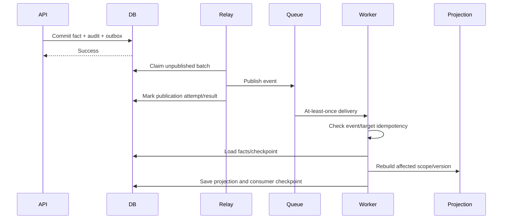

# Events, Background Jobs and Projections

## Event guarantees

- Domain changes and outbox events commit in one PostgreSQL transaction.
- Delivery is at least once; consumers are idempotent.
- Events carry IDs, aggregate/version, type/version, correlation/causation, occurred time and minimal references.
- Consumers load authorized facts by reference rather than receiving unnecessary financial payloads.
- Ordering is guaranteed only within the documented aggregate/partition key.

## Event catalogue

| Event | Key consumers |
|---|---|
| `principal.bootstrapped.v1` | First-run metrics/audit only. |
| `household.membership_changed.v1` | Authorization cache invalidation, household projections. |
| `access_grant.changed.v1` | Authorization cache invalidation, expiry scheduler, audit notifications. |
| `data_consent.changed.v1` | Connector authorization cache, expiry/revocation scheduler and audit notification. |
| `holding.changed.v1` | Wealth, allocation, liquidity, analysis and goal projections. |
| `ownership_schedule.changed.v1` | Historical/current projections and permission-dependent views. |
| `valuation.appended.v1` | Wealth/performance/goal projections and staleness schedule. |
| `transaction.appended.v1` | Cash flow, performance, wealth movement and goal projections. |
| `liability.changed.v1` | Wealth, debt/cash-flow and planning projections. |
| `document.uploaded.v1` | Malware scan and metadata extraction queue. |
| `document.scan_completed.v1` | Availability, notification and verification-review workflow. |
| `import.state_changed.v1` | Progress notification/monitoring; no direct wealth calculation before commit. |
| `goal.changed.v1` | Planning projection. |
| `policy.changed.v1` | Targeted or full affected projection rebuild. |

## Job catalogue and schedules

| Job | Trigger/schedule | Idempotency target |
|---|---|---|
| Projection rebuild | Domain events | Projection type + scope + source checkpoint + engine version. |
| Outbox relay | Continuous polling/notification | Event ID/publication destination. |
| Import parse/validate/commit | Explicit workflow state | Job ID + job version + chunk number. |
| Document scan | Upload event | Document version + checksum + scanner policy. |
| Metadata/OCR proposal | Clean scan event | Document version + extractor version. |
| Grant expiry | Indexed periodic sweep + scheduled time | Grant ID + expiry. |
| Consent expiry/revocation enforcement | Indexed periodic sweep + provider callback/event | Consent ID + state version. |
| Staleness transition | Scheduled policy boundary/sweep | Fact/policy/effective boundary. |
| Export compilation | User request | Export job version. |
| Retention/anonymization | Approved schedule | Record class + policy + cutoff checkpoint. |
| Projection reconciliation | Nightly/operational | Scope + checkpoint; detects missed events/drift. |

## Retry and dead-letter policy

- Transient failures use exponential backoff with jitter and bounded attempts/time.
- Validation/policy failures are terminal and exposed with safe reason codes.
- Poison events enter a dead-letter queue with alert, event reference and runbook; financial payloads are not copied into alerts.
- Operator replay requires documented cause/correction and remains idempotent.
- Queue age and oldest pending projection are SLO signals.

## Projection strategy

| Projection | Primary key/basis | Invalidated by |
|---|---|---|
| Wealth overview | Scope + as-of + valuation basis | Holding, ownership, valuation, liability, FX/policy. |
| Trend/snapshots | Scope + period/checkpoint | Historical fact/policy correction. |
| Movements | Scope + start/end + basis | Valuation, transaction, ownership and classification. |
| Cash flow | Scope + period | Transactions, transfer pairing and classification. |
| Performance | Scope + period + method + basis | Transactions, valuations, benchmark/FX and method version. |
| Attribution | Scope + period + method | Same plus classification/look-through. |
| Goal | Goal + scenario version | Goal/funding links, holdings, valuations and assumptions. |

Projection records include source checkpoint, calculation/policy versions, calculated time, completeness, omissions and named failure state. Serving stale projections is allowed only with explicit freshness disclosure and policy-permitted last-known behavior.

## Cache policy

- Redis may cache authorized projection responses keyed by principal-relevant scope/grant version and projection version.
- Cache entries contain no broader data than the requesting authorization context allows.
- Grant/revocation/membership events invalidate authorization-dependent keys immediately.
- Cache loss affects latency, not correctness.
