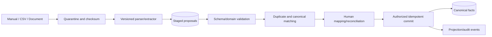

# Imports and Reconciliation Architecture

## Beta scope

Manual forms, CSV files and document-assisted proposals are supported. Live AA/depository/RTA connectors implement the same normalized-source interface later and remain disabled until approved.

## Normalized proposal contract

Each staged proposal includes source/file/row lineage, proposed fact type, raw value references, normalized fields, parser/schema versions, validation issues, candidate matches and a stable fingerprint. Raw sensitive content remains separately protected and is not copied into logs/errors.

## Duplicate detection

1. Exact external source ID within the same source.
2. File checksum + row fingerprint replay.
3. Exact account/ISIN/folio/registration identifiers after approved tokenization.
4. Probabilistic match on owner, subtype, date, quantity/value and institution.
5. Human decision for ambiguous candidates; never auto-merge solely from fuzzy similarity.

## Commit semantics

- Small jobs commit selected valid rows atomically.
- Large jobs use explicitly versioned, ordered chunks with a durable checkpoint; each chunk is atomic and replay-safe.
- A job version is frozen at confirmation; later mapping/decision changes require a new review version.
- Canonical commands perform the same authorization/invariant checks as direct API entry.
- Import does not directly write projection tables.

## Error classes

| Class | Behavior |
|---|---|
| Structural file error | Reject or request mapping; no canonical writes. |
| Row validation error | Keep staged with field-safe error codes. |
| Duplicate/conflict | Require explicit skip/link/create decision. |
| Authority failure | Block affected rows and require current authorized actor. |
| Commit conflict | Refresh canonical version and re-review affected rows. |
| Projection failure | Canonical commit remains; retry projection and disclose lag. |

## Future connector adapter

Adapters emit normalized source facts plus consent, fetch time, source sequence and deletion/retention metadata. They do not bypass staging/reconciliation for new/conflicting records. Connector health and consent expiry are distinct from financial fact validity; prior facts remain with provenance after revocation according to policy.

