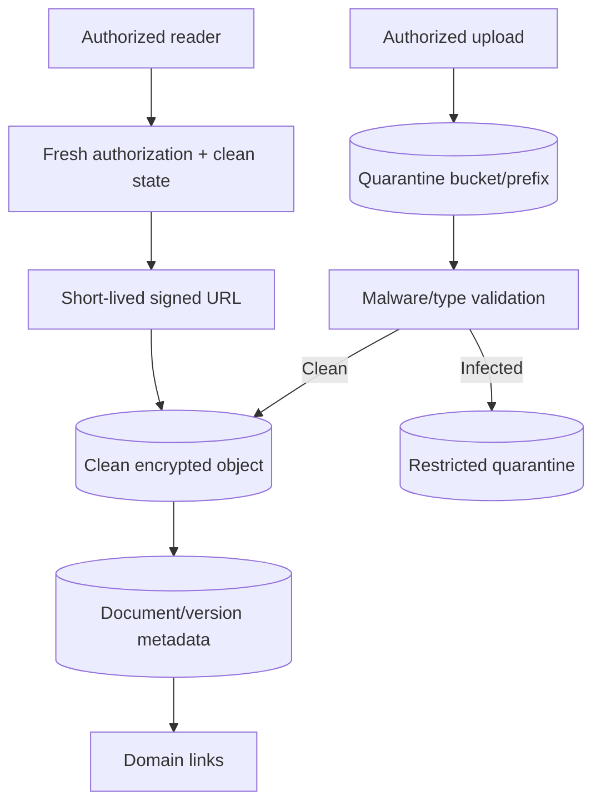

# Data Room Architecture

## Model

A document is a domain-linked metadata aggregate with immutable versions. Object storage holds encrypted bytes; the database holds authorization, provenance, lifecycle, links and audit evidence. Folders are derived views.

## Storage keys and security

- Keys use random document/version IDs, never names, PANs, account numbers or user-provided paths.
- Separate quarantine and clean access policies; public access is blocked.
- Server-side encryption uses approved managed keys; transport uses TLS.
- Signed URLs default to the shortest usable lifetime and are issued only after fresh authorization.
- Content disposition uses sanitized filenames; MIME is verified from bytes, not trusted extension.

## Lifecycle

Upload → quarantine → scan pending → available/infected → superseded/deactivated → retained/anonymized/purged under policy. Scanner errors remain pending. OCR creates proposals only and never silently modifies the ledger or verification level.

## Access and sharing

- Authorization evaluates document owner, domain link, grant scope/level, purpose and lifecycle state.
- Document access may be narrower than holding access.
- Every upload, scan outcome, link, access-URL issue, copy, supersession and policy deletion is audited.
- Future recipient-specific copies are separate document/version/access records with their own retention and revocation behavior.

## Retention and integrity

- Checksums detect byte identity/corruption; immutable/versioned storage is used where required.
- Legal hold prevents policy purge but not access revocation.
- Database metadata and objects are reconciled periodically for orphan/missing versions.
- Restore drills verify both metadata and object consistency.

