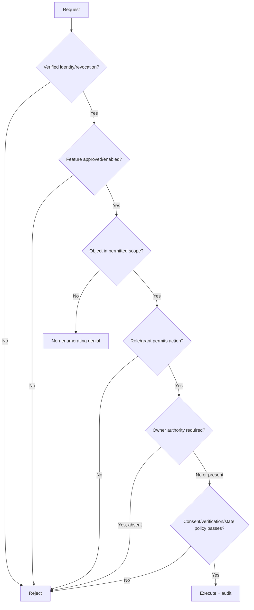

# Security and Threat Model

## Protected assets

Financial facts, ownership relationships, documents, authentication context, grants/consents, derived profiles, audit evidence, encryption keys, service credentials and availability/correctness of calculations.

## Primary threats and controls

| Threat | Required controls |
|---|---|
| Forged/stolen access token | RS256 allow-list, issuer/audience/time validation, short lifetime, revocation, no URL/localStorage tokens. |
| IDOR/cross-household access | Server-side object/field authorization, non-enumerating denial, scoped repositories, negative contract tests and defense-in-depth RLS. |
| Over-broad administrator | Ownership/action policy separate from manage grant; authority context and audit. |
| Revoked access served from cache | Grant-versioned keys and immediate invalidation; fresh checks for documents/sensitive actions. |
| Malicious upload | Quarantine, size/type/checksum limits, malware scan, sanitized filenames and no active inline execution. |
| Import formula/CSV injection | Treat cells as data, neutralize exported dangerous prefixes and never execute embedded content. |
| SQL/JSON injection | Parameterized repositories, schema allow-lists and no user-defined query fragments. |
| XSS/CSRF | Output encoding/CSP, safe component rendering, HttpOnly refresh cookie and double-submit/origin checks. |
| Mass assignment | Explicit command schemas; actor/owner/status/verification fields never client-authoritative. |
| Financial tampering | Append-only facts, optimistic concurrency, reconciliation, audit/outbox in same transaction and deterministic tests. |
| Event replay/duplication | Event IDs, consumer checkpoints and idempotent effects. |
| Insider/operator access | Least-privilege roles, no routine content access, governed exceptional workflow and audit-of-audit access. |
| Data exfiltration via logs/analytics | Structured allow-listed metadata, redaction tests, provider minimization and egress controls. |
| Re-identification | Gated outputs, minimum cohort/banding policy, purpose consent and privacy review. |
| Dependency/provider compromise | Signed/authenticated calls, network restrictions, rotation, circuit breakers, SBOM and incident disable gates. |

## Authorization decision

## Security verification

- Threat model reviewed per milestone and on material architecture changes.
- Automated authz matrix/IDOR tests cover every resource family.
- Fuzz/property tests cover money, allocations, parsers and state transitions.
- SAST, dependency/container scans, secret scanning and IaC checks run in CI.
- Independent penetration test and remediation/risk acceptance precede production.
- Incident playbooks cover token compromise, data access, malware, financial-integrity defect and provider breach.

