# Observability and Operations Design

## Telemetry contract

Every request/job propagates correlation and causation IDs. Telemetry is structured and allow-listed; it records technical identity references only where required and prohibits tokens, document content, full personal identifiers and unnecessary financial values.

## Required signals

| Area | Metrics/logs/traces |
|---|---|
| API | Rate, p50/p95/p99 latency, status/error code, saturation, route template and correlation. |
| Auth | Verification outcome/reason class, JWKS refresh, revocation dependency health; never token content. |
| PostgreSQL | Pool use/wait, query latency, locks/deadlocks, replica lag, storage and backup/PITR health. |
| Queue/workers | Depth, oldest age, throughput, retries, dead letters, runtime and concurrency saturation. |
| Projections | Lag, rebuild duration, state/current-partial-failed counts, reconciliation drift. |
| Imports | Jobs/rows by state, parse/validation/duplicate/commit rates and age. |
| Documents | Upload/scan latency, pending age, infected/error count, signed-access failures and orphan reconciliation. |
| Security | Rate-limit blocks, IDOR/authz denials by safe class, suspicious grant/download patterns and gate changes. |
| Product quality | Empty/partial/stale calculation outcomes and named engine failures without financial payload. |

## SLO monitoring

Dashboards calculate NFR3 indicators with consistent eligible-request rules and show error-budget burn. Multi-window burn alerts catch both rapid outages and slow degradation. Paging is reserved for urgent actionable symptoms; ticket alerts cover non-urgent capacity/data-quality work.

## Audit versus operational logs

- Audit evidence is durable business/security evidence and append-only.
- Operational logs diagnose system behavior and follow shorter approved retention.
- Audit evidence never becomes a dumping ground for request bodies.
- Access to audit-search functions is itself audited.

## Runbooks required before beta

Auth/verifier outage; database failover; queue backlog/projection lag; failed migration/deploy; object storage/scanner outage; import poison file; document malware; suspected cross-user access; token/secret compromise; calculation integrity incident; backup restore; privacy export/closure failure.

## Release operations

```mermaid
flowchart LR
    Commit --> CI[Lint type contract unit security]
    CI --> Image[Signed immutable artifacts/SBOM]
    Image --> Stage[Staging migrate deploy smoke]
    Stage --> Accept[Automated + owner acceptance]
    Accept --> Approve[Protected production approval]
    Approve --> Prod[Expand/migrate deploy]
    Prod --> Verify[Health/SLO/business checks]
    Verify -- fail --> Recover[Rollback app or forward-fix data]
```

Migrations precede code only when backward-compatible; otherwise use expand/migrate/contract. Feature activation is separate from deployment and remains audited/reversible.

