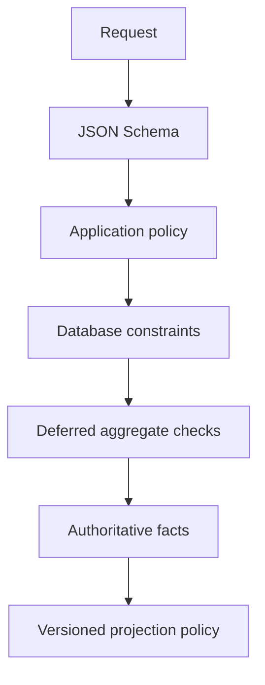

# Catalogue Seeds, Validation and Persistence Matrix

## Purpose

This document defines how the field dictionary becomes deterministic reference data, versioned validation and enforceable database behavior. It complements the logical database design; it is not physical migration code.

## Seed package contract

Reference data is committed as reviewed, deterministic files under `database/seeds/catalogue/` when implementation begins:

```text
database/seeds/catalogue/
├── manifest.yaml
├── asset-classes.yaml
├── asset-subtypes.yaml
├── liability-classes.yaml
├── liability-subtypes.yaml
├── field-profiles/
│   ├── asset/*.schema.json
│   └── liability/*.schema.json
├── valuation-methods.yaml
├── units.yaml
└── migrations/
```

`manifest.yaml` records catalogue version, compatible application version, source-document revision, checksum of every file, effective date, approver and change summary. Seeds are upserted by immutable code, never by display name. Published codes cannot be renamed or deleted; they may be deprecated with an effective end date and replacement code.

## Seed metadata

| Attribute | Required | Rule |
|---|---|---|
| `code` | Yes | Upper snake case, globally stable within catalogue kind. |
| `display_name` | Yes | Localizable message key plus default English label. |
| `parent_code` | Subtype | Must reference an active/effective class. |
| `priority` | Yes | `P1` guided beta form or `P2` schema-driven beta form. |
| `profile_codes` | Yes | Ordered, non-empty list from the approved field-profile registry. |
| `schema_version` | Yes | Semantic version; immutable schema artifact. |
| `allowed_valuation_methods` | Asset | Non-empty except explicitly non-valued containers. |
| `default_liquidity_class` | Asset | Presentation default only; user/source fact may override. |
| `net_worth_policy` | Yes | Include, exclude, or conditional with named policy code. |
| `effective_from` / `effective_to` | Yes/optional | Non-overlapping effective interval. |
| `replacement_code` | Deprecated only | Active compatible successor where one exists. |

## Validation layers

| Layer | Responsibility | Examples |
|---|---|---|
| JSON Schema | Shape and local field constraints | Required property, string length, enum, decimal-string format. |
| Application policy | Cross-field/domain rules | Option requires expiry; floating loan requires benchmark; authority and ownership checks. |
| Database constraints | Durable scalar/referential invariants | FK, unique code/version, range checks, date ordering. |
| Deferred transaction checks | Aggregate-wide invariants | Active ownership totals 100%; no overlapping effective ownership. |
| Projection policy | Inclusion/presentation | Notional excluded; contingent liability disclosed separately; stale valuation badge. |



Validation must use the schema version supplied by the catalogue response and persisted with the aggregate. A stale client receives `409 CATALOGUE_VERSION_CONFLICT` when its version can no longer create a valid record. Compatible additive fields may be accepted only under an explicitly declared compatibility range.

## Persistence mapping

| Concern | Typed persistence | Extension persistence |
|---|---|---|
| Identity/classification | Holding/liability IDs and class/subtype FKs | Never JSONB-only. |
| Ownership/access | Allocation, household and grant tables | Never JSONB-only. |
| Money/current value | Valuation, transaction, lot, schedule tables | JSONB may describe method details only. |
| Currency/quantity/status/dates | Typed aggregate columns | Never duplicated as authoritative JSONB. |
| Relationships | Typed link tables | Polymorphic link only where documented. |
| Profile attributes | Common searchable fields promoted when justified | Versioned `subtype_attributes` JSONB. |
| Provenance/evidence | Source/document/verification tables | Bounded metadata only. |

Every `subtype_attributes` value is validated before persistence and stores its schema version. Unknown JSON properties are rejected by default. A schema change requiring reinterpretation creates a new version plus an explicit, audited data migration.

## Constraint matrix

| Table/field | Required database enforcement |
|---|---|
| `asset_subtypes` | PK code; FK parent class; unique `(asset_class_code, display_name, effective_from)`; valid effective interval. |
| `liability_subtypes` | PK code; FK parent class; equivalent uniqueness/effective checks. |
| `holdings` | Composite FK or trigger proving subtype belongs to class; ISO currency check; quantity range; schema-version presence; status check. |
| `liabilities` | Composite class/subtype consistency; rate range; date order; nature/status checks. |
| `ownership_allocations` | Percentage `>0 AND <=100`; non-overlapping person/holding ranges; deferred active-total equals 100.0000. |
| `valuation_events` | Allowed method checked against effective subtype policy in application; amount/currency/as-of typed; immutable/supersession checks. |
| `holding_restrictions` | End after start; active-range overlap rules by restriction type. |
| `cost_basis_lots` | Positive cost; quantity required/positive for unitized holdings; immutable correction chain. |
| `commitments` | Committed non-negative; drawn between zero and committed unless approved overdraw policy; date-window order. |
| `liability_schedule_items` | Non-negative components; unique installment number; due-date ordering; ending balance reconciliation tolerance. |
| `subtype_attributes` | Object only, bounded byte size, schema version present; application JSON Schema validation before commit. |

Database triggers must not fetch external schemas or perform network I/O. Catalogue/schema artifacts are loaded and cached by the application; high-value cross-row invariants use local deferred constraints/triggers with concurrency tests.

## Index matrix

| Query/use case | Index |
|---|---|
| Active catalogue by class/order | `asset_subtypes(asset_class_code, active, sort_order)` and liability equivalent. |
| Holdings by owner/class/status | `(owner_person_id, status, asset_class_code, updated_at DESC)`. |
| Household asset breakdown | `(household_id, status, asset_class_code)` partial where active. |
| Canonical instrument lookup | Partial indexes on promoted identifier hash/ISIN; never index plaintext encrypted identifiers. |
| Current valuations | `valuation_events(holding_id, as_of_at DESC, recorded_at DESC)` excluding superseded rows where practical. |
| Ownership at date | GiST range index plus `(person_id, holding_id)` lookup. |
| Liability list and maturity | `(borrower_person_id, status, matures_on)` and `(household_id, status)`. |
| Floating-rate reset work | Partial `(next_reset_on)` for active floating liabilities after promoted typed field exists. |
| JSONB administrative search | Narrow expression indexes only for measured, approved fields; no blanket GIN index by default. |
| Import subtype mapping | `(import_job_id, candidate_domain_type, validation_state)` plus normalized external-key hash. |

An attribute becomes a typed/promoted column when it participates in authorization, money/ownership invariants, frequent filters/sorts, joins, uniqueness, regulatory reporting, or measured performance-critical queries. Promotion uses expand/backfill/switch/contract and retains schema compatibility during rollout.

## Catalogue API behavior

`GET /api/v1/catalogue/asset-classes` and `GET /api/v1/catalogue/liability-types` return:

- catalogue version and ETag;
- effective class/subtype codes and localized labels;
- priority and field-profile/schema versions;
- JSON Schema plus UI hints kept in separate namespaces;
- allowed units and valuation methods;
- conditional-rule identifiers and safe help text;
- deprecation/replacement metadata.

UI hints may control grouping, widget choice and help text but cannot relax server validation. Schema responses are cacheable by version and contain no tenant/user data.

## Import and migration behavior

1. Imports map source values to stable subtype codes, never display names alone.
2. Ambiguous mappings remain staged and require a reconciliation decision.
3. Imported attributes run the same versioned validator as manual entry.
4. Deprecated codes remain readable; new creation follows replacement policy.
5. Catalogue migrations are rehearsed against synthetic examples for every subtype and reject orphaned/invalid records.
6. Rollback restores application compatibility; it never deletes catalogue facts or silently downgrades stored attributes.

## Required verification evidence

- one valid and one invalid golden fixture for every subtype;
- property-based boundary tests for money, decimal, date and allocation rules;
- schema compatibility tests across supported client versions;
- database concurrency tests for ownership and supersession invariants;
- import round-trip tests preserving codes, decimals, provenance and unknown values;
- API contract tests verifying generated forms and server validation agree;
- query-plan evidence before adding or removing an index.

## Decisions still requiring owner or specialist review

1. Final display labels and grouping for every seed code.
2. Which P2 subtypes receive custom guided forms after beta usage evidence.
3. Jurisdiction-specific rules for tax credits, pensions, nominees, trusts and offshore reporting.
4. Approved valuation methods and staleness windows per subtype.
5. Exact maximum size for subtype JSON and free-text risk notes.
6. Whether any external identifier requires exact-match blind indexing after threat-model review.
