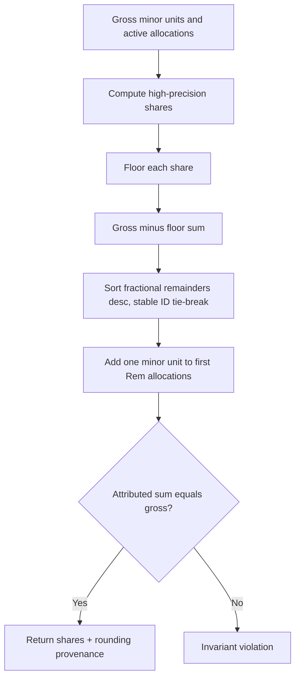

# Domain Algorithms

## Effective-dated ownership replacement

**Input:** holding, expected aggregate version, replacement allocations and effective date.

1. Lock the holding aggregate and verify expected version.
2. Authorize the actor for every affected owner and requested action.
3. Validate distinct people, percentage scale/range and exact 100% total.
4. Reject an effective date before immutable legal/history constraints permit.
5. Close current allocations immediately before the effective date.
6. Insert new allocations beginning on the effective date; never overwrite historical rows.
7. Validate no gaps/overlaps at all interval boundaries.
8. Increment aggregate version and emit one ownership-change event/audit record.
9. Rebuild projections from the earliest affected date.

Historical transactions/valuations remain attached to the canonical holding; attribution uses the allocation active at each required date.

## Valuation selection

1. Load active, non-invalidated assertions at/before requested as-of.
2. Filter methods/sources prohibited by subtype or requested basis.
3. Apply versioned precedence based on verification, source authority, method suitability and time.
4. Do not select a future assertion or silently combine competing assertions.
5. Calculate age and staleness under policy effective at requested calculation version.
6. Return selected event plus rejected candidates/reason codes in internal provenance.
7. If none applies, return `NO_APPLICABLE_VALUATION`.

## Transaction correction and transfer pairing

- Correction creates a new entry referencing the original and representing the exact reversing/adjusting economic effect.
- A transaction may be corrected multiple times only through a chain whose active net effect is deterministic.
- Internal transfer sides share a transfer-group ID, currency/value-date policy and opposite economic directions.
- Consolidated cash flow excludes balanced internal transfer groups; incomplete/unbalanced pairs remain a named reconciliation issue.

## Projection invalidation

Map event type and affected IDs to the smallest safe scope/date range. Store a monotonically comparable source checkpoint. Workers calculate from a consistent fact checkpoint and save only if the result is not older than the stored checkpoint. Policy/engine version changes explicitly invalidate affected projections even without financial fact changes.

## Import fingerprint and replay

Fingerprint uses normalized source identity, file checksum, sheet/row location and canonicalized relevant fields under a fingerprint version. Same idempotency key/request hash returns prior result. Same key/different hash conflicts. A matching fingerprint proposes duplicate/link; it never auto-merges a fuzzy match.

## Verification elevation

1. A fact begins at the level justified by its source.
2. Evidence links are appended independently.
3. Policy evaluates evidence type, reviewer authority, scope, dates and expiry.
4. A document alone can support documented status but cannot automatically create independent verification.
5. Elevation/expiry changes derived capability state without rewriting the original fact.
6. Sensitive output policies re-evaluate capability at request time.

## Largest-remainder ownership rounding

## Permission filtering

Authorization produces an allow-list of resource/action/field groups, not a post-hoc hide list. Repository queries constrain rows; response assemblers construct only permitted fields. Totals-only projections are computed/stored with disclosure-safe dimensions so exact holdings cannot be inferred from payloads or error differences.

## Feature-gate evaluation

Effective gate state requires code-known gate key, environment configuration, non-expired approval record, required control/version compatibility and no emergency suspension. Missing or inconsistent evidence resolves to disabled. Activation/deactivation is audited separately from deployment.

