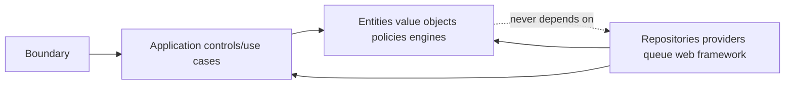

# Design Patterns and Object Decisions

## Patterns

| Pattern | Application | Reason |
|---|---|---|
| Hexagonal ports/adapters | Auth, storage, scanner, sources, benchmarks, notifications | Provider replacement without domain coupling. |
| Repository + Unit of Work | Aggregate persistence plus audit/outbox | One transaction protects facts, evidence and events. |
| Strategy | Valuation selection, staleness, returns, subtype validation | Versioned interchangeable policy with explicit selection. |
| Specification/Policy Object | Authorization, feature gates, verification capability | Composable testable decisions, no UI security logic. |
| Facade | Wealth/analysis/planning query assembly | Stable boundary over multiple projections/engines. |
| Template Method/Pipeline | Calculations and imports | Validate → execute → reconcile → provenance with specialized steps. |
| Outbox/Inbox | Background jobs and projection events | Atomic publication intent and idempotent consumption. |
| CQRS-lite | Authoritative facts vs read projections | Fast scalable reads without two independent truth stores. |
| State Machine | Imports, documents, grants, projections, closure | Explicit legal transitions and terminal/retry behavior. |
| Anti-corruption layer | auth-core and future financial connectors | External vocabulary/claims do not leak into domain ownership rules. |

## Aggregate decisions

- `Holding` owns current/future ownership schedule invariants, metadata lifecycle and restriction references.
- `ValuationEvent` and `Transaction` are append-only facts with separate streams; high-volume history does not inflate holding optimistic-lock contention.
- `Household` owns memberships, not financial ownership.
- `AccessGrant` is independently versioned because revocation/expiry must not wait for household edits.
- `ImportJob` owns staging workflow only; canonical aggregates remain responsible for commit validation.
- `Document` owns its version/link lifecycle; object bytes remain behind a port.
- Projections are not domain aggregates and may be rebuilt.

## Dependency direction

## Decisions against common shortcuts

- No active-record ORM business logic.
- No generic service/repository exposing arbitrary table CRUD.
- No `dict[str, Any]` as a substitute for core financial types; extensible attributes remain schema-versioned.
- No synchronous dashboard fan-out across raw facts on every request; serve versioned projections.
- No client-computed authorization, net worth or verification elevation.
- No distributed microservices until measured scaling/team/availability needs outweigh transactional simplicity.
- No event sourcing claim: selected facts are append-only, but aggregate state and projections use conventional persistence.

## Object-design review checklist

- Does each invariant have exactly one owning entity/control/policy?
- Can the object be tested without framework/database/network?
- Are time, currency, precision, policy and calculation version explicit?
- Does every sensitive read require an authorized scoped query?
- Do retry and concurrency semantics preserve idempotency?
- Are expected insufficiencies results rather than exceptions?
- Can historical output be reproduced after policy/code changes?

