# Implementation Roadmap

## Delivery principle

Each milestone produces a deployable, testable staging increment. A milestone is complete only when documentation, migrations, APIs, UI states, automated tests, observability and acceptance evidence agree.

## Documentation before application code

1. Complete actors/system boundary and stable terminology.
2. Rewrite functional and non-functional requirements with traceability IDs.
3. Write detailed use cases for every beta flow and deferred-module boundary.
4. Complete ECB/domain model and sequence/state diagrams.
5. Complete API, schema, event, security and read-model designs.
6. Complete class interfaces and calculation contracts.
7. Complete testing, operations and deployment specifications.
8. Reconcile the full set and obtain owner approval for the beta baseline.

## Implementation milestones

| Milestone | Deployable outcome |
|---|---|
| M0 Foundation | Monorepo, local environment, CI gates, environments, feature flags, structured telemetry and health checks. |
| M1 Auth and bootstrap | auth-core redirect/handoff, token verification, local principal, first-run routing and fail-closed tests. |
| M2 People and ownership | Household people, roles, explicit grants, shared holding ownership allocations and scope selector. |
| M3 Ingestion and catalogue | Manual entry, CSV import, import staging/reconciliation, all catalogue classifications and rich priority-1 forms. |
| M4 Ledger and data room | Valuations, transactions, income, liabilities, documents, provenance, audit and append-only corrections. |
| M5 Wealth experience | Net worth, assets/liabilities, cash flow, liquidity, data quality, staleness, projections and holding detail. |
| M6 Analysis | XIRR/TWRR, attribution, performance basis, costs, benchmark adapter and look-through concentration. |
| M7 Planning/settings | Goals, calculators, life-event prompts, preferences, notifications, export/closure coordination and revenue transparency. |
| M8 Beta hardening | E2E accessibility, security, load, recovery, backup restore, runbooks and controlled production readiness. |

## Gated later milestones

Sharing/resume, estate, Ask, credit, marketplace and advisors each receive an independent milestone only after the relevant feature-gate contract is satisfied.

## Required quality gates

```mermaid
flowchart LR
    Spec[Approved traced specification] --> Build[Implementation]
    Build --> Static[Lint, types, dependency/security scan]
    Static --> Unit[Unit/property/golden tests]
    Unit --> Integration[API, DB, auth and job integration]
    Integration --> E2E[E2E and accessibility]
    E2E --> Perf[Performance and resilience]
    Perf --> Stage[Staging acceptance]
    Stage --> Release[Manual production approval]
```

## Definition of Done

- Acceptance criteria and error/empty/stale states are implemented.
- OpenAPI and generated client agree.
- Database migrations are reversible or have a documented forward-recovery path.
- Financial calculations have deterministic golden cases and provenance.
- Cross-user access has explicit positive and negative tests.
- Logs/metrics contain correlation but no prohibited financial or identity content.
- SLO-relevant dashboards and alerts exist.
- Documentation, traceability and progress tracker are updated.
- Staging evidence is reviewed before production approval.

