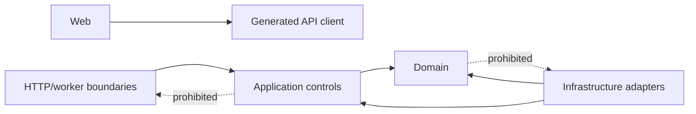

# Project Structure and Engineering Standards

## Planned monorepo

```text
vittavaan/
├── apps/
│   └── web/                       React + TypeScript + Vite
├── services/
│   ├── api/                       FastAPI HTTP boundary
│   └── worker/                    background worker entrypoint
├── packages/
│   ├── api-client/                generated OpenAPI TypeScript client
│   ├── design-system/             tokens and accessible shared components
│   ├── financial-formatting/      display-only formatters
│   └── test-fixtures/             versioned synthetic fixtures
├── backend/
│   └── vittavaan/
│       ├── domain/                entities, values, policies, pure engines
│       ├── application/           controls, commands, queries, ports
│       ├── infrastructure/        SQLAlchemy, Redis, queue, object/provider adapters
│       └── boundary/              FastAPI schemas/routes and worker consumers
├── database/
│   ├── migrations/
│   └── seeds/                     reference data only
├── infrastructure/
│   ├── terraform/
│   ├── environments/
│   │   ├── oci-staging/
│   │   └── aws-production/
│   └── deploy/
├── tests/
│   ├── contract/
│   ├── integration/
│   ├── e2e/
│   ├── security/
│   ├── performance/
│   └── recovery/
├── docs/v3/
├── compose.yaml
├── compose.local.yaml
├── compose.staging.yaml
├── Makefile
└── .github/workflows/
```

The backend package is shared by API and worker processes. Do not duplicate domain/application code between service entrypoints.

Container images must be reproducibly buildable for both `linux/amd64` and `linux/arm64`. The base Compose file is the portable service contract; overlays may change deployment concerns but must not fork domain behavior, schemas, migration history or API contracts. OCI staging infrastructure is declared in Terraform and deployment scripts consume an immutable release manifest rather than building on the server.

## Dependency rules



- Domain imports only standard library and approved pure utility packages.
- Application imports domain and declared ports; never FastAPI/SQLAlchemy/provider SDKs.
- Infrastructure implements ports and may import application/domain.
- Boundaries validate/translate and invoke controls; no business calculations or direct ORM queries.
- Frontend pages call generated clients only through query/mutation hooks; no raw `fetch` in components.

## Backend standards

- Python 3.12+, Ruff with line length 100 and rules `E,F,I,N,UP,B,SIM,RUF,ASYNC`; narrowly documented ignores only.
- mypy strict; no unparameterized collections or unexplained `Any`/ignore.
- Pydantic v2 at boundaries; domain objects remain framework-independent.
- SQLAlchemy 2 async only inside infrastructure repositories.
- Google-style docstrings for public contracts and non-obvious policy/algorithm implementations.
- `Decimal` created from strings/integers; never from binary float.
- UTC-aware datetimes; inject clocks into application/domain tests.
- Stable error codes and message keys; user prose belongs at presentation boundary.

## Frontend standards

- TypeScript strict including unchecked-index and exact-optional-property checking.
- React components are accessible, focused and presentation-oriented; server state uses TanStack Query.
- React Hook Form + generated/Zod schemas for UX validation; server remains authoritative.
- Currency uses `Intl.NumberFormat` with explicit locale/currency; components never accept an unproven bare number for a financial figure.
- Every financial display receives value, currency, as-of and provenance/presentation state.
- Tailwind/shadcn components conform to design tokens; no inaccessible colour-only states.
- Charts provide keyboard-accessible summaries or equivalent tables.

## API, migration and event standards

- OpenAPI changes are reviewed before implementation and generated client drift fails CI.
- Mutating endpoints define idempotency and optimistic concurrency behavior.
- Migrations use expand/migrate/contract, are tested on production-like volume and include recovery notes.
- Events are versioned, minimal, idempotent and documented in the event catalogue.
- Reference-data seeds are deterministic/versioned; no customer data in source control.

## Git and review

- Conventional Commits: `feat`, `fix`, `docs`, `test`, `refactor`, `perf`, `build`, `ci`, `chore`, `revert`.
- Small traceable increments; PR description lists requirement/use-case IDs, migrations, gates, tests, monitoring and rollback.
- Protected default/develop branches, required checks and at least one reviewed approval before production-bound merge.
- Generated files are identifiable and regenerated, not hand-edited.
