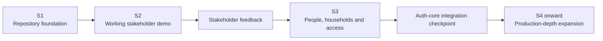
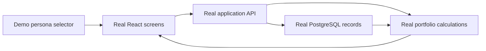

# Proposed Demo-First Sprint and Milestone Plan

> **Status:** Not selected by the owner on 21 Sep 2026; retained only as decision history
>
> **Created:** 21 Sep 2026
>
> **Current canonical plan:** [03_Sprint_and_Milestone_Plan.md](./03_Sprint_and_Milestone_Plan.md) remains unchanged
> **Purpose:** Produce a working stakeholder-visible application earlier without treating demo shortcuts as production security.

## Plain-English summary

The current plan builds several underlying capabilities before assembling the main portfolio experience in S8. This proposal changes the order so stakeholders receive a narrow but genuinely working application in S2.

The S2 demonstration will not be a static mock-up. Its screens will use real application APIs, real PostgreSQL tables and real calculations. The starter information will be fictional, and users will enter through a controlled demo-persona selector instead of auth-core.

The demo identity mechanism is not a second authentication product. It exists only for local development and an explicitly configured stakeholder-demo environment. It must be impossible to enable accidentally in staging, beta or production.

## Delivery strategy

The implementation follows a **vertical slice**: one smaller journey works from screen to API to database to calculation before the full catalogue is expanded.

## Proposed sprint sequence

Two-week iterations remain the planning assumption. Scope is accepted by demonstrated outcome rather than by date alone.

| Sprint | Stakeholder-visible outcome | Important foundation delivered |
|---|---|---|
| S0 Documentation approval — COMPLETE 20 Sep 2026 | Approved product direction and implementation documentation | Reconciled v3 baseline and owned gates |
| S1 Repository foundation — REVIEW READY | Minimal technical shell only | Monorepo, Docker stack, database, worker, object storage, monitoring, CI/security and clean-environment evidence |
| **S2 Working portfolio demo** | A stakeholder can choose a fictional persona, view net worth, browse assets/liabilities, add or edit selected records and see totals update | First real portfolio database slice, APIs, calculations, synthetic seed data and demo-only identity adapter |
| S3 People, households and access | Household members, ownership, access roles and household switching work | Production-shaped user reference, household membership, ownership allocation and authorization rules |
| **S3A Auth-core integration checkpoint** | A test user can enter from auth-core, return to Vittavaan and retain correct household access | Token verification, issuer/audience/JWKS configuration, revocation behavior, logout and denial testing |
| S4 Complete holding catalogue | All documented asset classes are recordable; priority assets have richer forms | Universal holding model, subtype schemas, ownership allocation and catalogue seeds |
| S5 Imports and reconciliation | Users can preview and safely import supported CSV data | Staging, mapping, duplicate detection, reconciliation and controlled commit |
| S6 Valuation, transactions and liabilities | Values, transactions, income, loans and schedules can be maintained | Append/correct financial facts, provenance, ledger and liability engines |
| S7 Data Room | Documents can be uploaded, linked, versioned and retrieved safely | Quarantine/scanning workflow, signed access, audit and lifecycle handling |
| S8 Complete wealth views | Every Assets and Liabilities embedded tab/state works with full underlying data | Projection pipeline, movement explanations, cash flow, consent and holding detail read models |
| S9 Analysis | Performance and portfolio-analysis screens work | XIRR/TWRR, attribution, basis, drawdown and permitted benchmarks |
| S10 Planning and settings | Goals, liquidity, scenarios, preferences and notifications work | Planning engines, preferences and auth-core security links |
| S11 Privacy and reliability | Export/closure and failure-recovery journeys work | Retention, deletion/anonymization, restore/replay and failure UX |
| S12 Beta hardening | A controlled beta is ready for approved users | End-to-end, accessibility, security, load and recovery evidence plus runbooks |

## S2 — Working Portfolio Demo

### Objective

Give stakeholders an application they can operate and discuss while preserving a path to the production design.

### Demonstration journey

1. Open the application.
2. Choose a fictional demo persona.
3. See the persona's current net worth and asset/liability totals.
4. Open the Assets tab and inspect existing records.
5. Add or edit a supported asset.
6. Open the Liabilities tab and inspect existing records.
7. Add or edit a supported liability.
8. Return to Net Worth and see the recalculated totals.
9. Switch to the new-user persona and see the correct first-run/empty state.

### Proposed S2 frontend scope

- Application frame and responsive navigation matching the current wireframe direction.
- Net Worth tab with total assets, total liabilities and net worth.
- Assets tab with grouping, list/detail and add/edit journeys.
- Liabilities tab with grouping, list/detail and add/edit journeys.
- A simplified Cash Flow summary where the available demo data supports it.
- First-run and empty states.
- Loading, validation, save-success, permission-denied and safe error states.
- Clear **Demo environment — synthetic data only** indicator.
- Basic accessibility: keyboard operation, labels, focus handling and readable contrast.

### Proposed S2 asset coverage

The initial rich forms should demonstrate common household wealth without pretending the entire catalogue is finished:

- bank account/cash;
- listed shares;
- mutual funds;
- fixed deposit;
- residential real estate;
- gold;
- EPF/PPF or equivalent retirement/provident balance.

Other documented asset classes remain in the approved catalogue and are completed in S4. If useful for coverage demonstrations, a long-tail asset may be stored through the approved universal holding fields, but S2 does not promise a specialized form for every subtype.

### Proposed S2 liability coverage

- home loan;
- personal loan;
- vehicle loan;
- credit-card balance;
- other liability using the approved common liability fields.

### Real implementation versus simulation

| Capability | S2 treatment |
|---|---|
| React screens and navigation | Real and retained |
| API endpoints | Real and retained |
| PostgreSQL tables and migrations | Real and retained |
| Asset/liability records | Real records containing fictional information |
| Net-worth calculation | Real calculation contract |
| Validation and error behavior | Real |
| Demo personas | Simulated identity source; replaceable adapter |
| Starter portfolio values | Synthetic seed data |
| Bank/broker connections | Not included; manual entry only |
| Auth-core login | Deferred to S3A, with its boundary preserved during S2 |
| Production use | Prohibited |

### Demo personas

| Persona | Purpose |
|---|---|
| Portfolio owner | Demonstrates a populated household and full permitted editing |
| Spouse/joint owner | Demonstrates shared assets and a different access scope |
| New user | Demonstrates first-run and empty states |
| Read-only member, if time permits | Demonstrates that view access does not imply edit permission |

All names, contact information, account references and financial values must be unmistakably fictional. No stakeholder should enter real personal or financial information into the demo.

### Demo-identity safety rules

1. Demo identity is implemented behind the same internal identity interface that auth-core will later use.
2. It is allowed only when the application runs in an explicit `local` or `demo` mode.
3. Staging, beta and production startup fail if demo identity is enabled.
4. There is no temporary password database, password reset or session system in Vittavaan.
5. Every demo request still carries a user identity, and household authorization is enforced rather than bypassed.
6. Demo records are separated from future real environments and can be reset safely.
7. The interface visibly identifies synthetic/demo mode on every page.

### S2 acceptance demonstration

S2 is complete only when the following can be shown without developer intervention:

- a stakeholder opens the application and selects a persona;
- the seeded portfolio loads from PostgreSQL;
- the displayed assets, liabilities and net worth agree mathematically;
- adding or changing an asset persists after refreshing the browser;
- adding or changing a liability persists and changes net worth correctly;
- the spouse persona cannot perform an operation outside its assigned permission;
- the new-user persona sees a usable first-run state;
- no real credentials or financial data are required;
- automated API, database, calculation, authorization and key browser-journey tests pass;
- the demo can be rebuilt from documented commands and synthetic seeds.

### S2 exclusions

- real authentication or password handling;
- real customer data;
- bank, broker, depository or government connectors;
- CSV import/reconciliation;
- document upload/Data Room;
- advanced performance analytics;
- financial planning;
- every specialized long-tail asset form;
- production deployment claims.

## S3 — People, Households and Access

S3 turns the demonstration's minimum access model into the complete beta household foundation:

- people and household records;
- membership lifecycle and household switching;
- ownership allocations, including jointly owned assets;
- household roles and resource-specific grants;
- invitation/acceptance behavior where approved;
- consistent authorization across APIs and frontend controls;
- negative tests proving that unrelated users cannot access each other's data;
- migration of S2 demo records without rebuilding the portfolio model.

The demo persona adapter remains available for local automated development after S3.

## S3A — Auth-core Integration Checkpoint

S3A is intentionally placed before broader financial functionality. It connects the already-built identity boundary to the existing auth-core without moving authentication responsibility into Vittavaan.

It must verify:

- redirect to and return from auth-core;
- signed-token validation through approved issuer, audience and JWKS values;
- mapping of the auth-core subject to Vittavaan's user reference;
- expired, malformed and revoked identity behavior;
- correct logout/security links;
- correct household access after authentication;
- demo identity remaining impossible in staging/beta/production;
- documented configuration and failure recovery.

No S4 shared-environment demonstration containing persistent financial records should proceed until S3A passes.

## Milestone view

| Milestone | Included work | Review result |
|---|---|---|
| M1 Foundation | S0–S1 | Technical foundation accepted |
| **M2 Stakeholder demonstrator** | S2 | Stakeholders can use a real database-backed portfolio slice and provide product feedback |
| M3 Trusted identity and household | S3–S3A | Household permissions and external auth-core identity are proven |
| M4 Wealth data foundation | S4–S8 | Full beta wealth-recording and portfolio views are operational |
| M5 Decision support | S9–S10 | Analysis and planning are operational within approved boundaries |
| M6 Controlled beta | S11–S12 | Privacy, reliability, security and operational gates pass |

## Feedback rule after the S2 demonstration

Stakeholder feedback is classified before changing the roadmap:

| Feedback type | Treatment |
|---|---|
| Incorrect behavior or calculation | Fix before accepting S2 |
| Confusing core workflow | Fix or explicitly schedule before the owning production-depth sprint |
| Presentation polish | Prioritize by demonstration impact and accessibility |
| New asset subtype detail | Add to the S4 catalogue backlog unless essential to the agreed S2 demo |
| New connector, marketplace or legal feature | Send through the existing approval gate; do not enable from demo feedback alone |
| Authentication request | Preserve auth-core ownership and schedule through S3A |

## Risks and controls

| Risk | Control |
|---|---|
| Stakeholders mistake the demo for production readiness | Persistent demo banner, synthetic data, written limitations and no production claim |
| Demo shortcuts become permanent architecture | Real ports/interfaces, migrations and calculations; temporary identity isolated behind an adapter |
| Authentication integration becomes indefinitely delayed | Mandatory S3A gate before S4 shared financial-data demonstrations |
| Common assets crowd out catalogue commitments | S4 remains responsible for every documented asset class |
| Feedback continuously expands S2 | Fixed demonstration journey and explicit exclusions |
| Synthetic records resemble real people | Clearly fictional names/values and no copied customer information |
| Demo identity reaches a real environment | Environment allow-list plus startup failure outside local/demo modes |

## Approval questions

The owner should confirm these points before this proposal replaces the current plan:

1. S2 should prioritize a working stakeholder portfolio demonstration.
2. S2 should initially provide rich forms for the listed common assets and liabilities.
3. Demo personas and synthetic PostgreSQL data are acceptable for the stakeholder environment.
4. The stakeholder environment must not contain real personal or financial information.
5. Auth-core connection moves to the mandatory S3A checkpoint rather than the end of the project.
6. S4 remains responsible for complete asset-catalogue coverage.
7. Two-week sprint cadence remains a planning assumption, with outcome—not date—determining completion.

The owner chose to continue with the original [Sprint and Milestone Plan](./03_Sprint_and_Milestone_Plan.md). This proposal must not be used as implementation authority unless a later recorded decision reopens it.
