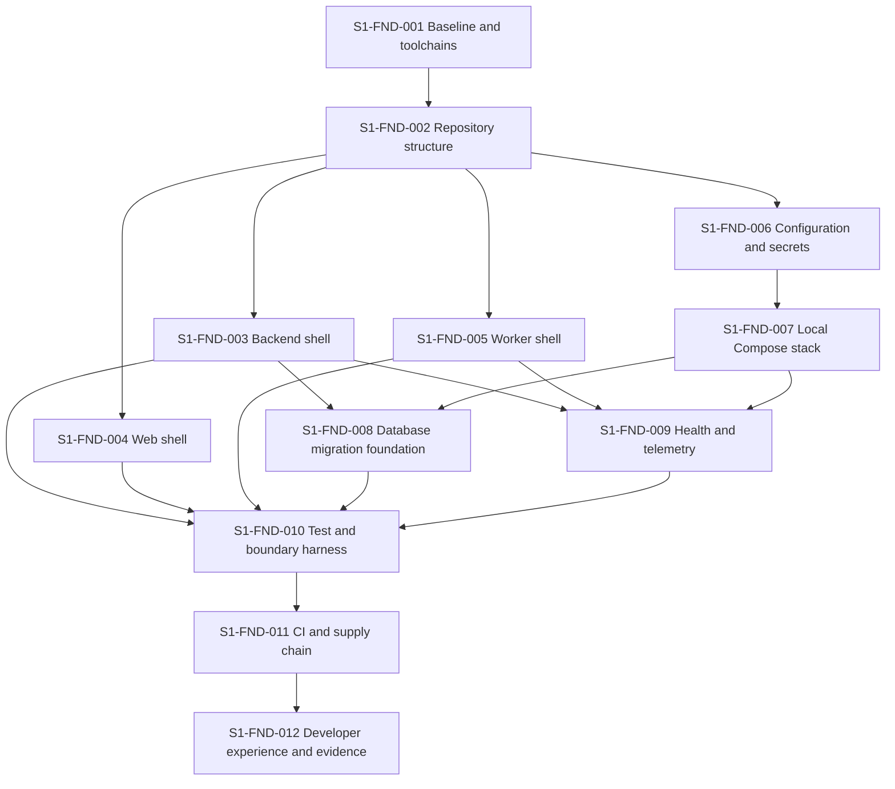

# S1 Repository Foundation Backlog

## Sprint objective

Create a reproducible, secure and observable engineering foundation on which S2 can integrate auth-core without restructuring the repository. S1 proves that the empty system can build, start, migrate, test and report health locally and in CI.

S1 is **foundation-only**. It must not implement login flows, people, households, holdings, liabilities, financial calculations, imports, documents or production infrastructure.

## Outcome statement

At S1 completion, a new developer can clone the repository, follow one setup path, start the local stack, run all quality gates, apply an empty baseline migration, open the application shell, inspect safe health/readiness responses, execute a background-worker smoke task and stop/reset synthetic local infrastructure. CI repeats the same checks and builds signed/scannable ARM64 and AMD64 candidate images.

## Traceability

| Source | S1 responsibility |
|---|---|
| ADR-014 / DEC3-002 | Enforce foundation-only scope. |
| ADR-015 / DEC3-003 | Establish approved technology stack and version locks. |
| ADR-016 / DEC3-004 | Preserve the separate auth-core boundary; no authentication implementation. |
| ADR-017 / DEC3-005 | Produce ARM64-compatible images and staging-ready Compose contract. |
| ADR-019 / DEC3-007 | Establish protected-quality and release workflow. |
| NFR3-MAINT-001–007 | Dependency boundaries, contracts, migrations, static checks, traceability and feature-gate metadata. |
| NFR3-OPS-001–006 | Correlation, telemetry, deployment automation, reproducibility and UTC. |
| NFR3-SEC-007/010 | Secret handling and CI security scanning. |
| NFR3-REL-003/008 | Idempotent worker foundation and health/recovery behavior. |

## Scope boundaries

### Included

- repository/monorepo structure and ownership rules;
- pinned development/runtime toolchains and lockfiles;
- empty React web, FastAPI API and Celery worker/scheduler entrypoints;
- architectural package boundaries with dependency enforcement;
- local PostgreSQL, Redis and S3-compatible object-storage dependencies;
- migration and deterministic seed framework, with an empty/baseline migration only;
- configuration schema and secret-file convention;
- liveness/readiness, structured logging, correlation/causation foundations and metrics export;
- unit/contract/integration test harnesses using synthetic data;
- CI quality/security gates and multi-architecture image builds;
- developer commands, onboarding, troubleshooting and foundation evidence.

### Excluded

- auth-core redirects, token/JWKS/revocation verification and principal tables (S2);
- business database tables beyond migration-framework proof (owning later sprints);
- financial domain behavior, catalogue seeds or generated forms;
- OCI resource provisioning and shared staging deployment;
- AWS production infrastructure;
- real credentials, production-like personal data or live providers;
- enabling any legal/vendor feature gate.

## Toolchain lock policy

Exact versions are selected and committed in `S1-FND-001`. Selection criteria are active security support, ARM64/AMD64 availability, dependency compatibility, licence approval, production-provider compatibility and a documented upgrade path.

| Component | Approved line / candidate | S1 lock rule |
|---|---|---|
| Python | 3.12; 3.12.13 is the S1 tool-compatible patch lock | Pin patch in runtime/dev files and container digest; record EOL and upgrade owner. Upgrade to a newer 3.12 patch after tool/image compatibility passes. |
| Node.js | 24 Active LTS at planning time | Pin an exact 24.x patch through the chosen version manager and CI image digest. |
| PostgreSQL | 17; current minor is 17.11 at planning time | Pin major for data compatibility and current minor image digest; reassess PostgreSQL 18 only through an ADR/provider-compatibility check. |
| Redis-compatible runtime | Supported stable release selected during S1 | Confirm Celery behavior, licence/production-service compatibility and ARM64 image. |
| Terraform | Latest non-prerelease supported 1.x selected during S1 | Pin CLI/provider versions and checksums; never use beta/RC for baseline. |
| Docker/Compose | Supported stable versions on developer/CI/OCI targets | State minimum versions and verify Compose features on ARM64. |
| Python/JS packages | Compatible stable versions resolved during S1 | Commit deterministic lockfiles; automated update PRs are reviewed and tested. |

Version evidence must cite official lifecycle/release sources. At planning time, [Python lists 3.12.14](https://www.python.org/doc/versions/), [Node 24 is Active LTS](https://github.com/nodejs/Release), and [PostgreSQL 17 is supported through November 2029](https://www.postgresql.org/support/versioning/). These references guide S1 selection but do not replace committed locks.

## Work-package dependency graph

## Backlog

### S1-FND-001 — Baseline repository and toolchain decision

**Priority:** P0
**Dependencies:** S0 approval
**Trace:** DEC3-001–003, NFR3-MAINT-003/004/006

**Tasks**

1. Record the approved documentation baseline commit/tag without including unrelated user changes.
2. Inventory developer/CI/OCI CPU architectures and supported operating systems.
3. Select exact supported Python, Node, PostgreSQL, Redis-compatible, Terraform, Docker/Compose and package-manager versions.
4. Record lifecycle/EOL, licence, architecture, vulnerability and provider-compatibility evidence.
5. Define automated dependency-update ownership and emergency security-update policy.
6. Commit version-manager files, deterministic package lockfiles and container base-image digests when implementation starts.

**Acceptance criteria**

- Every tool has one machine-readable version source and one human-readable support rationale.
- Local and CI fail clearly on unsupported tool versions.
- No beta/RC/nightly or floating `latest` dependency is used.
- Python remains on the owner-approved 3.12 line unless a separate ADR changes it.
- The documentation baseline identifier is recorded in governance/handover.

**Evidence:** version matrix, official lifecycle links, licence/security review, clean bootstrap output.

### S1-FND-002 — Monorepo skeleton and dependency boundaries

**Priority:** P0
**Dependencies:** S1-FND-001
**Trace:** NFR3-MAINT-001/006

**Tasks**

1. Create the approved `apps`, `services`, `packages`, `backend`, `database`, `infrastructure` and `tests` directories.
2. Add minimal package metadata and explicit workspace ownership.
3. Create empty domain/application/infrastructure/boundary Python packages.
4. Add dependency-boundary checks preventing domain→framework/infrastructure and application→boundary imports.
5. Define generated-file locations and rules; keep generated clients absent until an OpenAPI contract exists.
6. Add contribution, code ownership and conventional-commit guidance.

**Acceptance criteria**

- Repository tree matches the approved project structure or an ADR explains the difference.
- An intentionally forbidden dependency fails an automated architecture test.
- Empty packages import on both ARM64 and AMD64 without circular imports.
- No business entity, route or database table is implemented.

**Evidence:** tree snapshot, boundary-test report, ownership/config files.

### S1-FND-003 — FastAPI backend shell

**Priority:** P0
**Dependencies:** S1-FND-002, S1-FND-006
**Trace:** NFR3-MAINT-001/002/004, NFR3-OPS-001/006

**Tasks**

1. Create an application factory and typed settings injection.
2. Add versioned API routing shell without business routes.
3. Add RFC 9457-compatible foundation exception mapping.
4. Add request/correlation ID middleware and UTC clock abstraction.
5. Generate a minimal OpenAPI document containing health contracts only.
6. Configure graceful startup/shutdown and bounded server defaults.

**Acceptance criteria**

- API starts without importing infrastructure into domain/application packages.
- Unknown routes and validation failures use safe, stable problem details.
- Caller-supplied valid correlation IDs propagate; invalid/missing IDs are safely replaced.
- OpenAPI generation is deterministic and contains no placeholder business endpoints.
- Startup logs contain release/environment metadata but no secrets.

**Evidence:** unit/contract tests, OpenAPI checksum, log-redaction sample.

### S1-FND-004 — React web application shell

**Priority:** P0
**Dependencies:** S1-FND-002, S1-FND-006
**Trace:** NFR3-MAINT-002/004, NFR3-PERF-006, accessibility baseline

**Tasks**

1. Create strict TypeScript/Vite workspace and application entrypoint.
2. Establish design tokens, accessible document landmarks, error boundary and route shell.
3. Add a neutral foundation page showing environment/release and safe API readiness only.
4. Configure test runner, DOM/accessibility assertions and production bundle analysis.
5. Define generated API-client boundary; do not use ad hoc component `fetch`.
6. Ensure only explicitly public configuration is embedded in frontend assets.

**Acceptance criteria**

- TypeScript strict, unchecked-index and exact-optional-property checks pass.
- Keyboard navigation, landmark, title, focus and automated accessibility smoke checks pass.
- Production bundle contains no secret/private environment values.
- Web shell runs through both local dev and production-image paths.
- No wireframe/product feature is implemented.

**Evidence:** type/lint/test/a11y reports, bundle scan, screenshot optional but not acceptance proof alone.

### S1-FND-005 — Worker and scheduler shell

**Priority:** P0
**Dependencies:** S1-FND-002, S1-FND-006
**Trace:** NFR3-REL-003/004, NFR3-OPS-001/002

**Tasks**

1. Create worker/scheduler entrypoints using the shared backend package.
2. Configure bounded broker/backend connectivity, timeouts, acknowledgements and graceful shutdown.
3. Implement one idempotent synthetic smoke task with correlation/causation propagation.
4. Establish task naming/versioning and retry classification conventions.
5. Keep scheduler singleton behavior explicit; no financial/domain jobs.

**Acceptance criteria**

- The synthetic task can be delivered more than once without duplicate durable outcome.
- Broker loss produces bounded retry/degraded behavior and actionable logs.
- Worker shutdown does not silently acknowledge unfinished work.
- API and worker use the same domain/application packages without duplication.

**Evidence:** integration test, duplicate-delivery test, shutdown/reconnect log evidence.

### S1-FND-006 — Typed configuration and secret handling

**Priority:** P0
**Dependencies:** S1-FND-002
**Trace:** NFR3-SEC-007, NFR3-OPS-005

**Tasks**

1. Define a versioned configuration schema with local/test/staging modes.
2. Classify each key as public configuration, server configuration or secret.
3. Support `_FILE` secret loading and prohibit secret values in frontend/runtime diagnostics.
4. Provide `.env.example` files containing names and safe examples only.
5. Reject unsafe combinations, unknown production-like defaults and missing required keys at startup.
6. Add secret-scanning hooks/CI configuration and redaction tests.

**Acceptance criteria**

- A missing/invalid key fails startup with a safe field-level error.
- Secret values do not appear in logs, trace attributes, exceptions, OpenAPI or built web assets.
- Local defaults cannot accidentally select production/staging resources.
- Configuration drift/schema version is observable.

**Evidence:** configuration contract tests, secret canary scan, failure-output samples.

### S1-FND-007 — Portable local Compose stack

**Priority:** P0
**Dependencies:** S1-FND-003–006
**Trace:** ADR-017, NFR3-OPS-004/005

**Tasks**

1. Define base `compose.yaml` service graph and health-dependent startup.
2. Define `compose.local.yaml` hot-reload/developer ports without changing application semantics.
3. Add pinned PostgreSQL, Redis and S3-compatible object services on private networks.
4. Add API, web, worker and scheduler services and named local volumes.
5. Define deterministic start/stop/status/log/reset commands.
6. Keep staging overlay as a validated contract placeholder if OCI is not provisioned in S1.

**Acceptance criteria**

- One documented command starts a healthy stack from a clean supported workstation.
- Only documented developer ports are exposed; data services are not bound broadly by default.
- Health dependencies prevent false-ready application startup.
- Stop/start preserves named-volume data; explicit reset affects only validated local synthetic volumes.
- Base services resolve on ARM64 and AMD64.

**Evidence:** clean-start transcript, port inventory, persistence/reset tests, architecture matrix.

### S1-FND-008 — Database migration and seed foundation

**Priority:** P0
**Dependencies:** S1-FND-003, S1-FND-007
**Trace:** NFR3-MAINT-003, database migration policy

**Tasks**

1. Configure SQLAlchemy async engine/session ownership in infrastructure only.
2. Configure migration tooling with deterministic naming and metadata conventions.
3. Create a baseline/empty migration proving upgrade on a clean database.
4. Add migration advisory locking and current-head readiness check.
5. Establish deterministic reference-seed runner and manifest interface without adding business catalogue data.
6. Test upgrade, repeat-run behavior and documented forward-repair approach.

**Acceptance criteria**

- Clean database reaches exactly one expected migration head.
- Re-running migrations/seeds is safe and deterministic.
- Application role is not the migration owner/superuser.
- A schema-head mismatch makes readiness fail safely.
- No planned business tables are created in S1.

**Evidence:** clean/repeat migration tests, role/privilege test, migration-head output.

### S1-FND-009 — Health, logging, metrics and tracing foundation

**Priority:** P0
**Dependencies:** S1-FND-003, S1-FND-005, S1-FND-007
**Trace:** NFR3-OPS-001–003/006, NFR3-REL-008

**Tasks**

1. Implement `/health/live` as process liveness without dependency details.
2. Implement `/health/ready` with safe database/broker/config/migration state.
3. Establish structured JSON logs with UTC time, level, service, release, environment and correlation/causation IDs.
4. Establish OpenTelemetry-compatible trace/metric interfaces with local safe exporter.
5. Define initial HTTP/worker/dependency saturation/error metrics and cardinality rules.
6. Add redaction/allow-list rules and health degradation tests.

**Acceptance criteria**

- Liveness stays independent of optional dependencies; readiness turns non-ready when a required dependency/head is invalid.
- Health responses reveal no credentials, hosts, schema internals or stack traces.
- One synthetic request→worker path preserves correlation/causation.
- Logs and telemetry pass secret/PII canary checks.
- Metrics labels are bounded and never use user/resource IDs.

**Evidence:** dependency-failure matrix, correlation trace, log/metric schema samples.

### S1-FND-010 — Quality, test and architecture harness

**Priority:** P0
**Dependencies:** S1-FND-003–009
**Trace:** NFR3-MAINT-001/004/005, NFR3-SEC-010

**Tasks**

1. Configure Ruff, strict mypy, Python unit/integration tooling and coverage policy.
2. Configure ESLint/formatter, strict TypeScript, unit/component/a11y tooling and coverage reporting.
3. Add real PostgreSQL/Redis/object integration fixtures with isolated synthetic namespaces.
4. Add architecture/dependency, OpenAPI determinism and generated-drift checks.
5. Define test markers/suites and a fast local default versus complete CI suite.
6. Prove failures are reproducible and no test relies on execution order or shared developer data.

**Acceptance criteria**

- All strict checks run from documented commands and fail on planted violations.
- Integration tests create and clean only their isolated resources.
- Coverage thresholds apply without excluding meaningful foundation code.
- Flaky retry is not used to hide nondeterminism.
- Test output contains no secret values.

**Evidence:** passing reports plus controlled planted-failure demonstrations.

### S1-FND-011 — CI, security and multi-architecture artifacts

**Priority:** P0
**Dependencies:** S1-FND-010
**Trace:** ADR-019, NFR3-SEC-010, NFR3-OPS-004/005

**Tasks**

1. Define pull-request and protected-branch workflows with least-privilege permissions and concurrency cancellation.
2. Run docs/link checks, formatting, lint, strict types, unit, integration, contract and architecture tests.
3. Run secret, dependency, SAST, container and IaC scans with documented severity policy.
4. Build reproducible `linux/amd64` and `linux/arm64` images without publishing untrusted PR artifacts as releases.
5. Generate SBOM/provenance and verify image user, health, labels and embedded-secret absence.
6. Establish digest-based artifact manifest; signing/publication activation follows approved registry credentials.

**Acceptance criteria**

- A PR cannot pass when a required quality/security gate fails.
- Workflow permissions are explicitly minimal; untrusted fork code cannot access secrets.
- ARM64 and AMD64 images start and pass health smoke tests.
- Critical exploitable findings fail the build unless an approved, expiring risk record exists.
- Artifact digest/provenance maps unambiguously to source commit and lockfiles.

**Evidence:** workflow runs, scan reports, image manifests/digests, SBOM/provenance verification.

### S1-FND-012 — Developer experience and S1 evidence pack

**Priority:** P0
**Dependencies:** S1-FND-011
**Trace:** NFR3-MAINT-006, S1 Definition of Done

**Tasks**

1. Write prerequisites, clone/bootstrap, start, test, migrate, inspect, stop and reset instructions.
2. Document Apple Silicon/ARM64 and AMD64 differences and supported paths.
3. Add troubleshooting for ports, volumes, health, migrations, broker and architecture mismatches.
4. Run a clean-machine/onboarding rehearsal by a second operator or isolated environment.
5. Update architecture, ADRs, progress tracker and handover with actual implementation decisions.
6. Assemble S1 acceptance evidence and unresolved risks for S2 readiness review.

**Acceptance criteria**

- A clean supported machine reaches healthy stack using only documented steps.
- Common failure modes have safe recovery instructions with no broad/destructive commands.
- Documentation and implemented commands/configuration agree.
- S1 evidence maps every backlog item to passing proof.
- No S2/product behavior has entered the foundation accidentally.

**Evidence:** onboarding transcript, troubleshooting rehearsal, final trace/evidence index.

## Recommended execution slices

| Slice | Work packages | Demonstrable checkpoint |
|---|---|---|
| A — Lock and structure | 001–002 | Versioned empty monorepo with enforced dependency direction. |
| B — Runtime shells | 003–006 | API/web/worker start individually with typed safe configuration. |
| C — Local platform | 007–009 | Compose stack, migration proof, readiness and correlated telemetry. |
| D — Quality and delivery | 010–011 | Full local/CI checks and multi-architecture artifact evidence. |
| E — Handover | 012 | Clean-machine setup succeeds; S1 evidence accepted. |

Parallel work is allowed only after shared version/config/repository contracts are fixed. The database and telemetry foundations must be integrated, not independently mocked in ways that hide compatibility problems.

## S1 Definition of Ready

- `DEC3-001`–`DEC3-007` are confirmed — complete.
- Repository access and intended default/integration branch names are known.
- Supported developer operating systems/architectures are identified.
- CI provider/registry choice and required permissions are available or a no-publish local substitute is explicitly scoped.
- No unresolved user changes would be overwritten by scaffolding.

## S1 completion gate

S1 closes only when all P0 work packages meet acceptance criteria and the evidence pack is reviewed. Specifically:

1. clean local bootstrap passes on a supported machine;
2. strict backend/frontend and architecture checks pass;
3. real dependency integration and migration repeatability pass;
4. health/readiness and dependency-failure behavior pass;
5. correlation/log/metric redaction evidence passes;
6. ARM64 and AMD64 candidate images pass smoke tests;
7. CI/security gates and artifact provenance pass;
8. documentation/handover reflects actual implementation;
9. there is no business feature code or real-user data;
10. S2 auth-core decisions `DEC3-010` and `DEC3-011` are scheduled before S2 starts.

## Risks and controls

| Risk | Control |
|---|---|
| Foundation sprint grows into feature work | Scope tests/review and explicit exclusions; defer to owning sprint. |
| Architecture layers are ceremonial | Automated import/dependency tests with planted violations. |
| Local-only behavior hides ARM failures | Build and smoke both architectures in CI. |
| Compose startup appears healthy before dependencies | Health-based dependencies and application readiness. |
| Secrets leak through examples/logs/build args | Classification, `_FILE`, scanning and canary tests. |
| Migration framework creates premature schema | Empty baseline proof only; business migrations remain sprint-owned. |
| Newest version chosen without production compatibility | Official lifecycle/provider/licence/security decision record. |
| CI becomes slow/flaky | Fast/complete suite separation, deterministic fixtures and caching without correctness compromise. |

## Confirmed S1 kickoff defaults

The owner approved the recommended setup on **20 Sep 2026**:

1. Git branches: `main` is the stable/release branch and `develop` is the ongoing integration branch.
2. GitHub Actions runs automated checks; GitHub Container Registry stores packaged application images.
3. macOS ARM64 is the primary developer platform; Linux AMD64 runs in CI; Windows support uses WSL2 rather than a separate native path.
4. `uv` manages Python packages; `pnpm` through Corepack manages JavaScript packages.
5. Valkey is the preferred open-source Redis-compatible candidate, subject to the S1 compatibility/licence/managed-production check while preserving the Redis protocol adapter contract.
6. The local object store is digest-pinned RustFS 1.0.0 behind the S3 adapter boundary. It replaced the initial MinIO candidate after current maintenance/licence review; SeaweedFS 4.47 was functionally compatible but rejected by the HIGH vulnerability gate. Preserve path-style S3 portability for OCI Object Storage and AWS S3.
7. Required automated checks apply immediately. Mandatory independent human approval activates when another repository reviewer is available; until then, protected checks and documented owner approval govern merges.

These defaults are authorized for S1. Any material replacement requires a short ADR explaining compatibility, security, licence and migration effects.
