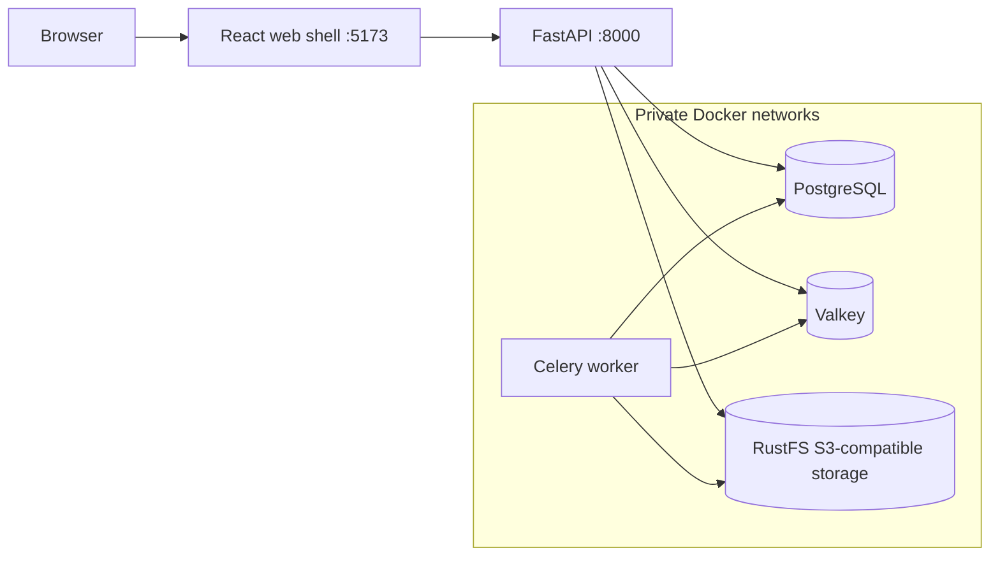

# Developer Onboarding and Troubleshooting

## Purpose

This is the practical setup guide for the S1 foundation. It is written so a developer or coding agent can start, verify and safely stop the project without needing the original chat history.

The current application is an engineering foundation, not a working wealth-management product. It contains no portfolio, asset, liability, household or local authentication workflow. Authentication belongs to the separate `auth-core` application.

## What runs locally



Only the web shell and API are published to the local computer. PostgreSQL, Valkey and RustFS stay on private Docker networks.

## Prerequisites

### Simplest Docker-based path

- A supported Docker Desktop installation with Docker Compose v2.
- At least 6 GB of memory available to Docker Desktop; 8 GB is a more comfortable development allocation.
- At least 10 GB of free disk space for images, dependency layers and retained local volumes.
- Git for obtaining and reviewing the repository.
- On macOS, both Apple Silicon and Intel are supported. Apple Silicon is the primary local verification platform.

### Running checks directly on the host

In addition to Docker, install the versions named by the repository:

- Python `3.12.13` from `.python-version`;
- `uv 0.12.4`;
- Node 24 from `.node-version`;
- Corepack with pnpm `12.5.1` from `package.json`.

Do not substitute prerelease tools or edit lockfiles manually to work around an installation problem.

## First setup

From the repository root:

```sh
make setup
make check
make up
```

What these commands do:

1. `make setup` installs the exact locked Python and JavaScript dependencies.
2. `make check` runs linting, strict type checks and fast tests.
3. `make up` creates ignored local-only secret files, builds containers, configures restricted database accounts, applies migrations and waits for healthy services.

Expected local URLs:

- Web shell: `http://localhost:5173`
- API liveness: `http://localhost:8000/health/live`
- API readiness: `http://localhost:8000/health/ready`
- Technical metrics: `http://localhost:8000/metrics`

Do not expect a login page or portfolio screens in S1.

## Routine commands

| Need | Command | Plain-English result |
|---|---|---|
| Start/rebuild | `make up` | Starts the complete local foundation and waits for health. |
| See status | `make status` | Shows running, healthy, completed or failed containers. |
| Read recent logs | `make logs` | Shows the last 200 lines without following forever. |
| Fast checks | `make check` | Runs backend/web lint, types and tests. |
| Real dependency tests | `make integration` | Tests PostgreSQL, Valkey, workers, metrics and authenticated S3 operations. |
| Worker failure drill | `make recovery-drill` | Force-kills a worker during synthetic work and proves safe re-delivery. |
| Repeat migrations | `make migrate-compose` | Safely asks Alembic to apply any missing migration again. |
| Export OpenAPI | `make openapi` | Recreates the deterministic API description for drift review. |
| Stop safely | `make down` | Removes containers/networks but retains database and object volumes. |

## Local data and secrets

- `runtime/secrets/` contains local-only credentials and is ignored by Git.
- `vittavaan_postgres_data` retains local PostgreSQL data.
- `vittavaan_object_data_rustfs` retains local object data.
- `make down` does not delete these volumes.
- Integration tests use unique synthetic names and remove the resources they create.

Never copy local credentials to staging. Never paste secret-file contents into issues, logs or documentation.

### Deliberately resetting local data

A full volume reset permanently deletes the local database and object-store contents. It is not part of normal troubleshooting. If a reset is genuinely required, first confirm that the named volumes contain no needed data, stop the project, and remove only the specifically identified `vittavaan` development volumes through Docker Desktop. Do not run broad volume-pruning commands.

## Troubleshooting

### Docker Desktop is not running

**Symptoms:** connection-to-daemon errors or every Compose command fails immediately.

**Action:** open Docker Desktop, wait until its engine reports ready, then run `make status` followed by `make up`.

### Port 5173 or 8000 is already in use

**Symptoms:** Docker reports that it cannot bind a host port.

**Action:** identify the application already using that exact port and stop it if appropriate. Do not expose PostgreSQL, Valkey or RustFS to work around the collision. The approved local host ports are 5173 for the web shell and 8000 for the API.

### A service remains unhealthy

Run:

```sh
make status
make logs
```

Find the first unhealthy dependency rather than repeatedly restarting everything:

- `postgres`: check available disk, volume permissions and the PostgreSQL log.
- `database-bootstrap`: check that local secret files exist and PostgreSQL is healthy.
- `migration`: inspect the Alembic error; never edit the version table by hand.
- `valkey`: check memory availability and its authentication/startup log.
- `object-store`: check the RustFS health/startup log and named-volume permissions.
- `api`: confirm PostgreSQL, Valkey and the migration container succeeded.
- `worker`: confirm Valkey, migration and object-store health.

After correcting the specific cause, rerun `make up`.

### Local secret files are missing or stale

Run `make bootstrap`. It creates missing development files and refreshes derived database URLs without printing credential values. If a role password was intentionally changed, coordinate the secret file and database role update; changing only one side will cause authentication failures.

### Migration failed

1. Read the migration container log with `docker compose -f compose.yaml -f compose.local.yaml logs migration`.
2. Correct the migration or connectivity cause.
3. Run `make migrate-compose` only when the API container is available, or rerun `make up` to use the normal one-shot migration path.

Migrations are serialized with a PostgreSQL advisory lock and must use the dedicated migration account. Do not run schema changes with the everyday application account and do not manually force the Alembic version marker.

### API readiness returns 503

This means a required dependency is unavailable or the database migration is not current. The public response intentionally does not reveal credentials or internal addresses. Use `make status`, container logs and the bounded dependency gauges at `/metrics` to identify PostgreSQL or Valkey health.

### Worker is disconnected or tasks remain queued

Check worker and Valkey logs. The worker retries broker startup with a bounded policy and reconnects after a temporary outage. Queue depth and oldest age are visible at `/metrics`. Use `make recovery-drill` only for the synthetic S1 proof; it intentionally kills and replaces the worker container.

### Object-storage request fails

1. Confirm `object-store` is healthy with `make status`.
2. Confirm the API is using the private `http://object-store:9000` endpoint from inside Docker, not a host URL.
3. Regenerate missing local credential files with `make bootstrap`.
4. Run `make integration`; its S3 test creates a unique bucket, uploads/downloads a synthetic object and cleans up.

RustFS is local infrastructure only. Application code must use the S3 adapter and path-style addressing so OCI Object Storage and AWS S3 can be selected by configuration later.

### Apple Silicon versus Intel/AMD64

- Docker automatically selects the ARM64 image on Apple Silicon and AMD64 on Intel machines.
- Do not force Intel emulation on Apple Silicon for normal development. A local QEMU AMD64 API build caused a `uv` segmentation fault and is not accepted as AMD64 evidence.
- Native AMD64 and ARM64 builds are defined in GitHub Actions. Their first hosted pass remains required before S1 closes.
- Windows development uses WSL2 plus Docker Desktop; a separate native Windows runtime path is not supported.

### Security scan reports a vulnerability

Do not suppress a HIGH/CRITICAL result merely to make CI green. Confirm whether a fixed version exists, update the pinned dependency/image, rerun tests and scans, and record the result. SeaweedFS 4.47 was removed from this foundation for exactly this reason even though its functional S3 test passed.

## Safe stopping and recovery

`make down` is the normal stopping command. It preserves named volumes. A later `make up` reapplies idempotent database-role configuration and repeatable migrations before starting application services.

If a test command is interrupted, rerun it. Tests use isolated synthetic identifiers. If Docker reports a leftover one-off test container, inspect it before removing only that specific test container.

## S1 evidence checklist

| Work package | Status | Evidence location or remaining requirement |
|---|---|---|
| S1-FND-001 Toolchain | In progress | Versions/locks and local security evidence exist; baseline commit/tag and hosted platform evidence remain. |
| S1-FND-002 Structure | Verified locally | Architecture test includes a planted forbidden-import proof. |
| S1-FND-003 API shell | Verified locally | Safe errors, correlation, deterministic OpenAPI and health tests pass. |
| S1-FND-004 Web shell | Verified locally | Strict lint/types/test/build and non-root production image pass. |
| S1-FND-005 Worker shell | Verified locally | Duplicate delivery, outage recovery and forced re-delivery drill pass. |
| S1-FND-006 Configuration/secrets | Verified locally | `_FILE`, redaction, canary and repository scans pass. |
| S1-FND-007 Compose stack | Verified locally | PostgreSQL, Valkey, RustFS, API, worker and web become healthy; six integration tests pass. |
| S1-FND-008 Migrations | Verified locally | Dedicated migration role, repeatability, concurrency lock and head-aware readiness pass. |
| S1-FND-009 Telemetry | Verified locally | Safe logs/traces plus bounded HTTP/dependency/pool/queue/worker metrics pass. |
| S1-FND-010 Test harness | Verified locally | 20 fast backend tests at 80% coverage, one web test and six integration tests pass. |
| S1-FND-011 CI/supply chain | In progress | Workflows and clean local scans exist; first hosted GitHub AMD64/ARM64/SBOM/provenance run remains. |
| S1-FND-012 Developer experience | Verified locally | This guide was followed in an isolated clean repository copy with new dependency directories, containers and data volumes; setup, fast checks and six integration tests passed. |

S1 must remain **in progress** until the remaining CI evidence gap is closed and the owner approves the completion report.
