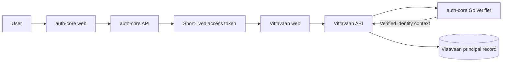

# S2 Authentication and Application Bootstrap Backlog

> **Status:** Authorized and in progress
>
> **Owner decision:** Continue with the original sprint plan; do not use the demo-first proposal as implementation authority.
>
> **Primary trace:** UC3-IAM-001, FR3-IAM, NFR3-SEC

## Plain-English objective

S2 lets Vittavaan safely recognize a person who has already signed in through the separate auth-core application. Vittavaan will learn only the stable identity information it needs. Passwords, OTPs, MFA, refresh tokens, recovery and login screens remain owned by auth-core.

## Confirmed integration boundary

The existing auth-core Go verifier exposes `GET /verify`. It validates RS256/JWKS, exact issuer and audience, expiry/issued time, required identity/session claims and Redis-backed revocation. Vittavaan treats its response as identity context, not as permission to access household financial data.

## Known auth-core contract

| Item | Current local contract | S2 treatment |
|---|---|---|
| Verifier endpoint | `GET http://localhost:8081/verify` outside Docker | Configurable internal adapter URL; no public browser call |
| Authorization | `Authorization: Bearer <access token>` | Forward only to verifier; never log or persist the raw token |
| Success identity | `user_id`, `session_id`, `family_id`, `jti`, `client_type`, `assurance`, optional workspace/roles, `IssuedAt` | Validate response schema and convert to an immutable local principal context |
| Rejection | HTTP 401, code `AUTH_TOKEN_INVALID` | Vittavaan returns a stable, safe 401 response |
| Local issuer | `http://localhost:8000` | Owned/configured by auth-core; must be environment-specific outside local use |
| Current local audience | `grox-platform` | Consume current contract for compatibility; a Vittavaan-specific production audience requires a coordinated auth-core change |
| Revocation | Per token, family, user and organization in auth-core Redis | Remains entirely inside auth-core verifier |

## Delivery slices

### S2-01 — Contract lock and configuration

**Status:** Complete locally on 21 Sep 2026.

Implement typed settings for verifier URL, auth web URL, safe return origin, request timeout and permitted client type. Secrets/tokens must not appear in settings output, health responses, logs or metrics.

**Back-end output:** Validated environment configuration and typed verifier response/error contracts.

**Front-end output:** Central public configuration for the auth-core entry URL and safe return location; no login form.

### S2-02 — Identity verification adapter

**Status:** Complete locally on 21 Sep 2026; real auth-core cross-service cases remain in S2-06.

Add an outbound HTTP adapter that forwards a bearer token to auth-core `GET /verify`, uses strict timeouts, validates the returned schema and fails closed on verifier failure.

**Back-end output:** Reusable verified-principal dependency with stable 401/503 distinctions and bounded telemetry.

**Front-end output:** None beyond safe handling of API authentication failures.

### S2-03 — Local principal persistence

**Status:** Complete locally on 22 Sep 2026.

Create the minimum local principal table described in the database design: Vittavaan ID, unique auth subject, local status, optional default person link seam, created time and last-seen time. Do not copy email, phone, factors or auth sessions.

**Back-end output:** Idempotent principal bootstrap and status enforcement using the normal application database account.

**Front-end output:** None; this supports first-run behavior.

### S2-04 — Bootstrap API

**Status:** Complete locally on 22 Sep 2026.

Implement an authenticated application-bootstrap endpoint. A valid new identity creates or finds its local principal and returns whether first-run setup is required. A suspended/closed local principal is denied even if auth-core accepts the token.

**Back-end output:** Versioned bootstrap contract, migration, audit-safe logs, idempotency and negative authorization tests.

**Front-end output:** Typed bootstrap client and application states for loading, ready, first-run, unauthenticated and denied.

### S2-05 — Browser handoff and states

**Status:** Complete locally on 22 Sep 2026 following owner authorization for the coordinated auth-core change.

The implemented contract uses a random, 60-second, single-use handoff code. The browser URL contains only the code and state; Vittavaan exchanges the code server-to-server using a private shared secret. The access token is held only in application memory and is never placed in a URL or persistent browser storage.

**Back-end output:** Approved callback/bootstrap boundary and safe error codes.

**Front-end output:** Redirect-to-auth action, return/loading screen, session-expired screen, access-denied screen, first-run route and auth-core account/security links.

### S2-06 — Cross-service verification and operations

**Status:** Complete locally on 22 Sep 2026. The valid flow, bootstrap, single-use enforcement, replay rejection, complete negative-token matrix and a real verifier outage/recovery drill pass. Hosted checks and shared-staging values remain release evidence, not missing local implementation.

Prove valid, malformed, expired, wrong-audience, wrong-issuer, unknown-key and revoked cases. Verify verifier outages fail closed and recover. Record staging configuration requirements and runbooks.

**Back-end output:** Contract/integration/security tests, dependency health metrics and operational evidence.

**Front-end output:** Tested user-safe unavailable, expired-session and denial experiences.

## Acceptance criteria

1. Vittavaan contains no password, OTP, MFA, refresh-token or recovery implementation.
2. A valid auth-core access token produces a verified internal principal context.
3. Invalid, expired, wrong-issuer/audience and revoked tokens are rejected safely.
4. A new auth subject is bootstrapped once even under repeat/concurrent requests.
5. Raw tokens and auth-core secrets never appear in logs, metrics, traces, database rows or frontend persistent storage.
6. Auth-core workspace roles do not automatically grant household access.
7. Verifier unavailability fails closed for protected operations and produces a user-safe response.
8. First-run, expired-session and access-denied frontend states are keyboard accessible and tested.
9. Local, integration and hosted quality/security checks pass.
10. Documentation, progress tracker, implementation evidence and handover agree.

## Decisions still required before shared staging

- Environment-specific auth-core public URL, internal verifier URL, issuer and audience.
- Shared-staging allow-listed return origins and separately provisioned handoff secret.
- Network placement of the Go verifier in OCI staging.
- Whether/when auth-core introduces a Vittavaan-specific audience instead of the current shared local value.

These do not block the typed adapter, local principal model or contract tests. They do block claiming that shared staging authentication is complete.
