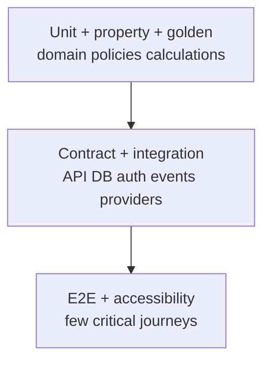

# Test Strategy

## Test pyramid and ownership

- Domain unit/property tests run fastest and own financial invariants.
- Integration tests use real PostgreSQL/Redis/object/queue-compatible services where behavior matters.
- Contract tests verify OpenAPI, auth-core, event and adapter compatibility.
- E2E validates critical wireframe journeys and states, not every mathematical branch.

## Required suites

| Suite | Coverage |
|---|---|
| Domain unit | Ownership, money, state transitions, policies, subtype validation. |
| Golden financial | Wealth, rounding, movements, EMI, XIRR/TWRR, attribution, drawdown, goals and FX. |
| Property-based | Allocation sums, transfer neutrality, correction chains, reconciliation, serialization and date boundaries. |
| Repository integration | Constraints, append-only protection, optimistic concurrency, RLS/scoped queries and migrations. |
| API contract | Schemas, problem details, pagination, idempotency, `If-Match`, authz and compatibility. |
| Event/job | Outbox atomicity, duplicate/out-of-order delivery, retry/dead-letter and checkpoint races. |
| Auth-core contract | Issuer/audience/JWKS/revocation, expiry, failure closed and return-state security. |
| Import | Malformed/large/replayed files, duplicate matching, partial rows, formula injection and resumability. |
| Documents | Type spoofing, malware, scanner outage, signed URL expiry, revoked access and orphan reconciliation. |
| E2E/accessibility | All beta pages/tabs plus empty/partial/stale/failure/negative/unauthorized states. |
| Performance/resilience | Target workload, queue lag, pool saturation, dependency outage and recovery. |
| Recovery | Backup/PITR/object restore, projection rebuild, dead-letter replay and failed deploy. |

## CI gates

PR: lint/type/unit/property, migration/static checks, OpenAPI/client drift, focused integration, security scans. Main/develop: full integration/contract and build. Staging: E2E/accessibility/smoke and scheduled performance/security. Production approval consumes immutable evidence from the exact artifact.

## Test isolation

- Unit tests use pure objects/fakes, not a database.
- Integration tests use isolated schemas/databases and rollback or deterministic teardown.
- Clocks, UUIDs, FX/benchmark sources and randomness are injectable/fixed.
- Fixtures are synthetic and versioned; production data never enters tests by default.
- Flaky tests are defects: quarantine requires owner, issue and expiry.

## Coverage targets

- Domain/calculation line coverage ≥90% plus branch/property tests.
- Overall backend ≥80%; frontend line coverage is secondary to critical component/E2E behavior.
- Every requirement has at least one acceptance test; every security decision has a denial test.

