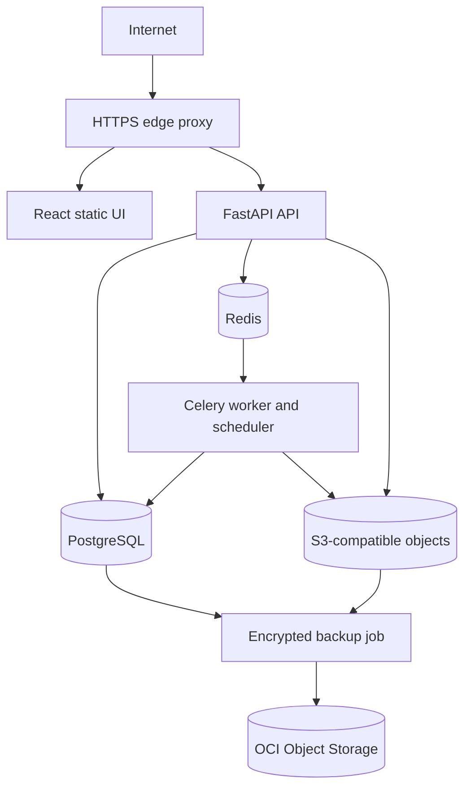
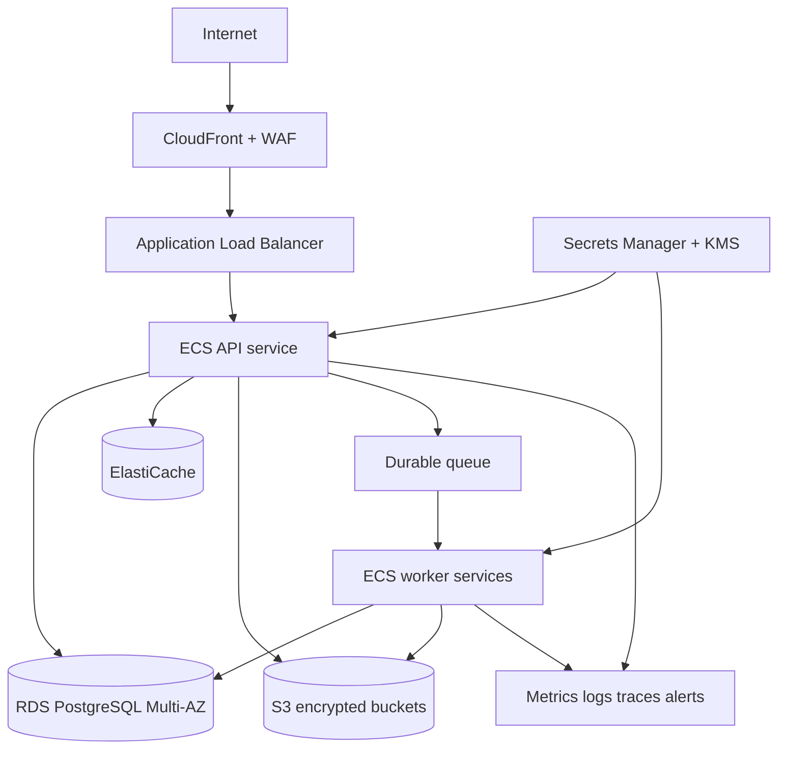

# Infrastructure and Environments

## Environment strategy

Local development, CI and OCI staging use the same versioned, OCI-compatible container images and the same base `compose.yaml`. Small, reviewed overlays supply environment-specific ports, persistence, health checks and resource limits. Configuration follows twelve-factor principles; images contain no environment secrets or cloud-specific assumptions.

| Environment | Runtime | Intended evidence |
|---|---|---|
| Local | Docker Compose on developer machine | Fast feedback, complete workflow and synthetic fixtures. |
| CI | Ephemeral containers | Unit, contract, integration, migration and image/platform checks. |
| Staging | OCI Ampere A1 VM plus Docker Compose | Integration, UAT, deployment, migration, backup/restore and smoke evidence. |
| Performance pre-production | Ephemeral AWS production-shaped stack | Capacity, scaling, failover and SLO evidence. |
| Production | Managed AWS services in `ap-south-1` | Customer workload. |

## OCI staging target

OCI Always Free is approved as the initial economical staging target, subject to successful capacity allocation in the tenancy's home region. It is **not** treated as highly available or performance-equivalent to production.

Oracle's current documentation is inconsistent: the [Always Free resource page](https://docs.oracle.com/en-us/iaas/Content/FreeTier/freetier_topic-Always_Free_Resources.htm) describes 2 Ampere A1 OCPUs and 12 GB memory for an Always Free tenancy, while the [Ampere compute page](https://docs.oracle.com/en-us/iaas/Content/Compute/References/arm.htm) describes 3,000 OCPU-hours and 18,000 GB-hours per month. Provisioning must use the limits shown in the actual tenancy console and the design must operate within **2 OCPUs/12 GB** unless a higher allowance is confirmed. The 200 GB allowance includes boot and attached block volumes; it is not automatically 200 GB of application data space. Oracle also warns that idle Always Free instances can be reclaimed and that capacity may be unavailable.

The proposed ARM64 Ubuntu or Oracle Linux host runs these containers:

- edge proxy (Caddy or equivalent) for HTTPS and automatic Let's Encrypt certificate lifecycle;
- built React static application;
- FastAPI API;
- Celery worker and scheduler, with concurrency capped for the VM;
- PostgreSQL and Redis;
- S3-compatible local object-store adapter and document scanner only when required by the tested increment;
- lightweight metrics/log shipping agents.

Let's Encrypt is a separate free certificate authority, not an OCI entitlement. A public IP is permitted, but only TCP 80/443 is internet-facing. Administrative access uses OCI Bastion where available or source-allow-listed SSH with short-lived individual keys; PostgreSQL, Redis, object storage, worker and application management ports are never public.

### Local-to-OCI portability contract

1. `compose.yaml` defines service names, networks, dependencies and health checks shared by local and staging.
2. `compose.local.yaml` may expose developer ports, mount source code and enable hot reload.
3. `compose.staging.yaml` uses immutable image digests, restart policies, resource limits, named volumes, no source bind mounts and only the edge proxy's public ports.
4. Images are built for `linux/arm64` and `linux/amd64`; CI executes tests on the target architecture or under a declared emulation gate.
5. Environment variables contain non-secret configuration only. Staging secrets are created on the host from OCI Vault or an encrypted deployment channel and referenced through Docker secrets/read-only files.
6. Database migrations run as a one-shot image from the same release before compatible services are promoted. Reference seeds are deterministic and idempotent.
7. Cloud storage, queue, notification and secret services are accessed only through documented ports/adapters. Local substitutes and AWS production adapters pass the same contract suite.
8. Persistent paths are named volumes on an attached block volume. Containers remain disposable.
9. Staging uses the real auth-core staging issuer/JWKS/redirect contract. A local auth stub is allowed only for isolated developer tests and can never be enabled in shared staging.

### Staging limitations and safeguards

- Single VM, single availability domain and self-managed database mean no HA; a host or disk event can take all staging services offline.
- Always Free capacity is not guaranteed, idle instances may be reclaimed, and free limits may change. Terraform plus documented restore procedures must recreate the environment.
- Use synthetic data by default. Masked data requires recorded approval and must never include production credentials or unrestricted documents.
- Nightly encrypted PostgreSQL logical backups and required object manifests are copied off-host to OCI Object Storage; retention is bounded to the applicable free allowance. Restore tests run at least monthly during active development.
- Disk, memory, certificate expiry, backup age, container health and queue lag generate alerts. Reserve memory for the OS and database; disable optional services before allowing swap thrashing.
- OCI staging is valid for functional and deployment evidence, not the final 10,000-concurrent-session claim, managed-service failover, multi-AZ recovery, WAF behavior or AWS-specific IAM/KMS integration.
- Maintain an exit path: the deployment runbook can recreate staging on a paid OCI VM or ephemeral AWS host without application changes.

## Production target

AWS `ap-south-1`: CloudFront/WAF/TLS, load balancer, ECS/Fargate API/workers/scanner isolation, RDS PostgreSQL Multi-AZ/PITR, ElastiCache Redis, S3 quarantine/clean/export buckets, KMS, Secrets Manager and centralized telemetry. Exact sizes/autoscaling follow measured staging load tests.

## Network/security baseline

Only CDN/load balancer is public. Application/data services use private subnets/security groups, controlled egress and VPC endpoints where practical. Database/Redis have no public route. Administrative access uses audited managed mechanisms, not permanent bastions/shared keys.

## Environment isolation

Separate accounts/projects, databases, buckets, keys, secrets, domains and feature-gate state. Production credentials never work in lower environments. Terraform remote state is encrypted, locked and access-controlled. Staging uses synthetic/approved masked data only. OCI resources live in a dedicated compartment with quotas/budgets, least-privilege policies and an explicit home-region constraint for Always Free eligibility.

## Backup and lifecycle

- RDS automated backups/PITR satisfy approved RPO window; periodic snapshots follow retention.
- S3 versioning/lifecycle and, where required, object lock support retention/evidence.
- Backup copies and keys are protected from the primary runtime role.
- Restore is tested quarterly and before material storage/migration changes.
- OCI staging backups are stored off the VM and tested monthly; a boot-volume backup alone is not accepted as a database recovery strategy.

## Capacity controls

Autoscaling uses request/CPU/memory plus queue age and projection lag. Database capacity includes pool limits/query budgets/storage/IO alarms. Costs are tagged by environment/service and budget anomalies alert owners without disabling safety-critical services automatically.
