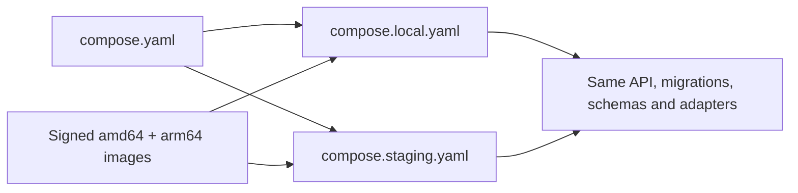
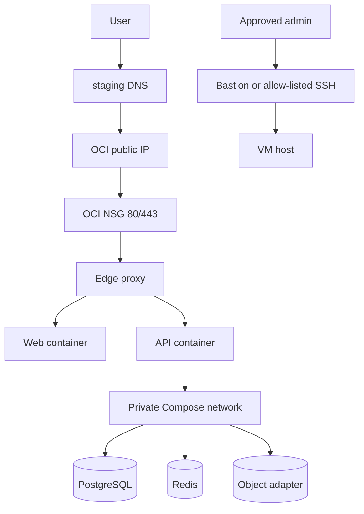
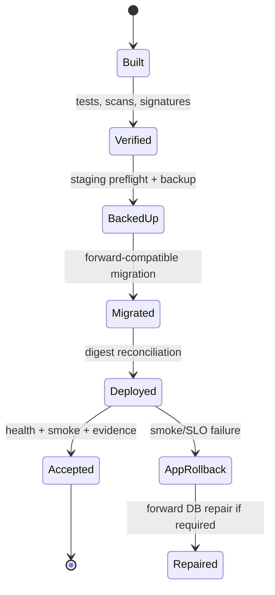

# Local-to-OCI Deployment Specification

## Status and intent

This is the implementation contract for moving the same Vittavaan release from a developer workstation to the initial OCI staging environment. It specifies future files, interfaces and controls; it does not imply that Compose, Terraform or CI code already exists.

OCI staging is an integration/UAT environment. It validates portability, migrations, auth-core integration, recovery mechanics and release procedures. It is not highly available and is not accepted as final production capacity, failover or RPO evidence.

## Deployment invariants

1. One source commit produces immutable multi-architecture images; staging never builds application source.
2. Local, CI and staging share `compose.yaml`; overlays may change operational configuration but not domain behavior.
3. Database migrations and catalogue seeds come from the same release image as the API and worker.
4. Only the edge proxy publishes host ports in staging.
5. PostgreSQL is authoritative; Redis, queues and projections are reconstructible.
6. Secrets are mounted at runtime and never committed, baked into images, printed by CI or exposed to the web bundle.
7. The real auth-core staging issuer/JWKS/handoff contract is used in shared staging.
8. Every deploy records source commit, image digests, migration head, catalogue version and configuration version.

## Planned deployment files

```text
vittavaan/
├── compose.yaml                         # portable service graph
├── compose.local.yaml                   # development override
├── compose.staging.yaml                 # OCI staging override
├── .env.example                         # non-secret names/examples only
├── deploy/
│   ├── release-manifest.schema.json
│   ├── config/
│   │   ├── local.env.example
│   │   └── staging.env.example
│   └── runbooks/
└── infrastructure/
    ├── terraform/modules/oci-single-vm-staging/
    └── environments/oci-staging/
```

Generated secrets, Terraform state, database dumps, certificates and runtime `.env` files are excluded from Git.

## Portable Compose topology

| Service | Base definition | Local override | Staging override |
|---|---|---|---|
| `edge` | Routes `/`, `/api`, health endpoints | Optional/direct app ports | Caddy-compatible HTTPS; only `80/443` published |
| `web` | Immutable static frontend | Dev server and source mount | ARM64 image by digest; read-only filesystem |
| `api` | FastAPI, health checks, internal port | Hot reload/source mount | ARM64 image by digest; no host port; bounded workers |
| `worker` | Same backend image, Celery entrypoint | Debug concurrency | Concurrency 1 initially; graceful shutdown |
| `scheduler` | Same backend image, scheduled jobs | Optional profile | Singleton; persistent schedule/lock strategy |
| `postgres` | Supported pinned major version | Disposable/named volume | Named volume on attached OCI block volume |
| `redis` | Pinned version; cache/broker only | Disposable/named volume | Password/auth, memory cap and eviction policy |
| `objects` | S3-compatible development adapter | Local named volume | Named volume or OCI Object Storage adapter by contract |
| `scanner` | Malware scanning adapter | Optional profile | On-demand/optional profile due to memory budget |
| `migration` | One-shot backend image | Developer command | Required pre-release gate; never long-running |
| `backup` | Backup tooling image | Manual test profile | Scheduled logical/object backup and verification |
| `telemetry` | OpenTelemetry-compatible endpoint | Console/local stack | Lightweight collector/exporter with bounded buffers |



Compose profiles keep optional high-memory services out of the default staging footprint. A service omitted for resource reasons must fail visibly through its feature gate; it cannot be silently mocked.

## Container construction contract

- BuildKit/buildx produces `linux/amd64` and `linux/arm64` manifests from the same Dockerfile and source commit.
- Base images are pinned by digest and support Python 3.12, Node build tooling and required native libraries on both architectures.
- Frontend assets are built once, contain only public runtime configuration, and are served by the web/edge layer.
- Backend images run as a fixed non-root UID/GID, use a read-only root filesystem where possible and write only to declared temporary/runtime mounts.
- Images contain health-check clients but not shells/debug tools unless a separately controlled diagnostic image requires them.
- CI generates SBOMs, scans OS/application dependencies, signs images and records provenance.
- Staging references image digests; tags are human navigation only. `latest` is prohibited.

## Conservative 2-OCPU/12-GB resource budget

The tenancy console is authoritative. Until a larger allowance is confirmed, staging must fit the lower documented 2 OCPU/12 GB envelope.

| Consumer | Memory reservation | Memory limit | CPU guidance | Notes |
|---|---:|---:|---:|---|
| Host OS, Docker and filesystem cache | 1.5 GiB | 2.25 GiB reserved capacity | 0.20 OCPU baseline | Not a container limit. |
| PostgreSQL | 1.75 GiB | 2.50 GiB | 0.60 OCPU | Conservative shared buffers and connection cap. |
| API | 512 MiB | 1.00 GiB | 0.45 OCPU | Start with one/two measured workers. |
| Celery worker | 640 MiB | 1.25 GiB | 0.45 OCPU | Concurrency 1; no unbounded child processes. |
| Scheduler | 64 MiB | 128 MiB | 0.05 OCPU | Singleton. |
| Redis | 192 MiB | 384 MiB | 0.10 OCPU | Bounded `maxmemory`; no durable truth. |
| Edge and web | 96 MiB | 256 MiB | 0.10 OCPU | Static content and reverse proxy. |
| Object adapter | 384 MiB | 768 MiB | 0.10 OCPU | Can move to OCI Object Storage adapter. |
| Telemetry agent | 128 MiB | 256 MiB | 0.05 OCPU | Bounded queues/log buffers. |
| Scanner, when enabled | 768 MiB | 1.50 GiB | 0.50 OCPU burst | Profile/on-demand; do not overlap load tests. |

Limits are ceilings, not expected steady-state usage, and CPU quotas may share burst capacity. Deployment preflight rejects the release if available memory/disk is below policy. Swap is an emergency buffer only; sustained swap, OOM kills or load average saturation generates an alert and blocks acceptance testing.

This host is appropriate for low-volume UAT. The production SLO envelope is tested on temporary production-shaped AWS infrastructure.

## Storage layout and budget

The Always Free 200 GB block-volume allowance includes boot volumes. The proposed initial allocation is confirmed against the tenancy before applying:

| Storage | Proposed size | Purpose |
|---|---:|---|
| Boot volume | 50 GB | OS, Docker engine and small runtime files. |
| Attached data volume | 100 GB | `/srv/vittavaan`: PostgreSQL, Redis runtime, objects and deployment state. |
| Unallocated allowance | 50 GB | Growth/recovery buffer; not assumed until console confirms eligibility. |

The attached data volume is mounted by filesystem UUID with restrictive permissions. Suggested subpaths are `postgres/`, `redis/`, `objects/`, `releases/`, `backups-staging/` and `telemetry/`. Container volumes bind only to their assigned subpath.

Controls:

- container JSON logs rotate by size/count;
- database/object growth and inode use alert at 70%, 80% and 90%;
- temporary imports/exports have TTL cleanup;
- local staging backup files are deleted only after off-host checksum verification;
- document objects never share public web roots;
- storage encryption at rest is enabled and application-level envelope encryption still protects designated sensitive fields.

## OCI Terraform resource plan

| Resource | Planned purpose and constraints |
|---|---|
| Dedicated compartment | Isolate staging policies, quotas, budgets and inventory. |
| VCN | One staging network in the Always Free home region. |
| Public subnet and route | Internet edge for the single VM; no assumption of private managed services. |
| Network security group | Inbound 80/443 from internet; 22 only from approved source or Bastion; deny data-service ports. |
| Ampere A1 Flex instance | ARM64, Always Free-eligible shape, conservative 2 OCPU/12 GB target. |
| Boot and block volumes | Explicit sizes, encryption and attachment; deletion protection policy documented. |
| Reserved public IP | Stable DNS target when eligible/available; otherwise DNS/runbook handles replacement. |
| Object Storage bucket | Encrypted off-host backup artifacts with lifecycle and no public access. |
| Vault/secrets | Runtime secrets where eligible; HSM/software key choice follows threat/cost review. |
| Bastion or restricted SSH path | Auditable administration without unrestricted permanent SSH exposure. |
| Monitoring alarms | Host CPU/memory/disk, instance status and backup/deploy heartbeat signals. |
| Notifications topic | Routes actionable staging alerts to approved recipients. |
| Budget/quota controls | Alert on chargeable resources and prevent accidental non-free scale where supported. |

Terraform state must not live solely on the staging VM. Use an encrypted, access-controlled remote backend or OCI Resource Manager. Plans are reviewed in CI; apply requires the staging protected environment. Resource discovery and drift checks run on a schedule. Terraform never manages application database contents.

## Network, DNS and TLS



- Staging uses a dedicated subdomain and never production cookies, OAuth clients or credentials.
- DNS TTL is reduced before IP/environment migration and restored afterward.
- The edge obtains and renews Let's Encrypt certificates after DNS is correct and ports 80/443 are reachable.
- HSTS is enabled only after HTTPS and subdomain behavior are verified; staging does not set policies that unintentionally cover production domains.
- Security headers, request-body limits, timeouts and API rate limits are version-controlled edge configuration.
- Internal Compose networks are marked internal where feasible. Host firewall duplicates OCI ingress restrictions as defense in depth.

## Configuration and secret matrix

### Non-secret configuration

| Key | Consumers | Local | Staging rule |
|---|---|---|---|
| `APP_ENV` | All | `local` | Exactly `staging`; startup rejects unsafe combinations. |
| `APP_RELEASE_ID` | API/worker/web metadata | Local commit | Immutable release-manifest ID. |
| `PUBLIC_WEB_URL` | Web/API/auth flow | Local origin | HTTPS staging origin. |
| `PUBLIC_API_URL` | Web | Local API | HTTPS staging API path/origin. |
| `AUTH_ISSUER` | API/verifier | Local/test issuer | Exact auth-core staging issuer. |
| `AUTH_AUDIENCE` | API/verifier | Local audience | Exact Vittavaan staging audience. |
| `AUTH_JWKS_URL` | Verifier | Local/test endpoint | HTTPS auth-core staging JWKS endpoint. |
| `AUTH_WEB_URL` | Web | Local auth UI | Auth-core staging login/handoff origin. |
| `AUTH_CLOCK_SKEW_SECONDS` | Verifier | Test default | Bounded reviewed value. |
| `DATABASE_POOL_SIZE` | API/worker | Developer default | Budgeted global connection allocation. |
| `REDIS_NAMESPACE` | API/worker | Local prefix | Environment-specific prefix. |
| `OBJECT_ADAPTER` | API/worker | Local S3-compatible | Approved staging adapter. |
| `OTEL_EXPORTER_ENDPOINT` | Services | Local/console | Internal collector endpoint. |
| `FEATURE_GATE_DEFAULTS_VERSION` | API | Seed version | Staging seed version; gated features off. |

### Secrets

| Secret | Consumers | Rotation/handling |
|---|---|---|
| PostgreSQL application/admin credentials | API/worker/migration/backup as separately scoped | Separate roles; rotate and redeploy; never one shared superuser. |
| Redis credential | API/worker/scheduler | Rotate with bounded dual-credential or controlled restart plan. |
| Object-store access keys | API/worker/backup | Least privilege per runtime/backup role. |
| Field-encryption key reference/material | API/worker | Managed key hierarchy; versioned rotation; never CI output. |
| Backup encryption key | Backup/restore operator | Separate from VM/runtime compromise domain where practical. |
| OCI deployment identity | CI protected environment | Least privilege; short-lived/federated when supported, otherwise encrypted and regularly rotated. |
| SSH/Bastion credential | Deployment/operator | Individual, time-bounded and audited; no shared private key in repo. |
| Telemetry ingest credential | Telemetry agent | Write-only and staging-scoped. |

Secrets are exposed to containers as read-only files under `/run/secrets` where supported. A `_FILE` convention is preferred over direct environment variables. Startup logs may report that a secret is present and its version identifier, never its value.

## Auth-core staging contract

Before shared staging is declared ready, auth-core owners must provide and approve:

- exact issuer, JWKS URL, Vittavaan audience and supported signing algorithms;
- allow-listed Vittavaan return/callback and logout destinations;
- handoff/state/CSRF contract with no token in URLs or local storage;
- revocation verification endpoint/cache behavior and failure policy;
- CORS/cookie `Secure`/`SameSite` behavior across the selected subdomains;
- test identities for owner, delegate, expired/revoked and insufficient-authority scenarios;
- coordinated versioning and incident contacts.

Shared staging cannot fall back to a local auth stub when auth-core is unavailable; protected financial operations fail closed.

## Release manifest

Every candidate release contains at least:

| Field | Meaning |
|---|---|
| `release_id` / `source_commit` | Immutable source identity. |
| `images` | Service name, registry and digest for both architectures. |
| `migration_from` / `migration_to` | Supported database heads and target head. |
| `catalogue_version` | Required deterministic seed version. |
| `compose_contract_version` | Base/overlay compatibility. |
| `configuration_schema_version` | Required configuration names/types. |
| `minimum_auth_contract_version` | Compatible auth-core boundary. |
| `sbom` / `provenance` / `signatures` | Supply-chain artifact references. |
| `rollback_release_id` | Last compatible application release. |

Deployment fails before mutation if the manifest, signatures, architecture, configuration or current migration head is incompatible.

## Promotion and rollback semantics



Application rollback selects the previous compatible digests and configuration. Database downgrade is not assumed. Expand/migrate/switch/contract makes the previous application compatible through the recovery window; otherwise deployment is blocked until an explicit forward-repair procedure exists.

## Recovery objectives

| Environment | Data objective | Recovery objective | Evidence |
|---|---|---|---|
| OCI staging | Nightly off-host backup plus pre-deploy backup; target staging RPO 24 hours outside deployments | Target staging RTO 4 hours during staffed development periods | Monthly restore drill and rebuild exercise. |
| AWS production | RPO <=5 minutes using managed PITR and protected objects | RTO <=60 minutes | Pre-launch and quarterly restore/failover evidence. |

Staging recovery evidence validates procedures and data integrity but cannot prove production objectives because its topology and backup technology differ.

## Cost and free-tier guardrails

- Provision only resources explicitly labelled Always Free-eligible in the tenancy console.
- Set compartment quotas where supported and create zero/low-threshold budget alerts before provisioning.
- Do not assume a free resource outside the home region.
- Avoid accidental paid boot volume, backup, public IP, load balancer, egress, logging or Vault consumption.
- Record expected free-tier classification and console evidence in each infrastructure change.
- Review OCI's current [Always Free resources](https://docs.oracle.com/en-us/iaas/Content/FreeTier/freetier_topic-Always_Free_Resources.htm) before apply; cloud allowances are external and may change.
- If required staging capability exceeds the safe envelope, approve a paid limit or use ephemeral AWS. Do not weaken security, backup or correctness controls to remain free.

## Acceptance criteria

The deployment specification is implemented only when:

1. A clean workstation can start the complete local profile from documented prerequisites.
2. CI builds/tests ARM64 and AMD64 manifests and verifies their signatures/digests.
3. Terraform can create a fresh OCI staging environment without console-only drift.
4. The same release manifest deploys locally and to OCI through overlays.
5. Auth-core positive, revoked, expired and unauthorized flows pass.
6. A migration, catalogue seed, application rollback and forward repair rehearsal succeeds.
7. Backup restoration into an isolated fresh environment passes integrity and reconciliation checks.
8. No staging data service is publicly reachable, and secret/log scans pass.
9. Monitoring detects stopped services, full disk, stale backup and expired/failed TLS renewal.
10. The entire environment can be rebuilt from Terraform, release artifacts, secrets and verified backups.
