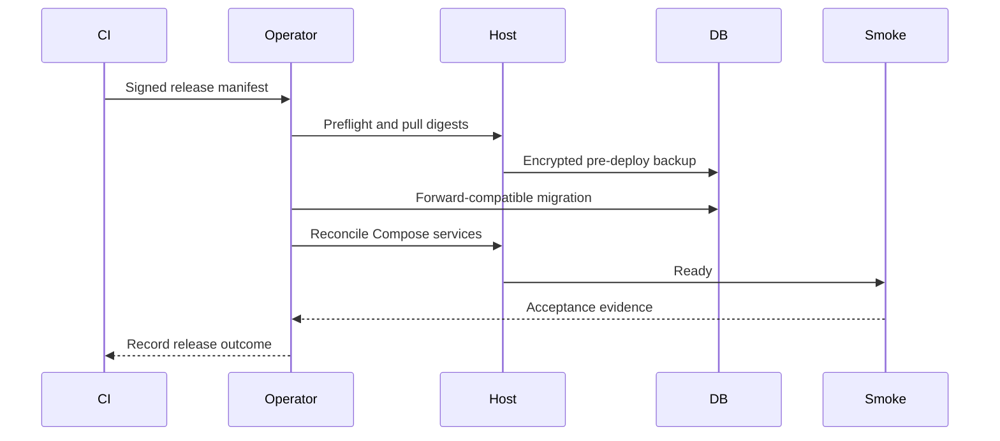

# OCI Staging Deployment and Recovery Runbook

## Purpose and execution rule

This runbook is the operator sequence for creating, deploying, validating, restoring and retiring OCI staging. Commands named below are **planned interfaces** to be implemented later; do not assume they currently exist. Every execution records operator, ticket/change ID, timestamps, release ID and evidence links.

## Roles

| Role | Responsibility |
|---|---|
| Release operator | Executes approved staging deployment and captures evidence. |
| Infrastructure approver | Reviews Terraform plan, networking, limits and charge risk. |
| Database owner | Reviews migrations, backups, restore and reconciliation. |
| Auth-core owner | Confirms staging issuer/audience/JWKS/handoff compatibility. |
| Security reviewer | Reviews exposure, secrets, image findings and exceptional access. |

One person may hold multiple roles in early development, but approval evidence remains explicit for security-sensitive or destructive changes.

## Phase 0 - prerequisites

Confirm before provisioning:

- OCI account/home region and console-displayed Always Free eligibility;
- actual available A1 OCPU, memory, boot/block volume, Object Storage and backup limits;
- dedicated staging compartment and approved operator identities;
- staging DNS name under owner-controlled DNS;
- auth-core staging contract values and test identities;
- approved registry and CI protected environment;
- synthetic fixture policy and notification recipients;
- recovery key custody and an off-host copy of bootstrap instructions.

Stop if the only available resource is chargeable and cost approval has not been given.

## Phase 1 - infrastructure creation

1. Select the pinned Terraform/toolchain version.
2. Initialize the encrypted remote state/OCI Resource Manager stack.
3. Run formatting, validation, policy/security checks and a speculative plan.
4. Verify plan contains only the dedicated compartment's intended resources.
5. Confirm VM shape is ARM64 and Always Free-eligible, storage totals stay within the console allowance, bucket is private and ingress is only 80/443 plus restricted administration.
6. Obtain staging infrastructure approval and apply the reviewed plan without editing resources manually in the console.
7. Capture Terraform outputs without printing secret values.
8. Verify drift is empty immediately after apply.

Planned interface:

```text
make infra-staging-plan
make infra-staging-apply CHANGE_ID=<approved-id>
make infra-staging-drift
```

## Phase 2 - host bootstrap

Bootstrap is idempotent cloud-init/configuration automation and performs:

1. OS security updates and automatic security-patch policy.
2. Non-root deployment/operator accounts with individual keys.
3. Docker Engine and Compose plugin from approved repositories, pinned to supported versions.
4. Host firewall matching the OCI NSG.
5. Attached-volume filesystem creation, UUID mount and `/srv/vittavaan` directory ownership.
6. Docker log rotation, time synchronization, audit/host telemetry and OOM visibility.
7. Creation of release/config/secret directories with least-privilege permissions.
8. Disable password SSH and root login after verified alternate access.

Validation includes OS/architecture, filesystem mount after reboot, disk capacity, time sync, firewall exposure, Docker health and absence of default/public services.

## Phase 3 - DNS, TLS and auth-core registration

1. Point the staging DNS record to the reserved/current public IP.
2. Confirm external resolution from more than one resolver.
3. Register exact HTTPS origin, callback/return and logout destinations with auth-core.
4. Deploy only the edge readiness configuration initially.
5. Obtain/renew the Let's Encrypt certificate and verify chain, hostname and automatic-renewal timer.
6. Test HTTP-to-HTTPS behavior, security headers and that HSTS scope is safe.
7. Verify no bearer token, code or sensitive state appears in URLs or access logs.

Do not enable the application route before auth-core allow-listing and certificate validation are complete.

## Phase 4 - secret and configuration installation

1. Generate database, Redis, object and backup credentials using approved entropy.
2. Create separate PostgreSQL roles for migration owner, application runtime, read-only/observability and backup.
3. Install secrets through OCI Vault or the approved encrypted channel into root-owned files; record version IDs, not values.
4. Install the versioned non-secret staging configuration.
5. Run configuration-schema validation and unsafe-combination checks.
6. Confirm permissions prevent web, edge and unrelated containers from reading backend secrets.
7. Confirm production secret names/values are absent.

Secret contents must never be pasted into a ticket, chat, terminal transcript or CI output.

## Phase 5 - first deployment

1. Select a signed release manifest produced by CI.
2. Verify signatures, digests, ARM64 availability, SBOM/vulnerability disposition and Compose/config compatibility.
3. Pull images by digest while the application route remains closed.
4. Start PostgreSQL/Redis/object dependencies and wait for internal health.
5. Create and verify the first encrypted off-host backup, even if the database is empty.
6. Run the migration container under the migration role and advisory lock.
7. Apply deterministic catalogue/reference seeds and verify manifest checksums/version.
8. Start API, worker, scheduler, web and telemetry services.
9. Start the edge application route only after internal readiness passes.
10. Run the complete smoke suite and record evidence.

Planned interface:

```text
make staging-preflight RELEASE=<release-id>
make staging-backup REASON=pre-deploy
make staging-deploy RELEASE=<release-id>
make staging-smoke
make staging-evidence RELEASE=<release-id>
```

## Deployment preflight checklist

| Check | Blocking condition |
|---|---|
| Release manifest/signatures | Missing, invalid or architecture absent. |
| Current DB migration head | Not in release's supported `migration_from` set. |
| Backup | Last verified backup too old or pre-deploy backup fails. |
| Disk | Less than policy free space or inode threshold. |
| Memory/load | Sustained resource pressure or recent OOM kill. |
| Secrets/config | Missing, expired or schema mismatch. |
| Auth-core | Issuer/JWKS/handoff unreachable or incompatible. |
| Certificate/DNS | Invalid certificate or wrong DNS target. |
| Critical vulnerability | Unapproved exploitable critical finding. |
| Existing incident | Active incident/change freeze conflicts with deploy. |

## Smoke and acceptance suite

The post-deploy suite proves:

- `/health/live` and `/health/ready` behavior without sensitive dependency detail;
- web asset load and API routing over HTTPS;
- auth redirect, successful callback/bootstrap and logout handoff;
- invalid issuer/audience, expired token and revoked session fail closed;
- authorized owner can create/read a synthetic holding and append valuation;
- unauthorized person/household lookup is non-enumerating;
- background job executes once and projection checkpoint advances;
- Redis loss does not corrupt durable facts;
- object upload remains quarantined until scan succeeds when scanner profile is enabled;
- catalogue version and migration head match the release manifest;
- logs/traces carry correlation IDs without tokens, secrets or sensitive payloads.

Synthetic smoke records use a stable test namespace and are cleaned through an approved fixture-reset mechanism, never ad hoc SQL deletion.

## Routine release



During rollout, watch container restarts, OOM events, HTTP error/latency, DB connections/locks, queue age, projection lag, disk and auth failures. A deployment is not successful merely because containers are running.

## Application rollback

Use when the new application fails and the prior version remains database-compatible:

1. Stop further deployments and record incident/change state.
2. Keep database facts and logs intact.
3. Select the manifest's approved `rollback_release_id`.
4. Reconcile API/web/worker/scheduler to prior digests and compatible configuration.
5. Run readiness, auth, authorization, write/read and projection smoke checks.
6. Record whether forward database repair/backfill remains necessary.

Do not run a down migration or restore a pre-deploy database merely to roll back application containers unless an approved recovery plan proves no accepted writes will be lost.

## Failed migration response

1. Hold application traffic if the migration left compatibility uncertain.
2. Preserve migration logs, database state and backup references.
3. Determine whether the migration transaction rolled back completely.
4. If safe, redeploy the prior compatible application without changing the database.
5. Otherwise execute the migration's reviewed forward-repair procedure.
6. Restore only when integrity cannot be recovered and the incident owner accepts the documented data-loss window.
7. Reconcile outbox, projections, sequences, catalogue version and smoke fixtures before reopening.

## Backup procedure

Staging runs nightly and before every migration-bearing deploy:

1. Record database migration/catalogue versions and release ID.
2. Produce a consistent PostgreSQL custom-format logical dump with the backup role.
3. Export object manifest containing object key, size, checksum and lifecycle state; include required staging objects according to policy.
4. Encrypt artifacts before off-host upload using the backup key/version.
5. Upload to the private OCI Object Storage backup prefix.
6. Verify remote size/checksum and perform a lightweight archive listing/read test.
7. Write a signed/hashed backup manifest and backup heartbeat.
8. Remove local transient artifacts only after remote verification and retention checks.

Alert on missed schedule, failed upload, checksum mismatch, storage-limit risk or backup older than policy. A volume snapshot may supplement but never replace the logical/object backup.

## Isolated restore drill

Run monthly during active development and before material storage/migration changes:

1. Create an isolated restore network/project with no user-facing DNS and no outbound notifications.
2. Select the backup by manifest; retrieve and verify checksum/signature before decryption.
3. Start clean, supported PostgreSQL/object services at compatible versions.
4. Restore database roles/schema/data without production or staging runtime secrets.
5. Restore objects and compare every manifest checksum/count.
6. Start the matching application release with notification/connectors disabled.
7. Run referential-integrity, ownership-total, valuation-selection, liability-balance, outbox/checkpoint and document-link reconciliation.
8. Execute read-only golden persona journeys.
9. Record achieved RPO/RTO, missing artifacts, manual steps and corrective actions.
10. Destroy the isolated environment through its approved lifecycle after evidence retention.

A successful SQL import alone is not a successful restore.

## VM loss or OCI reclamation

1. Confirm instance state through OCI and ensure the event is not an account/security incident.
2. Freeze DNS changes and deployments; record last known backup/release/secret versions.
3. Use Terraform to create a replacement eligible VM or invoke the paid/AWS exit path.
4. Bootstrap from automation; never clone an unknown-compromise host filesystem.
5. Restore the newest verified backup and required objects.
6. Deploy the matching release, then apply compatible forward migrations/releases.
7. Rotate secrets if the old host's confidentiality is uncertain.
8. Update DNS, validate TLS/auth-core allow-listing and run full smoke/reconciliation.
9. Record achieved staging RPO/RTO and improve automation for any undocumented step.

## Capacity exhaustion

At 70% disk or sustained memory/CPU pressure, identify growth by service and remove only policy-approved caches/expired artifacts. At 80%, pause bulk imports, projection rebuilds and nonessential scanners/jobs. At 90% or repeated OOM, declare a staging incident and stop writes if database durability is threatened.

Never delete PostgreSQL files, active object data, audit records or unverified backups manually. Scale to an approved paid VM or move the environment when correct operation no longer fits the free envelope.

## Exit to paid OCI or AWS

The exit trigger includes unavailable/reclaimed A1 capacity, persistent saturation, storage overrun, required HA, stronger support needs or free-tier policy change.

1. Provision the target through Terraform using the same network/security contract.
2. Verify target architecture image availability; use the same release manifest.
3. Restore a recent backup and run reconciliation without public traffic.
4. Put staging into a short maintenance/read-only window, take a final verified backup and restore it to target.
5. update DNS with planned TTL, validate TLS and auth-core allow-listing, then run full smoke.
6. Retain the old environment only for the approved rollback window without accepting divergent writes.
7. Destroy old resources through Terraform after backup/evidence and cost verification.

## Environment retirement

Retirement requires confirmation of retained evidence, backup disposition, legal/security holds and secret revocation. Remove DNS and auth-core allow-list entries, revoke deployment/runtime credentials, expire objects/backups under policy, destroy Terraform resources, verify no chargeable orphan remains, and preserve the final state/release/restore evidence in the approved repository.

## Evidence record

Every create/deploy/restore/retire operation retains:

- change/incident ID, operator and approvals;
- Terraform plan/apply and drift summary;
- release manifest and image digests;
- configuration/secret version IDs;
- database migration and catalogue versions;
- backup manifest/checksums;
- smoke, security and reconciliation results;
- start/end time, achieved downtime/RPO/RTO;
- rollback/forward-repair decision;
- anomalies and follow-up owners/dates.
