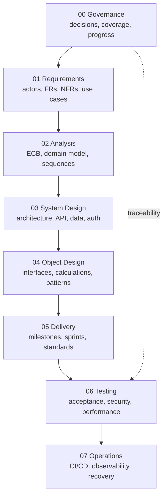

# Vittavaan v3 — Canonical Documentation Index

> **Status:** Owner-approved implementation baseline; S1 foundation authorized
> **Started:** 20 Sep 2026  
> **Canonical inputs:** the 25 files in `docs/v2/Wireframe/`, the asset-class operator PDF, the implemented sibling `auth-core` repository, and validated v2 domain work.  
> **Rule:** v1 and v2 are historical references. Where they conflict with v3, v3 governs.

## Purpose

Vittavaan is an India-first, desktop-first wealth intelligence application. It records what people own and owe, preserves provenance, attributes jointly owned holdings correctly, and turns the resulting ledger into understandable wealth, performance, liquidity and planning views. It does not execute trades, hold money, or silently turn incomplete data into certainty.

The v3 rebuild corrects two foundational problems in v2:

1. v2 was written against an older 19-screen wireframe set; the current product has 25 wireframe files and materially different behavior.
2. v2 designed its own Supabase authentication flow even though `auth-core` is the implemented Vittavaan identity and session authority.

## Documentation architecture

## Current documents

| Area | Document | Status |
|---|---|---|
| Governance | [Documentation Governance](./00_Governance/01_Documentation_Governance.md) | Draft |
| Governance | [Wireframe Coverage Matrix](./00_Governance/02_Wireframe_Coverage_Matrix.md) | Draft |
| Governance | [Progress Tracker](./00_Governance/03_Progress_Tracker.md) | Active |
| Governance | [Traceability Matrix](./00_Governance/04_Traceability_Matrix.md) | Draft |
| Governance | [End-to-End Consistency Audit](./00_Governance/05_End_to_End_Consistency_Audit.md) | Draft |
| Governance | [Owner Review and Decision Checklist](./00_Governance/06_Owner_Review_and_Decision_Checklist.md) | Review required |
| Requirements | [Product Scope and Release Boundaries](./01_Requirements/01_Product_Scope_and_Release_Boundaries.md) | Draft |
| Requirements | [Actors and System Boundary](./01_Requirements/02_Actors_and_System_Boundary.md) | Draft |
| Requirements | [Functional Requirements](./01_Requirements/03_Functional_Requirements.md) | Draft |
| Requirements | [NFRs and SLOs](./01_Requirements/04_Non_Functional_Requirements.md) | Draft |
| Requirements | [Detailed Use Cases](./01_Requirements/05_Use_Cases.md) | Draft |
| Requirements | [Legal and Approval Register](./01_Requirements/06_Legal_and_Approval_Register.md) | Draft |
| Analysis | [Asset and Liability Coverage Catalogue](./02_Analysis/01_Asset_and_Liability_Coverage.md) | Draft |
| Analysis | [Domain Glossary](./02_Analysis/02_Domain_Glossary.md) | Draft |
| Analysis | [ECB Object Model](./02_Analysis/03_ECB_Object_Model.md) | Draft |
| Analysis | [Sequence and State Diagrams](./02_Analysis/04_Sequence_and_State_Diagrams.md) | Draft |
| Analysis | [Requirements-to-Domain Coverage](./02_Analysis/05_Requirements_to_Domain_Coverage.md) | Draft |
| Analysis | [Asset and Liability Field Dictionary](./02_Analysis/06_Asset_and_Liability_Field_Dictionary.md) | Draft |
| Analysis | [India Subtype Attribute Schemas](./02_Analysis/07_India_Subtype_Attribute_Schemas.md) | Draft |
| Analysis | [Asset Field Requirement Matrix](./02_Analysis/08_Asset_Field_Requirement_Matrix.md) | Draft |
| System design | [Auth-Core Integration](./03_System_Design/01_Auth_Core_Integration.md) | Draft |
| System design | [Architecture Overview](./03_System_Design/02_Architecture_Overview.md) | Draft |
| System design | [Database Design](./03_System_Design/03_Database_Design.md) | Draft |
| System design | [API Design](./03_System_Design/04_API_Design.md) | Draft |
| System design | [Events, Jobs and Projections](./03_System_Design/05_Events_Jobs_and_Projections.md) | Draft |
| System design | [Imports and Reconciliation](./03_System_Design/06_Imports_and_Reconciliation.md) | Draft |
| System design | [Data Room Architecture](./03_System_Design/07_Data_Room_Architecture.md) | Draft |
| System design | [Security and Threat Model](./03_System_Design/08_Security_and_Threat_Model.md) | Draft |
| System design | [Observability and Operations](./03_System_Design/09_Observability_and_Operations_Design.md) | Draft |
| System design | [Phase 3 Coverage Audit](./03_System_Design/10_Phase3_Coverage_Audit.md) | Draft |
| System design | [Catalogue Seeds, Validation and Indexes](./03_System_Design/11_Catalogue_Seeds_Validation_and_Indexes.md) | Draft |
| Object design | [Shared Types and Interfaces](./04_Object_Design/01_Shared_Types_and_Interfaces.md) | Draft |
| Object design | [Calculation Contracts](./04_Object_Design/02_Calculation_Contracts.md) | Draft |
| Object design | [Domain Algorithms](./04_Object_Design/03_Domain_Algorithms.md) | Draft |
| Object design | [Design Patterns and Decisions](./04_Object_Design/04_Design_Patterns_and_Object_Decisions.md) | Draft |
| Object design | [Phase 4 Coverage Audit](./04_Object_Design/05_Phase4_Coverage_Audit.md) | Draft |
| Delivery | [Implementation Roadmap](./05_Delivery/01_Implementation_Roadmap.md) | Draft |
| Delivery | [Project Structure and Standards](./05_Delivery/02_Project_Structure_and_Standards.md) | Draft |
| Delivery | [Sprint and Milestone Plan](./05_Delivery/03_Sprint_and_Milestone_Plan.md) | Draft |
| Delivery | [S1 Repository Foundation Backlog](./05_Delivery/04_S1_Repository_Foundation_Backlog.md) | Complete |
| Delivery | [Implementation and Verification Log](./05_Delivery/05_Implementation_and_Verification_Log.md) | Active audit trail |
| Delivery | [Developer Onboarding and Troubleshooting](./05_Delivery/06_Developer_Onboarding_and_Troubleshooting.md) | Active |
| Delivery | [S2 Authentication and Bootstrap Backlog](./05_Delivery/07_S2_Authentication_and_Bootstrap_Backlog.md) | In progress |
| Testing | [Test Strategy](./06_Testing/01_Test_Strategy.md) | Draft |
| Testing | [Test Personas and Golden Scenarios](./06_Testing/02_Test_Personas_and_Golden_Scenarios.md) | Draft |
| Testing | [Security, Performance and Recovery Plan](./06_Testing/03_Security_Performance_and_Recovery_Test_Plan.md) | Draft |
| Operations | [Infrastructure and Environments](./07_Operations/01_Infrastructure_and_Environments.md) | Draft |
| Operations | [CI/CD and Release Management](./07_Operations/02_CI_CD_and_Release_Management.md) | Draft |
| Operations | [Runbooks and Incident Response](./07_Operations/03_Runbooks_and_Incident_Response.md) | Draft |
| Operations | [Local-to-OCI Deployment Specification](./07_Operations/04_Local_to_OCI_Deployment_Specification.md) | Draft |
| Operations | [OCI Staging Deployment Runbook](./07_Operations/05_OCI_Staging_Deployment_Runbook.md) | Draft |
| Handover | [Agent Handover](./AGENT_HANDOVER.md) | Active |

## Non-negotiable product rules

- Every stored financial fact has a source, an as-of timestamp and a verification level.
- Money is stored as integer minor units with an ISO currency code; exchange rates and percentages use fixed-precision decimals.
- A jointly owned holding is stored once and attributed through ownership allocations totalling 100%.
- Household visibility is explicitly granted; kinship never grants access automatically.
- Historical ledger facts are corrected by supersession or compensating entries, not destructive rewriting.
- Missing data is disclosed and never interpolated unless a specifically documented calculation permits it.
- XIRR, TWRR, benchmark return and attribution contribution are separate concepts.
- The platform does not hold money, initiate payment, execute trades, or provide unlicensed recommendations.
- Core wealth screens contain no marketplace promotion.
- Production features subject to legal, regulatory, vendor or operational approval default to disabled.
- All diagrams in v3 use Mermaid syntax.

## Traceability rule

Every implementation increment must be traceable through:

No feature is complete if any required link is absent.
